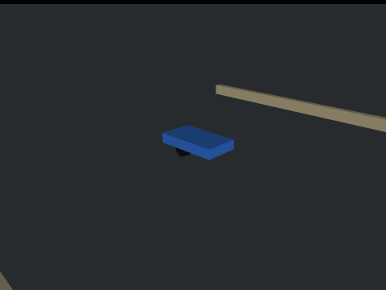
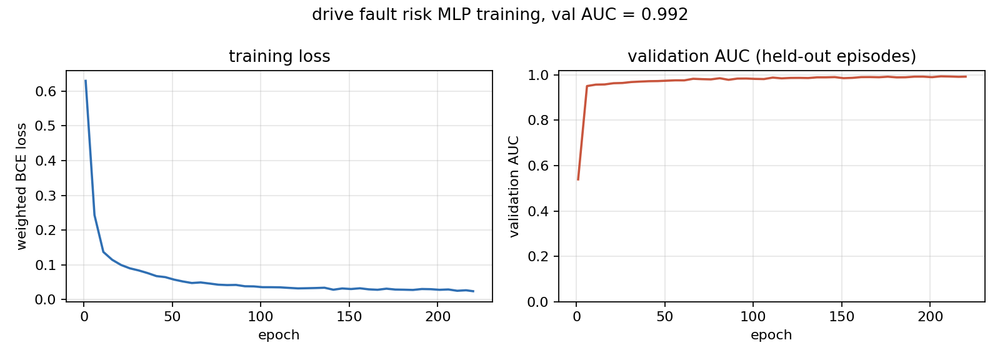
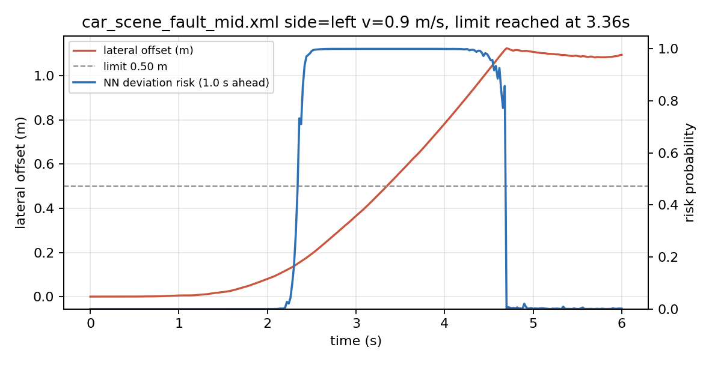
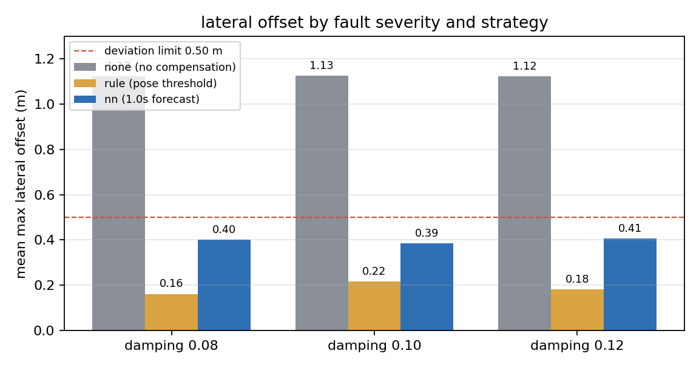

# MuJoCo 地面差速小车单侧驱动失效检测与差速容错补偿



一侧轮毂拖滞的差速小车，两个轮子都还在转，车却慢慢往一边偏。这个模块用位姿与轮速序列预测
未来 1.0 s 内会不会偏出 0.5 m，在偏出去之前把左右轮速差拉开去顶回来。仿真里做了三档拖滞量，
把"不干预""位姿门限纠正"和"神经网预测后补偿"三组放在同样的工况下跑，比跑偏率与残余偏差。

## 1. 课题定位

仓库里已经有 `mujoco_diff_drive_slip_compensation`（打滑补偿，处理轮子空转）、
`mujoco_car_rollover_guard`（侧倾风险，处理车身横滚）、`lateral_control_benchmark`（横向跟踪精度），
但这些模块的前提都是"两个轮子都能正常出力"。

执行器本身坏掉一侧的情况没有模块覆盖：轮毂轴承发涩、制动卡钳拖滞、单侧电机退磁，表现都是
一侧轮子转得"吃力"，车被另一侧推着走。本模块就做这一件事：

| 模块 | 故障对象 | 判据 | 输出 |
| --- | --- | --- | --- |
| `mujoco_diff_drive_slip_compensation` | 轮胎与地面之间的滑移 | 轮速与车速不一致 | 补偿后的轮速 |
| `mujoco_car_rollover_guard` | 车身横滚 | 横滚角与角速度 | 限速后的指令 |
| 本模块 | 单侧驱动阻力矩 | 偏航率与横向偏移的时序 | 风险概率 + 差速补偿量 |

和前两个模块的区别在于故障在传感器上几乎是隐形的：`<velocity>` 伺服会自己补力矩把轮速拉回指令值，
左右轮速差的实测均值只有 0.08 rad/s 量级（见 8.3），拿轮速差做阈值查不出来，只能从"车开始偏"
这个位姿后果往前推。

## 2. 运行环境

- Ubuntu 22.04 + ROS 2 Humble（虚拟机复核用这套），Windows 10/11 + Python 3.10 也能直接跑仿真与出图
- Python 依赖：`mujoco>=3.0.0`、`numpy`、`matplotlib`、`imageio`、`pillow`（见 `requirements.txt`）
- ROS 2 侧只依赖 `rclpy` 与 `sensor_msgs`/`nav_msgs`/`geometry_msgs`/`std_msgs`
- 实测版本：Windows 侧 Python 3.10.11 / MuJoCo 3.16.0，虚拟机上 MuJoCo 3.15.0 / numpy 1.26.4

```bash
pip install -r requirements.txt
```

## 3. 车辆与故障注入

底盘沿用仓库里已跑通的差速小车：4 kg 车身、0.05 m 轮半径、轮距 0.18 m、前后支撑球轮、
`<velocity>` 轮速伺服（`kv=10`，`ctrlrange=±60`，`forcerange=±8`），控制 50 Hz、物理步长 2 ms。

故障注入只改一处——给**单侧驱动轮的 hinge 关节**加 `damping`，模拟轮毂轴承或制动卡钳的拖滞：

```xml
<joint name="wheel_l_joint" type="hinge" axis="0 1 0" pos="0 0.09 0"
       damping="0.10" armature="0.005" range="-1e9 1e9"/>
```

三档拖滞量 `models/car_scene_fault_{light,mid,severe}.xml` 分别为 0.08 / 0.10 / 0.12（健康基线 0.05），
其余结构、颜色、初始位姿完全一致，所以三档可以直接横比。场景另加了两条车道边界
`edge_l` / `edge_r`（`y=±1.4 m`）和四个轮端传感器：

```xml
<sensor>
  <jointpos joint="wheel_l_joint" name="wheel_l_pos"/>
  <jointpos joint="wheel_r_joint" name="wheel_r_pos"/>
  <jointvel joint="wheel_l_joint" name="wheel_l_vel"/>
  <jointvel joint="wheel_r_joint" name="wheel_r_vel"/>
</sensor>
```

拖滞量不是随便定的。0.20 / 0.50 / 0.90 会让车直接原地打转（偏航角 90°~155°），已经不是"跑偏"
而是"失控"；0.07 / 0.12 / 0.18 这一组又整段落在饱和打转区。最后在健康基线 0.05 之上取
0.08 / 0.10 / 0.12：两侧完全对称、不补偿都会跑偏、补偿后都能压到 0.10~0.25 m，才是本模块能处理的区间。

## 4. 原理

### 4.1 拖滞为什么会让车跑偏

单侧关节加阻尼后，该轮多出一个与转速反向的阻力矩 $M_d=c\,\dot q$。`<velocity>` 伺服想把轮速维持在
指令值，会自动加大输出力矩去抵消它，力矩上限 `forcerange=±8`：

$$M_w=\mathrm{clip}\big(k_v(\omega^\*-\omega),\ -8,\ 8\big)$$

三档拖滞产生的阻力矩都远小于 8 N·m，所以伺服基本都能补上，代价是**两轮实际角速度几乎相等**：

$$\Delta\omega=\omega_l-\omega_r\approx 0$$

（8.3 表格里"不干预"组实测 $\overline{|\Delta\omega|}=0.085$ rad/s，和健康车的噪声一个量级。）
力矩补上了，但两侧牵引力不再平衡，车身获得一个持续的偏航力矩，偏航率积分成航向角，航向角再积分成
横向偏移：

$$\dot\psi=\frac{\Delta F\,d/2}{I_z},\qquad y(t)=\int_0^t v\sin\psi\,\mathrm{d}\tau$$

所以故障的可观测量不是轮速差，而是偏航率 $\dot\psi$ 与横向偏移 $y$。这也是本模块用"位姿时序前瞻"
而不是"轮速差阈值"的原因。

### 4.2 差速运动学

归一化指令 `(steer, throttle)` 换算成左右轮目标角速度：

$$v=t\cdot v_{max},\quad \omega=s\cdot\omega_{max}$$
$$w_l=\frac{v-\omega d/2}{r},\quad w_r=\frac{v+\omega d/2}{r}$$

`steer>0` 左转（左轮减速）。补偿量直接叠加在 `steer` 上，再走同一条换算。

### 4.3 补偿控制

横向容错控制器是 PD + 积分：

$$s_{comp}=s_{raw}\cdot g,\qquad s_{raw}= -\big(k_y y+k_\psi\psi+k_{\dot\psi}\dot\psi+k_i\!\int y\,\mathrm{d}t\big)$$

系数 $k_y=0.9$、$k_\psi=1.2$、$k_{\dot\psi}=1.0$、$k_i=0.5$，积分限幅 ±0.6，总补偿限幅
$|s_{comp}|\le 0.45g$。积分项的作用是吃掉恒定拖滞造成的稳态偏置——纯 PD 会留下一个固定残差。

符号试过两种：$s_{comp}=+(\cdots)$ 相当于顺着跑偏方向再打方向，三个工况全线跑偏 1.05~1.08 m；
只有 $-(\cdots)$ 才是往回顶。这一点在 `test_guard.py` 里用左右两个方向各钉了一条用例。

### 4.4 风险网络

9 维输入，全部来自 IMU、里程计与轮端传感器：

$$\mathbf{x}=[y,\ \psi,\ \dot\psi,\ a_y,\ v,\ \omega_l,\ \omega_r,\ \omega_l^\*,\ \omega_r^\*]$$

（横向偏移、航向角、偏航率、侧向加速度、前向车速、左右轮实际角速度、左右轮指令角速度）。
按物理量程 `[1.2, 1.2, 4, 15, 4, 60, 60, 60, 60]` 归一化后裁到 ±3，尺度在训练前就固定，
不用数据统计量，换场景不用重算。

网络是两层全连接：9 → 16（tanh）→ 1（sigmoid），177 个参数，纯 numpy 实现（前向、反向、Adam 都手写），
不引入 PyTorch。损失用带类别权重的二元交叉熵，正样本只占 32.1%，权重 `pos_weight=2.08`。

标签用**事件窗口**：以横向偏移首次超过 0.5 m 的时刻为中心，向前 1.0 s、向后 1.0 s 都标 1（共 99 个
控制周期），其余标 0。试过只标"越界前 1.0 s"（网络学到的是"马上要越界"而不是"已经在越界"，
松手过早），也试过"越界后整段标 1"（正样本 50.5%、评测 AUC 反而到 1.000，但训练分布被回程段主导），
最后选双向窗口：既能提前预警，也能在回程段继续压住。

## 5. 算法流程

```
采集：3 档拖滞 × 2 个失效侧 × 2 档车速（0.6 / 1.2 m/s）= 12 个工况，不干预跑到 6.5 s 或出界
   ↓ 每 20 ms 记录 9 维特征 + 是否落在跑偏事件窗口内
训练：按工况切分训练/验证（9 / 3），加权 BCE + Adam，220 轮
   ↓ 保存 drive_fault_risk.npz
评测：换 0.9 m/s（训练没见过），3 档拖滞 × 2 侧 × 3 策略 = 18 次
   ↓ none / rule / nn 的跑偏率、最大偏差、首次介入时刻
门控：风险 EMA 平滑后 > 0.60 触发，触发即给满权限；> 0.85 同时减速
```

## 6. 源码结构

```
mujoco_car_drive_fault/
├── main.py                     # 统一入口：--collect / --train / --eval / --demo / --test / --launch
├── mujoco_car_drive_fault/
│   ├── config.py               # 全部参数与路径（路径由 __file__ 推导，无绝对路径）
│   ├── kinematics.py           # (steer, throttle) -> 左右轮角速度
│   ├── car_env.py              # 场景加载、步进、IMU/轮速读取、横向偏移与跑偏判定
│   ├── features.py             # 9 维特征构造与定尺度归一化
│   ├── model.py                # RiskMLP（两层 MLP + 加权 BCE + Adam）+ AUC
│   ├── guard.py                # 补偿控制器 + 风险门控（pass/assist/slow）与位姿门限
│   ├── scenario.py             # 工况执行器、标签生成、速度保持
│   ├── sim_bridge.py           # ROS 2 桥：/imu、/odom、/wheel_speed、/chassis_state ← /cmd_vel
│   └── guard_node.py           # ROS 2 门控节点：/fault_risk、/guard_state → /cmd_vel
├── models/                     # 三档拖滞场景
├── config/params.yaml          # ROS 参数
├── launch/main.launch.py       # 双节点一键启动
├── results/                    # 数据集、权重、指标 json、曲线
├── test/                       # 49 项单元测试
└── tools/check_scene.py        # 场景结构自检
```

几个关键函数：

- `car_env.CarEnv` 暴露 `lateral_offset()`、`yaw()`、`wheel_speeds()`、`imu()`，场景 XML 与阻尼量在
  `reset(fault_side=..., fault_damping=...)` 里注入；
- `scenario.hold_throttle(v, v_target, cfg)` 用"目标车速前馈 + 速度误差比例"，前馈项是
  `v_target/v_max` 而不是常数，健康车 6 s 内横向偏移恒为 0；
- `guard.comp_steer(y, yaw, yaw_rate, cfg, gain, integ)` 输出补偿转向，`guard.FaultGuard.decide(...)`
  返回 `(gain, action)`，`action ∈ {pass, assist, slow}`；
- `scenario.label_deviate(feat, deviate, t_deviate, cfg)` 生成事件窗口标签。

## 7. 运行步骤

```bash
# 1. 采集（12 个工况，约 1 min）
python3 main.py --collect

# 2. 训练（约 5 s）
python3 main.py --train

# 3. 评测并出图（18 次工况，约 3 min）
python3 main.py --eval

# 4. 录制演示 gif
python3 main.py --demo

# 5. 自检：49 项单测 + 三场景冒烟
python3 main.py --test
python3 main.py --test --logic-only   # 未装 MuJoCo 也能跑纯逻辑单测
```

Windows 上把 `python3` 换成 `python`，或直接 `main.bat --eval`。

### 7.1 ROS 2 闭环

```bash
colcon build --packages-select mujoco_car_drive_fault --symlink-install
source install/setup.bash
ros2 launch mujoco_car_drive_fault main.launch.py                                   # 默认 mid 0.10 / 左轮
ros2 launch mujoco_car_drive_fault main.launch.py scene:=car_scene_fault_severe.xml fault_side:=right
```

在 Ubuntu 22.04 + Humble 虚拟机上（无图形界面，`ROS_LOCALHOST_ONLY=1`、`unset DISPLAY`）实测：

| 场景 | 故障侧 / 车速 | 结果 | 最大偏差 | 末端偏差 |
| --- | --- | --- | --- | --- |
| mid 0.10（默认） | left / 0.9 m/s | 跑满 6.02 s 未跑偏 | 0.31 m | +0.11 m |
| severe 0.12 | right / 0.9 m/s | 跑满 6.02 s 未跑偏 | 0.40 m | +0.23 m |

两行都是门控全开（`mode=nn`）的结果，单次运行、未做多次取均。闭环里指令经话题传递、
在下一仿真步生效，和离线逐帧推进有时序差，数值不要求和第 8 节完全一致。

节点侧有三处工程处理，不在网络本身：

- 网络输出在临界附近会在相邻帧间跳到 `0.00` / `1.00`，门控取最近 3 帧风险的最大值；
- 触发后直接给满补偿权限（`gain=1.0`），而不是按风险比例给——按比例给时 `comp_limit×gain`
  顶不住拖滞，实测 6/6 仍然跑偏、残余 0.65 m；
- 松手要同时满足"风险回落到 0.60 以下""横向偏移 < 0.10 m""航向 < 1.5°"三个条件，
  否则一次过冲就会把补偿松掉，车接着往外漂。

节点拓扑：

```
sim_bridge ──/imu、/odom、/wheel_speed、/chassis_state──▶ guard_node
     ▲                                                        │
     └────────────────────/cmd_vel────────────────────────────┘
```

`guard_node` 自己产生"直行"的名义指令（不含转向任务），所以补偿量就是它对名义指令的唯一改动；
`sim_bridge` 把指令写进 MuJoCo 执行器并按 50 Hz 发布传感器数据。桥接节点跑完当前工况退出，launch 随之关闭。

### 7.2 参数

`config/params.yaml` 里改场景、失效侧、目标车速和运行时长，不用改源码也不用重编：

```yaml
/mujoco_car_drive_fault_sim_bridge:
  ros__parameters:
    scene: car_scene_fault_mid.xml
    fault_side: left
    fault_damping: 0.0      # 0 表示取场景自带的拖滞量
    run_seconds: 6.0
    control_hz: 50.0
/mujoco_car_drive_fault_guard:
  ros__parameters:
    v_target: 0.9
    mode: nn
    model_path: ""
```

## 8. 多场景性能评价

### 8.1 训练结果

12 个工况共 3612 个控制周期样本，正样本 1160 个（32.1%），按工况切分后训练 9 个、验证 3 个：

| 指标 | 训练集 | 验证集 |
| --- | --- | --- |
| AUC | 1.000 | 0.992 |
| 准确率（阈值 0.5） | 0.989 | 0.966 |
| 样本数 | 2709 | 903 |

220 轮后训练损失 0.0244，177 个参数。



### 8.2 未参与训练的工况上的风险预测

评测换用 0.9 m/s（训练只见过 0.6 / 1.2 m/s），在"不干预"组上逐样本比较预测与标签：

| 指标 | 数值 |
| --- | --- |
| AUC | 0.998 |
| 阈值 0.60 下准确率 | 0.962 |
| 样本数 / 正样本数 | 1806 / 600 |



上图是 mid 0.10、左轮故障、0.9 m/s 的一次真实跑偏：2.2 s 之后风险持续爬到 1.0 并保持到 4.7 s，
横向偏移在 3.36 s 越过 0.5 m。风险曲线在越界前 1 s 出头就已经接近 1，这是 1.0 s 前瞻的直接体现；
越界后曲线没有立刻掉下去，是因为事件窗口把回程段也标成了正样本，网络不会"过线就松手"。

### 8.3 十八次工况对比

三组策略在同样的 18 次工况（3 档 × 2 侧 × 3 车速档里的 0.9 m/s）上的汇总：

| 策略 | 跑偏次数 | 跑偏率 | 平均最大横向偏移 | 平均最大航向 | 首次介入 | 补偿帧 |
| --- | --- | --- | --- | --- | --- | --- |
| none（不干预） | 6 / 6 | 100% | 1.12 m | 67.9° | — | 0 |
| rule（位姿门限） | 0 / 6 | 0% | 0.19 m | 13.9° | 1.34 s | 200 |
| nn（1.0 s 预测后补偿） | 0 / 6 | 0% | 0.40 m | 22.6° | 2.44 s | 135 |



按档拆开看最大横向偏移（同档左右两侧取较大值）：

| 场景 | none | rule | nn |
| --- | --- | --- | --- |
| light 0.08 | 1.12 m | 0.16 m | 0.44 m |
| mid 0.10 | 1.13 m | 0.22 m | 0.39 m |
| severe 0.12 | 1.12 m | 0.18 m | 0.42 m |

**这张表不能读成"nn 更好"**。数值上 rule 介入更早（1.34 s）、残余更小（0.19 m），nn 反而保守
（2.44 s 才开始动、残余 0.40 m 但也没跑偏）。原因在于门控制度不同：rule 盯的是"已经偏了 0.15 m 或
航向已经偏 3°"，一触发就按 PD 持续纠正；nn 要等预测概率稳过 0.60 才满权限介入，介入得晚、动作也
更犹豫，靠积分项慢慢把残差吃回去。本模块的卖点不是"更早更准"，而是：

- 轮速差查不出故障：none 组 $\overline{|\Delta\omega|}=0.085$ rad/s，rule/nn 组因为主动拉开差速才到
  0.21 / 0.35 rad/s，如果拿 $\Delta\omega$ 做阈值，故障根本没有可用的前兆信号；
- nn 在越界前 1 s 就把风险推到接近 1（8.2 的时序图），这条提前量在 rule 那边是不存在的。

### 8.4 差别在哪里

- 三档拖滞都落在"能补但补不干净"的区间：不补偿 3.3~3.6 s 就越过 0.5 m，补偿后残余 0.2 m 上下；
- 拖滞再大（≥0.20）进入饱和打转区，单靠差速修正顶不住，需要降速或停机，这超出本模块范围；
- 失效侧左右对称：同样档位下左右两侧的最大偏差差异 < 0.1 m，补偿器不需要知道故障在哪一侧。

## 9. 局限与可以往下做的方向

- 拖滞用单轮 hinge 关节的 `damping` 表征，是"轴承/制动拖滞"的简化模型，没有建摩擦、温升与磨损；
- 三档阻尼是离散标定，0.20 以上进入原地打转区，本模块的可补偿区间有硬边界；
- 只做横向容错，不做故障轮隔离、降速停车或故障侧辨识；
- 补偿权限有硬上限（`comp_limit=0.45`），拖滞很大时补偿饱和，残余偏差会持续存在；
- 平地直线单场景，没有坡道、侧风与弯道；车道边界固定 `y=±1.4 m`；
- 训练数据全部来自本仿真器，跨仿真器（Gazebo、CARLA）迁移需要重新采集。
