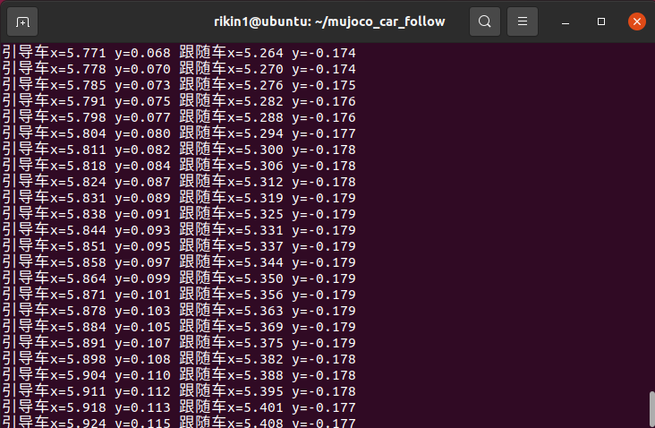
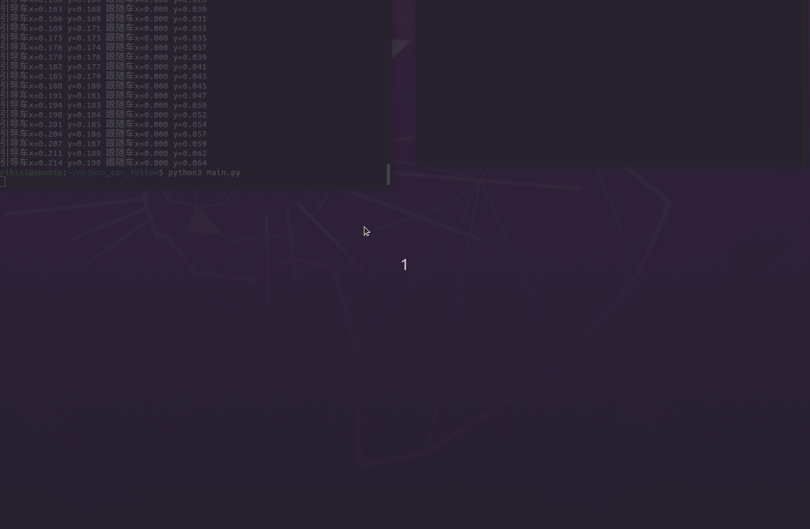

# mujoco_car_follow

MuJoCo 双车跟车仿真项目：引导车在 ±3 m 范围内往返前进、横向正弦摆动走出 S 形曲线，
跟随车通过 **前馈 + PD** 控制自动调整位置，与引导车保持 **0.5 m 的真实车心距**跟随。

## 运行环境
- Ubuntu 20.04 及以上
- Python 3.8 及以上
- MuJoCo 2.3.7
- ROS 2 Humble（仅 ROS 2 启动方式需要）

## 运行步骤

### 方式一：直接运行（不依赖 ROS）

```bash
# 1. 安装依赖
pip install mujoco==2.3.7 numpy

# 2. 进入包源码目录
cd src/ground/mujoco_car_follow

# 3. 运行（脚本会自动在包目录下查找 scene.xml）
python3 scripts/main.py
```

### 方式二：ROS 2 编译运行

```bash
# 1. 把包拷进工作空间
mkdir -p ~/ros2_ws/src
cp -r src/ground/mujoco_car_follow ~/ros2_ws/src/

# 2. 加载 ROS 2 环境（Humble 为例，其他发行版换成对应路径）
cd ~/ros2_ws
source /opt/ros/humble/setup.bash

# 3. 编译
colcon build --packages-select mujoco_car_follow

# 4. 加载工作空间环境
source install/setup.bash

# 5. 启动
ros2 launch mujoco_car_follow main.launch.py
```

`scene.xml` 安装到 `share/mujoco_car_follow/`，脚本通过
`ament_index_python.get_package_share_directory()` 定位，不需要手动设路径。

### 无显示器环境

```bash
sudo apt install xvfb
xvfb-run -a python3 scripts/main.py
```

## 实现思路

1. 场景：地面平面（覆盖 ±12 m）+ 两个双滑动关节小车，蓝色引导车、红色跟随车
2. 引导车：x 方向在 ±3 m 内往返，y 方向 `0.3*cos(2t)` 正弦摆动，走出 S 形
3. 跟随车：`ctrl = ff + KP*err - KD*v`
   - 前馈项 `ff` 跟随引导车当前推力并做变化率限幅，抵消两车相同的阻尼负载，**消除匀速段的稳态误差**
   - PD 项负责收敛距离并抑制超调
4. 距离按两车 body 的世界坐标计算：`世界坐标 = body 初始位置 + 关节位移`，
   避免初始偏移导致的距离口径错误

## 距离口径说明

`dx` 是**两车车身中心（车心）之间的纵向距离**，车身长 0.30 m，
因此 0.5 m 车心距对应前保险杠间隙约 **0.20 m**。横向目标是两车横向对齐，
实际残差见运行统计输出。

## 运行输出

每 0.5 s 打印一行（不是每步），关闭窗口后输出统计：

```
[t= 12.50s] 真实车心距=0.503 m  横向残差=+0.008 m | 引导(+1.230,+0.150) 跟随(+0.727,+0.142)

===== 统计（去掉前 3 s 过渡段） =====
纵向车心距：均值 0.497 m，最大偏差 0.053 m
横向残差：均值 +0.000 m，最大偏差 0.032 m
```

以上为 120 s 无头实测（步长 0.01 s，含 ±3 m 折返瞬态），匀速段偏差小于折返瞬间。

## 运行效果




## AI 辅助声明

本模块的代码整理、文档撰写与调试排错在 **豆包（Doubao）** 辅助下完成；控制方案设计、
仿真模型结构由作者完成，作者对全部内容负责。
