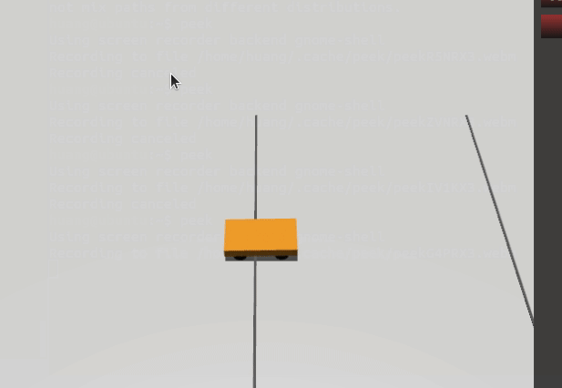

# 基于 MuJoCo 的双车自动跟车

## 一、实验目的

本实验基于 Ubuntu 20.04、MuJoCo 2.3.7 物理引擎和 Python 3.8，编写控制节点，实现两辆差速小车沿直线行驶时的自动跟车控制：前车速度按正弦规律大幅变化，后车根据两车之间的实时距离自动调整车速，保持约 1.2 m 的车距跟随前车。

实验主要使用了 MuJoCo 的物理步进、`qpos` 状态读取以及 velocity 执行器驱动。

## 二、实验环境

| 项目 | 配置 |
| --- | --- |
| 操作系统  | Ubuntu 20.04（VMware 虚拟机） |
| 物理引擎  | MuJoCo 2.3.7 |
| 编程语言 | Python 3.8 |
| 依赖库 | mujoco, numpy |
| 功能包 | mujoco_car_following |

## 三、功能包结构

```text
mujoco_car_following/
├── CMakeLists.txt
├── package.xml
├── launch/
│   └── main.launch
└── main.py              # 主控制程序（含两车模型）
```

## 四、实现原理

**前车（蓝色）控制：**
速度指令按正弦规律变化：

```
lead_ctrl = 12.0 + 11.0 * sin(0.006 * n)
```

一个周期约 2.1 s，车速在 0.05 ~ 1.15 m/s 之间来回加减速，模拟现实中走走停停的车流，四轮同速，只走直线。

**后车（橙色）控制：**

1. 从 `qpos` 读取两车 freejoint 的 x 坐标，计算实时车间距：

```
gap = x_leader - x_follower
```

2. 目标速度 = 前车速度（前馈） + 车距误差反馈：

```
target = lead_ctrl + 8.0 * (gap - 1.2)
```

3. 目标速度经过一阶低通滤波，模拟驾驶员反应滞后：

```
filt += 0.003 * (target - filt)
```

滤波延迟约 0.67 s，所以前车变速后后车会"慢半拍"再跟上，动态更接近真实驾驶。

4. 滤波结果限幅到 [2, 26]，四轮同速输出，后车全程不转向，只靠调速保距。

## 五、编译

```shell
cd ~/ros2/src/ground/mujoco_car_following
```

## 六、运行

```shell
python3 main.py
```

或者使用 ROS launch：

```shell
roslaunch mujoco_car_following main.launch
```

## 七、实验结果

运行节点后弹出 MuJoCo 渲染窗口，俯视视角自动锁定后车。蓝色前车沿直线大幅加减速，橙色后车延迟约 0.7 s 后跟随，车距稳定在 1.0 ~ 1.3 m 之间，全程不追尾、不翻车。终端实时打印两车位置和速度指令：

```text
step=... lead_x=... follow_x=... gap=... lead_ctrl=... f_ctrl=...
```



## 八、总结

本实验通过 MuJoCo 实现了地面双车自动跟车仿真。初期直接把车距误差乘上较大的比例系数，后车会在前车减速时冲过头、加速时追不上，来回振荡；后来把反馈比例降到 8，并加入一阶滤波延迟响应，才稳定下来。实验掌握了 MuJoCo 的物理步进与 `qpos` 状态读取，理解了"前馈 + 误差反馈 + 滞后滤波"在跟车控制中的实际作用。

借助模型：豆包。
