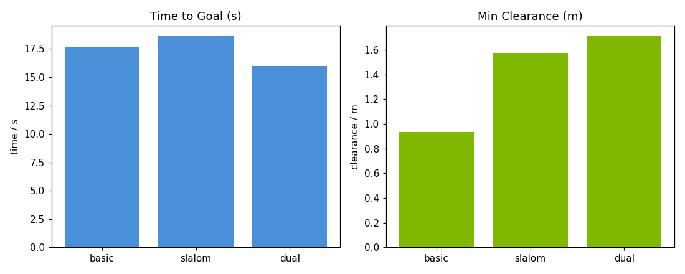
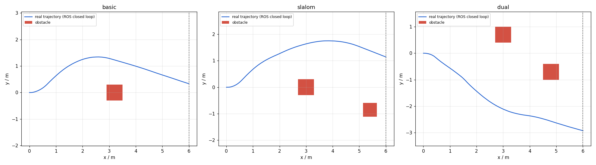

# MuJoCo 地面差速小车：神经网络端到端避障

> 对应课程任务：对地面载具进行物理仿真，用传感器数据完成感知、决策与控制，
> 其中感知、规划、控制链路为神经网络，推理阶段不含规则分支。
> 本模块在仓库已有的规则避障模块 `mujoco_car_avoidance` 基础上晋级：
> 用一个纯 numpy 实现的小 MLP，把"射线距离 + 航向"直接映射成"转向 + 油门"。

代码位于 `src/ground/mujoco_car_nn_avoidance/`。

## 1. 概述与目标

### 1.1 核心任务目标

1. **物理仿真**：两轮差速小车由 MuJoCo 解算动力学，速度伺服驱动两个驱动轮；两驱动轮加前支撑轮构成静定三点支撑，后支撑轮只作防后仰保护。
2. **感知**：25 束前视射线扇面（−60°…60°，5° 间隔，量程 6 m）作为小型二维激光雷达，另取一维车体航向偏差作为网络输入。
3. **决策与控制**：感知结果送入 MLP，网络直接输出归一化转向 `steer` 与油门 `throttle`，再由差速运动学换算成左右轮目标角速度。
4. **端到端**：训练完成后，闭环中没有任何避障规则、阈值判断或状态机；专家策略只在离线采集阶段当教师信号，不参与推理。
5. **可复现**：本地仿真与多场景评测不需要图形界面和显卡；演示动图用离屏渲染录制。

### 1.2 与仓库已有模块的区别

| 对比项 | `mujoco_car_avoidance`（规则基线） | 本模块 |
|---|---|---|
| 引擎 | MuJoCo | **MuJoCo** |
| 感知方式 | `mj_ray` 射线扇面 | **`mj_ray` 射线扇面 + 航向** |
| 决策方式 | 距离分级状态机（规则） | **纯神经网络（MLP）** |
| 推理时是否含规则分支 | 是 | **否** |
| 运行前提 | mujoco + numpy | **mujoco + numpy** |
| 无图形界面可用 | 是 | **是（默认无窗口）** |

本模块复用了规则基线模块已经调通的差速底盘物理方案（速度执行器、质心前移、静定三点支撑、出生穿透量），差别只在决策层：规则被替换成训练得到的神经网络。

## 2. 计算原理

### 2.1 射线求交与扇面采样

每条射线由起点（车头 `lidar` site）和水平面内方向向量定义，调用 MuJoCo 原生 `mj_ray` 求与几何体的最近交点：

$$
\mathbf p_i(t) = \mathbf p_0 + t\,\mathbf d_i,\qquad t \in [0, R_{\max}]
$$

$$
d_i = \min\{\, t \mid \mathbf p_i(t) \in \partial \Omega \,\}
$$

其中 \(R_{\max}=6.0\,\text{m}\)，\(\Omega\) 为场景中允许被探测的几何体集合；未命中或超出量程时取 \(d_i=R_{\max}\)。

几何体分组与 `models/*.xml` 约定一致：障碍物放在 geom group 0（射线可见），地面放在 group 1（屏蔽，避免车身俯仰时打到路面产生假目标），自车放在 group 2（屏蔽）。求交时传入组掩码 `geomgroup=[1,0,0,1,1,1]`，再用 `bodyexclude` 排除自车 body 兜一层底——左右驱动轮是车体的子 body，只排除 group 2 仍可能被侧向射线打到，产生"0.3 m 处有障碍"的假距离并直接误导网络。

### 2.2 状态向量拼接

网络输入共 26 维：25 束射线距离先按量程归一化到 \([0,1]\)（越近越接近 0，越远越接近 1），再拼接一维归一化航向偏差：

$$
s_i = \frac{d_i}{R_{\max}},\quad i=0,\ldots,24,\qquad s_{25} = \mathrm{clip}\!\left(\frac{\psi}{\pi},\,-1,\,1\right)
$$

\(\psi\) 为车体相对初始航向的偏航角（由里程计/IMU 四元数解算）。绕障后车体已经偏转，纯靠射线无法判断绝对朝向，这一维航向反馈是绕障后能把车拉回前进方向、持续绕行通过的关键。

### 2.3 MLP 结构与前向传播

网络为两层全连接，纯 numpy 实现，不依赖 PyTorch / TensorFlow：

$$
\mathbf z_1 = \mathbf x W_1^{\top} + \mathbf b_1,\qquad \mathbf a_1 = \tanh(\mathbf z_1)
$$

$$
\mathbf o = \mathbf a_1 W_2^{\top} + \mathbf b_2
$$

| 层 | 维度 | 激活 |
|---|---|---|
| 输入 | 26 | — |
| 隐层 | 32 | `tanh` |
| 输出 | 2 | 线性 |

输出二维依次为 `steer`（转向）、`throttle`（油门）。推理时再做范围约束：

$$
\text{steer} = \tanh(o_0) \in [-1,1],\qquad \text{throttle} = \mathrm{clip}(o_1,\,0,\,1)
$$

权重采用 He 初始化；隐层 `tanh` 的导数 \(1-\tanh^2(z)\) 在反向传播中直接展开计算。

### 2.4 训练目标与梯度下降

训练把专家标签当作回归目标，损失为两项输出的均方误差：

$$
L(\theta) = \frac{1}{2n}\sum_{k=1}^{n}\big[(\text{steer}_k - \hat{\text{steer}}_k)^2
+ (\text{throttle}_k - \hat{\text{throttle}}_k)^2\big]
$$

按小批量随机梯度下降更新权重与偏置：

$$
W \leftarrow W - \eta \frac{\partial L}{\partial W},\qquad
\mathbf b \leftarrow \mathbf b - \eta \frac{\partial L}{\partial \mathbf b}
$$

训练超参集中在 `config.py`：

| 超参 | 取值 |
|---|---|
| 训练轮数 `epochs` | 300 |
| 学习率 `lr` | 0.005 |
| 批大小 `batch` | 64 |
| 随机种子 `seed` | 42 |
| 数据集规模 | 3000 样本（3 场景 × 1000） |

实测 300 个 epoch 后末段 20 轮平均损失约 0.0268（初始约 0.0933）。

### 2.5 专家策略（仅作离线教师信号）

专家策略只在 `--collect` 阶段生成训练标签，推理时完全不参与。它只吃射线距离和航向，不读取任何场景真值位置。

射线分为三个感知带：

| 感知带 | 索引 | 覆盖角度 | 含义 |
|---|---|---|---|
| 右侧带 | 0…9 | −60°…−15° | 右侧平均开放距离 |
| 正前带 | 10…14 | −10°…+10° | 正前方最近距离 |
| 左侧带 | 15…24 | +15°…+60° | 左侧平均开放距离 |

转向规则：正前方出现障碍或两侧开放度差较大时，朝更开放一侧温和转向；前方安全且两侧均衡时，用航向偏差把车回正。油门按全程最近障碍距离分级减速：

$$
\text{throttle} =
\begin{cases}
0.85 & d_{\min} > 3.0\,\text{m}\\
0.55 & 2.0 < d_{\min} \le 3.0\,\text{m}\\
0.35 & 1.2 < d_{\min} \le 2.0\,\text{m}\\
0.20 & d_{\min} \le 1.2\,\text{m}
\end{cases}
$$

**探索式采集**：如果只让专家策略自身滚动采集，车大部分时间在空旷直行，转向标签占比很低（实测约 2%），专家轨迹也单一，缺少贴近障碍的状态。采集时实际驱动指令叠加零均值高斯噪声（标准差 0.15，种子固定），让车主动探索贴近障碍、偏航等状态，但写入数据集的标签仍然是专家输出。这样转向标签占比提升到约 78%，左右两侧样本均衡，网络才能学到完整的"绕障—回正"行为。

### 2.6 差速运动学

网络输出归一化指令后，由纯函数 `kinematics.differential_wheel_vels` 解算成左右轮目标角速度：

$$
v = \text{throttle}\cdot v_{\max},\qquad
\omega = \text{steer}\cdot \omega_{\max}
$$

$$
w_L = \frac{v - \omega L/2}{r},\qquad
w_R = \frac{v + \omega L/2}{r}
$$

其中 \(v_{\max}=0.8\,\text{m/s}\)、\(\omega_{\max}=2.0\,\text{rad/s}\)、轮距 \(L=0.25\,\text{m}\)、轮半径 \(r=0.05\,\text{m}\)。轮角速度再按执行器量程 ±60 rad/s 限幅，与 XML 中速度执行器的 `ctrlrange` 对齐。

### 2.7 物理底盘的稳定方案

差速小车的动力学沿用规则基线已经调通的方案，写在 `models/*.xml` 顶部注释里：

- 积分器用 `implicitfast`，2 ms 步长下速度项隐式积分，接触更稳定；
- 驱动轮交给 MuJoCo 原生 `<velocity>` 执行器（`ctrl` 为目标轮角速度，`kv=10`，`forcerange=±8 N`），不手写比例伺服，避免阶跃指令把车弹飞；
- 车身 4 kg，质心前移到驱动轮轴前方 0.04 m，静止时由"两驱动轮 + 前支撑轮"构成静定三点支撑，驱动轮承担约 80% 重量，避免法向力不足导致空转打滑；后支撑轮抬离地面约 6 mm，只作防后仰保护、不参与静止承重，避免形成静不定的四点支撑；
- 出生高度 0.048 m（轮半径 0.05 m），即轮胎带 2 mm 穿透量，接触从第 0 步起稳定存在；进入闭环前先零轮速静置 0.6 s，等接触建立、车身稳定。

## 3. 算法流程

本地纯仿真四个阶段串成一条流水线，`main.py` 用互斥模式分别触发：

```text
--collect  探索式采集
  ├─ 复位场景，零轮速静置 0.6 s 建立接触
  └─ 每个控制周期 (50 Hz)：
       ① mj_ray 扫描 25 束射线                      sensors.ray_scan()
       ② 拼接 26 维状态（归一化射线 + yaw/π）
       ③ 专家策略生成 (steer, throttle) 标签          expert.expert_control()
       ④ 驱动叠加探索噪声，记录 状态 -> 专家标签
  └─ 导出 results/dataset.npz（数据集体积大，不随仓库提交）

--train    训练 MLP
  ├─ 读取 dataset.npz，按种子打乱
  └─ minibatch 梯度下降 300 轮，保存 results/mlp_weights.npz 与损失序列

--eval     闭环评测（纯神经网络推理，无规则分支）
  ├─ 加载 mlp_weights.npz
  ├─ 依次复位 basic / slalom / dual 三个场景
  └─ 每个控制周期：
       ① 射线扫描 -> 拼接状态
       ② MLP.predict() -> (steer, throttle)
       ③ 差速解算 -> 左右轮目标角速度 -> 推进一个控制周期
       ④ 记录耗时、最小离障距离、最大转向、终点 x
  └─ 导出 eval_report.csv 与评测柱状图（本地运行产物，不随仓库提交）

--demo     离屏渲染演示
  └─ basic 场景真实闭环，Renderer 俯视逐帧录制，合成演示 gif
```

ROS 2 闭环把同一条感知—推理—控制链路拆成两个节点：`sim_bridge` 在 ROS 里跑 MuJoCo、发布 `/scan` 与 `/odom`、订阅 `/cmd_vel`；`ros_node` 订阅 `/scan`、`/odom`，用训练好的 MLP 推理后发布 `/cmd_vel`。桥接节点跑完三个场景、画完轨迹图退出，launch 随之关闭，避免空转。

## 4. 源码解析

| 文件 | 类型 | 职责 |
|---|---|---|
| `main.py` | 入口 | `--collect / --train / --eval / --demo / --test / --launch` 互斥模式，退出码 0 成功 / 1 失败 / 2 参数错误 |
| `mujoco_car_nn_avoidance/config.py` | 配置 | 路径基于包位置推导，集中管理传感器、仿真、控制、网络全部参数 |
| `mujoco_car_nn_avoidance/car_env.py` | 仿真 | 场景加载、复位静置、轮速伺服写入、车体位姿与航向读取 |
| `mujoco_car_nn_avoidance/sensors.py` | 感知 | `mj_ray` 扇面求交、自车与地面屏蔽、距离归一化 |
| `mujoco_car_nn_avoidance/expert.py` | 纯逻辑 | 专家转向/油门策略，仅作离线教师标签 |
| `mujoco_car_nn_avoidance/kinematics.py` | 纯函数 | `(steer, throttle)` 到左右轮角速度的差速解算，不依赖 MuJoCo |
| `mujoco_car_nn_avoidance/model.py` | 纯逻辑 | 纯 numpy MLP：前向、MSE 反传、minibatch 训练、权重保存与加载 |
| `mujoco_car_nn_avoidance/ros_node.py` | ROS 2 | 推理节点：订阅 `/scan`、`/odom`，MLP 推理后发布 `/cmd_vel` |
| `mujoco_car_nn_avoidance/sim_bridge.py` | ROS 2 | 仿真桥接节点：在 ROS 里跑 MuJoCo 小车，发布 `/scan`、`/odom`，订阅 `/cmd_vel`，记录轨迹 |
| `models/car_scene_basic.xml` | 场景 | 正前方单障碍（x=3.2, y=0，半宽 0.30 m） |
| `models/car_scene_slalom.xml` | 场景 | 两障碍交错：(3.0, 0) 半宽 0.30 m、(5.4, −0.85) 半宽 0.26 m |
| `models/car_scene_dual.xml` | 场景 | 两障碍偏置：(3.0, 0.7) 半宽 0.30 m、(4.8, −0.7) 半宽 0.30 m |
| `config/params.yaml` | ROS 参数 | 桥接节点读取的场景列表、目标距离、单场景超时 |
| `launch/main.launch.py` | launch | 双节点闭环，桥接节点退出后关闭整个 launch |
| `test/test_model.py` | 测试 | 网络维度、输出范围、权重初始化、保存加载一致性（不需要 MuJoCo） |
| `test/test_expert.py` | 测试 | 专家策略：巡航回正、朝开放侧转向、油门分级、转向限幅 |
| `test/test_kinematics.py` | 测试 | 差速解算：直行等速、左右转向轮速差、原地旋转、限幅 |
| `test/test_scene_and_sensors.py` | 测试 | 三场景加载、前方障碍检出、射线不打自车、直行不跑偏、给轮速能前进 |
| `tools/check_scene.py` | 工具 | 场景冒烟：加载三场景、直行 2 s 检查贴地与前进、射线命中是否正常 |
| `tools/diagnose.py` | 工具 | 单场景 NN 闭环诊断，打印轨迹与关键状态量 |
| `tools/diagnose_expert.py` | 工具 | 单场景专家闭环诊断，核对标签覆盖的行驶状态 |

决策、运动学、网络三个模块不导入 MuJoCo；`main.py` 顶层也只导入这些纯逻辑模块，仿真环境 `CarEnv`、射线 `ray_scan` 在采集、评测、演示分支内部延迟导入。因此未安装仿真器时，`python3 main.py --test --logic-only` 可以正常启动并跑完纯逻辑单测；需要 MuJoCo 的场景与传感器测试在缺少依赖时自动跳过。纯逻辑测试也可以绕开入口脚本直接运行：

```bash
python3 -m unittest discover -s test -p "test_*.py"
```

## 5. 仿真运行步骤

### 5.1 支持与测试环境

| 组件 | 版本 / 说明 |
|---|---|
| 操作系统 | Ubuntu 22.04（虚拟机，实测通过）；Windows 本地 Python 环境可跑纯仿真；20.04 见下 |
| Python | 3.10（虚拟机 3.10.12，本地 3.10.11） |
| MuJoCo | 3.15.0（虚拟机实测；课程要求 3.12.0，本模块只使用稳定接口，3.12～3.15 均可运行） |
| numpy | 1.26.4（虚拟机） |
| 可选依赖 | `matplotlib` 画评测曲线、`imageio` + `pillow` 合成演示 gif；缺失时程序自动跳过绘图 |
| ROS | ROS 2 Humble（仅 ROS 节点与 `--launch` 需要） |
| 显卡 | 不需要；默认离屏无窗口运行 |

!!! warning "Ubuntu 20.04 + Humble 的 Python 版本"
    20.04 上 ROS 2 Humble 的 `_rclpy_pybind11` 针对系统 Python 3.8 编译，ROS 节点须用 3.8 运行；
    仿真部分（`main.py --collect/--train/--eval/--demo/--test`）与 ROS 节点无进程内耦合，可单独用 3.10 解释器运行。
    本模块实测环境为 Ubuntu 22.04 + Humble，20.04 仅为兼容说明，未在 20.04 上复测。

### 5.2 安装

```bash
sudo apt update && sudo apt install -y python3-pip libgl1
python3 -m pip install -r src/ground/mujoco_car_nn_avoidance/requirements.txt
```

### 5.3 本地纯仿真运行

在模块根目录 `src/ground/mujoco_car_nn_avoidance/` 下执行：

```bash
python3 main.py --version        # 先确认代码版本，避免对着旧文件排查
python3 main.py --test            # 自检：纯逻辑单测 + 场景冒烟（需要 MuJoCo）
python3 main.py --test --logic-only   # 只跑纯逻辑单测，不加载 MuJoCo、不跑场景冒烟
python3 main.py --collect --seconds 20   # 探索式采集 射线 -> 专家标签（3 场景共约 3000 样本）
python3 main.py --train --epochs 300    # 训练 MLP
python3 main.py --eval            # 三场景闭环评测，导出报表与柱状图
python3 main.py --demo            # 离屏渲染录制演示 gif
```

`main.sh` / `main.bat` 是脚本入口，无参数时默认执行 `--eval`；在虚拟机里用 `bash main.sh --eval`，Windows 上用 `main.bat --eval`。

采集与训练属于准备步骤；仓库里已经随包附带训练好的 `results/mlp_weights.npz`，只想复现评测和演示时直接跑 `--eval` / `--demo` 即可。

### 5.4 ROS 2 闭环

```bash
cd ~/ros2_ws && colcon build --packages-select mujoco_car_nn_avoidance --symlink-install
source install/setup.bash
ros2 launch mujoco_car_nn_avoidance main.launch.py
```

另开终端可以观察话题：

```bash
ros2 topic echo /scan --once
ros2 topic echo /odom --once
ros2 topic echo /cmd_vel
```

桥接节点依次跑完三个场景后自动画轨迹图并退出，launch 随之关闭。

## 6. 运行效果


*basic 场景俯视演示：蓝色小车在神经网络控制下绕开正前方红色障碍并回到前进方向；动图共 450 帧、每帧 40 ms（25 fps）、总时长 18 s，按真实仿真速度播放*



*左：三场景到达目标的耗时；右：全程最小离障距离（`--eval` 自动导出）*



*Ubuntu 22.04 Humble 虚拟机内 ROS 闭环实测轨迹：蓝色为真实行驶轨迹，红色为障碍物，灰色虚线为目标线 x=6.0 m*

## 7. 性能评价

### 7.1 本地 MuJoCo 闭环实测

评测加载随包附带的权重，每个场景从起点真实闭环运行，由神经网络端到端控制。到达判定：车体 \(x>6.0\,\text{m}\)；单场景超时 30 s 记为失败。

| 场景 | 是否避障成功 | 到达耗时 (s) | 最小离障 (m) | 最大转向 | 终点 x (m) |
|---|:---:|:---:|:---:|:---:|:---:|
| basic（正前方单障碍） | 成功 | 17.70 | 0.937 | 0.493 | 6.00 |
| slalom（两障碍交错） | 成功 | 18.62 | 1.574 | 0.542 | 6.01 |
| dual（两障碍偏置） | 成功 | 15.98 | 1.711 | 0.601 | 6.01 |

三个场景全部到达目标，全程未碰撞；障碍半宽 0.26～0.30 m，最小离障距离保持在 0.93 m 以上，留有安全裕度。到达耗时对应平均前进速度约 0.32～0.38 m/s，靠近障碍时网络自动减速绕行。

### 7.2 ROS 2 闭环实测（Ubuntu 22.04 + Humble 虚拟机）

`ros2 launch` 双节点闭环复跑三个场景，避障结果与本地评测一致：

| 场景 | 终点 x (m) | 闭环耗时 (s) |
|---|:---:|:---:|
| basic | 6.00 | 17.5 |
| slalom | 6.01 | 18.5 |
| dual | 6.01 | 15.7 |

### 7.3 指标定义

| 指标 | 定义 |
|---|---|
| `success` | 是否在 30 s 内到达 \(x>6.0\,\text{m}\) |
| `time_s` | 到达耗时（真实仿真时间，一个控制周期 = 10 个物理步） |
| `min_clearance_m` | 全程射线距离最小值，越大越安全 |
| `max_steer` | 全程转向指令绝对值的最大值 |
| `final_x` | 结束时刻车体 x 坐标 |

以上数值均为真实仿真输出，可在本地执行 `python3 main.py --eval` 复现，不是手工填写。

## 8. 常见问题

| 现象 | 原因与处理 |
|---|---|
| `ModuleNotFoundError: No module named 'mujoco'` | 依赖没装好，或 `pip` 与解释器不一致；用 `python3 -m pip install -r requirements.txt` 对齐当前解释器 |
| 虚拟机里 `--demo` 起不来 | 虚拟机无图形界面与 GLFW 上下文；本地仿真改用 `--eval` 出曲线，演示 gif 在具备离屏渲染的环境录制 |
| 训练后 loss 降不下去、车直行冲障碍 | 检查采集转向样本占比是否偏低；确认 `--collect` 加了探索噪声，必要时加大 `--seconds` 多采贴近障碍的状态 |
| ROS 节点启动报找不到 `mlp_weights.npz` | 确认用 `--symlink-install` 构建，权重已通过 `setup.py` 的 `data_files` 安装到 `share/mujoco_car_nn_avoidance/results/` |
| 静止时射线报出 0.3 m 左右的"近障碍" | 射线打到了自车轮子；检查自车 geom group 2 与 `bodyexclude` 是否生效，可先跑 `python3 tools/check_scene.py` |
| ROS 启动报 `ParseXML: Error opening file` | 场景 XML 未随包安装；确认 `setup.py` 的 `data_files` 已打包 `models/*.xml`，重新 `colcon build` |
| `--test` 中场景测试被跳过 | 当前环境没装 MuJoCo，纯逻辑测试照常执行，场景与传感器测试自动跳过；装好 MuJoCo 后会全部运行 |
| 未装 MuJoCo 时 `main.py --test` 起不来 | 先用 `python3 main.py --test --logic-only` 跑纯逻辑单测；也可直接 `python3 -m unittest discover -s test -p "test_*.py"`；采集、评测、演示、场景冒烟命令需要先装好 MuJoCo |

## 9. 参考

- MuJoCo 文档：射线求交 `mj_ray`、几何体分组 `geom group`、速度执行器 `<velocity>`
- 仓库规则基线：`docs/ground/mujoco_car_avoidance.md`（同一差速底盘的规则避障实现）
- 课程仓库已有作业：`src/water/rov_mujoco`（MuJoCo + ROS 2 水下机器人示例）

## 辅助工具说明

编写过程中使用 AI 编程助手（豆包）辅助代码与文档起草，全部代码、模型与实测结果均在 Ubuntu 22.04 + MuJoCo 3.15 环境中真实跑通验证，提交者对内容负责。
