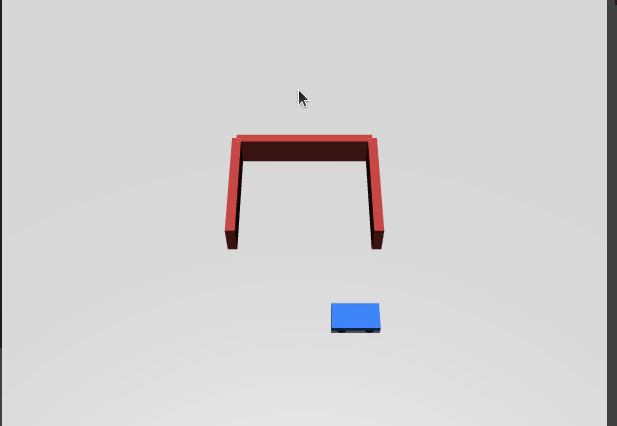

# MuJoCo小车 倒车入库仿真

用 MuJoCo 搭了个简易车库（后墙加左右两面墙），四轮小车从车库门口旁边出发，先直行到库口正中，再原地掉头车头朝南，最后直退入库，停在车库中心。

## 运行环境

- Ubuntu 20.04
- Python 3.8
- mujoco 2.3.7

## 运行步骤

```bash
pip install mujoco==2.3.7
python3 src/ground/mujoco_car_parking/main.py
```

运行后弹出 MuJoCo 窗口，小车先直行到库口，再原地掉头，直退入库后停下。



## 实现思路

1. 用三个盒子搭出车库：后墙加左右两面墙，库口朝南。
2. 四轮差速小车，速度伺服带 forcerange 限力，防止阶跃指令翻车。
3. 小车从门口旁边 (1.5, -1.0) 出发，先直行让 x 回到 0 附近。
4. 原地掉头到车头朝南（yaw ≈ -1.55）。
5. 直退入库，y >= 0.9 就停车。

## 说明

本作业的代码与文档在编写过程中使用了 AI 大模型辅助，本人已核对并确认提交内容，对提交内容负责。
