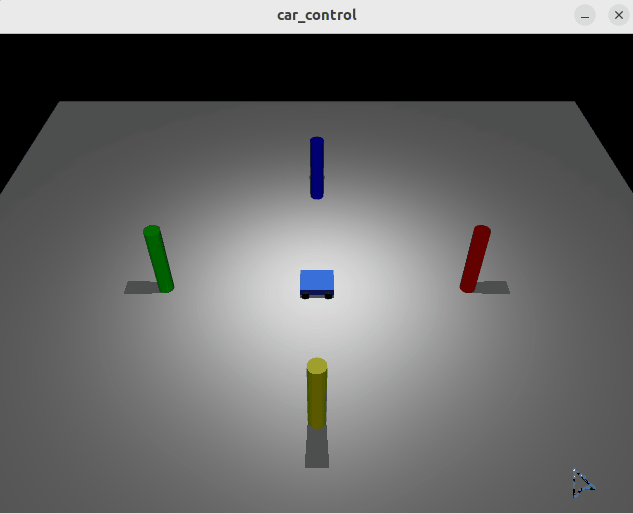

# 基于 Mujoco 的键盘遥控小车

## 一、实验目的

本实验基于 Ubuntu 22.04、MuJoCo 物理引擎和 Python 3，编写 Python 控制节点，实现一个四轮小车在复杂环境下的键盘遥控运动控制。

实验主要使用了 MuJoCo 的物理步进、图像渲染以及 OpenCV 的键盘事件捕获机制。

## 二、实验环境

| 项目 | 配置 |
| --- | --- |
| 操作系统  | Ubuntu 22.04 LTS（VMware 虚拟机） |
| 物理引擎  | MuJoCo (Python 3.10+) |
| 编程语言 | Python 3 |
| 依赖库 | mujoco, mujoco-python-viewer, opencv-python, numpy |
| 功能包 | mujoco_car_project |

## 三、功能包结构

```text
mujoco_car_project/
├── CMakeLists.txt
├── package.xml
├── main.sh              # 一键运行脚本
├── requirements.txt     # 依赖清单
├── models/
│   └── car.xml          # 小车物理模型文件
└── scripts/
    └── main.py          # 主控制程序
```

## 四、实现原理

**程序读取：**
利用 OpenCV 的 `cv2.waitKey(1)` 捕获键盘事件，获取按键状态。

**程序输出：**
将键盘按键映射为左右轮的速度指令，直接赋值给 MuJoCo 的电机控制数组 `data.ctrl`，通过 `mujoco.mj_step` 驱动小车运动。

- W / 向上键：向前行驶
- S / 向下键：向后行驶
- A / 向左键：向左转弯
- D / 向右键：向右转弯
- Q：退出仿真

小车采用差速驱动模型，左右轮速度 \(v_l\) 和 \(v_r\) 与两轮间距 \(L\)、车轮半径 \(R\) 决定了小车的运动状态。小车线速度 \(v\) 与角速度 \(\omega\) 为：

$$
v = \frac{v_r + v_l}{2} = \frac{R(\omega_r + \omega_l)}{2}
$$

$$
\omega = \frac{v_r - v_l}{L} = \frac{R(\omega_r - \omega_l)}{L}
$$

在每次控制循环中，先将左右轮速度清零，再根据按键赋予速度，从而完全消除指令残留，实现“松开即停”的顺滑手感。

## 五、编译

首先进入工作空间：
```shell
cd ~/ros2_ws/src/ground/mujoco_car_project
```

安装依赖（或者直接运行 main.sh 自动安装）：
```shell
pip3 install -r requirements.txt
```


## 六、运行

可以直接一键运行（推荐）：
```shell
bash main.sh
```

也可以分别运行（需要先手动安装依赖）：
```shell
python3 scripts/main.py
```

## 七、实验结果

运行节点后，将会弹出一个 MuJoCo 渲染窗口，展示蓝色小车和地面参照物。按下 W/A/S/D 可以控制小车在平面上流畅运动，松开按键小车立即刹停。



## 八、总结

本实验通过编写 MuJoCo 控制和键盘监听脚本，实现了地面载具的物理仿真与实时遥控。实验掌握了 MuJoCo 的渲染与物理步进原理，理解了差速驱动模型的实际应用，并通过“松开即停”的清零逻辑，成功复刻了 ROS 小海龟的顺滑控制手感。

借助模型：Deepseek,豆包。