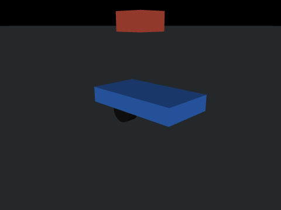
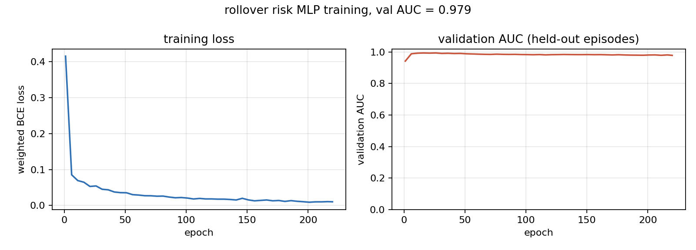
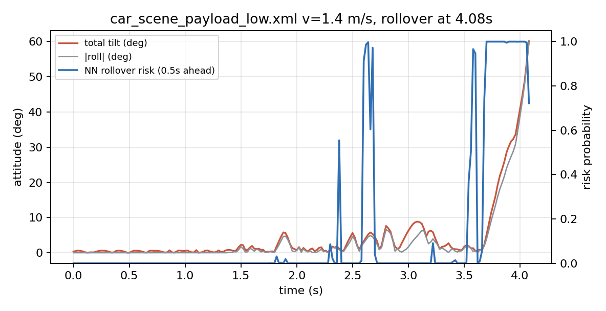
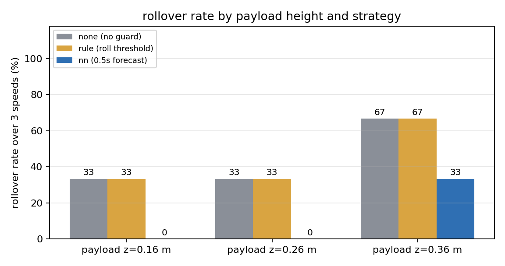

# MuJoCo 地面差速小车侧倾/翻车风险预测与主动限速



载重偏高的差速小车在急转弯时，轮子还在地上，车身先翻过去。这个模块做的事很直接：用 IMU 和当前指令
预测未来 0.5 s 内会不会翻车，在真的翻之前把速度压下来。仿真里搭了三档不同的顶部载荷高度，把
"不干预""横滚角超限才减速"和"神经网预测风险后限速"三组放在同样的工况下跑，比翻车率。

## 1. 课题定位

仓库里已有 `mujoco_car_avoidance`（射线规则避障，作为本方向的规则基线），也有 `mujoco_diff_drive_slip_compensation`
（打滑补偿）、`lateral_control_benchmark`（横向控制）等模块，但这些都在处理"车往哪走、走得准不准"。
车辆自身的横向稳定性——载荷偏高、转弯过急时会不会翻——没有模块覆盖。

这里的侧重点不是避障，而是**在执行上游速度指令之前先判断这条指令安不安全**：

| 模块 | 关注对象 | 输出 |
| --- | --- | --- |
| `mujoco_car_avoidance` | 前方有没有障碍 | 转向/油门 |
| `mujoco_diff_drive_slip_compensation` | 轮子打滑多少 | 补偿后的轮速 |
| 本模块 | 当前姿态与指令下会不会翻 | 风险概率 + 限速后的指令 |

因此它可以直接挂到任何已有的速度指令后面：上游给多少速度都先过这道门，风险高就压下来。

## 2. 运行环境

- Ubuntu 22.04 + ROS 2 Humble（虚拟机复核用这套），Windows 10/11 + Python 3.10 也可直接跑仿真与出图
- Python 依赖：`mujoco>=3.0.0`、`numpy`、`matplotlib`、`imageio`、`pillow`（见图 `requirements.txt`）
- ROS 2 侧只依赖 `rclpy` 与 `sensor_msgs`/`nav_msgs`/`geometry_msgs`/`std_msgs`
- 实测版本：Python 3.10.11、MuJoCo 3.16.0、numpy 1.26.x、matplotlib 3.8.x

MuJoCo 走 pip 安装，不通过 apt 装（`python3-mujoco` 不是 ROS 包名）：

```bash
pip install -r requirements.txt
```

## 3. 车辆与场景

底盘沿用仓库里已经跑通的那套差速小车（4 kg 车身、0.05 m 轮半径、前支撑球轮），只改了三处，
让侧翻过程可复现：

1. **轮距收窄到 0.18 m**（左右轮各 ±0.09 m）。轮距越窄，横向稳定性越差，同样的转弯更容易翻；
2. **后支撑轮放下到 -0.018 m**，真正着地。之前悬空时车身会绕前支撑轮点头，俯仰角抖动盖住横滚信号；
3. **顶部加一块 1.8 kg 载荷**，三档高度分别 0.16 / 0.26 / 0.36 m（离地高度），对应低、中、高三种质心。

三个场景文件 `models/car_scene_payload_{low,mid,high}.xml` 只在载荷高度与颜色上不同，其余完全一致，
所以三组结果可以直接横向比较。场景里加了三个传感器：

```xml
<sensor>
  <gyro site="imu_site" name="imu_gyro"/>
  <accelerometer site="imu_site" name="imu_acc"/>
  <framelinvel objtype="body" objname="chassis" name="imu_linvel"/>
</sensor>
```

姿态不取 `<framequat>`，而是直接读 `data.xquat[chassis]`。实测这个小车场景里 `framequat` 读出的四元数
与刚体真实姿态对不上（初始时刻就差 90°），换成 `xquat` 后姿态与倾角一致。

## 4. 原理

### 4.1 静态侧翻临界角

车在横向平面内的支撑多边形宽度是轮距 $d$，质心高度 $h_{cg}$。重力作用线一旦越过外侧轮，
车就失去抗倾覆力矩，静态临界角

$$\theta_c=\arctan\frac{d/2}{h_{cg}}$$

按质量加权估算三档质心高度（车身 4 kg @0.088 m、轮 0.5 kg @0.048 m、载荷 1.8 kg @h）：

| 载荷高度 | 质心高度 $h_{cg}$ | 静态临界角 $\theta_c$ |
| --- | --- | --- |
| 0.16 m | 0.105 m | 40.5° |
| 0.26 m | 0.134 m | 33.9° |
| 0.36 m | 0.163 m | 28.9° |

判断"已经翻"用的是总倾角 ≥ 55°。比静态临界角高，是因为轮子还在转、轮胎仍有横向抓地，
车会先侧倾到很大角度再彻底翻过去；55° 这个值是在三档载荷、三档车速下实测翻车时刻都稳定
落在 55°~60° 之间后定的。

### 4.2 动态侧翻条件

转弯时离心加速度 $a_y=v\,\omega$，横向载荷转移比

$$\frac{\Delta F_z}{F_z}=\frac{a_y h_{cg}}{g\, d/2}$$

当 $a_y/g>d/(2h_{cg})$ 时内侧轮离地。按上式，三档载荷对应的横向加速度阈值分别是 8.4 / 6.6 / 5.4 m/s²，
所以载荷越高，同样的转弯速度越早进入危险区。

### 4.3 差速运动学

归一化指令 `(steer, throttle)` 换算成左右轮目标角速度：

$$v=t\cdot v_{max},\quad \omega=s\cdot\omega_{max}$$
$$w_l=\frac{v-\omega d/2}{r},\quad w_r=\frac{v+\omega d/2}{r}$$

`steer>0` 左转。

### 4.4 风险网络

9 维输入，全部可从 IMU 与指令直接得到：

$$\mathbf{x}=[\phi,\theta,\omega_x,\omega_y,\omega_z,a_x,a_y,v,s]$$

（横滚角、俯仰角、三轴角速度、纵向/侧向加速度、前向车速、转向指令）。按物理量程归一化
$[0.6,0.6,4,4,4,15,15,4,1]$ 后裁剪到 ±3，训练前就固定，不用数据统计量，换场景不用重算。

网络是两层全连接：9 → 16（tanh）→ 1（sigmoid），177 个参数，纯 numpy 实现（前向、反向、Adam 都手写），
不引入 PyTorch。损失用带类别权重的二元交叉熵——翻车样本只占 3.8%，不加权的话网络会全部预测"不翻"。

标签按"未来 0.5 s 内是否翻车"打：翻车时刻前 25 个控制周期（50 Hz）标 1，其余标 0。
这样网络学的是提前量，而不是事后识别"已经歪了"。

## 5. 算法流程

```
采集：3 载荷 × 3 车速 × 3 转向斜率 = 27 个工况，全都不加干预地跑到翻车或 9 s 超时
   ↓ 每 20 ms 记录一帧 IMU + 指令 + 是否在 0.5 s 内翻车
训练：按工况切分训练/验证集（20 / 7），加权 BCE + Adam，220 轮
   ↓ 保存 rollover_risk.npz
评测：换一条没参与训练的转向斜率（0.45/s），9 个工况 × 3 种策略对比
   ↓ none / rule / nn 的翻车率、翻车时刻、最大横滚
门控：风险 > 0.60 按比例限速，> 0.85 直接制动，EMA 平滑抑制单帧抖动
```

## 6. 源码结构

```
mujoco_car_rollover_guard/
├── main.py                     # 统一入口：--collect / --train / --eval / --demo / --test / --launch
├── mujoco_car_rollover_guard/
│   ├── config.py               # 全部参数与路径（路径由 __file__ 推导，无绝对路径）
│   ├── kinematics.py           # (steer, throttle) -> 左右轮角速度
│   ├── car_env.py              # 场景加载、步进、IMU 读取、倾角与翻车判定
│   ├── features.py             # 9 维特征构造与定尺度归一化
│   ├── model.py                # RiskMLP（两层 MLP + 加权 BCE + Adam）+ AUC
│   ├── guard.py                # 风险门控（pass/slow/brake）与传统横滚角门限
│   ├── scenario.py             # 工况执行器与标签生成
│   ├── sim_bridge.py           # ROS 2 桥：/imu、/odom、/chassis_state ← /cmd_vel
│   └── guard_node.py           # ROS 2 风险节点：/rollover_risk、/guard_state → /cmd_vel
├── models/                     # 三个载荷高度场景
├── config/params.yaml          # ROS 参数
├── launch/main.launch.py       # 双节点一键启动
├── results/                    # 数据集、权重、指标 json、曲线、演示 gif
├── test/                       # 38 项单元测试
└── tools/check_scene.py        # 场景结构自检
```

几个关键函数：

- `car_env.CarEnv.imu()` 返回 `{quat, gyro, acc, linvel}`，姿态统一走 `data.xquat`；
- `features.from_imu(quat, gyro, acc, speed, steer)` 与 `features.build(env, steer, cfg)` 共用同一套拼装，
  ROS 节点和仿真走的是同一条特征链路；
- `guard.RolloverGuard.gate(risk, steer, throttle)` 返回 `(steer, throttle, action)`，
  `action ∈ {pass, slow, brake}`，内部对风险做 EMA（系数 0.7），单帧尖峰不会直接触发制动；
- `scenario.run_episode(env, cfg, v_target, mode, net, max_s, steer_ramp, collect)` 分两段：先直行加速到 0.95 倍目标车速，再按斜率加大转向，直到翻车或超时。

## 7. 运行步骤

```bash
# 1. 采集（约 40 s）
python3 main.py --collect

# 2. 训练（约 5 s）
python3 main.py --train

# 3. 评测并出图（三组策略 × 9 工况，约 1 min）
python3 main.py --eval

# 4. 录制演示 gif
python3 main.py --demo

# 5. 自检：38 项单测 + 三场景冒烟
python3 main.py --test
python3 main.py --test --logic-only   # 未装 MuJoCo 也能跑纯逻辑单测
```

Windows 上把 `python3` 换成 `python`，或直接 `main.bat --eval`。

### 7.1 ROS 2 闭环

```bash
colcon build --packages-select mujoco_car_rollover_guard
source install/setup.bash
ros2 launch mujoco_car_rollover_guard main.launch.py                       # 默认中载荷 0.26 m / 1.4 m/s
ros2 launch mujoco_car_rollover_guard main.launch.py scene:=car_scene_payload_high.xml v_target:=1.1
```

在 Ubuntu 22.04 + Humble 虚拟机上（无图形界面，`ROS_LOCALHOST_ONLY=1`、`unset DISPLAY`）实测：

| 场景 | 目标车速 | 结果 | 最大倾角 | 门控动作 |
| --- | --- | --- | --- | --- |
| 中载荷 0.26 m（默认） | 1.4 m/s | 连跑 3 次均跑满 9.02 s 未翻 | 28.8°（三次 20.4°~31.4°） | 制动 7 帧、减速 49 帧，最大风险 1.00 |
| 中载荷 0.26 m | 1.1 m/s | 跑满 9.02 s 未翻 | 16.8° | 未触发 |
| 低载荷 0.16 m | 1.4 m/s | 跑满 9.02 s 未翻 | 13.2° | 触发减速 |
| 高载荷 0.36 m | 1.1 m/s | 5.36 s 侧翻 | 56.6° | 先减速、再制动，没压住 |

高载荷这一行是这套方法最诚实的边界：网络预测的是 0.5 s 后的翻车概率，而高质心车一旦越过临界，从风险抬头到 55° 只有零点几秒，门控来不及把速度降下来。默认工况选 0.26 m，是因为它能稳定触发减速、又撑得住整段。

节点侧还有三处工程处理，不在网络本身：

- 网络输出在临界附近常在相邻帧间跳到 `0.00` / `1.00`，单帧取值会让同一工况两次运行结果相反，所以门控取最近 3 帧风险的最大值；
- 触发后动作保持 6 帧，避免油门在 `1.00` 与 `0.00` 之间抖动；
- 释放带迟滞：已经限过速的车，要风险连续 5 帧低于 0.35 才恢复油门。

要注意 ROS 闭环和离线评测不是同一条执行路径：闭环里门控由 `/imu` 帧驱动，指令在下一个仿真步生效，`/odom` 车速比姿态晚一帧；`main.py --eval` 是单进程逐帧推进、指令当帧生效。所以同一场景两边数值不会一致，本节表格只对 ROS 闭环负责，第 8 节表格只对离线评测负责。


节点拓扑：

```
sim_bridge ──/imu、/odom、/chassis_state──▶ guard_node
     ▲                                        │
     └──────────────/cmd_vel──────────────────┘
```

`guard_node` 自己按斜率生成转向指令，读 IMU 算风险，限速后再发 `/cmd_vel`；`sim_bridge` 把指令写进
MuJoCo 执行器并按控制周期发布传感器数据。桥接节点跑完当前工况退出，launch 随之关闭。

### 7.2 参数

`config/params.yaml` 里改场景、目标车速、转向斜率和运行时长，不用改源码也不用重编：

```yaml
/mujoco_car_rollover_guard:
  ros__parameters:
    v_target: 1.4
    steer_ramp: 0.45
    run_seconds: 9.0
```

## 8. 多场景性能评价

### 8.1 训练结果

共 27 个工况、9156 个控制周期样本，按工况切分后训练 20 个、验证 7 个：

| 指标 | 训练集 | 验证集 |
| --- | --- | --- |
| AUC | 1.000 | 0.979 |
| 准确率（阈值 0.5） | 0.992 | 0.976 |



### 8.2 未参与训练的工况上的风险预测

评测换用 0.45/s 的转向斜率（训练时只见过 0.35/0.50/0.65），在"不干预"组上逐样本比较预测与标签：

| 指标 | 数值 |
| --- | --- |
| AUC | 0.994 |
| 阈值 0.60 下准确率 | 0.990 |
| 样本数 / 正样本数 | 3260 / 100 |



上图是载荷 0.16 m、目标车速 1.4 m/s 的一次真实侧翻：倾角在 3.6 s 后快速抬升，风险概率同步爬升，
4.08 s 达到 55° 判定翻车。曲线里 2.4~2.7 s 有两处单帧尖峰（风险直接冲到 0.9 以上），来自轮胎与
地面碰撞时的加速度毛刺；门控的 EMA 把单帧尖峰压到 0.3 以下，不会误触发制动。

### 8.3 九工况对比（转向斜率 0.45/s）

"不干预"组的逐工况结果：

| 载荷高度 | 0.8 m/s | 1.1 m/s | 1.4 m/s |
| --- | --- | --- | --- |
| 0.16 m | 未翻，最大倾角 6.9° | 未翻，5.7° | **4.08 s 翻车**，60.1° |
| 0.26 m | 未翻，11.0° | 未翻，19.1° | **4.66 s 翻车**，55.2° |
| 0.36 m | **6.16 s 翻车**，57.7° | **5.12 s 翻车**，57.7° | 未翻，14.1° |

0.36 m + 1.4 m/s 这一格没翻，是高速下轮速伺服先进入饱和、车辆实际横摆角速度反而变小所致，
单独看属于个例；载荷抬高的整体趋势在另外两档车速上很清楚。

三组策略的汇总：

| 策略 | 翻车工况数 | 翻车率 | 平均翻车时刻 | 平均最大横滚 |
| --- | --- | --- | --- | --- |
| none（不干预） | 4 / 9 | 44% | 5.00 s | 29.8° |
| rule（横滚角门限） | 4 / 9 | 44% | 5.03 s | 29.7° |
| nn（0.5 s 预测后限速） | 1 / 9 | 11% | 7.96 s | 16.7° |



规则门限盯的是当前横滚角：20° 才开始减速、35° 才制动，等它动作时横向载荷已经转移完，
所以翻车率和"不干预"几乎一样（4 起翻车里 3 起只比原来晚 0.02~0.06 s）。网络看的是加速度和角速度
的变化趋势，在倾角还只有 10° 左右时就已经给出高概率，把翻车压到 1 起——那一起来自 0.36 m + 1.1 m/s，
门控把翻车时刻从 5.12 s 推到 7.96 s，但该工况转弯半径已经小到即便限速也撑不住。

## 9. 局限与可以往下做的方向

- 三档载荷是几何上的离散改动，没有连续变化的质量分布，网络没在"载重未知"的情形下验证过；
- 场景是单层平地，没有坡道和侧向风，真实车辆的侧翻还受路面附着与坡度影响；
- 翻车判据用总倾角 55°，是经验值，换底盘参数（轮距、质心）后要重新标定；
- 风险网络的训练数据全部来自本仿真器，跨仿真器（CARLA 等）迁移需要重新采集；
- 门控只限速不修正转向，未来可以改成"限速 + 转向回正"的联合动作，进一步缩小转弯半径。
