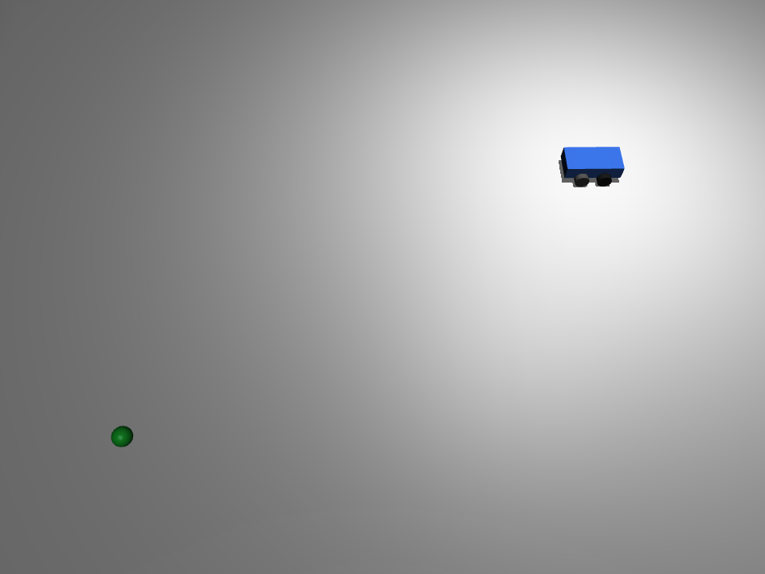

# MuJoCo 差速小车到达目标点（go-to-goal）

功能包源码位于仓库的 `src/ground/mujoco_diff_drive_go_to_goal` 目录。

## 1. 问题描述

蓝色四轮差速小车（后两轮驱动、前两轮被动支撑）在 MuJoCo 平地仿真中从原点 `(0, 0)` 出发，
自主驶向绿色目标点 `(3.0, 2.0)` m。控制目标是：先把车头对准目标方向，再直行逼近，
最终停在目标点附近；直行过程中持续做航向修正，避免沿直线跑偏。

## 2. 运行环境（实际验证）

| 项 | 版本 / 说明 |
|---|---|
| 操作系统 | Ubuntu（无头云主机，无独立显卡） |
| Python | 3.12.11 |
| 模拟器 | MuJoCo `>=3.2,<4.0`（本机实测 3.17.0），numpy 1.26.4；Pillow 仅录帧导出 GIF 时需要 |
| 渲染后端 | 可视化用 `MUJOCO_GL=glfw`；无头离屏录帧用 `egl`（mesa 软件渲染，无独立显卡也可出图） |

MuJoCo 不在 apt 仓库，需按 `requirements.txt` 用 pip 安装。

## 3. 算法

### 3.1 差速运动学

模型后两轮由 `velocity` 执行器驱动，`ctrl` 单位是**轮子角速度 (rad/s)**，不是车体线速度。
给定目标车体线速度 `v` (m/s) 与车体角速度 `omega` (rad/s)，由差速逆解换算左右轮角速度：

```
ω_L = v/R - ω·L/(2R)
ω_R = v/R + ω·L/(2R)
```

其中轮半径 `R=0.05 m`，左右轮间距 `L=0.22 m`。

### 3.2 偏航角解算

车体是 `<freejoint/>`，其 7 个 `qpos` 为 `[x, y, z, qw, qx, qy, qz]`；
`qpos[5]` 是四元数 `qy`，绕 z 轴转动时恒为 0，**不能当作 yaw**。
偏航角由四元数分量解算：

```
yaw = atan2(2·(qw·qz + qx·qy), 1 - 2·(qy² + qz²))
```

### 3.3 分段比例控制与滞回

- 角度差 `angle_diff = wrap(atan2(dy, dx) - yaw)`，归一化到 `(-π, π]`；
- `|angle_diff| > 0.5 rad`：原地差速转向，`v=0`，`omega=±1.5 rad/s`；
- 否则：直行 `v=0.6 m/s`，航向比例修正 `omega = K·angle_diff`，`K=3.0`；
- 两档阈值带滞回：转向中误差降到 `0.3 rad` 以下才回直行，直行中误差超过 `0.5 rad` 才转，
  避免在切换边界来回切换形成极限环；
- 到达判据：距目标 `< 0.12 m` 即两轮速度清零停车；循环带步数上限 `20000`（`dt=0.005`，兜底 100 s）。

## 4. 模型参数（models/diff_drive.xml）

| 部件 | 参数 |
|---|---|
| 底盘 | 长方体，实际全尺寸 `0.4 × 0.2 × 0.1 m`（XML `box` 的 `size="0.2 0.1 0.05"` 为半边长，需乘 2），蓝色，质量 2.0 kg |
| 底盘惯性矩 | 按全尺寸 `0.4 × 0.2 × 0.1 m`、质量 `2.0 kg` 实心长方体绕质心轴计算：`Ixx≈0.00833`、`Iyy≈0.02833`、`Izz≈0.03333 kg·m²`（`diaginertia` 顺序为 Ixx Iyy Izz） |
| 后轮 | 左右各一，轮半径 0.05 m，hinge 绕 y 轴，`velocity` 驱动，`kv=2` |
| 前轮 | 左右各一，被动支撑，无执行器 |
| 目标点 | 绿色小球，`(3.0, 2.0, 0.06)`，半径 0.06 m，不参与碰撞 |
| 物理 | timestep=0.005 s，地面摩擦 `1.0 0.1 0.1` |

## 5. 运行步骤

### 5.1 安装依赖

在**包目录**下执行：

```bash
# 先进入本包目录（仓库内 checkout 路径如下）：
cd src/ground/mujoco_diff_drive_go_to_goal
pip install -r requirements.txt
```

### 5.2 运行

```bash
python3 main.py              # 打开 MuJoCo 窗口，关闭窗口即退出
python3 main.py --headless   # 无头模式：到达或超时后打印结果退出（无窗口）
```

### 5.3 测试与录帧

纯逻辑单测（`unittest.TestCase` 结构，不加载模型、无需图形界面；可被 unittest / pytest / nose 自动收集，断言为 `self.assert*` 方法，`-O` 优化模式下仍有效）：

```bash
python3 test/test_go_to_goal.py        # 直接运行
python3 -m unittest discover -s test   # 或由测试框架收集
```

离屏渲染导出演示 GIF（无头环境用 EGL 软件渲染即可，无需独立显卡）：

```bash
python3 test/record_demo_gif.py
```

## 6. 实测结果（本机 mujoco 3.17.0 实测）

`python3 main.py --headless` 实测：

- 已到达；步数 `1435`，仿真时长 `7.17 s`；
- 判据触发时位置 `(3.008, 1.882) m`，距目标 `0.118 m`（小于 `0.12 m` 到达阈值）。该位置是 `arrived` 判据为真、循环 `break` 的瞬间位置，未继续仿真到惯性滑行静止；
- 先原地转向对准目标方向，再直行逼近；直行段航向误差由比例增益持续修正，无边界极限环。

## 7. 运行效果



`docs/img/ground/mujoco_diff_drive_go_to_goal_demo.gif` 由本包 `test/record_demo_gif.py` 离屏渲染生成，不是另外录屏：

- 闭环 `1435` 步（`dt=0.005 s`），脚本复用 `main.py` 的目标点与 `control_step`，每 `8` 步录一帧抽稀后写入 GIF；
- 实测：960×720、179 帧、每帧 40 ms、循环播放，总时长约 `7.16 s`（与闭环 `7.17 s` 基本一致，按实时 1:1 播放），文件 761,153 B（0.73 MB）；
- 复现：在包目录执行 `python3 test/record_demo_gif.py`（录帧需 Pillow；离屏后端 `MUJOCO_GL=egl`）；
- 同环境重跑帧数、尺寸、时长与文件字节数一致，逐帧像素差为 0；跨 Pillow 版本时调色板量化可能带来少量字节差异；
- 小车从起点 `(0, 0)` 出发，先原地转向对准绿色目标球，再直行逼近并停在球旁（斜俯视投影下其画面方位会随相机角度变化）。

## 8. 已知限制

- 只验证固定起点 `(0, 0)` 与目标点 `(3.0, 2.0)`；其他起点 / 目标未做回归；
- 到达判据只看位置距离，不约束最终车头朝向；
- 速度与增益为初始取值，未做整定优化；
- 仅在 mujoco 3.17.0（`>=3.2,<4.0` 区间内）上验证，区间内其他版本与更早版本未做回归；
- 录帧依赖 EGL/OpenGL 离屏上下文；个别极简容器若未带 mesa 软件渲染库，需先装好 EGL 驱动。

## 9. 大模型使用声明

本作业的代码与文档在编写过程中使用了**豆包（Doubao）** AI 大模型辅助，本人已核对并确认提交内容，对提交内容负责。
