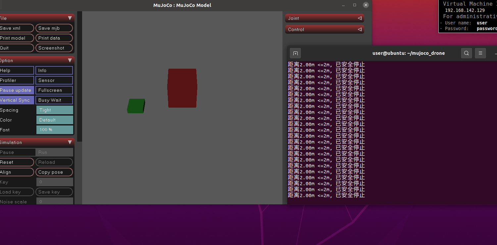

# 基于距离阈值的前置避障控制（碰撞前预判减速）

- **议题**：基于距离阈值的前置避障控制（碰撞前预判减速）
- **仿真环境**：Ubuntu + MuJoCo Python
- **模块目录**：`src/ground/mujoco_drone_distance_stop/`
- **运行入口**：`main.py`

## 1. 选题说明

常见的避障方案多依赖激光雷达、深度相机等传感器做实时感知，成本与复杂度较高。本模块在 MuJoCo 物理仿真中实现一种**基于距离阈值的前置避障控制**：直接读取仿真中无人机刚体与障碍物的真实坐标，计算两者欧氏距离，按**分段距离阈值**提前调整推力，实现「全速 → 减速 → 制动急停」的碰撞前预判减速，在碰撞发生前就完成避障。

## 2. 实现思路

### 2.1 搭建极简 MuJoCo 仿真场景（scene.xml）

创建仿真世界：地面、绿色方块无人机刚体、红色方块障碍物刚体。无需在 xml 内配置任何控制器 / 执行器，只用 `xfrc_applied` 在代码中外部施加力。

- 地面：`plane`，尺寸 10 × 10；
- 无人机：`freejoint` 自由浮动刚体，初始位置 `x=-5, z=1`，质量 1kg，场景关闭重力使其稳定悬浮；
- 障碍物：红色方块，固定在 `x=0` 位置。

### 2.2 编写控制代码 main.py（核心改进代码）

在原有项目基础上**新增分段距离阈值避障预判逻辑**（本次迭代的提交改动点）：

- 读取仿真中无人机、障碍物实时坐标，计算两者欧氏距离，同时读取 X 方向速度用于制动判断；
- 设置两段阈值：5m、2m：
  - 距离 > 5m：全速推力；
  - 2m < 距离 ≤ 5m：推力降为 30%，提前减速；
  - 距离 ≤ 2m：施加**反向制动推力**，速度接近零后推力归零并锁定速度，实现紧急急停；
- 使用 MuJoCo `data.xfrc_applied` 给无人机刚体施加 X 方向力驱动运动；
- 循环执行仿真步，终端持续打印实时距离与运行状态。

### 2.3 仿真调试

运行代码，验证判断逻辑：终端持续输出距离信息；调试中发现两个问题并解决——①推力不足导致无人机不动，调整 `base_thrust` 与质量参数解决；②无摩擦环境下推力归零无法立即停车，存在惯性滑行导致碰撞，改为**反向制动 + 速度锁定**后实现稳定急停。

## 3. 运行环境

| 项目 | 说明 |
|---|---|
| 操作系统 | Ubuntu |
| Python 依赖 | mujoco、numpy |
| 运行方式 | 在模块目录内执行 `python3 main.py` |

## 4. 运行步骤

```bash
# 1. 安装系统底层依赖 libglfw3（MuJoCo 可视化窗口必需）
sudo apt update
sudo apt install libglfw3

# 2. 安装 Python 依赖包（清华镜像）
pip3 install --user --timeout 120 mujoco numpy -i https://pypi.tuna.tsinghua.edu.cn/simple

# 3. 进入模块目录运行
cd src/ground/mujoco_drone_distance_stop
python3 main.py
```

参数说明：

- `--user`：安装到用户目录，不需要管理员权限；
- `--timeout 120`：延长下载等待时间，防止网络中断；
- `-i`：指定清华 PyPI 国内镜像源，加速下载。

## 5. 运行效果

无人机从 `x=-5` 出发沿 X 方向飞向位于 `x=0` 的障碍物：

1. 距离障碍物大于 5m 时全速前进；
2. 进入 2m ~ 5m 区间后推力降为 30%，明显减速；
3. 距离 ≤ 2m 时反向制动，无人机在障碍物前安全停止，全程无碰撞。

终端同步输出实时距离与当前状态，例如：

```
距离4.83m, 减速前进
距离2.31m, 减速前进
距离1.87m <=2m, 紧急急停(制动中)!
距离1.26m <=2m, 已安全停止
```



## 6. 提交内容说明

| 内容 | 位置 |
|---|---|
| 文档（本文件） | `docs/ground/mujoco_drone_distance_stop.md` |
| 源码 `main.py`、`scene.xml` | `src/ground/mujoco_drone_distance_stop/` |
| 运行效果图 | `docs/img/mujoco_drone_distance_stop/` |

## 大模型使用声明

本项目在开发过程中使用了大模型辅助（环境安装步骤整理、文档撰写），全部代码逻辑调试与运行验证由本人完成，并对提交内容负全部责任。
