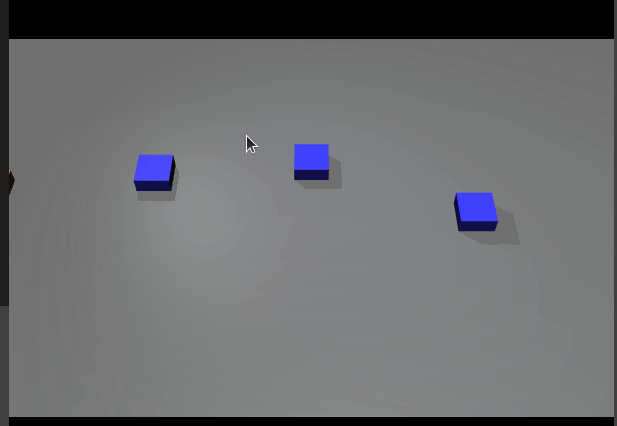

# MuJoCo 动态障碍局部避障仿真

橙色自车沿道路从左端开到右端终点，路上三个蓝色障碍横向穿行车流，自车实时绕行避让。

## 运行环境

- Ubuntu 20.04
- Python 3.8
- mujoco 2.3.7

## 运行步骤

```bash
pip install mujoco==2.3.7
python3 src/ground/mujoco_dynamic_avoidance/main.py
```

运行后弹出 MuJoCo 窗口，自车朝终点行驶，接近障碍时向空闲一侧绕行。



## 实现思路

1. 路面一条直道，左端起点、右端终点，三个蓝色障碍在不同 x 位置沿 y 方向正弦往复穿行；
2. 自车用三个关节控制 x/y/yaw，位置和速度每步写进关节 qpos/qvel；
3. 每步先算指向终点的吸引方向，再对每个近处障碍叠加径向排斥，距离越近排斥越强；
4. 排斥之外再加一个切向分量，奇偶障碍分别从道路两侧交替绕过去；
5. 合力方向作为期望航向，航向做 P 跟踪，沿航向积分前进，接近终点后减速停车；
6. 时钟用仿真时间 `data.time`，主循环按仿真步长对齐实时运行；最长运行 30 s，到点自动退出；结束时根据与终点的距离判定到达或未到达，打印用时、剩余距离和最小车障间距。

## 说明

本作业的代码与文档在编写过程中使用了 AI 大模型辅助，本人已核对并确认提交内容，对提交内容负责。
