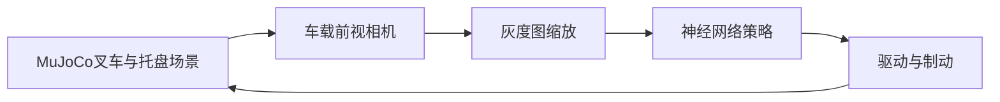

# MuJoCo 叉车相机引导的托盘接近与低速插入

## 场景与目标

本例使用 MuJoCo 3.12.0 模拟叉车沿直线接近木托盘。叉车前视相机持续观察托盘及叉孔，神经网络将灰度图映射为驱动与制动指令；评估统计叉齿插入深度、最终速度和过度插入状态。


[多起点评估 JSON 运行记录](../img/ground/mujoco_forklift_pallet_docking_results.json)

## 运行流程



### Ubuntu 22.04 与 ROS 2 Humble

```bash
cd ~/ros2_ws
colcon build --packages-select mujoco_forklift_pallet_docking
source install/setup.bash
ros2 launch mujoco_forklift_pallet_docking main.launch.py
```

直接运行单一场景或多起点评估：

```bash
cd src/ground/mujoco_forklift_pallet_docking
python3 main.py --mode run --start-x -4 --speed 2
python3 main.py --mode evaluate
```

键盘手动控制在交互式终端中运行：

```bash
python3 main.py --mode manual --start-x -4
```

按 `W` 前进、`S` 制动、空格滑行、`Q` 退出；终端持续显示位置和速度。模型提供纵向驱动，不含转向控制。自动化或非 TTY 环境可传入 `--manual-keys 'wws q'`，按序列逐步执行同一控制映射。

## 算法

前视相机灰度帧缩放为 $16\times16$ 像素向量 $\mathbf{x}$。两层感知机计算连续驱动与制动输出：

$$
\mathbf h=\tanh(W_1\mathbf{x}+\mathbf b_1),\qquad
\hat{\mathbf a}=\sigma(W_2\mathbf h+\mathbf b_2)
$$

训练监督标签由仿真中的叉齿至托盘入口距离 $d$ 与当前速度 $v$ 生成。制动距离近似为：

$$
d_b=\frac{v^2}{2a_b}+m
$$

当距离进入制动区间时策略从驱动切换到制动。训练数据由 MuJoCo 模拟不同起始位置与速度后逐帧渲染采集，网络采用均方误差训练。相机帧作为推理输入；仿真状态仅用于生成训练标签和计算评估结果，不进入策略预测。

## 多场景运行结果

MuJoCo 3.12.0 下，初速度 2 m/s，不同起始位置的运行记录：

| 起始位置（米） | 叉齿插入深度（米） | 最终速度（米/秒） | 过度插入 |
| ---: | ---: | ---: | :--- |
| -5.0 | 0.2706 | 0.0162 | 否 |
| -4.0 | 0.2646 | 0.0222 | 否 |
| -3.0 | 0.3090 | 0.0192 | 否 |

插入深度按托盘入口面到叉齿尖端的纵向距离计算。以上数据和 JSON 记录来自 Ubuntu 22.04、ROS 2 Humble 容器内的 MuJoCo 3.12.0 运行；动图由闭环运行期间的前视相机帧组成，三组场景均完成低速插入且未发生过插。

## 源码位置

核心文件位于 `src/ground/mujoco_forklift_pallet_docking/`：

- `model.xml`：叉车、叉齿、托盘、相机和执行器。
- `mujoco_forklift_pallet_docking/policy.py`：图像策略与训练标签。
- `mujoco_forklift_pallet_docking/simulation.py`：MuJoCo 场景、相机渲染和多起点评估。
- `main.py`：训练、运行和评估入口。
- `launch/main.launch.py`：ROS 2 启动入口。
