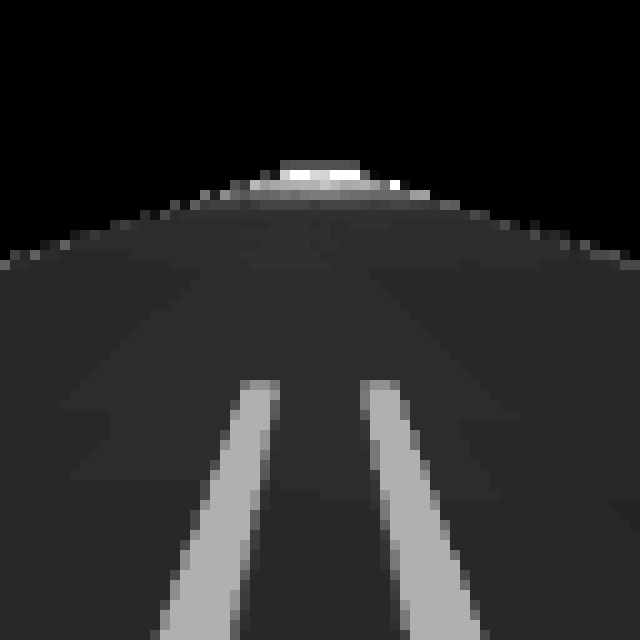
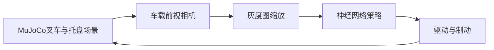

# MuJoCo 叉车相机引导的托盘接近与低速插入

## 场景与目标

本例使用 MuJoCo 3.12.0 模拟叉车沿直线接近木托盘。叉车前视相机持续观察托盘及叉孔，神经网络将灰度图映射为驱动与制动指令；评估统计叉齿插入深度、最终速度和过度插入状态。



[同次录制终态与多起点评估记录](../evidence/forklift_pallet_docking/results.json)

## 运行流程



### Ubuntu 22.04 与 ROS 2 Humble

本教程的权重、动力学评估和容器依赖对应 **MuJoCo 3.12.0**。请按 `requirements.txt` 安装该版本；其他版本的物理与渲染行为不同，不直接复用本教程的量化结果。

```bash
cd ~/ros2_ws
colcon build --packages-select mujoco_forklift_pallet_docking
source install/setup.bash
ros2 launch mujoco_forklift_pallet_docking main.launch.py
```

安装后的命令行入口为 `ros2 run mujoco_forklift_pallet_docking forklift_pallet_docking --mode evaluate`，原 `main` 入口继续兼容。

直接运行单一场景或多起点评估：

```bash
cd src/ground/mujoco_forklift_pallet_docking
python3 main.py --mode run --start-x -4 --speed 2
python3 main.py --mode evaluate
```

键盘手动控制在交互式终端中运行：

```bash
python3 main.py --mode manual --start-x -4
```

按 `W` 前进、`S` 制动、空格滑行、`Q` 退出；终端持续显示位置和速度。模型提供纵向驱动，不含转向控制。自动化或非 TTY 环境可传入 `--manual-keys 'wws q'`，按序列逐步执行同一控制映射。

## 算法

前视相机灰度帧缩放为 $16\times16$ 像素向量 $\mathbf{x}$。两层感知机计算连续驱动与制动输出：

$$
\mathbf h=\tanh(W_1\mathbf{x}+\mathbf b_1),\qquad
\hat{\mathbf a}=\sigma(W_2\mathbf h+\mathbf b_2)
$$

训练监督标签由仿真中的叉齿至托盘入口距离 $d$ 与当前速度 $v$ 生成。制动距离近似为：

$$
d_b=\frac{v^2}{8}-0.40
$$

其中距离以米、速度以米/秒计；分母 8 对应 $2a_b$，取 $a_b=4$ 米/秒²，减去的 0.40 米用于使叉齿进入托盘。距离不大于阈值时生成制动标签。自动运行通过 `--brake-scale` 显式设置制动力校准系数，Ubuntu 容器默认 1.0。训练数据由 MuJoCo 模拟不同起始位置与速度后逐帧渲染采集，网络采用均方误差训练。相机帧作为推理输入；仿真状态仅用于生成训练标签和计算评估结果，不进入策略预测。

## 多场景运行结果

MuJoCo 3.12.0 下，初速度 2 m/s，不同起始位置的运行记录：

| 起始位置（米） | 叉齿插入深度（米） | 最终速度（米/秒） | 过度插入 |
| ---: | ---: | ---: | :--- |
| -5.0 | 0.0987 | 0.0226 | 否 |
| -4.0 | 0.0939 | 0.0156 | 否 |
| -3.0 | 0.1901 | 0.0207 | 否 |

插入深度按托盘入口面到叉齿尖端的纵向距离计算。以上数据和动图来自 Windows 上 MuJoCo 3.12.0、显式制动力系数 0.8 的同次记录；动图展示起始位置 -4.0 米的闭环回合，其终态与 JSON 记录一致。三组场景均完成低速插入且未发生过插。加载已有权重的评估不重新计算留出集误差。

从仓库根目录复现相机记录及评估：

```bash
python3 src/ground/mujoco_forklift_pallet_docking/tools/record_demo.py --output docs/evidence/forklift_pallet_docking/docking.gif --json-output docs/evidence/forklift_pallet_docking/results.json --seed 17 --brake-scale 0.8
```

动图不使用字体；相机灰度帧经对比度增强和最近邻缩放展示，数值保存在 JSON 中。每个仿真步为 0.01 秒，动图每帧播放 0.08 秒以便观察。

## 源码位置

核心文件位于 `src/ground/mujoco_forklift_pallet_docking/`：

- `mujoco_forklift_pallet_docking/model.xml`：叉车、叉齿、托盘、相机和执行器。
- `mujoco_forklift_pallet_docking/policy.py`：图像策略与训练标签。
- `mujoco_forklift_pallet_docking/simulation.py`：MuJoCo 场景、相机渲染和多起点评估。
- `main.py`：训练、运行和评估入口。
- `launch/main.launch.py`：ROS 2 启动入口。
