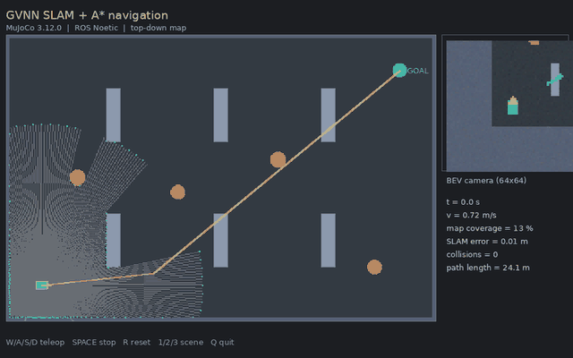
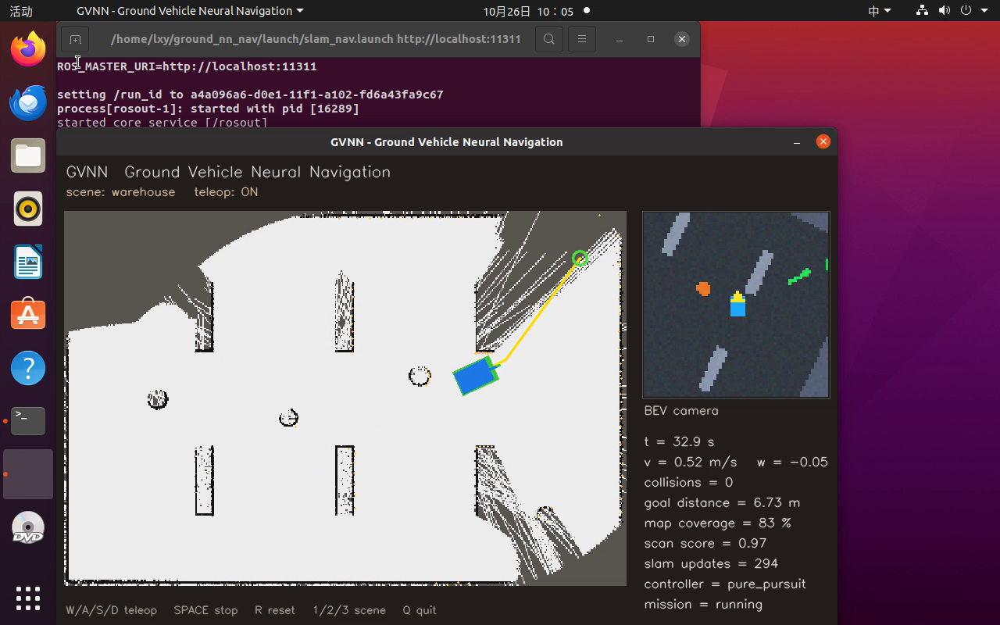

# MuJoCo 地面无人车：激光 SLAM、A* 导航与神经感知/控制

基于 **ROS Noetic + MuJoCo 3.12.0** 的差速驱动地面无人车模块。包含物理仿真、键盘遥控、360° 激光、前向 RGB-D/BEV 相机、在线占据栅格 SLAM、A* 重规划、纯跟踪控制，以及四个纯 NumPy 神经网络：激光去噪、速度/转向控制、局部规划、端到端 BEV 图像驾驶。



## 与仓库已有模块的区别

| 模块 | 仿真器 | 主要能力 |
| --- | --- | --- |
| `mujoco_car_avoidance` | MuJoCo | 射线感知 + 规则分级减速 |
| `mujoco_car_nn_avoidance` | MuJoCo | 射线 + MLP 端到端避障 |
| `carla_mapping_navigation` | CARLA | 激光建图 + 神经网络规划 |
| **本模块** | **MuJoCo** | **在线 SLAM + A* + 纯跟踪 + 四个网络 + ROS Noetic 全链** |

本模块不是单一避障演示：它同时验证了“建图 → 重规划 → 跟踪 → 神经感知/控制/端到端”的完整链路，并给出三场景闭环指标与失败分析。

## 项目结构概览

```text
mujoco_ground_slam_nn_nav/
├── main.py / main.sh             统一入口（--launch / --test / --info）
├── gvnn/
│   ├── sim/                      MuJoCo 场景、传感器、Pillow 渲染
│   ├── slam/                     对数几率栅格、增量扫描匹配
│   ├── planning/                 A*、神经局部规划
│   ├── control/                  纯跟踪、安全层
│   └── nn/                       MLP/CNN/Adam（纯 NumPy）
├── scripts/nodes/                9 个 ROS 节点
├── launch/                       6 个 launch
├── models/                       4 个训练好的网络
├── tools/                        采集、训练、评估、GIF 录制
├── tests/                        15 个单元测试
├── results/                      benchmark 与训练指标
├── package.xml
└── CMakeLists.txt
```

## 一、环境准备与核心依赖

| 组件 | 版本 |
| --- | --- |
| Ubuntu | 20.04.6 LTS（VMware 虚拟机实测） |
| ROS | Noetic（`/opt/ros/noetic`） |
| Python（计算节点） | 3.11，项目内 `.venv` |
| MuJoCo | 3.12.0 |
| NumPy / Pillow | 1.26.4 / ≥9 |
| OpenCV | 4.2（系统 Python，仅 Viewer） |

> MuJoCo 3.12 要求 Python ≥ 3.10，而 Ubuntu 20.04 的系统 Python 是 3.8。因此 `roslaunch/roscore` 仍用系统 Python 3.8，仿真/SLAM/规划/控制/E2E 节点由脚本自动 `exec` 到项目 `.venv` 的 Python 3.11。**不会修改** `.bashrc`、PATH、系统 Python 包或 `/opt/ros`。

安装：

```bash
# 1. 放入 catkin 工作区
mkdir -p ~/catkin_ws/src
cp -r <仓库>/src/ground/mujoco_ground_slam_nn_nav ~/catkin_ws/src/

# 2. 项目内 venv
cd ~/catkin_ws/src/mujoco_ground_slam_nn_nav
bash scripts/setup_env.sh

# 3. 编译
cd ~/catkin_ws
catkin_make
source devel/setup.bash
```

若系统没有 Python 3.11，可先通过 deadsnakes/pyenv/conda 安装，再执行：

```bash
PYTHON311=/path/to/python3.11 bash scripts/setup_env.sh
```

## 二、启动流程

每个新终端先执行：

```bash
source /opt/ros/noetic/setup.bash
source ~/catkin_ws/devel/setup.bash
```

### 【终端 1】键盘遥控（任务 1、2）

```bash
roslaunch mujoco_ground_slam_nn_nav teleop.launch scene:=warehouse
```

- 弹出 OpenCV Viewer：左侧俯视图与激光点，右侧 BEV 相机与 HUD。
- 点击窗口后按 `W/A/S/D`，`SPACE` 停车，`R` 重置，`1/2/3` 切换场景，`Q` 退出。
- 若窗口不可用，使用终端遥控：

```bash
rosrun mujoco_ground_slam_nn_nav teleop_keyboard.py
```

### 【终端 2】SLAM + A* 自主导航（任务 3）

```bash
roslaunch mujoco_ground_slam_nn_nav slam_nav.launch scene:=warehouse viewer:=true
```

流程：`/scan` + `/odom` → SLAM 发布 `/map`、`/slam_pose` → A* 每 0.5 s 重规划 `/plan` → 控制器发布 `/cmd_vel`；到达目标后写入 `results/ros_classical_warehouse.json`。

无窗口：

```bash
roslaunch mujoco_ground_slam_nn_nav slam_nav.launch viewer:=false
```

### 【终端 3】神经规划 + 神经控制

```bash
roslaunch mujoco_ground_slam_nn_nav neural_nav.launch scene:=warehouse
```

规划器用 21×21 局部栅格 + 目标极坐标预测 8 方向；置信度 <0.50 或路点被挡时回退 A*。控制器用 5 维特征预测速度/角速度，横向/航向误差大时由纯跟踪监督。

### 【终端 4】端到端 BEV-CNN

```bash
roslaunch mujoco_ground_slam_nn_nav e2e.launch scene:=crossing
```

`/camera/bev/image_raw` → 2 层 CNN → `/cmd_vel`，保留安全层与目标先验。

### 统一入口

```bash
python3 main.py --info
python3 main.py --launch slam_nav --scene warehouse
python3 main.py --launch teleop --no-viewer
.venv/bin/python main.py --test
```

## 三、实测结果

测试环境：VMware Ubuntu 20.04.6，4 vCPU / 3.8 GB，无 CUDA，MuJoCo 3.12.0，ROS Noetic。

| 指标 | 数值 |
| --- | --- |
| 全链 SLAM + A*（warehouse，seed=20261026） | **成功**，35.1 s，0 碰撞，终点 0.846 m |
| SLAM ATE RMSE | **0.0796 m** |
| 地图覆盖率 | **87.8%** |
| 三场景 classical（warehouse / obstacle_field / crossing） | **3/3 成功，0 碰撞**；ATE 0.136 / 0.248 / 0.353 m |
| 感知 1D CNN | 激光 RMSE **0.714 → 0.480 m（+32.8%）**，2081 参数 |
| 神经控制 MLP | v MAE **0.039 m/s**，ω MAE **0.077 rad/s** |
| 神经规划 MLP | 8 方向离线准确率 **72.8%** |
| 神经规划+控制（监督） | warehouse **成功**，61.15 s，0 碰撞，终点 0.157 m，ATE 0.170 m |
| 端到端 CNN | v MAE 0.226 / ω MAE 0.244；纯行为克隆闭环 0/3 成功 |



> **端到端限制**：纯行为克隆在 warehouse/obstacle_field 会碰撞；crossing 可行驶 23.3 m、0 碰撞但未到终点。该结果说明 CNN 已学会基本走廊跟随，但缺少全局纠错；页面不把离线 MAE 当作在线成功率。改进方向：DAgger、更多场景数据、更高分辨率 BEV。

## 四、常见报错与解决方法

### 1. `ModuleNotFoundError: No module named 'mujoco'`

原因：节点被系统 Python 3.8 启动或 `.venv` 不存在。

```bash
cd ~/catkin_ws/src/mujoco_ground_slam_nn_nav
bash scripts/setup_env.sh
.venv/bin/python -c "import mujoco; print(mujoco.__version__)"
```

### 2. Python 3.11 中 `rospy` 找不到 `yaml`/`genpy`

`.venv` 缺少 ROS 路径：

```bash
echo /opt/ros/noetic/lib/python3/dist-packages > \
  .venv/lib/python3.11/site-packages/ros_noetic.pth
```

或重新运行 `scripts/setup_env.sh`。

### 3. OpenCV 窗口不显示

需要在 Ubuntu 桌面会话运行（`DISPLAY=:0`），不能只用无桌面的 SSH；也可使用 `teleop_keyboard.py` 终端遥控。

### 4. 小车不动

```bash
rostopic hz /cmd_vel
rostopic echo -n 1 /gvnn/state
```

Viewer 需要窗口焦点；mission 成功/超时后会发布 `enable=false`；仿真节点对 `/cmd_vel` 有 0.6 s 看门狗。

### 5. `catkin_make` 找不到包

确认 `src` 下目录名与 `package.xml` 的 `<name>` 一致：`mujoco_ground_slam_nn_nav`，并先 `source /opt/ros/noetic/setup.bash`。

## 五、验证范围与限制

- 实测平台为 **ROS Noetic**；未在 ROS 2 Humble 验证，尽管仓库名为 `ros2`，本模块与已有的 `turtlebot3_auto_nav` 一样属于 Noetic 贡献。
- SLAM 无回环检测，长距离闭环会保留少量漂移；地图 IoU 是“表面地图 vs 体积真值”，仅作参考。
- 端到端策略为纯行为克隆，未做 DAgger；闭环失败案例已如实记录。
- 所有指标均在固定 seed、开启传感器/里程计噪声下测得；不同 CPU 的 wall time 会变化，仿真时间与指标不受影响。

## 六、源码与许可

源码：`src/ground/mujoco_ground_slam_nn_nav/`。许可证 MIT。测试：

```bash
.venv/bin/python tests/run_all.py   # 15/15
```
