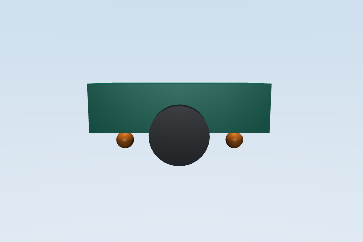

# MuJoCo 差速小车电机温升模型

本包使用 MuJoCo 模拟差速小车左右轮驱动，并以一阶集总模型估计绕组温度。轮速目标限幅约束输入；模型不包含温度降额，也不把散热系数建模为车速函数。

## 热模型

电流、铜损和温度变化按以下关系计算：

```text
I = |tau| / Kt + Iidle
Pcu = I^2 R
C dT/dt = Pcu - G (T - Ta)
T[k+1] = T[k] + (Pcu - G (T[k] - Ta)) dt / C
```

| 参数 | 数值 | 单位 | 用途 |
| --- | ---: | --- | --- |
| 绕组热容 C | 28.0 | J/°C | 温度变化的热惯量 |
| 绕组电阻 R | 0.42 | Ω | 铜损估计 |
| 散热系数 G | 0.22 | W/°C | 与环境温差对应的散热 |
| 转矩常数 Kt | 0.18 | Nm/A | 转矩到电流的换算 |
| 空载电流 Iidle | 0.25 | A | 空载电流估计 |

每次仿真使用配置环境温度作为绕组初温。车辆前后设置低摩擦球形支撑，俯仰角由自由关节姿态四元数计算并输出。

## 运行

从仓库根目录执行：

```bash
source /opt/ros/humble/setup.bash
python3 -m pip install "numpy<2" "mujoco>=3.2,<4"
colcon build --merge-install --packages-select mujoco_motor_thermal_control
source install/setup.bash
ros2 launch mujoco_motor_thermal_control main.launch.py steps:=12000 linear:=0.55 ambient:=25.0
```

当前 Humble rosdep 源没有 MuJoCo 的 key，故运行前使用上述 pip 命令安装。使用 `ros2 launch mujoco_motor_thermal_control main.launch.py render:=output/mujoco_demo.png` 可保存终点画面；Docker 镜像通过 `MUJOCO_GL=osmesa` 使用无显示器的软件渲染。

`steps` 默认 12000（模型步长 0.01 秒），`linear`、`angular` 和 `ambient` 分别设置目标线速度、角速度及环境温度。左右目标轮速限幅为 ±24 rad/s，轮缘速度上限为 1.68 m/s；驱动转矩限制为 ±2.5 Nm。

## 验证结果

Ubuntu 22.04 / ROS 2 Humble / Python 3.10 容器中完成 colcon 构建，并使用 pytest 运行 6 项测试。测试覆盖温升、冷却、非正时间步拒绝、15 rad/s 角速度命令限幅、环境温度初始化以及 120 秒的速度跟踪与俯仰角。120 秒固定速度运行得到行程约 62.92 m、终点速度约 0.526 m/s、左右绕组温度约 26.59 °C；该温度来自简化热模型。速度与 0.55 m/s 指令相差约 4.4%，源于比例控制及驱动轮关节阻尼；全程最大绝对俯仰角约为 0.0038 rad。

下图由 MuJoCo 离屏渲染器输出，展示 120 秒仿真终点；橙色球体为前后支撑球。`mujoco_motor_thermal_control/render.py` 固定输出 720×480 画面，使用跟随车体的侧视相机，距离 0.85 m、方位角 90°、俯角 8°。


