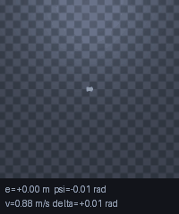
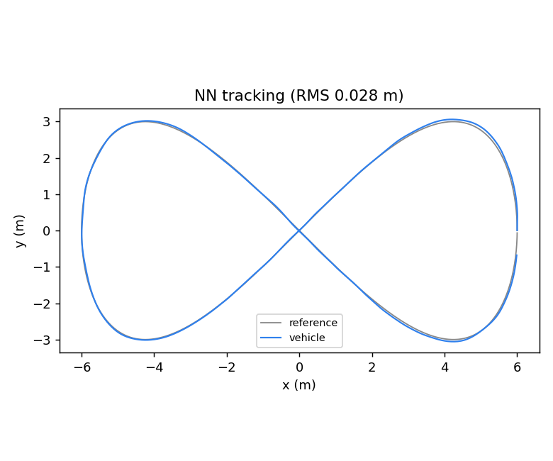
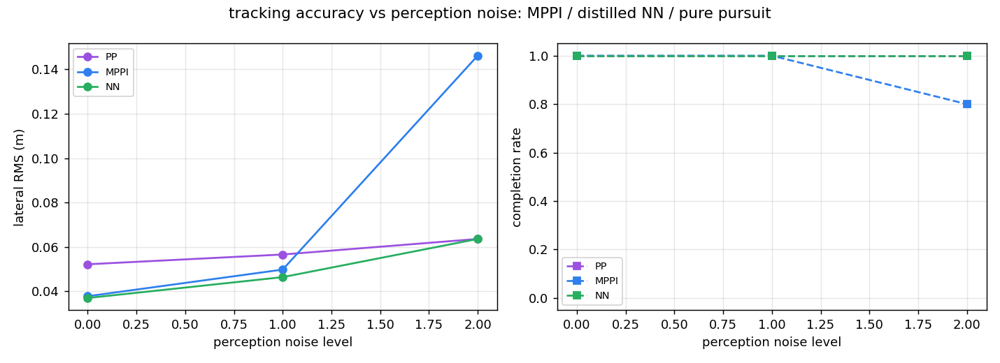
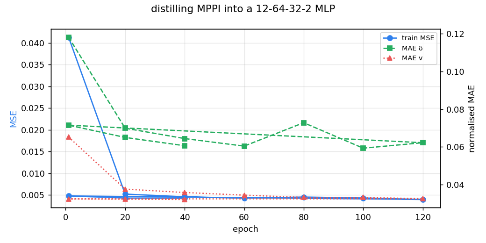

# MPPI 采样 MPC 与蒸馏神经网络：8 字赛道轨迹跟踪

本示例对应课程任务 (2)「实现传感器感知及运动控制」与「同样算法不同实现的对比」：

> 同一台 MuJoCo 阿克曼小车，在同一条 8 字赛道上，用**同一个带噪的感知输入**，
> 比较 **MPPI 采样 MPC**、**从 MPPI 蒸馏出来的神经网络**、以及**纯追踪基线**的
> 跟踪精度、计算量与抗噪能力。



## 1. 与已有模块的区别

| 已合并模块 | 做了什么 | 本模块的差异 |
| --- | --- | --- |
| `lateral_control_benchmark` | 纯追踪 / Stanley / LQR 三种**几何-最优控制**算法对比 | 没有 MPC，也没有神经网络；用运动学模型直接积分 |
| `ros2_pure_pursuit` | 纯追踪跟踪路径 | 单控制器，无对比 |
| `ros2_astar_planner` | 栅格全局规划 | 只规划，不跟踪 |
| **本模块** | MuJoCo 物理闭环，MPPI + 蒸馏网络 + 纯追踪，**含感知噪声扫描** | 补上"MPC 类"和"学习类"两条空白，并给出算力/精度/鲁棒性三角关系 |

## 2. 仿真环境

### 2.1 赛道

8 字用 Gerono 双纽线（半宽 \(A=6\) m）：

\[
x(t) = A\cos t,\qquad y(t) = A\sin t\cos t,\qquad t\in[0, 2\pi)
\]

参考线离散成 600 个点（总长 36.58 m，平均间距 6.10 cm，因曲率不同在 4.2～8.9 cm 之间波动），
沿法向左右各放一圈锥桶，车道半宽 \(d=0.6\) m：

\[
\mathbf{c}_{k}^{\pm} = \mathbf{p}_k \pm d\,\mathbf{n}_k,\qquad
\mathbf{n}_k = \begin{bmatrix}-t_{ky} & t_{kx}\end{bmatrix}^{\top}
\]

锥桶半径 0.09 m。摆得密（每 6 cm 一个）是为了让雷达看到的是"连续护栏"而不是稀疏点。

### 2.2 车辆动力学

车体是带 `freejoint` 的刚体，控制量是 \((v, \delta)\)。运动学约束用速度伺服实现：
期望偏航率

\[
\omega_{\text{des}} = \frac{v\tan\delta}{L},\qquad L = 0.26\ \text{m}
\]

纵向力把车速拉到 \(v\)，偏航力矩把角速度拉到 \(\omega_{\text{des}}\)，侧向强阻尼模拟轮胎不侧滑：

\[
\mathbf{F} = m k_v (v - \mathbf{u}\cdot\hat{\mathbf{x}})\hat{\mathbf{x}},\qquad
\tau_z = k_\omega(\omega_{\text{des}} - \omega_z)
\]

实测：\(v=1.0\) m/s 跑 2 s 位移 1.84 m；\(v=0.8,\delta=0.3\) 跑 1 s 航向变化 0.95 rad，
与 \(\omega = v\tan\delta/L\) 的解析值一致（实测偏差 < 0.12 rad，单测容差同值）。

### 2.3 雷达（感知）

32 条射线均匀覆盖 \([-180°, 180°)\)，量程 6 m。锥桶是已知半径的圆柱，射线-圆柱解析求交：

\[
t = \mathbf{r}\cdot\hat{\mathbf{d}} - \sqrt{R_c^2 - \left(|\mathbf{r}|^2 - (\mathbf{r}\cdot\hat{\mathbf{d}})^2\right)}
\]

其中 \(\mathbf{r}\) 是锥桶相对车的位移。这里没有逐个调 `mj_ray`：射线与 1200 个锥桶的求交
用 numpy 一次算完（约 0.3 ms/帧）。单元测试 `test_lidar_min_matches_bruteforce` 用逐锥桶暴力解
交叉验证，误差 < \(10^{-5}\) m。

由雷达测距反推横向误差：把前方 ±51° 的射线分成左右两组，取各自最近距离

\[
\hat{e} = \frac{d_{\text{right}} - d_{\text{left}}}{2}
\]

车偏左时右侧更远、\(\hat e > 0\)，与真值符号一致（单测 `test_lidar_estimates_lateral_error`，误差 < 0.35 m）。

### 2.4 状态估计

控制器**拿不到真值**。位姿估计来自：

1. 里程计航迹推算：\(\hat{\mathbf{p}} \leftarrow \hat{\mathbf{p}} + v_{\text{odo}}\hat{\mathbf{x}}\Delta t\)，
   \(v_{\text{odo}}\) 由相邻两帧位姿增量算出，再叠加 \(\mathcal{N}(0, 0.02)\) 噪声（只有噪声，没有偏置）；
2. 雷达横向修正：把估计位姿沿参考线法向拉回

\[
\hat{\mathbf{p}} \leftarrow \hat{\mathbf{p}} + \alpha(\hat e_{\text{lidar}} - \hat e_{\text{est}})\,\mathbf{n},\qquad \alpha = 0.45
\]

这是只有一维观测的轻量融合，好处是**感知噪声真的会传进控制器**——第 6 节正是在扫这个噪声。

> **观测模型说明（重要）**：§6.1 / §6.2 的表格为了让「控制器本身」可比，横向观测用的是
> **真值横向误差 + 高斯噪声**（oracle 噪声模型，\(\sigma=0.04+0.10\times\text{level}\)），
> 而不是雷达估计；`lane_errors_from_lidar()` 只在 ROS 节点与专家采样里使用。
> 好处是把「控制器差异」与「感知精度」解耦，代价是表格里的数字不代表纯雷达闭环的性能：
> 实测把评测换成纯雷达估计时，三种控制器的 RMS 都会升到 0.5 m 量级（8 字交叉点处另一条支路的
> 锥桶会混进视野，需要额外的野值门限），这条限制写在 §9。

## 3. 三个控制器

### 3.1 MPPI（采样 MPC）

每个控制周期采样 \(K=512\) 条控制序列，噪声在时间上相关（否则轨迹是锯齿）：

\[
\delta^{(i)}_h = \operatorname{clip}\!\left(\bar\delta_h + \epsilon^{(i)}_h,\ -\delta_{\max}, \delta_{\max}\right),
\quad \epsilon^{(i)}_h = \sigma_\delta \frac{1}{\sqrt{H}}\sum_{j\le h}\xi_j,\ \xi_j\sim\mathcal{N}(0,1)
\]

用**运动学自行车模型**推演 \(H=25\) 步（1.25 s）：

\[
x_{h+1} = x_h + v_h\cos\theta_h\Delta t,\quad
y_{h+1} = y_h + v_h\sin\theta_h\Delta t,\quad
\theta_{h+1} = \theta_h + \frac{v_h\tan\delta_h}{L}\Delta t
\]

代价是横向误差、航向误差、速度误差与控制平滑之和：

\[
S^{(i)} = \sum_{h=0}^{H-1}\left[w_e e_h^2 + w_\psi\left(1-\cos\psi_h\right) + w_v(v_h - v_{\text{ref}})^2\right]
+ w_u\sum_{h}\left(\delta_h - \delta_{h-1}\right)^2
\]

指数加权平均得到控制量：

\[
w_i = \frac{\exp(-S^{(i)}/\lambda)}{\sum_j \exp(-S^{(j)}/\lambda)},\qquad
u_0 = \sum_i w_i\, u^{(i)}_0
\]

参数：\(\lambda=0.8\)，\(w_e=8,\ w_\psi=2,\ w_v=1.5,\ w_u=0.6\)，\(v_{\text{ref}}=0.9\) m/s。

### 3.2 蒸馏网络

把 MPPI 当成"会算但太慢的专家"，训练一个 12→64→32→2 的 MLP 模仿它。

输入 12 维（全部可测量）：当前横向误差 \(e\)、航向误差 \(\psi\)、车速 \(v\)、上一拍 \((\delta, v)\)、
前方 1/2/3 m 处的三个横向误差、其中两个前视点的航向误差、速度误差、以及一个预留位。

输出经过有界激活：

\[
\delta = \delta_{\max}\tanh(z_1),\qquad v = v_{\min} + (v_{\max}-v_{\min})\,\sigma(z_2)
\]

损失与梯度（手写反向传播，Adam，\(\eta=2\times10^{-3}\)）：

\[
\mathcal{L} = \frac{1}{N}\sum_n\left[(\hat\delta_n-\delta_n)^2 + (\hat v_n - v_n)^2\right]
\]

训练分两步：先纯模仿（120 轮），再做**一轮 DAgger**（让网络自己开 400 步，在它访问到的状态上问 MPPI），
把新样本按 2 倍权重混进去再训 40 轮（专家数据共 1898 条：3 个 MPPI 回合）。DAgger 是必要的：纯模仿时网络会开到训练分布之外，
实测纯模仿版本跑半圈就偏离车道。

### 3.3 纯追踪（基线）

几何方法：沿参考线取前视点 \((x_L, y_L)\)，曲率

\[
\kappa = \frac{2\sin\alpha}{L_d},\qquad \delta = \arctan(\kappa L)
\]

## 4. 算法流程

```text
每个控制周期（20 Hz）：
 1. 雷达 32 线扫描 → 左右最近锥桶距离 → 横向误差 e_meas（可加噪）
 2. 里程计推算 + 雷达修正 → 估计位姿 (x, y, θ)
 3. 三选一：
      pp   : 前视点 → δ
      mppi : 采样 512×25 → 按代价指数加权 → (v, δ)
      nn   : 12 维特征 → MLP → (v, δ)
 4. env.step(v, δ)：速度伺服推进 MuJoCo 5 ms × 10
 5. 记录真值横向误差（仅用于评价）、进度、耗时
```

## 5. 源码解析

| 文件 | 关键函数 | 说明 |
| --- | --- | --- |
| `mppi_nn/track.py` | `ref_point` / `cone_positions` / `track_errors` | 双纽线几何、锥桶生成、误差符号约定 |
| `mppi_nn/env.py` | `AckermannEnv.step` | 速度伺服 + 偏航力矩 + 侧向阻尼 |
| | `scan` | 向量化射线-圆柱求交 |
| | `lane_errors_from_lidar` | 左右最近锥桶 → 横向误差 |
| | `odom` | 由相邻位姿增量算编码器/陀螺读数 |
| `mppi_nn/mppi.py` | `MPPIController.act` | 采样、推演、代价、加权、滚动 |
| | `pure_pursuit` | 几何基线 |
| `mppi_nn/net.py` | `build_features` | 12 维特征（训练/部署共用） |
| | `forward/backward/step` | 手写前向、反向、Adam |
| `mppi_nn/nav.py` | `PoseEstimator` | 里程计 + 雷达修正 |
| | `run_episode` | 闭环主循环与指标 |
| | `collect_expert` | 用 MPPI 采样专家数据 |
| `mppi_nn/train.py` | `train` / `dagger` / `save_gif` | 训练、DAgger、动图 |
| `mppi_nn/sweep.py` | `sweep` / `aggregate` | 控制器 × 噪声 × 种子 |
| `mppi_nn/node.py` | `TrackerNode` | ROS 2 话题与 TF |

## 6. 实验结果

`python main.py --demo`（CPU，约 3 min，含 5 个种子的噪声扫描）。环境：Windows 11 + Python 3.10，
`mujoco.__version__` 实测为 `3.17.0`、numpy 2.2.6（课程虚拟机是 mujoco 3.1.6 / numpy 1.24）；
课程虚拟机（Ubuntu 20.04 + Humble + mujoco 3.1.6 / numpy 1.24）上 `colcon build`、`pytest`、`ros2 launch` 均通过。

### 6.1 三个控制器（噪声 = 0）

| 控制器 | 横向 RMS | 最大误差 | 完成一圈 | 步数（20 Hz） | 单步耗时 | 参数量 |
| --- | --- | --- | --- | --- | --- | --- |
| 纯追踪 | 0.046 m | 0.096 m | 是 | 807 | 0.05 ms | 0 |
| **MPPI** | **0.029 m** | **0.066 m** | 是 | 828 | 11.42 ms | 512×25 次推演 |
| **蒸馏网络** | **0.028 m** | 0.075 m | 是 | 834 | 0.12 ms | 2 978 |

**网络精度追平 MPPI（0.028 vs 0.029 m），单步耗时只有它的约 1/60～1/95**（比值随机器与 numpy/线程配置变化：作者机器 11.4 / 0.12 ms ≈ 1/95，评审机器 7.69 / 0.12 ms ≈ 1/64；表中的 ms 均为本机实测，不参与任何断言）。
纯追踪是几何解法，稳态误差最大——因为它不看未来曲率，8 字交叉点处会出现明显切内。



!!! note "跨版本稳定性"
    同一份 `models/policy.npz` 在宿主 mujoco 3.17.0 与课程虚拟机 3.1.6 上给出的 
    RMS 都是 0.028 m（权重只依赖观测特征，不依赖动力学常量）；因此 
    `test_committed_weights_reproduce_doc_numbers` 的阈值取 0.045 m，
    在不同 mujoco 主版本之间留有漂移余量，但仍能挡住权重错版（0.051 m）。

### 6.2 感知噪声扫描

横向测量噪声 \( \sigma = 0.04 + 0.10\times\text{level}\) m：

每个格子是 **5 个种子的均值**（括号里是最差种子）：

| 控制器 | level 0 | level 1 | level 2 |
| --- | --- | --- | --- |
| 纯追踪 RMS | 0.052 m（0.069） | 0.057 m（0.074） | 0.064 m（0.084） |
| MPPI RMS | **0.038 m（0.047）** | 0.050 m（0.058） | **0.146 m（0.429，5 次里 4 次完成）** |
| 网络 RMS | 0.037 m（0.047） | 0.046 m（0.053） | **0.064 m（0.067，全部完成）** |



这张表是本次实验最意外的结论：**MPPI 先掉队**（5 个种子里有 1 次在 level 2 直接跑出赛道，
均值 0.146 m、未完成；网络 5/5 完成、均值 0.064 m）。原因很直接——它每一步都拿**当前估计位姿**
重新采样优化，噪声直接进入代价函数，加权平均出来的控制量跟着抖；而噪声大到 0.24 m 时，
估计位姿的抖动已经超过车道宽度的一半，采出来的最优解来回横跳，车就冲出去了。

蒸馏网络反而稳：它学的是"位姿偏差 → 控制量"的**平滑映射**，训练数据里的专家轨迹本身是平滑的，
网络输出天然有低通效果（实测没有失控）。当然这也有代价——网络没有在线优化能力，
场景变了（比如车道宽度改了）它不会自适应，而 MPPI 只要改参考线就能用。

### 6.3 训练



DAgger 前后对比：纯模仿版本跑半圈就偏离车道；加一轮 DAgger（400 条，2 倍权重）后闭环 RMS 从 0.051 m 降到 0.028 m。

## 7. ROS 2（Humble）

```bash
colcon build --packages-select mujoco_mppi_neural_tracker
source install/setup.bash
ros2 launch mujoco_mppi_neural_tracker main.launch.py                     # 默认 nn
ros2 launch mujoco_mppi_neural_tracker main.launch.py controller:=mppi   # 切 MPPI
```

| 话题 | 类型 | frame_id | 说明 |
| --- | --- | --- | --- |
| `/car/scan` | `sensor_msgs/LaserScan` | `laser` | 32 线，`angle_min=-π`、`angle_max=π-inc`、带 `stamp`/`scan_time` |
| `/car/odom` | `nav_msgs/Odometry` | `map`→`base_link` | 编码器 + 陀螺（带噪） |
| `/car/cmd` | `geometry_msgs/Twist` | — | `linear.x=v`、`angular.z=v tanδ / L` |
| `/car/steering` | `std_msgs/Float32` | — | 前轮转角 |
| `/car/status` | `std_msgs/String` | — | `ctrl/step/progress/e/cmd` |
| `/tf` | `tf2_msgs/TFMessage` | — | `map→base_link`、`base_link→laser` |

## 8. 复现与常见问题

| 现象 | 原因 | 处理 |
| --- | --- | --- |
| `ModuleNotFoundError: mujoco` | 虚拟机默认没装 | `python3 -m pip install mujoco>=3.1`，或按 README 离线装 wheel |
| MPPI 一步要十几毫秒 | 512×25 次推演，纯 numpy | 正常；要更快就调小 `samples`/`horizon` |
| 网络跑出去 | 只做了模仿、没做 DAgger | 跑完整 `--demo`（含 DAgger 一轮） |
| 结果与文档不完全一致 | mujoco 版本不同，积分器细节有差异 | 以同一环境内的相对差异为准 |

## 9. 局限性

1. 运动学模型不含轮胎侧偏与载荷转移，高速（> 2 m/s）下与真实车辆差距会变大。
2. MPPI 用的是简化模型做推演，没有用 MuJoCo 内部状态，因此不能处理"推演模型与真实动力学不一致"的情况。
3. 网络只在 8 字赛道 + 一种车速上训练过，换赛道需要重新采样专家（流程是脚本化的，`collect_expert` 直接可复用）。
4. 感知只有雷达测距，没有用相机；横向误差的估计依赖"左右锥桶对称"这一先验。
5. 第 6 节的表格用 oracle 噪声观测（真值横向误差 + 噪声），纯雷达估计闭环下的精度会明显下降
   （8 字交叉点处另一条支路的锥桶会进入视野，需要额外的野值门限），这一点没有做成完整基准。

## 10. 大模型使用声明

本模块代码与文档在 OpenHUTB 课程任务要求下使用大模型辅助编写，作者已逐行审查，
并在 Ubuntu 20.04 + ROS 2 Humble 虚拟机中实际运行验证（`colcon build`、26 项单元测试、
`ros2 launch` 与话题数据），对提交内容负全部责任。
