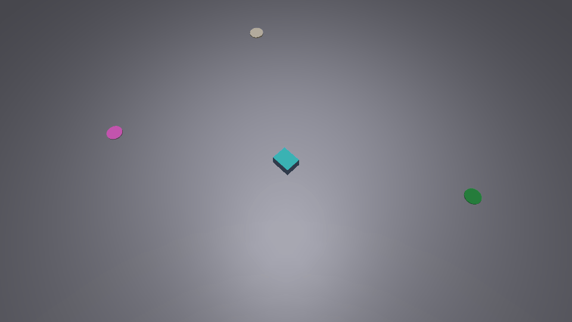
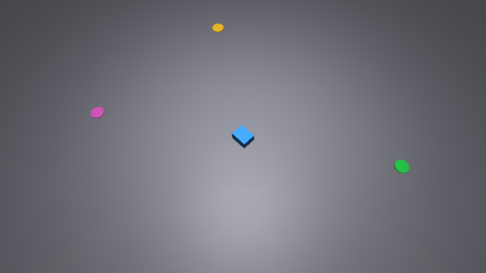

# MuJoCo 小车多目标导航

## 项目说明

一个 MuJoCo `free joint` 小车从原点出发，依次到达三个预设目标点，每到一个点打印目标坐标
与实测误差，全部到达后自动停车。用于演示平面内的多点导航与位置闭环控制。

控制按平面 3 自由度处理：x / y 平动的速度由「方向 + 距离衰减」给定；z 高度与姿态
（roll / pitch / yaw）每个仿真步锁定为初始值，避免车体在碰撞后倾斜、车头漂移。

## 场景

三个目标点在 `scene.xml` 里有对应的彩色圆盘标记（标记本身不参与碰撞），
与 `main.py` 中的 `GOALS` 列表一一对应：

| 序号 | 目标坐标 (x, y) / m | 标记颜色 |
|---|---|---|
| 1 | (1.5, 1.0) | 绿 |
| 2 | (-1.5, 1.0) | 黄 |
| 3 | (-1.5, -1.0) | 紫 |

- 车体：0.2 × 0.16 × 0.1 m 方体，`free joint`，初始位置 (0, 0, 0.05)，车头朝 +x；
- 地面：10 × 10 m 平面，`friction="1.0 0.1 0.1"`；
- 时间步长：`timestep="0.005"`。

## 运行环境

| 项 | 值 |
|---|---|
| 系统 | Ubuntu 20.04（ROS Noetic）|
| Python | 3.8+ |
| MuJoCo | 本文数据在 4.0.0 下实测；2.3.7 复跑逐位相同，代码未使用 4.x 独有 API |
| 依赖 | `pip3 install -r requirements.txt`（`mujoco`、`numpy`）|

## 目录结构

```
src/ground/mujoco_multi_goal_nav/
├── launch/
│   └── main.launch           # ROS 1 (catkin) 启动，带 nogui:= / duration:= 参数
├── test/
│   └── test_main.py          # 回归测试（unittest / pytest 均可）
├── CMakeLists.txt
├── main.py                   # 入口：目标点、速度闭环、姿态锁定、统计
├── package.xml
├── README.md
├── requirements.txt
└── scene.xml                 # 场景 + 三个目标点标记

docs/ground/mujoco_multi_goal_nav.md          # 本文
docs/img/ground/mujoco_multi_goal_nav_run.png # 场景截图
docs/img/ground/mujoco_multi_goal_nav_demo.gif # 运行动图
```

## 运行方式

### 1. 直接运行（不需要编译）

```bash
cd src/ground/mujoco_multi_goal_nav

pip3 install -r requirements.txt

python3 main.py                        # 带可视化窗口
python3 main.py --nogui                # 无窗口，只跑物理（服务器 / 无显示环境）
python3 main.py --nogui --duration 40  # 指定最大仿真时长
python3 main.py --nogui --csv traj.csv # 另外把轨迹落成 CSV
```

### 2. 回归测试

```bash
cd src/ground/mujoco_multi_goal_nav

python3 -m unittest discover -s test -v
# 或
python3 -m pytest test/test_main.py -v
```

8 项用例覆盖：`GOALS` 常量与坐标、参数取值范围、`resolve_scene_path()` 默认与
环境变量优先、`scene.xml` 里 `ground/goal1/goal2/goal3/chassis` 几何存在、
目标标记 `contype/conaffinity` 均为 0、`lock_pose()` 复位高度与四元数。
不启动仿真，0.1 s 内跑完。

## 参数

| 参数 | 默认值 | 说明 |
|---|---|---|
| `--nogui` | 关闭 | 不建可视化窗口，只推进物理，适合无显示环境 |
| `--duration` | 40.0 | 最大仿真时长（秒），超时视为未完成并返回非 0 |
| `--csv` | 无 | 轨迹 CSV 输出路径（`time,x,y,goal_index`），默认不写 |
| `SPEED`（源码常量）| 0.3 | 最高线速度 m/s |
| `SLOW_RADIUS` | 0.3 | 剩余距离小于该值时按比例降速，避免冲过目标点 |
| `STOP_DIST` | 0.02 | 到达判定阈值 m |

## 运行效果





实测输出（`python3 main.py --nogui`；MuJoCo 4.0.0 与 2.3.7 双版本复跑，三行数值逐位相同）：

```
场景文件：.../src/ground/mujoco_multi_goal_nav/scene.xml
目标点：(1.5, 1), (-1.5, 1), (-1.5, -1)
运行参数：最高速度 0.30 m/s，到达阈值 0.02 m，时长上限 40.0 s
[ 0.51s] 前往目标点1：x=+0.126 y=+0.084，剩余 1.653 m
...
到达目标点1：x=1.5, y=1（实测 x=1.483, y=0.989，误差 0.0199 m，累计用时 7.71 s）
...
到达目标点2：x=-1.5, y=1（实测 x=-1.480, y=1.000，误差 0.0199 m，累计用时 19.37 s）
...
到达目标点3：x=-1.5, y=-1（实测 x=-1.500, y=-0.980，误差 0.0200 m，累计用时 27.73 s）
所有目标点已到达，停车
=== 统计 ===
目标点1：用时 7.71 s，到达误差 0.0199 m
目标点2：用时 19.37 s，到达误差 0.0199 m
目标点3：用时 27.73 s，到达误差 0.0200 m
最终位置       : x=-1.500 m, y=-0.980 m
到达个数       : 3 / 3
总仿真时长     : 27.73 s
是否全部到达   : 是
```

| 指标 | 实测值 |
|---|---|
| 到达点数 | 3 / 3 |
| 各点到达误差 | 0.0199 / 0.0199 / 0.0200 m（判据 0.02 m）|
| 各点累计用时 | 7.71 / 19.37 / 27.73 s |
| 总仿真时长 | 27.73 s（原线性速度律约 356 s，改为最高 0.3 m/s 后缩短至 28 s）|

## 实现说明

- **运动控制**：直接改写 `data.qvel[0]`、`data.qvel[1]`，速度大小
  `v = min(SPEED, SPEED * dist / SLOW_RADIUS)`，方向为当前目标的方向余弦；
  `dist < STOP_DIST` 判定到达并切换到下一个目标。
- **姿态锁定**：每步 `mj_step` 之后把 `qpos[2]` 复位为 0.05、`qpos[3:7]` 复位为单位四元数，
  同时把 `qvel[2]`、`qvel[3:6]` 置 0，因此车头全程保持初始朝向，画面上不会斜着平移。
- **无窗口模式**：`--nogui` 时不创建 viewer，只循环 `mj_step`，可在纯服务器环境跑完并输出统计。
- **路径回退**：`resolve_scene_path()` 先看环境变量 `MUJOCO_MULTI_GOAL_SCENE`，没有则依次尝试
  脚本同目录、`../share/<pkg>/`，覆盖「显式指定 XML」「源码目录直跑」「装到 install 空间后启动」三种情形。

## 已知限制

- 速度是直接写 `qvel` 的运动学控制，不经过执行器，因此画面上没有轮子转动、也没有
  驱动力矩参与；这是课程演示取舍，物理真实性有限。
- 目标点为固定三个坐标，写在 `main.py` 的 `GOALS` 常量里；改目标点需要同时改
  `scene.xml` 的标记位置（可选）。
- 姿态被强制锁定，车不会转向，因而没有「朝向目标」的转向过程。

## AI 使用声明

本项目代码、文档在编写过程中使用 **豆包（Doubao）** 辅助完成；场景参数、控制律与
实测数据均由作者核对并实际运行确认，作者对提交内容负责。
