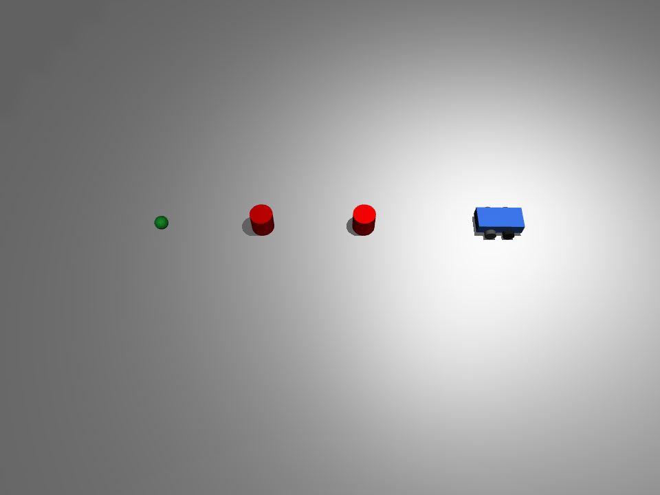

# MuJoCo 差速小车射线绕行避障

功能包源码位于仓库的 `src/ground/mujoco_obstacle_avoidance` 目录。

## 1. 问题描述

蓝色四轮差速小车（后两轮驱动、前两轮被动支撑）在 MuJoCo 平地仿真中从原点 `(0, 0)` 出发，
沿 `+x` 方向驶向绿色目标点 `(3.0, 0.0)` m；路径上布置两个红色圆柱障碍。
小车通过前向射线测距提前发现障碍，经「左转绕行 → 横向离开 → 回正」的状态机绕开障碍，
再回到目标方向逼近并停在目标点附近。

## 2. 运行环境（实际验证）

| 项 | 版本 / 说明 |
|---|---|
| 操作系统 | Ubuntu（无头云主机，无独立显卡） |
| Python | 3.12.11 |
| 模拟器 | MuJoCo `>=3.2,<4.1`（本机实测 3.17.0，4.0.0 亦验证通过），numpy 1.26.4；Pillow 仅录帧导出 GIF 时需要 |
| 渲染后端 | 可视化用 `MUJOCO_GL=glfw`；无头离屏录帧用 `egl`（mesa 软件渲染，无独立显卡也可出图） |

MuJoCo 不在 apt 仓库，需按 `requirements.txt` 用 pip 安装。

## 3. 算法

### 3.1 差速运动学

模型后两轮由 `velocity` 执行器驱动，`ctrl` 单位是**轮子角速度 (rad/s)**，不是车体线速度。
给定目标车体线速度 `v` (m/s) 与车体角速度 `omega` (rad/s)，由差速逆解换算左右轮角速度：

```
ω_L = v/R - ω·L/(2R)
ω_R = v/R + ω·L/(2R)
```

其中轮半径 `R=0.05 m`，左右轮间距 `L=0.22 m`。

### 3.2 偏航角解算

车体是 `<freejoint/>`，其 7 个 `qpos` 为 `[x, y, z, qw, qx, qy, qz]`；
`qpos[5]` 是四元数 `qy`，绕 z 轴转动时恒为 0，**不能当作 yaw**。
偏航角由四元数分量解算：

```
yaw = atan2(2·(qw·qz + qx·qy), 1 - 2·(qy² + qz²))
```

### 3.3 前向射线测距

用车体前方发射一束水平射线（`mj_ray`），方向按车身 yaw 解算，发射点在质心前方 `0.20 m`；
通过 `bodyexclude` 排除自车整棵 body，避免打到自己的轮子。射线命中障碍几何时返回距离 (m)，
未命中返回量程上限 `5.0 m`。

### 3.4 避障状态机

- `cruise`：朝目标点比例控制。航向误差大时转向对准目标，误差小时直行并叠加航向比例修正，
  两档阈值带滞回（转入 `0.5 rad`、转回 `0.3 rad`），避免边界极限环；
- 前向射线距离 `< 0.60 m` 判定前方有障，进入 `turn_left`：左转到朝 `+y` 侧；
- `side`：沿当前朝向直行，侧向抬到 `y ≥ 0.40 m`，离开障碍所在车道；
- `turn_right`：转回朝 `+x`，到位后回到 `cruise` 重新对准目标；
- 到达判据：距目标 `< 0.12 m` 即两轮速度清零停车；循环带步数上限 `20000`（`dt=0.005`，兜底 100 s）。

## 4. 模型参数（models/obstacle_avoidance.xml）

| 部件 | 参数 |
|---|---|
| 底盘 | 长方体 `0.2 × 0.1 × 0.05 m`，蓝色，质量 2.0 kg |
| 后轮 | 左右各一，轮半径 0.05 m，hinge 绕 y 轴，`velocity` 驱动，`kv=2` |
| 前轮 | 左右各一，被动支撑，无执行器 |
| 障碍 | 两个红色圆柱，`(1.2, 0.0)`、`(2.1, 0.0)`，半径 0.1 m，参与碰撞 |
| 目标点 | 绿色小球，`(3.0, 0.0, 0.06)`，半径 0.06 m，不参与碰撞 |
| 物理 | timestep=0.005 s，地面摩擦 `1.0 0.1 0.1` |

## 5. 运行步骤

### 5.1 安装依赖

在**包目录**下执行：

```bash
# 先进入本包目录（仓库内 checkout 路径如下）：
cd src/ground/mujoco_obstacle_avoidance
pip install -r requirements.txt
```

### 5.2 运行

在包目录下直接运行脚本：

```bash
python3 main.py              # 打开 MuJoCo 窗口，关闭窗口即退出
python3 main.py --headless   # 无头模式：到达或超时后打印结果退出（无窗口）
```

也可以在 source 过 ROS 2 工作空间后用 ros2 launch 拉起：

```bash
ros2 launch mujoco_obstacle_avoidance main.launch.py                # 开窗可视化
ros2 launch mujoco_obstacle_avoidance main.launch.py headless:=true # 无头模式
```

### 5.3 测试与录帧

测试（纯逻辑单测 + 闭环绕障断言）：

```bash
python3 test/test_obstacle_avoidance.py
```

离屏渲染导出演示 GIF（无头环境用 EGL 软件渲染即可，无需独立显卡）：

```bash
python3 test/record_demo_gif.py
```

## 6. 实测结果（本机 mujoco 3.17.0 实测）

`python3 main.py --headless` 实测：

- 已到达；步数 `3715`，仿真时长 `18.57 s`；
- 终点 `(2.951, 0.107) m`，距目标 `0.118 m`（小于 `0.12 m` 到达阈值）；
- 前向射线仅命中障碍 1 `(1.2, 0.0)`，触发一次主动绕行，到障碍 1 最小中心距 `0.629 m`；障碍 2 `(2.1, 0.0)` 全程未进入前向射线范围，小车绕行障碍 1 后被抬到 `y≈0.40 m`，以最小中心距 `0.413 m` 从障碍 2 侧方通过（轨迹侧偏结果，并非检测到障碍 2 后的主动绕行）；两障碍均未接触（障碍半径 0.1 m、车半宽 0.1 m）。
- 转向角速度 `1.5 rad/s` 是差速逆解下发的**指令值**（目标车体角速度）；受前两轮被动支撑与轮胎侧滑影响，车体实测偏航速率低于指令值：`turn_left` 段 1296 步（6.48 s）转 1.277 rad，实测约 `0.197 rad/s`，且该段 x 前移 0.275 m、并非严格原地。

## 7. 运行效果



`docs/img/ground/mujoco_obstacle_avoidance_demo.gif` 由本包 `test/record_demo_gif.py` 离屏渲染生成，不是另外录屏：

- 闭环 `3715` 步（`dt=0.005 s`），脚本复用 `main.py` 的目标点、障碍与 `control_step`，每 `8` 步录一帧抽稀后写入 GIF；
- 实测：960×720、464 帧、每帧 40 ms、循环播放，文件 1,439,521 B（1.37 MB）；
- 复现：在包目录执行 `python3 test/record_demo_gif.py`（录帧需 Pillow；离屏后端 `MUJOCO_GL=egl`，mesa 软件渲染）；
- 同环境重跑帧数、尺寸、时长与文件字节数一致，逐帧像素差为 0；跨 Pillow 版本时调色板量化可能带来少量字节差异；
- 小车直行接近障碍后左转绕行，从障碍上方侧向通过，再回正驶向绿色目标球。

## 8. 已知限制

- 只验证固定起点 `(0, 0)`、目标点 `(3.0, 0.0)` 与当前两个障碍位置；其他起点 / 目标 / 障碍布局未做回归；
- 绕行方向固定朝 `+y` 侧，未根据障碍在左 / 右动态选择绕行侧；
- 到达判据只看位置距离，不约束最终车头朝向；
- 速度与增益为初始取值，未做整定优化；
- 在 mujoco 3.17.0（本机实测）与 4.0.0（`>=3.2,<4.1` 区间内）上验证通过，区间内其他版本与更早版本未做回归；
- 录帧依赖 EGL/OpenGL 离屏上下文；个别极简容器若未带 mesa 软件渲染库，需先装好 EGL 驱动。

## 9. 大模型使用声明

本作业的代码与文档在编写过程中使用了**豆包（Doubao）** AI 大模型辅助，本人已核对并确认提交内容，对提交内容负责。
