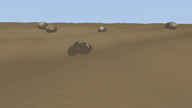
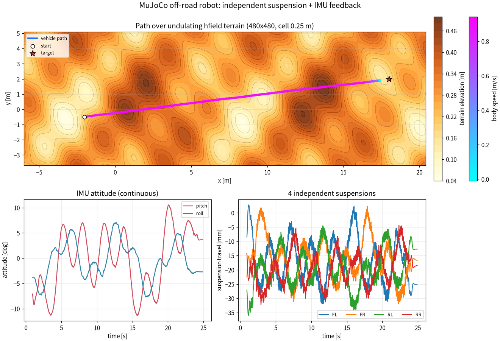
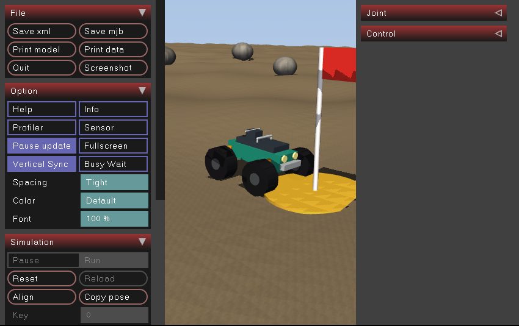

# MuJoCo 四轮独立悬架越野小车仿真

> Ubuntu 20.04 + ROS Noetic + MuJoCo：四轮独立滑柱悬架、高度场起伏地形、IMU 姿态反馈、滑移转向自主导航。

## 效果演示



上图为 `scripts/headless_demo.py` 无头渲染的产物：320×180、8 fps、32 色、195 帧、1,047,642 B（约 1.0 MB），24 s 全程，画面来自 MuJoCo 离屏画布（`mujoco.Renderer`），不是 viewer 录屏，底部叠了 `t / v / roll / pitch` 状态条。复现命令：

```bash
MUJOCO_GL=egl python3 scripts/main.py --headless \
    --duration 24 --fps 16 --gif-width 320 --gif-fps 8 --gif-colors 32
```

小车从 `(-2.0, -0.5)` 起步，在 ±0.25 m 起伏的高度场地形上滑移转向巡航 `19.58 m`，停进 `(18.0, 2.0)` 的旗标目标盘。四条滑柱悬架各自随地形伸缩，实测峰峰值 **27.8–34.7 mm**。

## 轨迹与姿态曲线



- 上图：车辆轨迹叠加在地形等高线上，颜色表示车体速度，右侧两条 colorbar 分别是车体速度与地形高程（1320×901，`scripts/plot_curves.py` 出图，`constrained_layout` 排版）
- 左下：IMU 姿态角（roll/pitch），连续无台阶
- 右下：四条独立悬架的行程（mm）

## 实测指标（24 s 全程）

| 指标 | 数值 |
|---|---|
| 行驶路径长度 | **19.58 m**（19.5750 m） |
| 平均车体速度 | **0.82 m/s** |
| 距目标点最终距离 | **0.60 m**（0.5968 m） |
| roll RMS / 最大 | **3.66° / 7.67°** |
| pitch RMS / 最大 | **5.88° / 11.34°** |
| 四悬架行程峰峰值 FL/FR/RL/RR | **34.7 / 34.2 / 31.5 / 27.8 mm** |
| 最小离地间隙 | **0.071 m** |
| 地形高程范围 | 0.04 – 0.52 m（480×480，单格 0.25 m） |

> 上表取自 `python3 scripts/main.py` 一次 24 s 运行（**1201 个采样点**，`sample_dt=0.02`）生成的
> `docs/img/offline_metrics.json`。该文件是程序产物，**不入库**（已写进 `docs/img/.gitignore`），
> 按上面的命令重跑即可原地重新生成并与上表逐项对照。跑表的机器：
> **Ubuntu 22.04.5 + Python 3.12.11 + MuJoCo 3.1.6 + numpy 1.26.4 + matplotlib 3.11.0**。
> `requirements.txt` 锁的就是实测版本 `mujoco==3.1.6`；同一台机器上用 3.1.1 复跑，
> 路径长度 19.5748 m、最终距离 0.60 m、roll/pitch RMS 3.66°/5.88°，与本表四舍五入后一致，
> 悬架峰峰值有 0.5 mm 级差异，所以表格统一取 3.1.6 的实测值，不分列两套数。

## 运行环境

- 离线仿真 / 曲线 / 动图：Ubuntu 22.04.5 + Python 3.12.11 + MuJoCo 3.1.6 + numpy 1.26.4 + matplotlib 3.11.0
- ROS 实测：ROS Noetic 1.17.0（`ros-noetic-ros-base` 1.5.0，RoboStack 的 Noetic 构建）+ Python 3.11，
  宿主 Ubuntu 22.04.5，`catkin_make` 编译通过，`roslaunch` 的 `gui:=false` / `gui:=true` 两种模式都跑过
- 尚未验证：Ubuntu 20.04 上通过 apt 安装的 Noetic（本机是 22.04，无法直接装 focal 源）
- `requirements.txt`：`mujoco==3.1.6`、`numpy>=1.21`、`matplotlib>=3.4`、`pillow>=8.0`

## 真实 Noetic 运行记录

在 Noetic 环境里按 `README.md` §2 装好依赖后：

```bash
cd ~/catkin_ws && catkin_make && source devel/setup.bash
roslaunch mujoco_offroad_suspension_robot_noetic offroad_sim.launch          # gui:=true
roslaunch mujoco_offroad_suspension_robot_noetic offroad_sim.launch gui:=false
```

实测输出（节选）：

```text
-- Configuring done
-- Generating done
[INFO] terrain: n=480x480 cell=0.25m elev[0.04, 0.52] m
$ rostopic hz /imu
average rate: 49.989
$ rostopic echo /odom/pose/pose/position
x: 17.432176450762768
y: 1.905324125253791
```

节点按 50 Hz 发布，40 s 后停在距目标 `(18, 2)` 约 **0.58 m** 的目标盘内（车体线速度 0.00015 m/s）；
`/imu` 的协方差为 `orientation=[-1, 0, …]`（姿态未建模噪声，按 ROS 惯例填 -1）、
`angular_velocity=[0.0004, …]`、`linear_acceleration=[0.01, …]`，不再是全 0 的「完全精确」。



## 快速开始

```bash
# 1. 安装 Python 依赖（MuJoCo / Pillow 走 pip，不走 rosdep）
pip3 install -r requirements.txt

# 2. 编译工作空间
cd ~/catkin_ws && catkin_make && source devel/setup.bash

# 3. 启动仿真（自动目标模式，带 3D viewer）
roslaunch mujoco_offroad_suspension_robot_noetic offroad_sim.launch

# 4. 生成物理曲线图（不需要 GPU，纯 CPU）
cd ~/catkin_ws/src/mujoco_offroad_suspension_robot_noetic
python3 scripts/gen_model.py          # 可在改地形/配色后重跑；缺贴图时脚本也会自动补
python3 scripts/main.py               # 模块入口，默认纯物理仿真出图（等同 physics_only_demo.py）
# 输出 docs/img/offline_curves.png、offline_log.csv、offline_metrics.json
```

> 贴图 `models/soil.png` / `rock.png` 是 `gen_model.py` 的程序产物，不入库；`offroad_sim_core.py`
> 已内置兜底：缺失时自动补生成，`share/<pkg>/models` 只读时改为镜像到 `~/.cache/<pkg>/models`。
> 改了地形/配色仍应显式重跑 `gen_model.py`（石头与旗标高度按新地形重算）。

**输出与产物说明**：在源码树里跑时默认写**仓库根** `docs/img/`（`resolve_out_dir()` 向上找到同时有
`docs/index.md` 与 `mkdocs.yml` 的目录），重跑即原地更新 `offline_curves.png`；装到工作空间后
（`<ws>/lib/<pkg>/`）找不到仓库根，自动退到 `~/.cache/<pkg>/output`，也可用 `--out DIR`
（无头模式用 `--outdir DIR`）或环境变量 `OFFROAD_OUT_DIR` 指定。

入库的图只有三张：`offroad_demo.gif`（1,047,642 B）、`offline_curves.png`（424,830 B）、
`offroad_noetic_viewer.png`（145,912 B），都是文档页配图；`offline_metrics.json`、`offline_log.csv`、
`offroad_demo_log.csv`、MP4 与关键帧属于运行产物，由 `docs/img/.gitignore` 忽略。

## 话题接口

| 方向 | 话题 | 类型 | 说明 |
|---|---|---|---|
| 订阅 | `/cmd_vel` | `geometry_msgs/Twist` | 线速度 m/s，偏航角速度 rad/s（超过 0.3 s 没收到就交回自动目标） |
| 发布 | `/odom` | `nav_msgs/Odometry` | 世界系位姿 + 车体系速度 |
| 发布 | `/imu` | `sensor_msgs/Imu` | 姿态四元数 + 角速度 + 线加速度，协方差按未知/典型噪声填写 |
| 发布 | `/suspension` | `sensor_msgs/JointState` | 四条滑柱行程（米） |

## 模型与控制要点

**地形**：解析高程函数生成 480×480 高度场，单格 0.25 m（必须明显小于轴距，否则轮胎骑网格尖抖动）。MuJoCo hfield 数据是归一化的，真实高程 = `base_z + data × size_z`。

**车体**：底盘 0.30×0.118×0.070 m，四角各一条 slide 滑柱悬架（`stiffness=380 damping=30`），轮胎半径 0.14 m、带 10 块胎纹，四轮 velocity 伺服驱轮。

**控制律**：
1. 航向误差 → P 控制偏航角速度 → 左右轮差速（滑移转向）
2. `|roll|` / `|pitch|` 超软阈值自动降速
3. 纵向加速度限幅 1.2 m/s²，防起步打滑、急停点头
4. 距目标 < 0.72 m 停车
5. 自动 / `/cmd_vel` 遥控切换时把控制器的 `v_ref` 清零，切回自动不会带着旧速度起步

## 常见坑

| 现象 | 根因 | 修法 |
|---|---|---|
| 地形设了起伏却看着平 | hfield 数据被归一化 | 用 `base_z + data*size_z` 反算写入 |
| 画面下半部天空色空洞 | `znear=0.02` 近裁剪面切地面 | `znear=0.001` |
| `body mass is too small` | 纯视觉 body 全 geom mass=0 | 改成 worldbody 直接 geom |
| VMware 里无头渲染报错 | 无 EGL/GPU | 用 `python3 scripts/main.py` 纯物理出图 |
| 装到 `<ws>/share/<pkg>/models` 只读时报 `resource not found` | 贴图要写回该目录 | 已内置镜像到 `~/.cache/<pkg>/models` 兜底，或用 `OFFROAD_MODEL_DIR` 指向可写目录 |
| 干净检出跑完产物没出现在 `docs/img/` | 旧版按 `<包目录>/docs` 判断，包目录下没有 `docs/` | 已改为向上定位仓库根（`docs/index.md` + `mkdocs.yml`），装到工作空间才退 `~/.cache` |
| 每次出图刷 `tight_layout` 警告 | colorbar 与 `tight_layout` 冲突 | 改用 `constrained_layout=True` |

## 大模型使用说明

使用豆包辅助编写代码与文档。

本作业的代码与文档在编写过程中使用了 AI 大模型辅助，本人已核对并确认提交内容，对提交内容负责。
