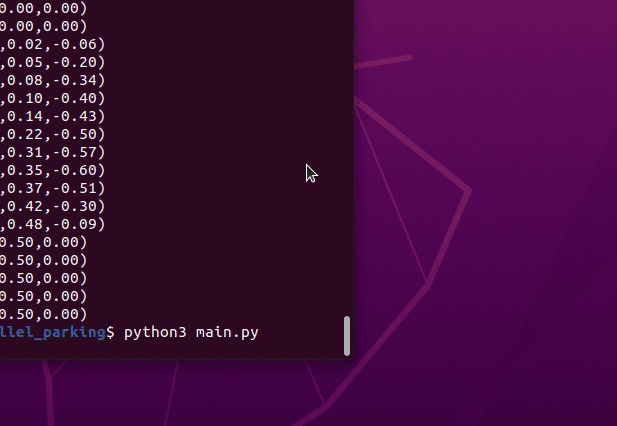

# MuJoCo 侧方停车仿真

黄色小车从路边开过车位，然后倒车入位，停在前后两辆车之间。

## 运行环境

- Ubuntu 20.04
- Python 3.8
- mujoco 2.3.7

## 运行步骤

pip install mujoco==2.3.7
python3 src/ground/mujoco_parallel_parking/main.py

运行后弹出 MuJoCo 窗口，小车先向右开过车位，然后倒车打方向入位。

## 实现思路

1. 路面上用两个盒子模拟前后停放的车，中间是侧方车位；
2. 黄色小车用三个关节控制 x/y/yaw，直接做位置伺服；
3. 用关键帧插值预设轨迹：开过车位 → 倒车打方向 → 斜着入位 → 回正停车；
4. P 控制跟踪插值后的目标位置，保证过程可见。

## 说明

本作业的代码与文档在编写过程中使用了 AI 大模型辅助，本人已核对并确认提交内容，对提交内容负责。
