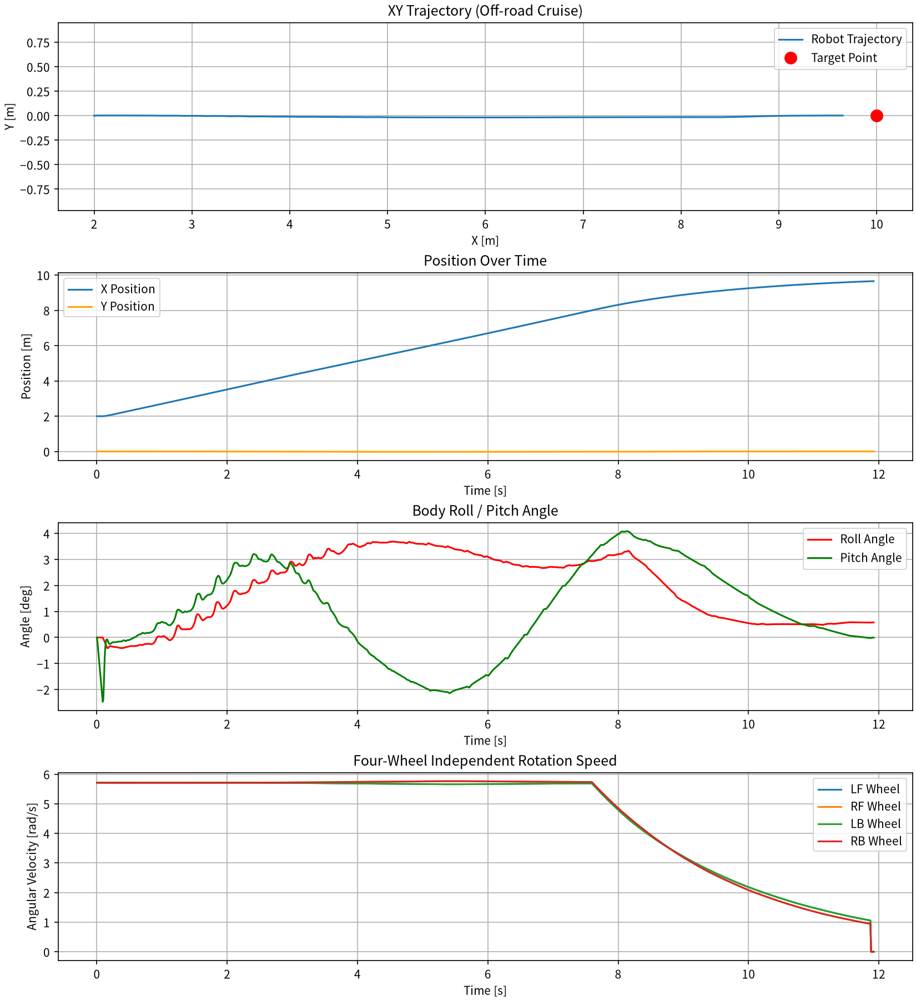

# MuJoCo 滑移转向越野小车定点巡航仿真

对应课程任务：对地面滑移转向底盘进行物理仿真，在随机起伏越野地形下实现定点直行巡航控制，采集车身姿态、轮速、轨迹数据并可视化绘图。

本模块基于 MuJoCo 物理引擎搭建滑移转向四轮小车模型，使用距离闭环控制：小车向目标点行驶，靠近目标自动减速停车；地形引入随机高度扰动模拟越野颠簸，观测车身俯仰、横滚姿态变化。

代码位于 `src/ground/mujoco_skid_steer_offroad_stable/`。

## 1. 概述与目标

### 1.1 核心任务目标

1. **物理仿真**：四轮滑移转向小车由 MuJoCo 解算动力学，车轮配置铰链关节、地面滚动/滑动摩擦，还原滑移转向底盘特性。
2. **地形环境**：生成随机起伏地面（起伏标准差 0.06 m，波长约 6 m），激励车身姿态变化。
3. **决策与控制**：根据与目标点的距离生成期望速度，靠近目标线性减速，进入停车半径后制动停车。
4. **数据采集**：记录仿真时间、车体位置、行驶速度、车身俯仰/横滚角、四个车轮目标转速。
5. **可视化输出**：viewer 使用 XML 中定义的固定全局相机，全程视野稳定便于录制演示动图；仿真结束自动输出轨迹、位置、姿态、轮速四联曲线图。

### 1.2 与仓库已有模块的区别

| 对比项 | 差速小车避障模块 | 本模块（滑移越野小车） |
| --- | --- | --- |
| 底盘形式 | 差速转向 | 滑移转向（Skid-Steer） |
| 地形 | 平整地面 | 随机起伏越野地形 |
| 控制目标 | 避开障碍物 | 定点直行巡航、到点停车 |
| 感知 | mj_ray 激光射线感知 | 无外部传感器，使用全局位置闭环 |
| 相机 | 可跟随/自由视角 | XML 固定全局广角相机 |
| 输出曲线 | 避障距离、转向油门 | 轨迹、位置、车身姿态、四轮转速 |

## 2. 计算原理

### 2.1 滑移转向与定点巡航控制

滑移转向小车依靠左右侧车轮转速差实现转向，本任务以直行为主、小幅修正航向。控制律按控制周期（2 ms）计算：

```text
dist  = hypot(x_target - x, y_target - y)
v_cmd = clip(K_v * dist, V_min, V_max)        # dist > R_stop
omega = v_cmd / R_wheel                        # 基准轮速
psi_e = wrap(yaw_target - yaw)                 # 航向误差
delta = clip(K_yaw * psi_e, -Delta_max, Delta_max)

lf = omega - delta    rf = omega + delta
lb = omega - delta    rb = omega + delta
```

其中 `K_v = 0.4 s⁻¹`（即 0.8 m/s ÷ 2.0 m），`V_min = 0.08 m/s`，`V_max = 0.8 m/s`，`R_stop = 0.35 m`，`K_yaw = 1.2 m·s⁻¹·rad⁻¹`，`Delta_max = 0.30 m/s`。

最低爬行速度 0.08 m/s 是刻意保留的：轮速指令过低时轮胎会被地形摩擦"咬住"，原地打滑而不前进，形成假停车。当 `dist <= R_stop` 时四轮指令置零，同时以"距离进入半径且车速低于 0.02 m/s"作为到位判据并结束仿真。

### 2.2 地形扰动

高度场（hfield）为 512×512 网格，覆盖 120 m×120 m，单格约 0.23 m；基准高度 0.05 m，叠加高斯随机场后用汉宁窗平滑（约 6 m 波长），归一化到标准差 0.06 m，并截断在 [0, 0.4] m。分辨率取 512 而非 128，是为了让网格尺寸小于轴距——否则整车会"骑"在一个平面片上，姿态曲线呈台阶状且画面看不出起伏。

起伏地面给车轮持续施加垂向扰动，车体产生俯仰 pitch、横滚 roll 变化。姿态由机体四元数解算：

```text
roll  = atan2(2(qw*qx + qy*qz), 1 - 2(qx^2 + qy^2))
pitch = asin(2(qw*qy - qx*qz))
yaw   = atan2(2(qw*qz + qx*qy), 1 - 2(qy^2 + qz^2))
```

### 2.3 车身姿态补偿（实验性功能，默认关闭）

`stable_controller.py` 提供俯仰差速补偿：把俯仰角换算成前/后轮速度差（前轮 +u、后轮 −u），试图产生与俯仰方向相反的力矩。

四轮为刚性底盘、没有悬架：左右轮差速改变的是偏航角，无法直接产生横滚力矩，因此横滚方向不做主动补偿；俯仰方向虽然能通过前/后轮滑移差产生一点力矩，但幅度远小于地形引起的姿态变化。多地形实测结论见 6.4 节——**补偿没有稳定收益，个别地形还会破坏定点收敛，故默认关闭**，仅在 `--stabilize` 时启用。

### 2.4 数据记录

每 0.01 s 采样一次，记录：

- 仿真时间 `t`
- 车体全局坐标 `x, y`
- 车体前进速度 `v`
- 俯仰角 `pitch`、横滚角 `roll`
- 四轮目标角速度 `lf, rf, lb, rb`

仿真结束使用 matplotlib 绘制四联图，同时保存为 `traj_plot.png`（功能包根目录）。

## 3. 算法流程

```text
启动
├─ 按脚本自身路径定位 models/skid_robot_offroad.xml（不依赖当前工作目录）
├─ 初始化 MjModel / MjData，写入随机起伏高度场
├─ 打开 viewer（--headless 时跳过），切换到 XML 固定相机 global_view
├─ 每个控制周期（2 ms）：
│   读取位置、四元数姿态、轮速
│   计算距离与航向误差 → 目标线速度 → 四轮目标转速
│   写入 data.ctrl
│   mj_step 物理求解
│   每 0.01 s 记录一组观测数据；viewer.sync() 并做实时节流
└─ 到位停车或超时 → 打印指标摘要 → 生成并保存曲线图
```

## 4. 源码解析

| 文件 | 类型 | 职责 |
| --- | --- | --- |
| `scripts/main.py` | 入口 | 模型加载、地形生成、控制主循环、数据记录、绘图与 viewer 渲染 |
| `scripts/stable_controller.py` | 控制（实验性） | 俯仰差速补偿器，默认不启用 |
| `models/skid_robot_offroad.xml` | 模型 | 小车本体、车轮、起伏地面、光源、固定全局相机、IMU 传感器、四轮速度执行器 |
| `run.sh` | 启动脚本 | 一键启动，设置软件渲染环境变量，透传命令行参数 |
| `requirements.txt` | 依赖 | mujoco / numpy / matplotlib |
| `traj_plot.png` | 输出 | 运行后自动生成，默认保存在功能包根目录 |

包内文件结构：

```text
mujoco_skid_steer_offroad_stable/
├── models/
│   └── skid_robot_offroad.xml
├── scripts/
│   ├── main.py
│   └── stable_controller.py
├── requirements.txt
└── run.sh
```

## 5. 仿真运行步骤

### 5.1 支持与测试环境

| 组件 | 版本 / 说明 |
| --- | --- |
| 操作系统 | Ubuntu 20.04（作者环境） / 22.04（本次复核环境） |
| Python | 3.8+ |
| MuJoCo | >= 3.0.0（本文数据在 3.17.0 上实测） |
| 依赖库 | numpy、matplotlib |
| 显卡 | 不需要，脚本支持 Mesa 软件渲染 |

> 本文第 6 节的实测数据在无窗口模式（`--headless`）下得到，与 viewer 画面使用同一套物理参数。

### 5.2 安装依赖

```bash
sudo apt update && sudo apt install -y python3-pip libgl1
python3 -m pip install -r src/ground/mujoco_skid_steer_offroad_stable/requirements.txt
```

### 5.3 启动仿真

```bash
# 方式 1：脚本一键启动（自动设置软件渲染）
bash src/ground/mujoco_skid_steer_offroad_stable/run.sh

# 方式 2：直接运行主程序
python3 src/ground/mujoco_skid_steer_offroad_stable/scripts/main.py
```

> 仿真窗口使用 XML 固定相机，小车全程在画面内，适合录制演示动图；关闭仿真窗口后自动弹出结果曲线图。脚本以自身路径定位模型，从任意目录启动均可。

### 5.4 命令行参数

| 参数 | 说明 |
| --- | --- |
| `--headless` | 不打开 viewer，跑完直接出图（服务器、无显卡环境） |
| `--stabilize` | 启用俯仰差速补偿（实验性，默认关闭） |
| `--model PATH` | 指定其他模型文件 |
| `--no-plot` | 不生成曲线图 |
| `--plot-path PATH` | 指定曲线图输出路径，默认功能包根目录 `traj_plot.png` |

示例：

```bash
bash src/ground/mujoco_skid_steer_offroad_stable/run.sh --headless
```

## 6. 实测结果

以下数据由 `python3 scripts/main.py --headless` 直接打印，可在任意机器复现（地形随机种子固定为 42）。

### 6.1 定点巡航精度

| 指标 | 数值 |
| --- | --- |
| 起点 | x = 2.0 m, y = 0 m |
| 目标点 | x = 10.0 m, y = 0 m |
| 停车判定半径 | 0.35 m |
| 到位时刻 | 11.9 s |
| 终点位置 | x = 9.653 m, y = 0.002 m |
| 距目标点 | 0.347 m（阈值内） |
| 横向偏差 | 0.002 m |

更换随机地形种子（7 / 123 / 2024）后，终点距离分别为 0.346 / 0.340 / 0.343 m，均在停车半径内。

### 6.2 车身姿态

| 指标 | RMS | 峰值 |
| --- | --- | --- |
| 横滚 roll | 2.33° | 3.69° |
| 俯仰 pitch | 2.01° | 4.09° |

姿态曲线连续跟随地形起伏（见图 1 第三个子图），没有阶跃或突变；仿真开始时（0~0.2 s）有一个约 −2.5° 的落地冲击，是小车从初始高度落到地面引起的。

### 6.3 地形高程

| 指标 | 数值 |
| --- | --- |
| 高度场网格 | 512×512，覆盖 120 m×120 m |
| 高程均值 | 0.057 m |
| 高程标准差 | 0.050 m |
| 沿行驶走廊实测高程 | 0.00~0.16 m |

沿 6 m 路程内的高程变化约 7 cm，车体因此持续俯仰、横滚。

### 6.4 姿态补偿对照实验（默认关闭）

同一随机地形下分别关闭 / 开启 `--stabilize`，俯仰角 RMS 对比：

| 地形种子 | 关闭 | 开启 | 变化 |
| --- | --- | --- | --- |
| 42 | 2.01° | 1.87° | −6.9% |
| 7 | 1.42° | 1.52° | +7.6% |
| 123 | 1.34° | 1.34° | +0.2% |
| 2024 | 2.32° | 2.63° | +13.2%（且 35 s 内未到达目标点） |

结论：四轮刚性底盘上用轮速差做"姿态稳定"没有稳定收益（平均 +3.9%，即变差），个别地形还会让定点巡航失效。因此该功能保留为可选实验、默认关闭，文档也不再声称"姿态稳定 PD 控制"；姿态只作为地形激励的观测量。

图 1：`traj_plot.png`（轨迹、位置、姿态、四轮转速）



## 7. 现象说明

- 0~8 s：小车以巡航速度前进，地形起伏持续激励车身姿态；
- 接近目标：距离进入 2 m 减速区后，目标轮速按距离线性下降；
- 到达目标：距离进入 0.35 m 停车半径，四轮指令归零，整车停住（四轮曲线在末端归零）；
- 直行阶段四轮目标转速基本重合，符合滑移直行特性。

## 8. 已知限制

- 底盘为刚性四轮、无悬架，横滚/俯仰角主要由地形几何决定，轮速差无法有效抑制，见 6.4 节；
- 地形高度场只做随机起伏，没有台阶、石块等离散障碍，因此不覆盖越障场景；
- 目标球仅作视觉标记（`contype=0, conaffinity=0`），不参与碰撞；若改成实体障碍，车头会在距离目标约 0.48 m 处被顶住而停不到位；
- 控制只使用全局位置与航向，没有使用 IMU 做惯导推算，属于"仿真内的特权信息"。

## 9. 常见问题

| 现象 | 原因与处理 |
| --- | --- |
| 启动黑屏、看不到小车 | 虚拟机缺少 OpenGL 硬件加速，确认 `run.sh` 已设置 `LIBGL_ALWAYS_SOFTWARE=1`；仍黑屏可先加 `--headless` 验证物理是否正常 |
| 小车直接弹飞、穿模 | 车轮半径与车体 z 坐标不匹配，或地形初始高程高于轮底，检查 `body pos` 与 `hfield` 基准高度 |
| 仿真一闪而过 | 实时节流按 walltime 计算，`--headless` 下不做节流属于正常现象 |
| 曲线不弹出 | 无显示环境下 matplotlib 使用 Agg 后端，图只保存为 `traj_plot.png` |
| 提示 No module named mujoco | 依赖未安装，执行 `python3 -m pip install -r src/ground/mujoco_skid_steer_offroad_stable/requirements.txt` |
| 停在目标外 0.4~0.5 m | 目标标记球仍是碰撞体，检查其 `contype/conaffinity` 是否为 0 |

## 10. 参考

- MuJoCo 官方文档：`mj_step`、geom friction、hfield、铰链关节配置
- 仓库同系列：`docs/ground/mujoco_car_nn_avoidance.md` 差速小车仿真文档
- 仓库已有作业：`src/ground/mujoco_car_avoidance` 规则避障小车基线

## 辅助工具说明

编写过程中使用 AI 编程助手（豆包）辅助代码、模型参数、文档起草，全部代码、模型与仿真效果本地实测验证，提交者对内容负责。
