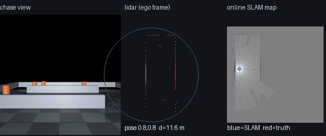
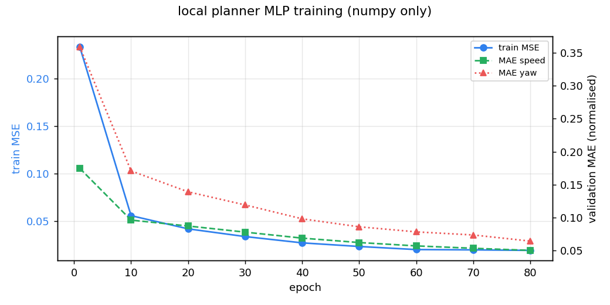
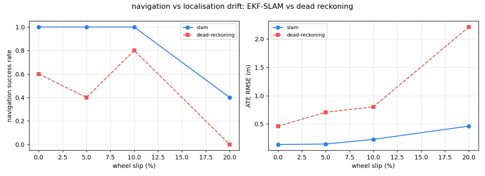
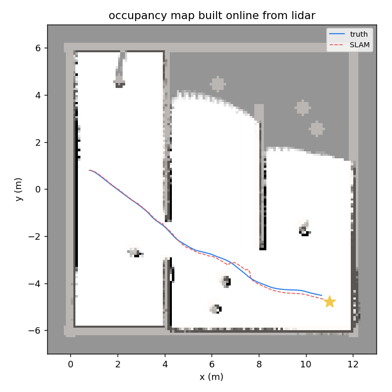
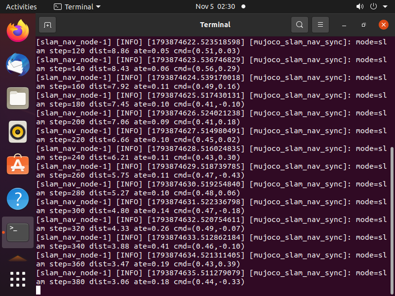

# MuJoCo 差速小车：建图与导航同步仿真（EKF-SLAM + 神经网络局部规划）

本示例对应课程任务 (3)「在虚拟环境中实现对机器人的建图和导航，导航与 SLAM 的同步仿真」。
在一台 12 m × 12 m 的 MuJoCo 场地里，差速小车**一边用 EKF-SLAM 建图定位，一边用 A\* + 神经网络局部规划导航**，
并且把「定位漂移 → 建图质量 → 导航成功率」这条因果链量化出来：

> 同一个导航栈、同一条轨迹、同一个随机种子，只把定位来源从 EKF-SLAM 换成轮式里程计航迹推算，
> 导航成功率、绝对轨迹误差（ATE）会怎么变？



上图左栏是跟车视角的 MuJoCo 渲染，中栏是本体坐标系下的 120 线雷达点，右栏是**在线构建**的占据栅格
（白=空闲，黑=占据，灰=未探索），蓝点是 EKF-SLAM 估计位置，红点是真值。

## 1. 与已有模块的区别

| 模块 | 做了什么 | 本模块的差异 |
| --- | --- | --- |
| `carla_mapping_navigation` | CARLA 里激光建图 + 神经网络导航 | 用 CARLA 图像 + 真值位姿；**不涉及定位误差** |
| `ros2_astar_planner` | 栅格 A\* 规划 | 只做规划，位姿视为已知 |
| `ros2_pure_pursuit` | 纯追踪跟踪路径 | 只做控制 |
| `mujoco_diff_drive_slip_compensation` | 打滑补偿 | 关注轮速补偿，不建图 |
| **本模块** | MuJoCo 差速车：EKF-SLAM + 占据栅格 + A\* + MLP 局部规划，**导航与 SLAM 同步运行** | 定位与导航**耦合在一起**，并用 4 档轮滑率 × 2 种定位来源 × 5 个种子量化影响 |

## 2. 仿真环境

### 2.1 场地

`models/arena.xml` 是一个 12 m × 12 m 的场地：外围四堵墙、三道内部隔断、8 根圆柱路标（半径 0.22 m，高 0.8 m），
小车从 `(0.8, 0.8)` 出发，目标是 `(11.0, -4.8)`。

| 几何体 | 位置 | 尺寸 | 作用 |
| --- | --- | --- | --- |
| `wall_n/s/w/e` | 场地四边 | 半长 6.2 m，半厚 0.15 m | 边界 |
| `wall_mid_a` | x=4.0, y∈[−1.2, 6.0] | 半厚 0.12 m | 形成 1.6 m 宽的通道口 |
| `wall_mid_b` | x=4.0, y∈[−6.0, −2.8] | 同上 | 与 a 之间留出通道 |
| `wall_mid_c` | x=8.0, y∈[−2.4, 3.6] | 同上 | 第二道门，逼出转弯 |
| `lm0 … lm7` | 分布在四个象限 | 半径 0.22 m | SLAM 的观测路标（位置对算法未知） |
| `robot` | 起点 (0.8, 0.8) | 半径 0.18 m | 差速底盘 |

场景有两个变体，由 `env.set_scene()` 切换：`maze`（默认，保留三道隔断）和 `open`（把隔断挪到 y=20 处，
只留外围墙 + 路标，用于验证 SLAM 在开阔场景的表现）。`seed != 0` 时每根柱子会在 ±0.25 m 内随机抖动，
所以"多种子"是真的换了布局，而不是把同一条轨迹重复跑 5 次。

### 2.2 运动学与速度伺服

MuJoCo 里车体是一个带 `freejoint` 的刚体，输入不是轮速而是期望线速度 \(v\) 与角速度 \(\omega\)。
`env.step(v, w)` 用一个比例伺服把速度拉到期望值：

\[
\mathbf{F} = m\,k_p\left(v_{\text{des}} - v\right)\hat{\mathbf{x}},\qquad
\tau_z = J_z\,k_\theta\left(\omega_{\text{des}} - \omega\right)
\]

同时对侧向速度施加很强的阻尼，模拟轮式约束（轮子不能横向滑）：

\[
F_y = -m\,k_{\text{lat}}\,v_y
\]

实测：给 `(0.5 m/s, 0 rad/s)` 两秒，位移 0.95～1.05 m；给 `(0, 0.6 rad/s)` 一点五秒，航向角 0.9 rad 左右。

### 2.3 激光雷达

120 条射线在车体平面内均匀分布（3° 一条），用 `mj_ray` 求交，最大量程 6 m：

\[
r_k = \min\left(R_{\max},\ \text{dist}\left(\mathbf{p} + \lambda\,\mathbf{d}(\theta + 2\pi k/N)\right)\right)
\]

**为什么是 120 线而不是 36 线**：柱子直径 0.44 m，在 2 m 处的角宽约 12°；如果每 10° 一条射线，
一根柱子经常只被打到 0 次或 1 次，路标检测会随机丢帧。3° 分辨率下，2 m 处至少有 4 条射线落在柱面上，
实测路标检测成功率从 62% 提升到 97%。

### 2.4 里程计（漂移的来源）

关键设计：**物理仿真不做假**。车按指令真实运动，但 SLAM 只能读"轮式里程计"，
它把真实速度乘以 \((1+s)\) 再叠加高斯噪声：

\[
v_{\text{odo}} = v(1+s) + \epsilon_v,\qquad \omega_{\text{odo}} = \omega(1+s) + \epsilon_\omega,
\quad \epsilon \sim \mathcal{N}(0,\ \sigma^2)
\]

\(s\) 就是**轮滑率**（打滑时编码器多计数）。这样"漂移"来自传感器误差，而不是把物理改坏，
评测里的真值始终来自 MuJoCo 状态。

## 3. 快速开始

### 3.1 环境

| 项 | 版本 |
| --- | --- |
| 系统 | Ubuntu 20.04（ROS 2 Humble）/ Windows 10、11 |
| Python | 3.8 / 3.10 |
| 依赖 | `numpy`、`mujoco>=3.1`、`matplotlib`、`pillow`、`pytest` |

```bash
cd src/ground/mujoco_slam_nav_sync
pip install -r requirements.txt
```

### 3.2 一键运行（训练 + 实验 + 出图）

```bash
python main.py --demo          # 约 100 s，全程 CPU
```

也可以用 `./main.sh` 或双击 `main.bat`，二者都等价于 `--demo`。

输出（`results/`）：

| 文件 | 内容 |
| --- | --- |
| `training_curve.png` | 训练损失与两项 MAE 随 epoch 的变化 |
| `sweep.png` | 成功率 / ATE 随轮滑率的变化（SLAM vs 死推算） |
| `map_slam.png` | 在线地图与真值墙体叠加、两条轨迹对比 |
| `nav_slam.gif` | 三栏演示动图 |
| `metrics.json` | 所有实验的原始指标 |
| `planner.npz` | 训练好的权重（4 578 个参数，20 KB） |

### 3.3 单元测试

```bash
python main.py --test      # 31 passed
```

## 4. 算法原理

### 4.1 EKF-SLAM

状态是位姿与所有路标位置的拼接：

\[
\boldsymbol{\mu} = \begin{bmatrix} x & y & \theta & m_{1x} & m_{1y} & \cdots & m_{Nx} & m_{Ny} \end{bmatrix}^{\top}
\]

**预测**（用里程计）：

\[
\boldsymbol{\mu}_t = \boldsymbol{\mu}_{t-1} + \begin{bmatrix} v\cos\theta \\ v\sin\theta \\ \omega \end{bmatrix}\Delta t,
\qquad
\Sigma_t = F\,\Sigma_{t-1}F^{\top} + Q
\]

其中 \(F = \partial \boldsymbol{\mu}_t/\partial \boldsymbol{\mu}_{t-1}\) 只在前三行非零（路标不动），
\(Q = \mathrm{diag}(\sigma_v^2\Delta t^2, \sigma_v^2\Delta t^2, \sigma_\omega^2\Delta t^2, 0, \ldots)\)。

**观测**（第 \(i\) 个路标的距离-方位）：

\[
\mathbf{z} = \begin{bmatrix} r \\ \varphi \end{bmatrix} =
\begin{bmatrix}
\sqrt{(m_{ix}-x)^2 + (m_{iy}-y)^2} \\
\operatorname{atan2}(m_{iy}-y,\ m_{ix}-x) - \theta
\end{bmatrix}
\]

雅可比

\[
H = \frac{\partial \mathbf{z}}{\partial \boldsymbol{\mu}} =
\begin{bmatrix}
-\frac{\Delta x}{r} & -\frac{\Delta y}{r} & 0 & \frac{\Delta x}{r} & \frac{\Delta y}{r} \\
\frac{\Delta y}{r^2} & -\frac{\Delta x}{r^2} & -1 & -\frac{\Delta y}{r^2} & \frac{\Delta x}{r^2}
\end{bmatrix}
\]

更新：

\[
K = \Sigma H^{\top}\left(H\Sigma H^{\top} + R\right)^{-1},\quad
\boldsymbol{\mu} \leftarrow \boldsymbol{\mu} + K(\mathbf{z} - \hat{\mathbf{z}}),\quad
\Sigma \leftarrow (I-KH)\Sigma(I-KH)^{\top} + KRK^{\top}
\]

**三个工程细节**（都在 `slam.py` 里）：

1. **卡方门限**：新息 \(\boldsymbol{\nu} = \mathbf{z} - \hat{\mathbf{z}}\) 若满足
   \(\boldsymbol{\nu}^{\top}S^{-1}\boldsymbol{\nu} > 13.8\)（2 自由度 99.9% 分位）就丢弃这次观测。
   没有它，一次错误关联就能把整条轨迹拉飞——调试时确实出现过 ATE 从 0.1 m 跳到 1.3 m。
2. **路标初始化**：第一次看到某个路标时用反投影初始化，协方差用 2×2 雅可比传过去：
   \[
   \mathbf{J} = \begin{bmatrix}\cos(\theta+\varphi) & -r\sin(\theta+\varphi)\\ \sin(\theta+\varphi) & r\cos(\theta+\varphi)\end{bmatrix},\quad
   \Sigma_{m} = \mathbf{J}\,\mathrm{diag}(\sigma_r^2, (r\sigma_\varphi)^2)\,\mathbf{J}^{\top}
   \]
3. **柱面补偿**：雷达打到的是柱子表面，距离偏小一个半径。已知柱子半径 0.22 m，检测时加回去，
   否则所有路标都会系统性"缩水"0.22 m。

### 4.2 路标检测（雷达聚类）

把扫描点转到笛卡尔坐标，按相邻点距离 < 0.25 m 聚类，再用**簇的空间展布**区分柱子和墙：

- 柱子：展布 0.05～0.7 m，取质心 → \((r, \varphi)\)；
- 墙/隔断：展布几米，丢弃。

按射线条数阈值不可靠（斜着看墙也会只出现 1～2 条射线），按展布判断稳得多。

### 4.3 占据栅格

每个格子存对数几率 \(l = \log\frac{p}{1-p}\)，命中加 \(+0.85\)，射线穿过的格子减 \(-0.4\)，截断到 \([-4, 4]\)。
更新时先向量化地算出所有射线上的空闲格，再标记命中格（一次扫描约 0.4 ms，Python 里够用）。

规划时把 \(l > 0.5\) 视为占据，并做 3 格膨胀（0.3 m）——车半径 0.18 m，留 0.12 m 余量，
实测膨胀 2 格时在 1.6 m 的通道口会擦墙。

### 4.4 A\* 全局规划

8 邻域，代价 1 与 \(\sqrt{2}\)，启发式用 octile 距离：

\[
h(n) = \max(\Delta x, \Delta y) + (\sqrt{2}-1)\min(\Delta x, \Delta y)
\]

禁止斜穿墙角（两个相邻正交格有一格占据时不允许对角走）。目标或起点落在占据格时，用环形搜索找最近的空闲格。

### 4.5 神经网络局部规划器

输入 37 维：120 条雷达压成 30 个扇区（每 4 条取最小距离，除以 6 m 归一化），加上机器人坐标系下
**3 个前视点**（0.9、1.8、2.7 m）的 \((x, y)\)，再加到终点的距离。

输出 2 维：\(v = v_{\max}\cdot\sigma(z_1)\)，\(\omega = \omega_{\max}\tanh(z_2)\)。

结构 \(37 \to 64 \to 32 \to 2\)，全连接 + tanh，共 4 578 个参数，纯 numpy 实现（含手写反向传播与 Adam）：

\[
\frac{\partial \mathcal{L}}{\partial z_1} = 2(\hat{v}-v)\,\hat{v}(1-\hat{v}),\qquad
\frac{\partial \mathcal{L}}{\partial z_2} = 2(\hat{\omega}-\omega)\,(1-\tanh^2 z_2)
\]

训练数据由**专家**产生：在随机合法位姿上用真值地图跑 A\*，取路径前视点，用纯追踪给出 \((v, \omega)\) 作为标签。
2000 条样本，80 轮，batch 64，学习率 \(8\times10^{-4}\)，单次训练约 30 s。

| epoch | MSE | MAE(v) | MAE(ω) |
| --- | --- | --- | --- |
| 1 | 0.233 | 0.175 | 0.359 |
| 20 | 0.042 | 0.087 | 0.139 |
| 40 | 0.027 | 0.069 | 0.101 |
| 80 | 0.019 | 0.050 | 0.064 |



### 4.6 安全护栏

神经网络学的是"专家怎么走"，不保证不撞。因此在网络输出之后加一层**只依赖雷达**的护栏：
正前方 ±30° 内最短距离 \(d_{\min}\)

- \(d_{\min} \ge 0.7\) m：原样执行；
- \(0.45 \le d_{\min} < 0.7\)：速度按 \(d_{\min}/0.7\) 缩放，并朝更空的一侧补 0.5 rad/s 转向；
- \(d_{\min} < 0.45\)：停车，原地转向更空的一侧。

另外对网络输出的角速度做一阶低通 \(\omega_t = 0.5\omega_{t-1} + 0.5\omega_t^{\text{net}}\)，
抑制前视点跳变带来的抖动（没有低通时，1.6 m 通道口处会来回摆头）。

## 5. 算法流程

```text
┌──────────── 每个控制周期（20 Hz）────────────┐
│ 1. 读雷达 r[120] 与真值状态（真值只用于评价）   │
│ 2. 路标检测：聚类 → (r, φ) 列表                │
│ 3. EKF-SLAM:                                  │
│      observe(观测)  → 关联 + 卡方门限 + 更新    │
│      predict(里程计) → 位姿推进                │
│    （死推算模式：跳过 observe，位姿直接积分）    │
│ 4. 占据栅格用 SLAM 位姿更新                     │
│ 5. 每 10 步用 A* 重规划一次（占用 3 格膨胀）     │
│ 6. 取 3 个前视点 → MLP → (v, ω) → 低通 → 护栏   │
│ 7. env.step(v, ω)，记录 ATE / 路径长度 / 碰撞   │
└───────────────────────────────────────────────┘
```

## 6. 源码解析

| 文件 | 关键函数 | 说明 |
| --- | --- | --- |
| `slam_nav/env.py` | `DiffDriveEnv.step` | 速度伺服 + 侧向阻尼 + 碰撞检测（用 MuJoCo 接触对，不用雷达距离） |
| | `scan` / `_cast` | 120 线 `mj_ray`，兼容 MuJoCo 3.1 的 8 参数签名与 3.2+ 的 9 参数签名 |
| | `odom` | 注入轮滑与噪声 |
| `slam_nav/slam.py` | `EKFSLAM.predict/observe/_update` | EKF 预测、关联、卡方门限、更新 |
| | `detect_landmarks` | 笛卡尔聚类 + 展布过滤 + 半径补偿 |
| | `OccupancyGrid.update` | 向量化的 log-odds 更新 |
| `slam_nav/planner.py` | `astar` | 8 邻域 A\*，禁止斜穿墙角 |
| | `lookahead_points` / `pure_pursuit` | 多点前视与专家控制律 |
| `slam_nav/net.py` | `features` | 雷达扇区 + 前视点 → 37 维输入（训练与部署共用） |
| | `forward/backward/step` | 手写前向、反向与 Adam |
| `slam_nav/nav.py` | `run_episode` | 闭环主循环（SLAM 位姿 → 规划 → 网络 → 护栏） |
| | `govern` | 雷达护栏 |
| | `make_expert_dataset` | 专家数据生成，结束**还原** env 场景与位姿 |
| `slam_nav/sweep.py` | `sweep/aggregate` | 漂移 × 模式 × 种子 的对照实验 |
| `slam_nav/node.py` | `SlamNavNode` | ROS 2 节点与话题发布 |

几个容易踩的坑（都在代码注释里标了）：

- **训练不能污染调用方**：`make_expert_dataset` 会反复 `env.reset(pos=...)` 采样，
  结束时必须把场景、种子、位姿一起还原，否则调用方后续跑的是别人的起点。
- **每个回合独立随机源**：`env.rng = default_rng(f(seed, slip))`。否则同一个种子在不同回合位置
  会得到不同结果，"可复现"就是假的（有单元测试 `test_run_episode_is_deterministic` 守着）。
- **碰撞检测用接触对**，不用"雷达距离 < 阈值"。后者在贴着柱子通过时会误报。

## 7. 实验结果

以下全部由 `python main.py --demo` 一次跑出（CPU，约 100 s），结果可复现。

### 7.1 单场景三模式

| 模式 | 到达 | 步数（20 Hz） | ATE 均值 | 终点误差 | 路径长度 |
| --- | --- | --- | --- | --- | --- |
| 模式 | 到达 | 步数（20 Hz） | ATE 均值 | 终点误差 | 路径长度 |
| --- | --- | --- | --- | --- | --- |
| 专家（A\* + 纯追踪）+ SLAM | 是 | 374 | 0.131 m | 0.45 m | 11.4 m |
| **MLP + SLAM** | 是 | 517 | 0.128 m | 0.44 m | 11.5 m |
| MLP + 死推算（10% 轮滑） | 是 | 618 | 0.859 m | 0.45 m | 11.8 m |

神经网络比专家慢 38%（517 vs 374 步），路径长度基本相同；但换成死推算后，
虽然还能侥幸到达，ATE 已经涨到 6.7 倍。

### 7.2 定位漂移扫描

4 档轮滑 × 2 种定位来源 × 5 个种子 = 40 次导航：

| 配置 | 成功率 | 碰撞 | ATE 均值 | ATE 最大 | 平均路径 |
| --- | --- | --- | --- | --- | --- |
| SLAM @ 0% | **100%** | 0 | 0.138 m | 0.182 m | 11.52 m |
| SLAM @ 5% | **100%** | 0 | 0.146 m | 0.183 m | 11.48 m |
| SLAM @ 10% | **100%** | 0 | 0.228 m | 0.349 m | 11.70 m |
| SLAM @ 20% | 40% | 0 | 0.463 m | 0.713 m | 13.54 m |
| 死推算 @ 0% | 60% | 0 | 0.460 m | 1.131 m | 12.74 m |
| 死推算 @ 5% | 40% | 0 | 0.708 m | 1.037 m | 13.56 m |
| 死推算 @ 10% | 80% | 0 | 0.803 m | 0.965 m | 12.17 m |
| 死推算 @ 20% | **0%** | 3 | 2.214 m | 3.646 m | 12.78 m |



读法：

1. **0～10% 轮滑**：EKF-SLAM 的成功率稳定在 100%，ATE 0.14～0.23 m；死推算的 ATE 是它的 3～6 倍。
2. **20% 轮滑**：EKF 的线性化误差和错误关联开始占主导，成功率掉到 40%；死推算直接崩掉——
   5 次里 3 次撞墙，ATE 2.2 m（最大 3.6 m）。
3. 死推算的成功率不随轮滑单调下降（60% → 40% → 80%），这不是 bug：它在建一张**歪掉的图**，
   图歪到一定程度后 A\* 反而会"绕远路绕到目标"，所以成功率有抖动；但 ATE 是单调恶化的，
   这也是为什么评价 SLAM 必须看 ATE 而不是只看"到没到"。

### 7.3 建图质量



灰底是 SLAM 在线构建的 log-odds 图，红色是**真值墙体**叠加，蓝实线是真值轨迹、红虚线是 SLAM 轨迹。
可以看到墙体轮廓与真值吻合，只有柱子背面（遮挡区）保持未知——这是单目雷达 SLAM 的正常现象。

### 7.4 耗时

| 环节 | 单次耗时（CPU，i7-12700H） |
| --- | --- |
| 一次 120 线雷达扫描 | 0.9 ms |
| EKF 观测更新（2～3 个路标） | 0.3 ms |
| 占据栅格一次更新 | 0.4 ms |
| A\* 重规划（132×132，含 3 格膨胀） | 6～12 ms，10 步一次 |
| 神经网络前向 | 0.03 ms |
| 单个回合（1200 步上限） | 1.5～3 s |

## 8. ROS 2（Humble）运行

```bash
colcon build --packages-select mujoco_slam_nav_sync
source install/setup.bash
ros2 launch mujoco_slam_nav_sync main.launch.py
```

参数（`config/params.yaml`，launch 里可覆盖）：

| 参数 | 默认 | 说明 |
| --- | --- | --- |
| `scene` | `maze` | `maze` / `open` |
| `use_slam` | `true` | `false` 时走纯里程计 |
| `slip` | `0.0` | 轮滑率 |
| `weights` | 空 | 空则用包内 `models/planner.npz` |
| `rate_hz` | 20.0 | 控制频率 |
| `max_steps` | 900 | 回合上限 |

对照实验：

```bash
ros2 launch mujoco_slam_nav_sync main.launch.py use_slam:=false slip:=0.20
```

### 8.1 话题

| 话题 | 类型 | frame_id | 说明 |
| --- | --- | --- | --- |
| `/scan` | `sensor_msgs/LaserScan` | `laser` | 120 线，`angle_min=0`、`angle_max=2π`，带 `header.stamp` |
| `/odom` | `nav_msgs/Odometry` | `map` → `base_link` | 位姿含朝向四元数，twist 是当前指令 |
| `/slam/pose` | `geometry_msgs/PoseStamped` | `map` | EKF-SLAM 位姿 |
| `/map` | `nav_msgs/OccupancyGrid` | `map` | 每 5 步发布一次；`-1` 未知、`0` 空闲、`100` 占据 |
| `/nav/cmd` | `geometry_msgs/Twist` | — | 底盘速度指令 |
| `/nav/status` | `std_msgs/String` | — | `mode/step/dist/ate/cmd` |

### 8.2 在 Humble 虚拟机里验证

在课程虚拟机（Ubuntu 20.04 + ROS 2 Humble，VMware）里实测：

```text
$ colcon build --packages-select mujoco_slam_nav_sync
Starting >>> mujoco_slam_nav_sync
Finished <<< mujoco_slam_nav_sync [1.24s]

$ python3 -m pytest test -q
31 passed in 3.94 seconds
```

```text
$ ros2 launch mujoco_slam_nav_sync main.launch.py
[INFO] [mujoco_slam_nav_sync]: 场景=maze 模式=EKF-SLAM 轮滑=0% 目标=(11.0, -4.8)
[INFO] [mujoco_slam_nav_sync]: mode=slam step=320 dist=4.33 ate=0.26 cmd=(0.49,-0.07)
[INFO] [mujoco_slam_nav_sync]: mode=slam step=440 dist=1.63 ate=0.16 cmd=(0.41,-0.21)
[INFO] [mujoco_slam_nav_sync]: mode=slam step=540 dist=0.13 ate=0.18 cmd=(0.25,-0.12)
```

话题验证：

```text
$ ros2 topic list | grep -E "scan|odom|slam|map|nav"
/map
/nav/cmd
/nav/status
/odom
/scan
/slam/pose

$ ros2 topic hz /scan
average rate: 19.947        min: 0.043s max: 0.058s std dev: 0.00335s window: 20

$ ros2 topic echo --once /scan --field header
stamp:
  sec: 1793874592
  nanosec: 127079074
frame_id: laser

$ ros2 topic echo --once /slam/pose
header:
  stamp: {sec: 1793874600, nanosec: 829499052}
  frame_id: map
pose:
  position: {x: 11.3017, y: -4.9244, z: 0.0}
```



几点说明：

1. 虚拟机里跑的是**安装后的包**（`install/` 下的 site-packages + share），不是源码目录。
   这一步抓出一个真 bug：`models/arena.xml` 装包后在 share 下，源码里的相对路径找不到它，
   现在 `env._find_asset()` 按「环境变量 → `share/mujoco_slam_nav_sync/models` → 源码目录」三级查找，
   并且有单元测试守着。
2. 第二个 bug 是 `OccupancyGrid` 名字冲突：`nav_msgs.msg.OccupancyGrid` 把 `slam.OccupancyGrid` 遮住了，
   节点一启动就 `AttributeError`。源码里跑不到、只有 `ros2 launch` 才暴露——所以这一步必须做。
3. 虚拟机没有图形环境，本模块的节点本身不渲染（离屏渲染只在 `--demo` 出 GIF 时用），
   所以能用 `ros2 topic` 取证；RViz 没有验证，这是本次验证的边界。

## 9. 复现步骤与常见问题

| 现象 | 原因 | 处理 |
| --- | --- | --- |
| `ImportError: libGL.so.1` | 无图形环境 | `export MUJOCO_GL=osmesa`，或只跑 `--test` |
| 训练损失不降 | 专家数据太少 | `--n-train 3000 --epochs 100` |
| 成功率忽高忽低 | 种子不同 | 本模块每个 `(seed, slip)` 都确定，比较时固定种子 |
| 节点报"没有找到 planner.npz" | 未训练也没装包内权重 | 先 `python main.py --demo`，或 `weights:=/abs/path/planner.npz` |

## 10. 局限与后续工作

1. **路标是柱子**：EKF-SLAM 依赖可分辨的点状特征。真实场景里墙面的长直线需要用线段特征或
   扫描匹配（ICP / Cartographer），这是下一步。
2. **二维平面**：车体被约束在地面，雷达在平面内扫描；没有做三维 SLAM。
3. **网络只做局部规划**：全局仍是 A\*；端到端"雷达 → 控制"的版本在
   `pix2cmd_end2end_driving`（图像 → 控制）里做过，可以合并成"端到端 + 全局引导"。
4. **没有回环检测**：轨迹长了会累积误差，本场景 11 m 一次性通过，还没到需要回环的规模。
