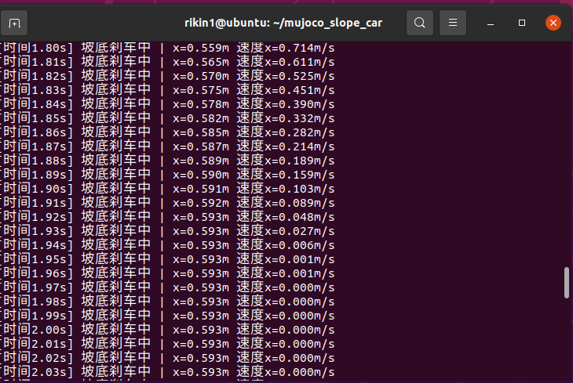
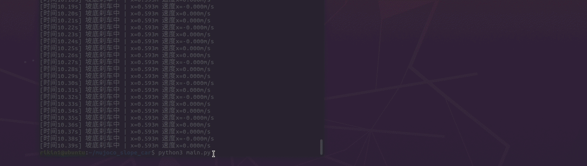

# mujoco_slope_car

MuJoCo小车滑斜坡仿真项目，小车从斜坡顶端自由滑下，到达坡底后自动刹车停住。

## 运行环境
- Ubuntu 20.04
- MuJoCo 2.3.7
- Python 3.8

## 运行步骤
```bash
pip install mujoco==2.3.7
python3 main.py
```

## 实现思路
1. 场景搭建：地面平面 + 20度倾斜斜坡 + 带free关节的小车模型
2. 初始状态：小车放在斜坡顶端，给0.5m/s初始速度沿斜坡向下
3. 控制逻辑：小车位置小于0.5m时自由下滑，大于0.5m时速度衰减实现刹车，直到小车停住
4. 物理仿真：使用MuJoCo内置物理引擎计算小车下滑、碰撞、刹车全过程

## 运行效果



