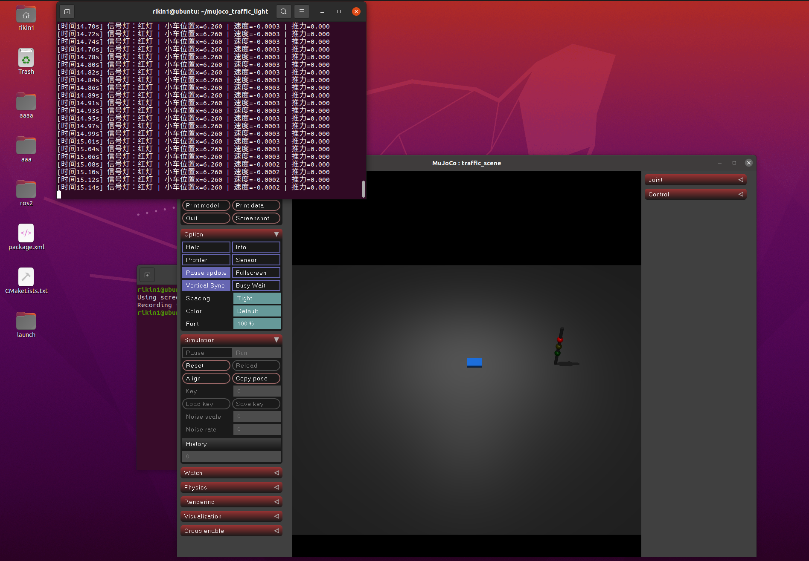
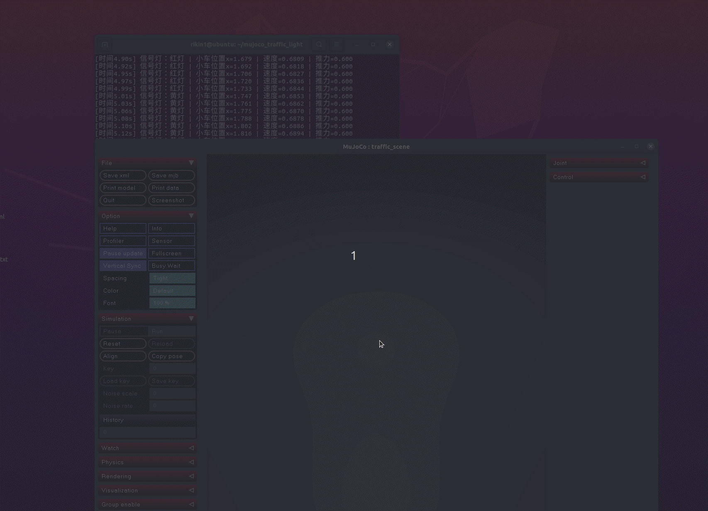

# MuJoCo 红绿灯启停小车

MuJoCo 写的红绿灯小车，红灯停绿灯行，黄灯慢下来。

## 依赖

```bash
pip install mujoco numpy
```

## 运行

```bash
cd src/ground/mujoco_traffic_light_stop
python3 mujoco_traffic_light_stop/main.py
```

## 功能

- 红绿灯循环：红灯5s → 黄灯2s → 绿灯5s
- 小车从左往右开
- 到停止线前1米就开始减速
- 红灯停，黄灯慢，绿灯走

## 效果




