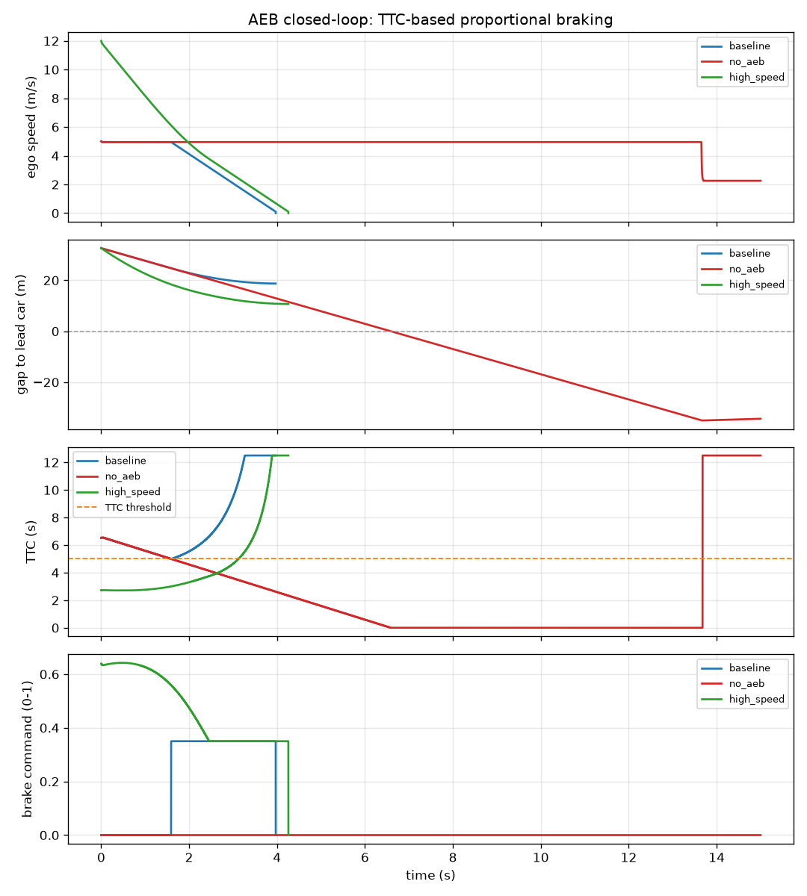
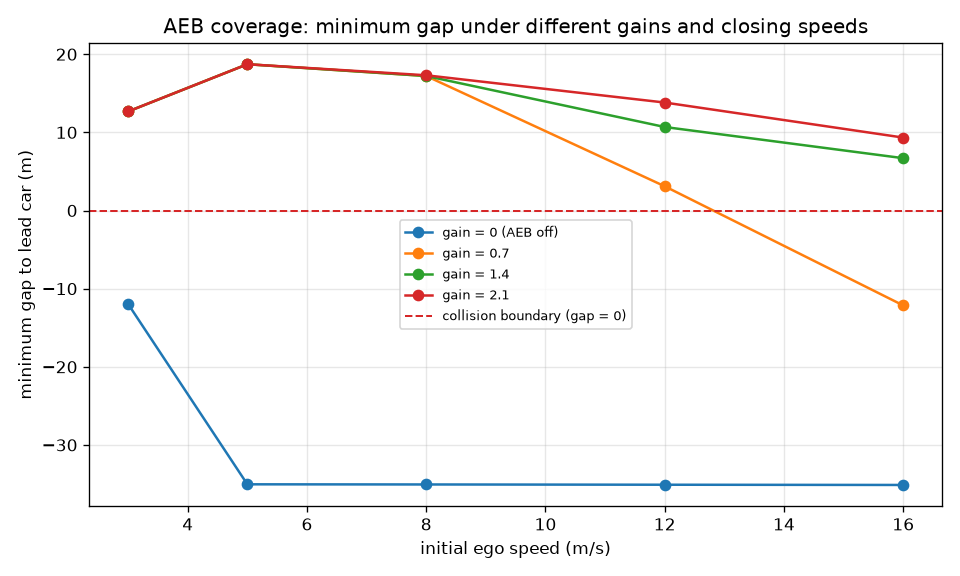
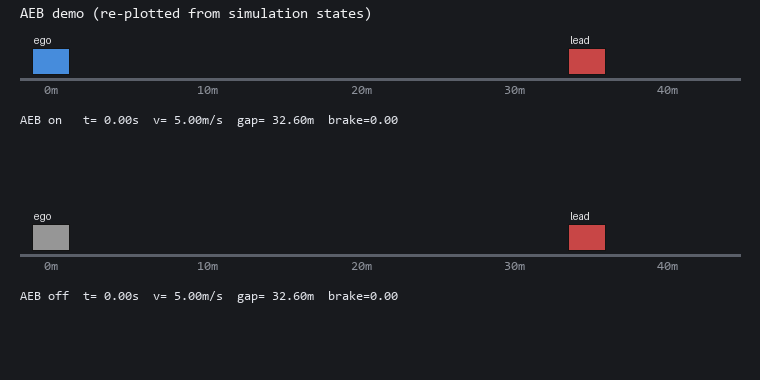

# 基于 MuJoCo 的自动紧急制动（AEB）TTC 仿真

两车纵向场景下的 **TTC（Time-To-Collision）型自动紧急制动**：实时由间距与相对速度
算碰撞时间，低于阈值时输出比例制动力，把自车在撞上前车之前停住。本文重点不是
"看它刹住了"，而是给出**可复算的安全指标**：最小净间距、是否碰撞、碰撞瞬间速度、
制动距离、最小 TTC，以及"初速度 × 增益"的覆盖范围。

源码位于 [`src/ground/mujoco_vehicle_aeb`](https://github.com/OpenHUTB/ros2/tree/master/src/ground/mujoco_vehicle_aeb)，
完整说明（参数、调参记录、常见问题）见该目录的
[`README.md`](https://github.com/OpenHUTB/ros2/blob/master/src/ground/mujoco_vehicle_aeb/README.md)。

## 1. 原理

### 1.1 TTC 碰撞时间

$$
\text{TTC} = \frac{d}{v_{\text{ego}} - v_{\text{lead}}}
$$

其中 \(d\) 为两车间距、\(v_{\text{ego}}\) 为自车纵向速度、\(v_{\text{lead}}\) 为前车速度。
相对速度 \(\le 0\)（不再接近）时不存在碰撞风险，TTC 取一个**明显不可达**的值
（代码里是 99 s），而不是 0 或负数——否则下游很容易把"安全"当成"马上要撞"。

### 1.2 比例制动 + 制动保持

$$
\text{brake} = \mathrm{clip}\Big(g \cdot \big(1 - \frac{\text{TTC}}{\text{TTC}_{\text{th}}}\big),\, 0,\, 1\Big),
\qquad \text{TTC} < \text{TTC}_{\text{th}} \text{ 时介入}
$$

制动力再乘以力上限（默认 6000 N ≈ 0.6 g）施加到车身。

**为什么还需要"制动保持"**：只按上面的比例律算，制动会抬高 TTC，TTC 抬高又把制动力
压回去，形成负反馈——实测 5 m/s、32.6 m 间距工况下制动力长期只有 0.15，车以约
0.9 m/s² 缓慢逼近，12 s 仍未停住，本质上退化成"贴脸才刹"。AEB 的工程做法是
**触发后保持一个制动下限**（默认 0.35），直到自车停住、或前车加速拉开距离
（相对速度 ≤ 0 且 TTC 恢复到 1.5 倍阈值）才解除。可用 `--no-latch` 复现纯比例律做对照。

### 1.3 模型与两个必须注意的细节

模型里自车是 `freejoint`（可平移可转）、前车是沿 x 的滑移关节，通过 `qfrc_applied`
施加纵向力。两个细节是实测踩出来的：

- **制动方向必须逆着运动方向**。模型没有滚动阻力，若恒定沿 −x 施力，车停下后会
  继续反向加速（实测 12 s 时 v = −19.5 m/s，等于倒着开）。`apply_brake` 按速度符号取方向；
  低速段用"驻车保持"把速度清零（近似真实车辆的停车保持），否则自车会以零点几 m/s 一直滑。
- **必须按关节名取下标**。原实现用 `qpos[11]` / `qvel[10]` 读前车，而该模型只有
  11 个 qpos、10 个 qvel（前车当时没有关节），一进循环就 `IndexError`，脚本根本跑不起来。

## 2. 运行环境

| 组件 | 实测版本 / 说明 |
|---|---|
| 操作系统 | Windows 11 原生（Linux/macOS 同样可用） |
| Python | 3.12.14 |
| MuJoCo | **3.2.7**（3.17.0 的 DLL 在本机被 Windows Smart App Control 拦截，见 §6 FAQ） |
| numpy | 2.3.5 |
| matplotlib | 3.11.2（可选，仅出图用；缺失时只写 CSV，退出码仍为 0） |
| ROS / 图形界面 | **都不需要**（默认离线批跑；`--gui` 才开窗口） |

```bash
cd src/ground/mujoco_vehicle_aeb
pip install -r requirements.txt      # mujoco + numpy
pip install matplotlib               # 可选
```

## 3. 编译与运行

```bash
# 方式 1：直接跑（推荐，无需 ROS）
python3 main.py                       # 三场景 + 工况扫描，产物写到 ./shots
bash scripts/main.sh                  # Linux/macOS 包装脚本
main.bat                              # Windows 包装脚本

# 方式 2：rosrun / roslaunch（需要 catkin 工作空间）
catkin_make && source devel/setup.bash
rosrun   mujoco_vehicle_aeb main.py
roslaunch mujoco_vehicle_aeb main.launch gui:=false v_ego:=8

# 方式 3：可视化窗口（需要图形界面）
python3 main.py --gui

# 方式 4：单元测试
python3 main.py --selftest            # 28 项
```

常用参数：`--ttc`（阈值 s）、`--gain`、`--v-ego`、`--v-lead`、`--lead-x`、`--sim-time`、
`--max-force`、`--no-latch`、`--no-sweep`、`--save-dir`。

## 4. 运行效果



四张子图自上而下：自车速度、与前车的净间距、TTC（虚线为阈值）、制动量。
蓝线（基线）在 TTC 降到 5 s 时开始制动，制动力保持 0.35，约 4.2 s 停住，
停住时距前车还有 18.7 m；红线（关闭 AEB）保持 5 m/s 一路撞过去。



最小净间距随初速度变化，按增益分组。红色虚线是碰撞边界：曲线落在它下面就是撞了。
增益 0（相当于关闭 AEB）在 5 m/s 以上全部失守；增益 1.4 / 2.1 能覆盖到 16 m/s。

## 5. 实验结果（本机实测，可由 CSV 逐点复算）

工况：自车 5 m/s、前车静止在 35 m 处、TTC 阈值 5 s、增益 1.4、制动力上限 6000 N。

| 场景 | 最小净间距 | 是否碰撞 | 碰撞速度 | 最小 TTC | 制动介入 | 制动距离 |
|---|---|---|---|---|---|---|
| `baseline`（AEB 开） | **18.72 m** | 否 | — | 4.99 s | 1.59 s | **13.88 m** |
| `no_aeb`（增益 0，对照组） | −35.04 m | **是** | **4.95 m/s** | −86.29 s | — | — |
| `high_speed`（12 m/s） | 10.69 m | 否 | — | 2.71 s | 0.00 s | 21.91 m |

"初速度 × 增益"覆盖扫描（数字为最小净间距 m，`撞` = 发生碰撞）：

| v (m/s) \ gain | 0（关闭） | 0.7 | 1.4 | 2.1 |
|---|---|---|---|---|
| 3 | −11.96 撞 | 12.67 | 12.67 | 12.67 |
| 5 | −35.04 撞 | 18.72 | 18.72 | 18.72 |
| 8 | −35.06 撞 | 17.21 | 17.21 | 17.30 |
| 12 | −35.09 撞 | 3.10 | 10.69 | 13.82 |
| 16 | −35.12 撞 | **−12.15 撞** | 6.70 | 9.33 |

读法：增益 0 时每一档都撞，这正是 AEB 的价值；增益 0.7 在 16 m/s 已经失守；
1.4 与 2.1 能覆盖到 16 m/s，且间距随增益增大。

> 口径说明：`no_aeb` 的"最小间距 −35 m"表示自车**穿过**了静止前车（模型只做纵向、
> 碰撞没有响应），用于对照"没刹车会怎样"；碰撞速度取首次接触瞬间的自车速度。
> 全部指标由 `shots/aeb_metrics.csv` 与 `*_series.csv` 复算，仿真为定步长 0.001 s。



> 上图**不是 GUI 录屏**，而是用同一次仿真的状态序列（`*_series.csv`）逐帧重绘的示意图：
> 上排 AEB 开启、下排关闭 AEB，右侧实时显示 `t / v / gap / brake`。
> 之所以这样做：本机验证环境没有图形界面，用真实数据重绘比"贴一张来源不明的录屏"更可复算。

## 6. 常见问题

**Q1：`import mujoco` 报 `OSError: [WinError 4551] 应用程序控制策略阻止了此文件`？**
Windows Smart App Control 拦截了该版本 DLL。换 `pip install "mujoco==3.2.7"` 即可
（本机实测通过）；或自行关闭智能应用控制（该开关不可逆，请评估后再动）。

**Q2：`--gui` 打不开窗口？**
GUI 需要图形界面与 GLFW；无显示环境直接用默认的离线批跑，指标与 CSV 完全一样。

**Q3：为什么"无 AEB"场景 TTC 会出现负数、间距 −35 m？**
碰撞后两车重叠、相对速度仍为正，按定义算出的 TTC 就是负的；间距 −35 表示自车
已经穿过前车。这些值只用于对照"没刹车"的后果。

**Q4：为什么刹车后车不会倒着走？**
真实制动器的力始终与运动方向相反。早期实现恒定沿 −x 施力，而模型没有滚动阻力，
车停下后会继续反向加速，所以现在按速度符号取方向。

## 7. 文件结构

```
docs/
├── ground/mujoco_vehicle_aeb.md
└── img/ground/
    ├── mujoco_vehicle_aeb_curves.png
    └── mujoco_vehicle_aeb_sweep.png
src/ground/mujoco_vehicle_aeb/
├── main.py                     # 入口（转发 scripts/cli.py）
├── main.bat
├── models/aeb_car.xml
├── scripts/
│   ├── main.py / main.sh       # rosrun 兼容入口 / Linux 包装脚本
│   ├── cli.py                  # headless（默认）/ --gui / --selftest
│   ├── aeb_controller.py       # TTC + 比例制动 + 制动保持
│   ├── aeb_env.py              # MuJoCo 封装（按关节名取地址）
│   ├── aeb_metrics.py          # 指标（纯函数）
│   ├── runner.py               # 场景 + 扫描 + CSV
│   └── plotting.py             # 可选出图
├── launch/main.launch
├── test/test_aeb_logic.py      # 28 项
├── CMakeLists.txt / package.xml / requirements.txt
└── README.md
```

## 8. 已知限制

- 模型是**纵向一维简化**：没有转向、没有悬架与轮胎滑移模型，碰撞也没有物理响应。
- 没有滚动阻力与静摩擦，低速段用"驻车保持"把速度清零（近似真实车辆停车保持）。
- 前车匀速、不减速，不覆盖"前车急刹"这类更难的工况。
- 制动力上限 6000 N（≈0.6 g）按乘用车量级取值，未做实车标定。
- 本机未安装 ROS，`catkin_make` / `roslaunch` 路径尚未实测。

## 9. 大模型声明

本文档及配套代码在编写过程中使用了 AI 大模型辅助（需求分析、代码重构、参数调试、文档撰写）。
所有数字均由本机命令实际跑出（`python3 main.py` 会重新生成 CSV/PNG）。作者对提交内容负全部责任。
