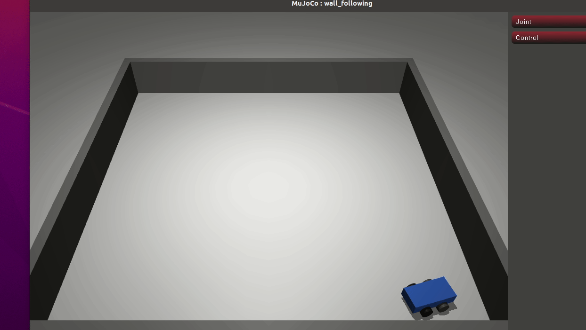

# MuJoCo 差速小车沿墙巡线

功能包源码位于仓库的 `src/ground/mujoco_wall_following` 目录。

## 1. 问题描述

蓝色四轮差速小车在 MuJoCo 平地仿真中从起点 `(-1.45, -1.45)` m 出发，场地是一圈矩形闭环
走廊（四面外墙围成，内侧可行驶区域 `x,y∈[-1.9,1.9]` m）。小车沿预设航点逆时针绕走廊
一圈，最终回到起点附近；途中通过右侧射线感知与墙的距离，把车稳定保持在目标贴墙偏移上，
并用前向射线限速防止直冲撞墙。途中与墙壁几何接触即判定撞墙失败，回到起点附近判定成功。

## 2. 运行环境（实际验证）

| 项 | 版本 / 说明 |
|---|---|
| 操作系统 | Ubuntu（无头云主机，无独立显卡） |
| Python | 3.12.11 |
| 模拟器 | MuJoCo `>=3.2,<4.1`（本机实测 3.17.0 与 4.0.0，结果一致），numpy 1.26.4；Pillow 仅录帧导出 GIF 时需要 |
| 渲染后端 | 可视化用 `MUJOCO_GL=glfw`；无头离屏录帧用 `egl`（mesa 软件渲染，无独立显卡也可出图） |

MuJoCo 不在 apt 仓库，需按 `requirements.txt` 用 pip 安装。

## 3. 算法

### 3.1 差速运动学

模型后两轮由 `velocity` 执行器驱动（前两轮为被动随动支撑轮，没有执行器），`ctrl` 单位是
**轮子角速度 (rad/s)**，不是车体线速度。给定目标车体线速度 `v` (m/s) 与车体角速度
`omega` (rad/s)，由差速逆解换算左右轮角速度：

```
ω_L = v/R - ω·L/(2R)
ω_R = v/R + ω·L/(2R)
```

其中轮半径 `R=0.05 m`，左右轮间距 `L=0.22 m`。

需要区分**指令值**与**车体实测**：`TURN_OMEGA=1.5 rad/s` 是差速逆解下发的目标车体角速度
（指令值）。底盘靠轮地摩擦推进，转向时轮胎存在侧向打滑，车体实际偏航速率明显低于指令值，
也不是严格原地转动；文档与代码中不把它写成「原地转向角速度」。

### 3.2 偏航角解算

车体是 `<freejoint/>`，其 7 个 `qpos` 为 `[x, y, z, qw, qx, qy, qz]`；
`qpos[5]` 是四元数 `qy`，绕 z 轴转动时恒为 0，**不能当作 yaw**。
偏航角由四元数分量解算：

```
yaw = atan2(2·(qw·qz + qx·qy), 1 - 2·(qy² + qz²))
```

### 3.3 航点闭环状态机

航点（逆时针一圈，末航点回到起点）为 `(1.45,-1.45)`、`(1.45,1.45)`、`(-1.45,1.45)`、
`(-1.45,-1.45)`。每一段航点：

- 当前航向误差大：差速转向，先把车头对准航点；
- 航向误差小：直行并叠加航向比例修正，边走边对准；
- 两档阈值带滞回（转入 `0.5 rad`、转回 `0.3 rad`），避免在切换边界来回抖动（极限环）；
- 距当前航点 `< 0.18 m` 切换下一段，重新进入转向；
- 末航点（回起点）用更紧的到达判据 `< 0.10 m`，避免提前判停。

航点内缩到 `±1.45 m`、距墙面留出安全余量，是为了让转弯段不贴墙；早期用 `±1.7 m` 时
转角处侧向打滑会蹭到外墙。

### 3.4 贴墙侧距 PD 与防撞限速

直行段在航向修正之外叠加一项侧距比例修正，让车向右侧墙的期望侧距收敛（这是收敛控制，不是严格等距保持：实测有效段侧距均值 0.238 m，比目标 0.28 m 低约 15%，std 0.055 m）：

- 右侧射线（相对车头 `-90°`，射线原点**沿射线方向外移 `0.15 m`**，即车体中心**右侧 `0.15 m`**）测**射线原点到右墙**的距离，未命中记为量程上限；
- **口径换算**：`D_DES=0.28 m` 是「射线原点到墙」；换算到车体中心约 `0.28 + 0.15 = 0.43 m`，
  换算到车身外沿（车宽 `0.2 m`、半宽 `0.1 m`）约 `0.33 m`。前向射线的 `0.15 m` 偏移才落在
  质心**前方** `0.15 m`——两种射线的偏移方向不同，不能统一写成「质心前 0.15 m」；
- 侧距先做一阶低通（`α=0.5`）滤掉射线抖动，再做比例修正：`ω_side = KP_SIDE·(D_DES - d_side)`，
  偏差限幅 `±0.15 m`，避免单帧跳变把车甩偏；
- 前向射线距墙小于 `SAFE_FRONT=0.30 m` 时把直行速度降到 `0.15 m/s`，作为直冲前的最后保护。
  该分支在本闭环**从未触发**（实测最小前向距 `0.373 m` > `0.30 m`），属「未触发的兜底保护」，
  只在单测里直接驱动验证；

射线用 `mj_ray`，通过 `bodyexclude` 排除自车整棵 body，未命中返回量程上限。

### 3.5 碰撞与到达判定

- 每步扫描 MuJoCo 接触对，任一接触几何名以 `wall` 开头即判定撞墙，停车失败；
- 回到起点附近（末航点 `< 0.10 m`）判定完成，两轮速度清零；循环带步数上限 `20000`
  （`dt=0.005`，兜底 100 s）。

## 4. 模型参数（models/wall_following.xml）

| 部件 | 参数 |
|---|---|
| 底盘 | 长方体 `0.2 × 0.1 × 0.05 m`（半尺寸 `size` 即此值），蓝色，质量 2.0 kg，惯量 `0.01/0.01/0.02` |
| 车轮 | 共四个，轮半径 0.05 m，hinge 绕 y 轴：后轮 `left_wheel`/`right_wheel`（`x=-0.08`）接 `velocity` 执行器、`kv=2`；前轮 `front_left_wheel`/`front_right_wheel`（`x=+0.08`）为被动随动支撑，无执行器 |
| 走廊外墙 `wall_south/north/west/east` | 长方体，中心分别在 `(0,-1.95)`、`(0,1.95)`、`(-1.95,0)`、`(1.95,0)`，半尺寸 `2.0 × 0.05 × 0.25` 或 `0.05 × 2.0 × 0.25`，即内圈 `x,y∈[-1.9,1.9]`、墙厚 0.1 m、墙高 0.5 m（中心 z=0.25），参与碰撞 |
| 物理 | timestep=0.005 s，地面摩擦 `1.0 0.1 0.1` |

> 四轮布局是从「只有两个后轮、车头悬空」的早期版本改过来的：两轮车头没有支撑，重力让车身
> 低头、姿态不稳，补两个被动前轮后车身平稳（`z≈0.10`，roll/pitch≈0）。

## 5. 运行步骤

### 5.1 安装依赖

在**包目录**下执行：

```bash
# 先进入本包目录（仓库内 checkout 路径如下）：
cd src/ground/mujoco_wall_following
pip install -r requirements.txt
```

### 5.2 运行

在包目录下直接运行脚本：

```bash
python3 main.py              # 打开 MuJoCo 窗口，关闭窗口即退出
python3 main.py --headless   # 无头模式：绕完一圈 / 撞墙 / 超时后打印结果退出（无窗口）
```

也可以在 source 过 ROS 2 工作空间后用 ros2 launch 拉起：

```bash
ros2 launch mujoco_wall_following main.launch.py                # 开窗可视化
ros2 launch mujoco_wall_following main.launch.py headless:=true # 无头模式
```

### 5.3 测试与录帧

测试（纯逻辑单测 + 闭环绕回起点 / 撞墙判定断言）：

```bash
python3 test/test_wall_following.py
```

离屏渲染导出演示 GIF（无头环境用 EGL 软件渲染即可，无需独立显卡）：

```bash
MUJOCO_GL=egl python3 test/record_demo_gif.py                          # 默认输出 ./wall_following_demo_script.gif
MUJOCO_GL=egl python3 test/record_demo_gif.py --out /tmp/demo.gif      # 或显式指定路径
```

脚本默认输出到**当前工作目录**，并会拒绝写入仓库入库的录屏文件
`docs/img/ground/mujoco_wall_following_demo.gif`，避免误覆盖；默认参数为
`768×576`、每 `32` 步录一帧（`8803` 步 `275` 帧）、每帧 `160 ms`；本机实测产物 `280,662 B`
（0.27 MB，已按 128 色调色板量化，与入库 viewer 录屏同量级）。

## 6. 实测结果（本机 mujoco 3.17.0 实测）

`python3 main.py --headless` 实测：

- 绕回起点；步数 `8803`，仿真时长 `44.02 s`；
- 终止位置 `(-1.431, -1.355) m`，距起点 `0.097 m`（小于 `0.10 m` 到达阈值）；
- 有效贴墙段侧距：均值 `0.238 m`、std `0.055 m`、最小 `0.151 m`；
- 最小侧距 `0.151 m`（**侧向射线值 = 射线原点到墙**；射线原点在车体中心右侧 `0.15 m`，换算到车体中心
  约 `0.301 m`，与下面的总最小墙距 `0.301 m` 同一口径），最小前向距 `0.373 m`；
- 车体中心到四面内墙的最小距离：`x-` `0.305 m`、`x+` `0.301 m`、`y-` `0.435 m`、`y+` `0.312 m`，
  轨迹整体最小墙距 `0.301 m`；
- 车体支撑：四轮着地，**底盘与地面接触 `0` 步（0.0%）**，最大俯仰角 `2.27°`，底盘最低 `z=0.099 m`
  （名义 `0.10 m`），车体由轮胎支撑、不发生底盘擦地；
- 闭环过程未接触墙壁，余量充足。

## 7. 运行效果



`docs/img/ground/mujoco_wall_following_demo.gif` 是 MuJoCo viewer 窗口的实际运行录屏（Peek 录制）：

- `1244×702`、`310` 帧、每帧 `100 ms`（约 `31 s`）、无限循环，文件 `511,620` 字节；
- 录制内容对应闭环 `8803` 步（`dt=0.005 s`）的完整运行，小车从走廊左下角出发，沿下边向东、右边向北、上边向西、左边向南，逆时针绕回起点；
- 重新生成有两条路：① 录 viewer 窗口——在包目录 `python3 main.py` 后录窗口区域；
  ② 无头离屏渲染——`MUJOCO_GL=egl python3 test/record_demo_gif.py`，复用 `main.py` 的起点、航点、
  走廊、贴墙参数与 `control_step`，默认输出到当前目录 `./wall_following_demo_script.gif`；默认
  `768×576`、每 `32` 步录一帧（`275` 帧）、每帧 `160 ms`、`280,662 B`（0.27 MB）。脚本会拒绝写入上面那支入库录屏，
  所以两条复现路线互不覆盖（与入库 viewer 录屏的尺寸/帧率不同属正常差异）；
- 两处口径已统一：**入库的演示 GIF 是 viewer 窗口录屏（Peek），脚本产物是另一份离屏渲染图**，
  PR 描述与本页说法一致；
- 录帧需 Pillow；离屏后端 `MUJOCO_GL=egl`，mesa 软件渲染。

## 8. 已知限制

- 只验证当前矩形走廊布局、起点 `(-1.45,-1.45)` 与预设航点序列；其他起点 / 墙布局未做回归；
- 航点为预设固定序列，贴墙与防撞都基于局部射线反馈，未做实时全局路径规划；
- 到达判据只看距起点的位置距离，不约束最终车头朝向；
- 速度、增益与贴墙偏移为初始取值，未做整定优化；底盘转向存在轮胎侧滑，车体实测偏航速率
  低于指令角速度 `1.5 rad/s`；
- 在 mujoco **3.17.0 与 4.0.0**（本机实测，均属 `>=3.2,<4.1` 区间内）上验证通过，两者闭环结果
  （`8803` 步、终止位置、侧距统计）与 `10` 项单测完全一致；区间内其他版本未做回归；
- 录帧依赖 EGL/OpenGL 离屏上下文；个别极简容器若未带 mesa 软件渲染库，需先装好 EGL 驱动；
- 离屏录帧在高分辨率/小步长下很吃 CPU（软件渲染 `960×720`、每 `8` 步一帧时本机跑 `8` 分钟未出结果），
  故脚本默认已降到 `768×576`、每 `32` 步一帧，产物约 `275` 帧、体积与耗时都在可接受范围。

## 9. 大模型使用声明

本作业的代码与文档在编写过程中使用了**豆包（Doubao）** AI 大模型辅助，本人已核对并确认提交内容，对提交内容负责。
