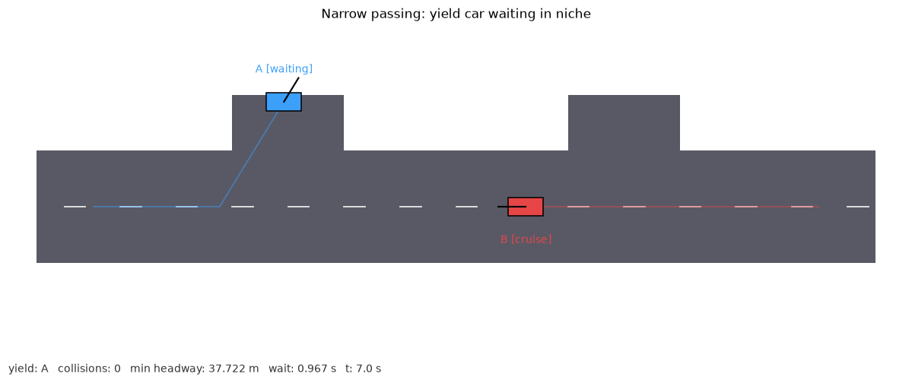
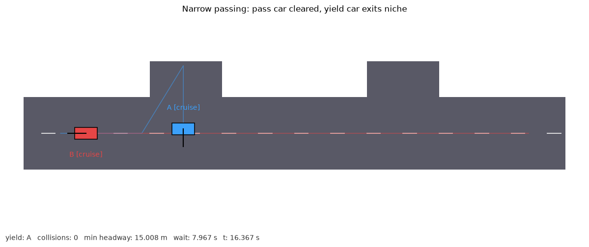

# 窄道会车让行仿真（避让龛规则）

纯 NumPy + Matplotlib 实现的二维窄道会车仿真，不依赖 ROS / Gazebo / CARLA / MuJoCo。
一条双向共用的单车道窄路，路侧设有两处避让龛，两辆对向小车按“谁先靠近自己
一侧的避让龛，谁进龛等待”的规则会车：让行车驶入避让龛停稳，对向车直行通过，
交汇完成后让行车再驶出避让龛继续通行。

- 源码：[`src/ground/narrow_giveway_passing`](../../src/ground/narrow_giveway_passing)
- 作者：jiangdong000

## 环境

- Python 3.8+（纯 Python，跨平台；Linux / Windows / macOS 均可运行）
- NumPy、Matplotlib（见模块 `requirements.txt`）

```bash
pip install -r src/ground/narrow_giveway_passing/requirements.txt
```

## 运行

代码位于 `src/ground/narrow_giveway_passing/main.py`，在仓库根目录下执行：

```bash
python3 src/ground/narrow_giveway_passing/main.py --demo --outdir demo_out
```

无窗口评测（不打开窗口，写 `metrics.json`）：

```bash
python3 src/ground/narrow_giveway_passing/main.py --headless --duration 40 --outdir demo_out
```

## 实现

小车采用独轮运动学模型：

```
dx = v · cos(θ) · dt
dy = v · sin(θ) · dt
dθ = ω · dt
```

让行决策：A 车分配左侧龛、B 车分配右侧龛，分别计算到己方龛中心的距离，
距离更近者进入龛内等待。让行车状态机：

```
to_niche → enter → waiting → exit → cruise
```

- `to_niche`：驶向避让龛入口；
- `enter`：驶入龛内目标点并停稳；
- `waiting`：龛内等待，直到对向车完全越过本车龛位所在的纵向区间；
- `exit`：对向车清空后驶回行车道；
- `cruise`：沿车道直行到终点。

碰撞检测：两车中心距离小于 `2 · CAR_R` 记一次碰撞，一次持续接触只计数一次；
场景同时记录全程最小间距 `min_headway`。

## 评测指标

`metrics.json`：

| 字段 | 含义 |
|---|---|
| `yield_role` / `pass_role` | 让行车 / 直行通过车角色 |
| `collisions` | 碰撞事件次数 |
| `min_headway` | 两车全程最小间距（米） |
| `wait_time` | 让行车龛内等待时长（秒） |
| `total_time` | 场景总时长（秒） |
| `passed` | 是否无碰撞完成交汇 |

固定 `--seed` 后指标可完全复现。

## 测试

```bash
python3 -m unittest discover -s src/ground/narrow_giveway_passing/tests -v
```

覆盖角度归一化、让行决策、无碰撞完成、等待阶段经历与同种子确定性。

## 参数

| 参数 | 默认值 | 说明 |
|---|---|---|
| `MAX_SPEED` | 6.0 m/s | 小车最大速度 |
| `ARRIVE_R` | 1.2 m | 到达目标点判定半径 |
| `DT` | 1/30 s | 固定仿真步长 |

## 限制

- 让行规则按到己方龛距离判定，未引入实时车速与车型协商。
- 二维独轮模型，不考虑车身扫掠、转向半径与悬挂。
- 龛位数量与位置写死在场景中。

## 运行截图

**让行车在避让龛内等待，对向车正在通过：**



**对向车通过后，让行车驶出避让龛：**


