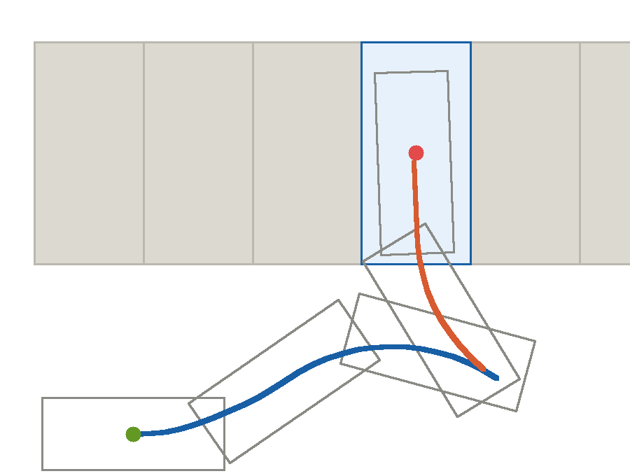
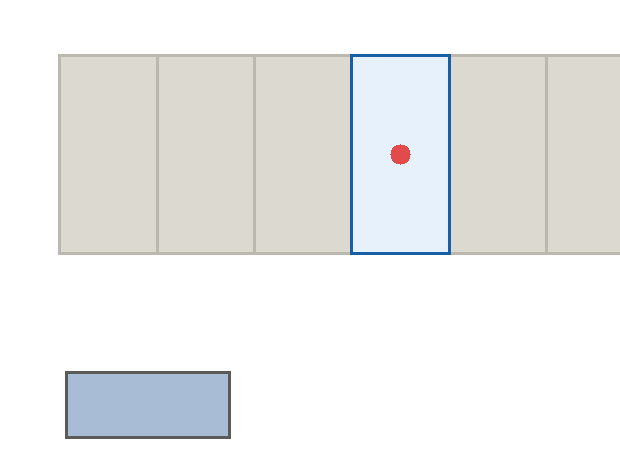

# 垂直车位泊车路径规划

## 概述

在停车场中找到目标车位后，车辆需要从车道完成"前进摆位 + 倒车入库"的动作。本模块用 **Hybrid A\*** 在车位周围搜索一条**车辆真正开得出来**的轨迹：

* 轨迹曲率处处满足车辆最小转弯半径，不是折线路径；
* 自动决定何时前进、何时倒车、在哪里换挡；
* 输出 `nav_msgs/Path`，可直接交给下游跟踪控制器；
* 在 RViz2 中显示车位框、目标位姿与双色轨迹。

本模块只做**规划**，不含车辆控制与感知。配套场景参考 [CARLA 停车场场景生成](./carla_parking_lot.md)。



图中绿色圆点为起始位姿，红色圆点为目标位姿；**蓝色为前进段**、**橙色为倒车段**，灰色格位表示两侧已停放车辆。

## 环境要求

| 项目 | 要求 |
|------|------|
| 操作系统 | Ubuntu 22.04 |
| ROS | ROS 2 Humble |
| Python | 3.10（规划器仅用标准库，不需要 numpy） |
| 可视化 | RViz2 |

```bash
sudo apt update
sudo apt install ros-humble-nav-msgs ros-humble-geometry-msgs \
                 ros-humble-visualization-msgs ros-humble-std-srvs
```

## 编译与运行

```bash
cd ~/ros2_ws/src
git clone https://github.com/OpenHUTB/ros2.git

cd ~/ros2_ws
colcon build --packages-select parking_path_planner
source install/setup.bash

ros2 launch parking_path_planner main.launch.py
```

launch 会同时启动规划节点与 RViz2，并自动完成一次规划。RViz2 中可以看到绿色车位框、红色目标位姿箭头，以及蓝/橙双色轨迹。

如果机器上没有 ROS，也可以直接离线跑出轨迹图：

```bash
cd src/ground/parking_path_planner
python3 main.py --offline --output results
```

会在 `results/` 下生成 `parking_path.svg` 与 `parking_waypoints.json`。

## 运行效果

没有 ROS 环境时，规划器可以直接离线运行并把结果渲染成动图（`docs/img/ground/parking_path_planner_demo.gif` 为脚本自动生成，非 RViz2 界面截图）：



车体从车道出发，先**前进摆位**（蓝色轨迹），再**倒车入库**（橙色轨迹），最终停在车位内并与车位长边平行。

一次典型的规划输出：

```
最小转弯半径 R_min = 3.86 m
起点 (-7.00, -4.20, 0.0 deg)
规划成功：扩展 14628 次，路径节点 40，稠密点 79
  总里程 15.60 m，换挡 1 次
  最大曲率 0.2593 1/m（上限 0.2593）
  终点误差 dx=0.054 m, dy=0.246 m, dyaw=-2.03 deg
```

即：车辆从车道出发向前摆位，然后**一把**倒车入库，全程 15.60 m，只在车位入口处换挡一次。

## 参数说明

| 参数 | 默认值 | 说明 |
|------|--------|------|
| `frame_id` | `map` | 坐标系 |
| `slot_width` / `slot_depth` | `2.70` / `5.50` | 车位宽/深（m） |
| `slot_center_x` / `slot_center_y` | `0.0` / `2.75` | 车位中心（世界坐标） |
| `slot_heading_deg` | `0.0` | 车位朝向（度） |
| `start_x` / `start_y` / `start_yaw_deg` | `-7.0` / `-4.2` / `0.0` | 起始位姿 |
| `wheelbase` | `2.70` | 轴距（m） |
| `vehicle_width` / `vehicle_length` | `1.80` / `4.50` | 车体尺寸（m） |
| `max_steer_deg` | `35.0` | 前轮最大转角（度） |
| `step` | `0.40` | 搜索单步弧长（m） |
| `goal_xy_tolerance` | `0.35` | 目标位置容差（m） |
| `neighbors_parked` | `true` | 两侧是否视为已停车 |
| `auto_plan` | `true` | 启动后是否自动规划 |

更换起点或车位：

```bash
ros2 launch parking_path_planner main.launch.py start_x:=-6.0 slot_center_x:=0.0 rviz:=false
```

## 话题与服务

| 名称 | 类型 | 说明 |
|------|------|------|
| `/parking_path` | `nav_msgs/Path` | 泊车轨迹 |
| `/parking_markers` | `visualization_msgs/MarkerArray` | 车位框、目标位姿、双色轨迹 |
| `/plan_parking` | `std_srvs/Trigger` | 触发重新规划 |

```bash
ros2 service call /plan_parking std_srvs/srv/Trigger {}
ros2 topic echo /parking_path --field poses
```

## 算法说明

### 为什么不用普通 A\*

普通 A\* 得到的是折线，曲率不连续，车辆无法跟踪；Reeds-Shepp 曲线虽然是理论最优，但对起终点位姿非常敏感，稍有偏差就要重新求解。Hybrid A\* 在栅格上搜索、用**车辆运动学原语**扩展节点，既有栅格搜索的鲁棒性，又能保证每一段轨迹都可执行。

### 状态与动作

* 状态：`(x, y, yaw)`，按 0.25 m / 5° 离散去重；
* 动作：5 档转角 `{0, ±0.5, ±1} × δ_max` 与两个方向 `{前进, 倒车}` 组合；
* 推进：自行车模型沿圆弧积分 0.40 m，取中点朝向以减小离散误差；
* 最小转弯半径 `R_min = L / tan(δ_max) = 2.70 / tan35° ≈ 3.86 m`。

### 代价与启发

代价函数在弧长基础上加入两项惩罚：

| 项 | 权重 | 作用 |
|----|------|------|
| 换挡 `gear != gear_prev` | 1.2 | 抑制无意义的前后挪动 |
| 满舵 `abs(steer) > 0.9` | 0.05 | 略微偏好平缓轨迹 |

启发式为欧氏距离加 0.6 倍航向差，权重 1.2。如果去掉换挡惩罚，同样场景会退化成 9 次换挡、32.75 m 的抖动轨迹，前后对比一下就能看出这一项是必要的。

### 碰撞模型

车位两侧按"已停车"处理，车位后方为墙。把车体矩形转到车位坐标系后，只需要判断：

* `Y >= -depth/2` 的部分是否越出 `|X| > width/2`（侵入邻车位）；
* 是否越过 `Y > depth/2`（撞后墙）。

判断方式是把车体多边形用 Sutherland-Hodgman 算法按半平面裁剪，再看剩余多边形面积是否为零。相比等间隔取点检查，这种做法**不会漏掉"车身斜插进邻车位"的情形**，计算量也不大。

### 输出

规划结果是带朝向的节点序列，再插值为 0.15 m 间隔的稠密点，同时保留每点的挡位（`D` / `R`），供控制器判断前进还是倒车。

## 验证

```bash
# 单元测试（8 项，无需 ROS）
python3 -m unittest discover -s tests -v
```

测试覆盖：规划成功、终点在容差内、曲率不超过 1/R_min、全程无碰撞、换挡次数受限、存在倒车段、插值端点一致、两侧无车时仍可规划。

也可用话题手工核对：

```bash
ros2 topic echo /parking_path --field poses | head -20
```

## 已知限制

* **只做规划，不做跟踪**。把 `/parking_path` 交给控制器（纯跟踪、Stanley、MPC）执行后，终点误差还能进一步收敛；参考[横向控制算法对比](./lateral_control_benchmark.md)中的跟踪实现。
* 目标位姿容差为 0.35 m / 10°，规划终点与车位中心还有约 0.25 m 偏差，剩下的交给控制部分修正。
* 只处理垂直车位。平行车位、斜列车位需要调整车位坐标系与目标位姿，搜索部分可以复用。
* 场景是静态的：若泊车过程中出现动态障碍，需要在外层加重规划机制。
