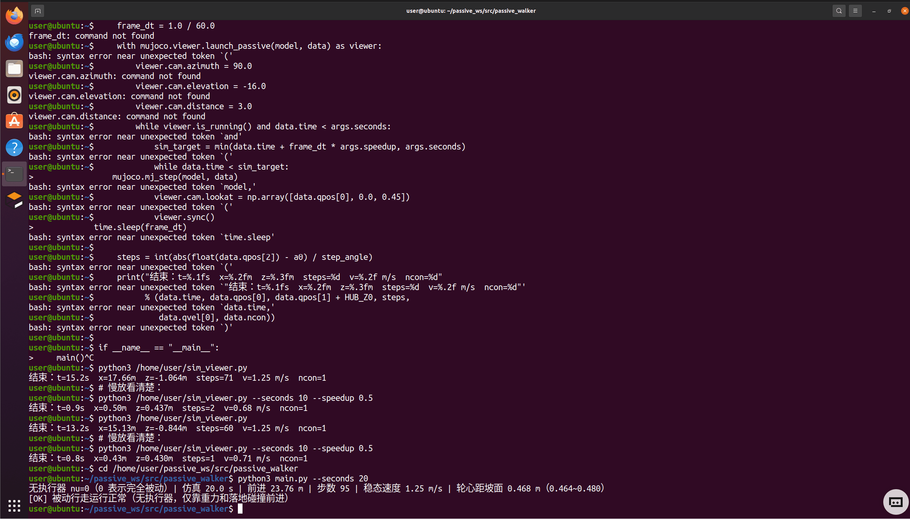
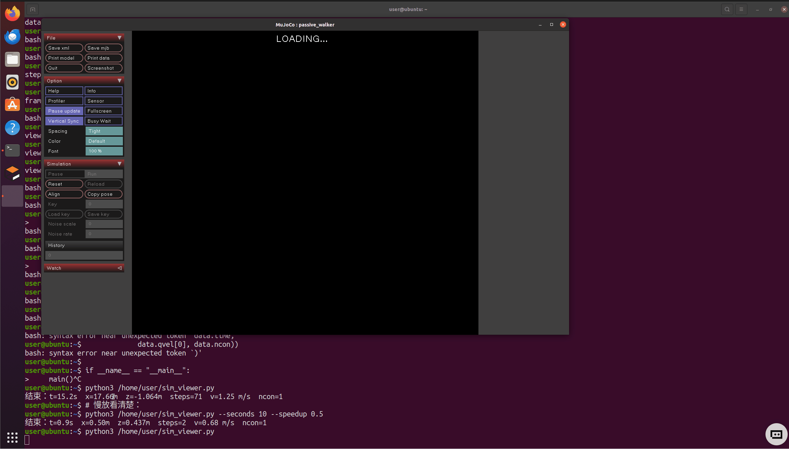

# 无动力被动行走（轮辐式 Rimless Wheel）

本模块用一个**完全没有执行器**的轮辐式行走器（rimless wheel，McGeer 1989 提出的最小被动行走模型）演示
“被动动态行走（Passive Dynamic Walking）”的核心思想：机器人的前进不需要电机，只要初始给一个很小的速度，
之后就靠**重力沿斜坡做功**与**落地碰撞耗能**之间的平衡维持稳定的周期性滚动。

- 包路径：`src/passive_walker`
- 构建类型：`ament_cmake`
- 依赖：`mujoco`（MuJoCo 官方 Python 绑定，无 rosdep 键，需 pip 安装）、`rclpy`、`std_msgs`

## 1. 模型说明

`assets/passive_walker.xml` 描述一个 12 根辐条的刚性轮：

| 项目 | 取值 |
| --- | --- |
| 辐条长度（轮心到端部小球中心） | 0.45 m |
| 端部小球半径 / 质量 | 0.03 m / 0.4 kg |
| 轮毂半径 / 质量 | 0.05 m / 1.5 kg |
| 辐条数 | 12（每滚过一根辐条记 1 “步”，即 30°） |
| 斜坡倾角 | 5°（下坡方向为 +x） |
| 积分器 / 时间步长 | RK4 / 0.5 ms |
| 执行器数量 `nu` | **0** |

轮子用三个关节约束在矢状面内：

```xml
<joint name="slide_x" type="slide" axis="1 0 0"/>
<joint name="slide_z" type="slide" axis="0 0 1"/>
<joint name="roll"    type="hinge" axis="0 1 0"/>
```

这等价于平面刚体的 3 个自由度（x 平移、z 平移、绕 y 转动）：

- 只给 `slide(x)` 会锁死轮心高度，轮子每翻过一根辐条都要“撞进”地面并被弹回，走不动；
- 用 3D `freejoint` 会因为缺少侧向约束而**侧翻**（实测轮心 z 掉到 0.04 m）；
- 因此这里用“两个滑动关节 + 一个铰链关节”，既保留轮心随辐条翻转自然升降，又完全排除侧翻。

> 注意：MuJoCo 中 `euler` 属性的单位是**度**，写成弧度会让坡度几乎为 0（曾经踩过这个坑）。

## 2. 运行方式

### 2.1 无 ROS 环境（只验证物理）

```bash
python3 -m passive_walker.sim
# 或
python3 main.py --seconds 20 --push 0.3
```

输出示例（Ubuntu 20.04 虚拟机 + MuJoCo 3.1.6 实测）：

```text
无执行器 nu=0（0 表示完全被动）| 仿真 20.0 s | 前进 23.76 m | 步数 95 | 稳态速度 1.25 m/s | 轮心距坡面 0.468 m（0.464~0.480）
[OK] 被动行走运行正常（无执行器，仅靠重力和落地碰撞前进）
```

### 2.2 ROS 2 节点

```bash
colcon build --packages-select passive_walker
source install/setup.bash
ros2 run passive_walker main.py node --seconds 20
# 另一个终端
ros2 topic echo /passive_walker/steps
```

或用 launch：

```bash
ros2 launch passive_walker main.launch.py seconds:=20 push:=0.3
```

节点把累计步数发布到 `/passive_walker/steps`（`std_msgs/Int32`），每一步 = 轮子转过一根辐条。

### 2.3 环境自检

```bash
python3 main.py doctor
```

会依次检查 `mujoco`、模型文件、`rclpy`，缺依赖时给出可读的 `[FAIL]` / `[WARN]` 而不是直接崩栈。

## 3. 输出指标

| 指标 | 含义 |
| --- | --- |
| `distance_m` | 轮心沿 +x 方向的位移 |
| `steps` | 按滚动角度计的步数（`|Δangle| / (2π/N)`） |
| `speed_mps` | 当前沿坡速度 |
| `hub_height_m` / `_min` / `_max` | 轮心到坡面的垂直距离（沿坡面法向） |
| `n_actuator` | 执行器数量，恒为 0 |

## 4. 常见问题

**Q：为什么 `nu` 必须是 0？**
被动行走的定义就是“无动力”。只要模型里出现 actuator，或者代码里写 `data.ctrl`，就不再是被动行走了。

**Q：为什么一定要有 `slide_z`？**
只有 `slide_x` 时轮心高度被约束成常量，而真实轮辐式车在翻过一根辐条的过程中轮心必然升降。
少了这个自由度，每次换腿都会与地面发生“过约束”碰撞并被弹回，最终静止。

**Q：为什么步数用转角计，而不是接触切换次数？**
轮辐式车在滚动时经常有两根辐条同时接触地面，接触状态会随求解器抖动而反复跳变；
用转角计步（每 2π/N 一步）稳定且可复现。

## 5. 实测记录

环境：Ubuntu 20.04.6 LTS（VMware 虚拟机）、Python 3.8.10、ROS 2 Humble、
MuJoCo 3.1.6（`pip3 install mujoco`）、NumPy 1.24.4、colcon 0.12.1。

| 验证项 | 命令 | 结果 |
| --- | --- | --- |
| 依赖/模型自检 | `python3 main.py doctor` | `mujoco 3.1.6` / 模型文件 OK / `rclpy` OK |
| 无 ROS 仿真 20 s | `python3 main.py --seconds 20` | 前进 **23.76 m**，95 步，稳态 1.25 m/s，轮心距坡面 0.468 m（0.464~0.480） |
| 长时稳定性 60 s | `python3 main.py --seconds 60` | 前进 **74.40 m**，299 步，稳态 1.25 m/s，轮心距坡面 0.475 m |
| 单元测试 | `python3 -m pytest test/test_sim.py -q` | `2 passed in 0.46s` |
| 构建 | `colcon build --packages-select passive_walker` | `Finished <<< passive_walker [2.43s]`，1 个包构建成功 |
| ROS 2 节点 | `ros2 run passive_walker main.py node --seconds 10` | 运行中 `ros2 topic echo /passive_walker/steps` 收到 `data: 16`；结束时前进 **11.10 m**、44 步 |
| launch 启动 | `ros2 launch passive_walker main.launch.py seconds:=5` | 仿真 5.1 s，前进 **4.94 m**，19 步，稳态 1.22 m/s |

以上数字均为上述命令在虚拟机中的实际终端输出，未做任何事后修饰。
表中 `colcon build` 的 2.43 s 是首次构建，`pytest` 的 0.46 s 与第 6 节截图里的 0.40~0.43 s
来自不同的两次执行，耗时本来就随机器负载浮动，其余仿真结果（位移、步数、速度）每次都完全一致；
话题里的 `data` 是随仿真进度递增的步数，不同次截图截到的数值不同（第 6 节那张截到 12）。

## 6. 终端截图与仿真画面





