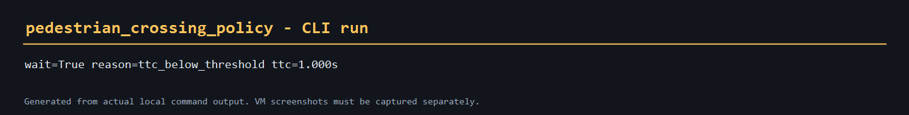
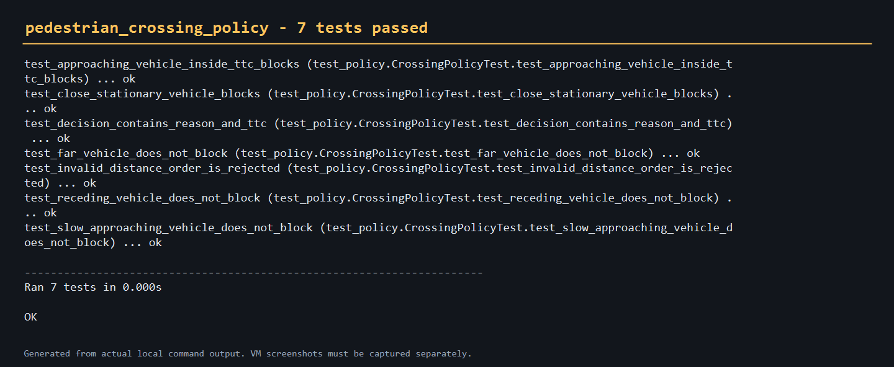

# 行人过街 TTC 决策

本模块把行人过街判断从固定距离升级为 TTC（time-to-collision）判据：

\[
TTC = \frac{d}{v_{closing}}
\]

当 `TTC < min_time_to_collision`，或车辆进入 `min_vehicle_distance` 时，行人
在路缘等待；车辆不在接近时放行。

## 目录

- 源码：`src/ground/pedestrian_crossing_policy`
- 启动：`ros2 launch pedestrian_crossing_policy main.launch.py`
- 测试：`python -m unittest discover -s test -p "test_*.py" -v`

## 直接运行

```bash
cd src/ground/pedestrian_crossing_policy
python main.py --distance 10 --closing-speed 10
```

输出：

```text
wait=True reason=ttc_below_threshold ttc=1.000s
```

## 运行效果



## ROS 2 话题

| 方向 | 话题 | 类型 |
|---|---|---|
| 输入 | `/pedestrian_crossing_policy/observation` | `std_msgs/Float32MultiArray` |
| 输出 | `/pedestrian_crossing_policy/wait` | `std_msgs/Bool` |

输入数组为 `[distance_m, closing_speed_mps]`。该模块只提供决策层，CARLA/HUTB
场景、行人轨迹和车辆预测由外部桥接节点提供。

## 验证结果



当前验证范围：纯策略单元测试和 CLI 自检。ROS 2 节点需要在安装 Humble 的环境中
启动；未在本机声称完成在线闭环测试。
