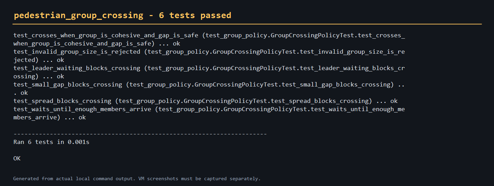

# 群体行人过街决策

该模块在单行人 TTC 判据之上增加群体行为：成员是否到齐、队形是否分散、
带队者是否等待，以及车辆间隙是否满足阈值。

## 使用

```bash
cd src/ground/pedestrian_group_crossing
python main.py --group-size 3 --arrived 2 --spread 1.0 --gap 4.0
```

源码：`src/ground/pedestrian_group_crossing`

## 验证



本模块只验证决策规则，不替代 CARLA 场景或社会力模型。
