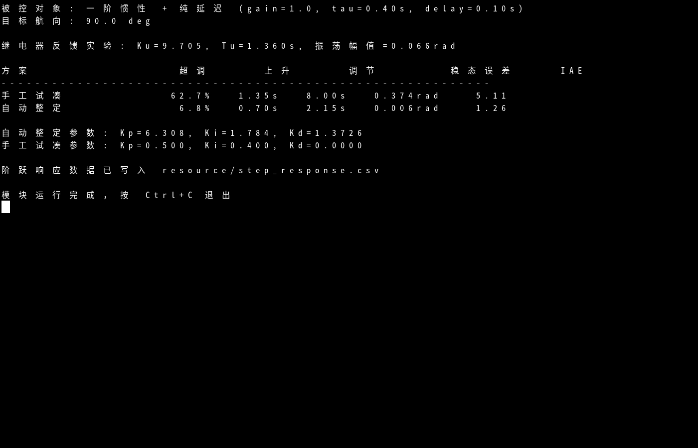
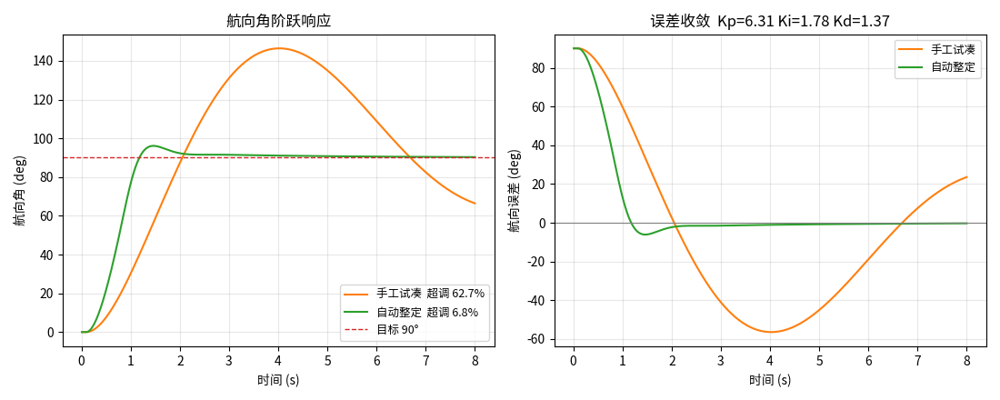
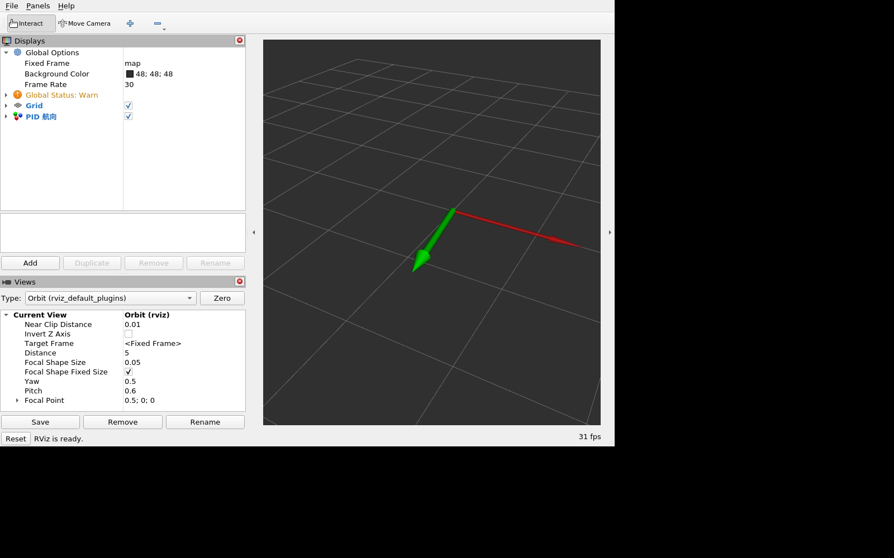

title: 航向 PID 参数自整定与手工试凑对比

# 航向 PID 参数自整定与手工试凑对比

## 1. 模块概述

差速小车的航向环通常用 PID 控制，但 `Kp/Ki/Kd` 靠人工试凑很费时间，换一台车就要重新调。
本模块用**继电器反馈法**自动测量被控对象的临界增益 `Ku` 与临界振荡周期 `Tu`，
再按经验规则生成 PID 参数，并用闭环指标（超调、上升时间、调节时间、稳态误差、IAE）
在候选参数里挑选最优，最后与一组手工试凑参数在同工况下对比。

模块不依赖 MuJoCo / CARLA / Gazebo，被控对象是简化的一阶惯性 + 纯延迟航向模型：

```
d(omega)/dt = (K·u(t-τ) - omega) / T     K = 1.0,  T = 0.40 s,  τ = 0.10 s
d(theta)/dt = omega
```

## 2. 运行环境

- 操作系统：Ubuntu 20.04（实测）
- ROS 版本：ROS 2 Humble
- Python：3.8（Ubuntu 20.04 自带版本）
- 依赖：`rclpy`、`std_msgs`、`visualization_msgs`（ROS 2 Desktop 自带）；`main_plot` 另需 `python3-matplotlib`

## 3. 编译与运行步骤

```bash
cd ~/ros2                      # 仓库克隆目录，按实际路径调整
source /opt/ros/humble/setup.bash
colcon build --packages-select pid_auto_tuning
source install/setup.bash
```

一键跑完整流程（终端输出指标表，并在当前目录的 `resource/step_response.csv` 写入阶跃数据）：

```bash
ros2 run pid_auto_tuning main
```

绘制对比图（弹窗显示阶跃响应与误差收敛曲线，可直接截图）：

```bash
ros2 run pid_auto_tuning main_plot
```

在 RViz 中用箭头显示当前航向与目标航向：

```bash
cd ~/ros2                      # rviz 配置使用相对路径，需在仓库根目录执行
ros2 launch pid_auto_tuning main_launch.py
rviz2 -d src/ground/pid_auto_tuning/resource/pid_tuning.rviz
```

RViz 中 `Fixed Frame` 为 `map`，`MarkerArray` 话题为 `/pid_auto_tuning/markers`；绿色箭头是当前航向，红色箭头是目标航向，目标每 6 s 在 ±90° 之间切换。

## 4. 原理简述

1. **继电器反馈实验**：把控制器换成 `±d` 的继电器，让闭环产生等幅振荡，记录振荡幅值 `a` 与周期 `Tu`，由描述函数得 `Ku = 4d / (π·a)`
2. **参数生成**：用三条经典规则（Ziegler-Nichols 经典版 / 无超调版、Tyreus-Luyben）给出初值，其中 `Ki = Kp / Ti`、`Kd = Kp·Td`
3. **候选筛选**：在 `Ku`、`Tu` 附近做小范围网格搜索，用闭环指标打分（超调、调节时间、稳态误差、IAE 加权），取最优
4. **对比**：同一目标航向、同一被控对象下，与手工试凑参数（只加 P、I，没有微分项）比超调与调节时间

## 5. 参数说明

| 参数 | 默认值 | 说明 |
| --- | --- | --- |
| `target_deg` | 90.0 | 目标航向角（度） |
| `dt` | 0.02 | 仿真步长（秒） |
| `switch_period` | 6.0 | 目标航向切换周期（秒） |
| `u_limit` | 2.5 | 角速度指令饱和上限（rad/s） |

## 6. 运行效果验证

`ros2 run pid_auto_tuning main` 的终端输出（航向角阶跃目标 90°）：

```
被控对象: 一阶惯性 + 纯延迟 (gain=1.0, tau=0.40s, delay=0.10s)
目标航向: 90.0 deg

继电器反馈实验: Ku=9.705, Tu=1.360s, 振荡幅值=0.066rad

方案                 超调      上升      调节        稳态误差     IAE
----------------------------------------------------------
手工试凑            62.7%   1.35s   8.00s   0.374rad    5.11
自动整定             6.8%   0.70s   2.15s   0.006rad    1.26

自动整定参数: Kp=6.308, Ki=1.784, Kd=1.3726
手工试凑参数: Kp=0.500, Ki=0.400, Kd=0.0000

阶跃响应数据已写入 resource/step_response.csv
```



`ros2 run pid_auto_tuning main_plot` 的绘图窗口，左侧为航向角阶跃响应，右侧为航向误差收敛过程：



从结果看：手工试凑只加了 P、I，超调 62.7%，8 s 内才进入 ±2% 误差带；
自动整定在同等工况下把超调压到 6.8%，调节时间 2.15 s，稳态误差 0.006 rad。

`ros2 launch pid_auto_tuning main_launch.py` 配合上面的 `rviz2` 命令，可以看到 RViz 中的网格与航向箭头，绿色为当前航向、红色为目标航向：



## 7. 指标定义

| 指标 | 定义 | 单位 |
| --- | --- | --- |
| 超调量 | `(峰值 - 目标值) / 目标值 × 100%` | % |
| 上升时间 | 响应从 10% 到 90% 目标值所用时间 | s |
| 调节时间 | 最后一次超出 ±2% 误差带之后的时间 | s |
| 稳态误差 | 末段 5% 样本均值与目标值之差 | rad |
| IAE | 绝对误差积分 `Σ|e|·dt` | rad·s |

整定与对比在 `main` 的一次运行内完成：继电器实验按 60 s 仿真时长采集振荡，随后做候选参数网格搜索与两组闭环仿真，无需人工干预。

## 8. 简化假设

- 被控对象为一阶惯性 + 纯延迟的航向模型，不含轮胎侧偏、道路坡度与侧风
- 仅在仿真与离线计算中验证，没有上真车
- 控制量按角速度指令饱和处理，未建模电机死区
