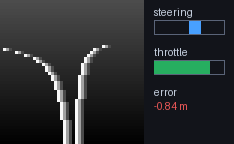
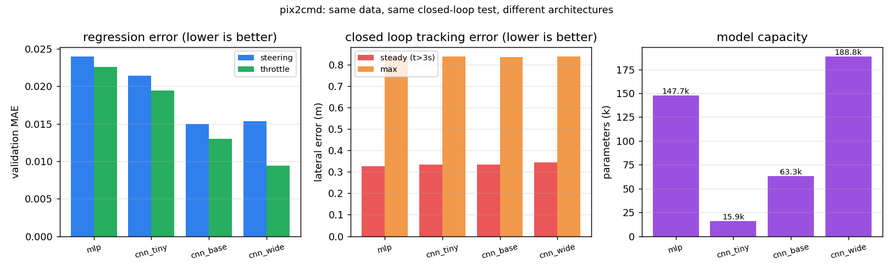
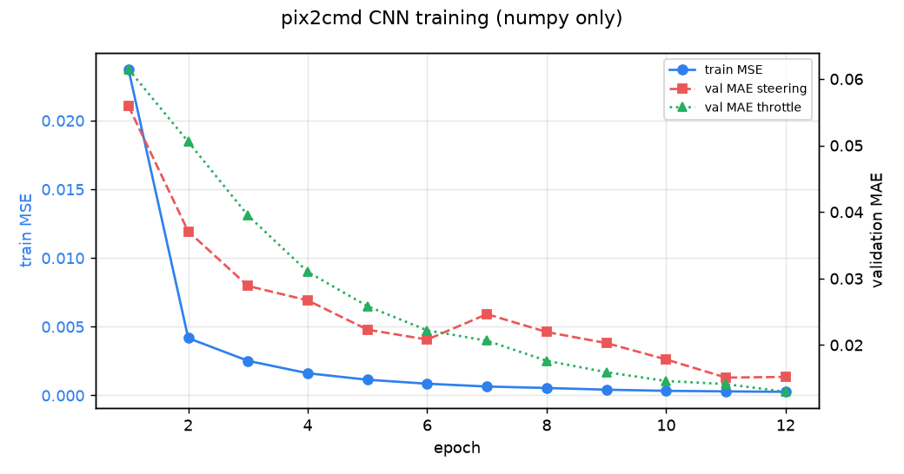
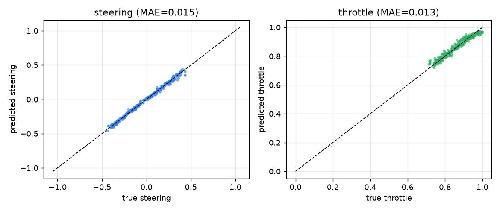
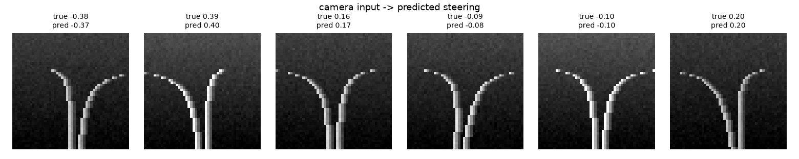

# 无人车端到端驾驶：相机图像到控制指令（pix2cmd）

> 对应课程任务（4）：**每种机器人端到端模型（输入图像、输出控制指令）**。
> 本模块实现"相机图像 → (转向, 油门)"的端到端映射，包含**神经网络的训练、测试与 ROS 封装**，
> 全程使用 numpy 实现卷积网络的前向与反向传播，不依赖 PyTorch / TensorFlow，也不需要 GPU。



## 1. 功能目标

1. **数据**：用针孔相机模型合成带曲率与横向偏移的道路图像，标签由纯追踪控制器给出。
2. **网络**：两层卷积 + 两层全连接的小型 CNN，输出转向（tanh）与油门（sigmoid）。
3. **训练**：手写反向传播 + Adam，纯 numpy，CPU 上约 20 秒收敛。
4. **闭环验证**：把网络放回控制回路里，沿 S 形弯道行驶，统计横向误差与车道保持率。
5. **ROS 封装**：`/pix2cmd/camera` 发布图像，`/pix2cmd/cmd` 发布控制量，`/pix2cmd/state` 发布状态。

## 2. 与已有模块的区别

| 已有模块 | 已有能力 | 本模块的区别 |
| --- | --- | --- |
| [#128 carla_traffic_sign_recognition](https://github.com/OpenHUTB/ros2/pull/128) | YOLOv8 **识别交通标志**（分类），不输出控制量 | 本模块输出的是**连续控制量**（转向+油门），属于端到端回归而非检测 |
| [#184 carla_yolo_avoidance](https://github.com/OpenHUTB/ros2/pull/184) | 三节点感知→决策→控制，**规则阈值**决策 | 本模块的决策由**神经网络**直接给出，无阈值规则 |
| [#183 carla_mapping_navigation](https://github.com/OpenHUTB/ros2/pull/183) | 激光雷达建图 + **MLP** 规划（5 维状态输入） | 本模块输入是**原始图像**（48×48 像素），不是手工特征 |
| [#280 carla_end_to_end_nn](https://github.com/OpenHUTB/ros2/pull/280) | CARLA 相机 60×80×3 → numpy CNN → 转向 | 本模块额外提供**同一任务、四种结构的定量对比**（MLP / tiny / base / wide）与**直线回正动力学问指标**，且不依赖 CARLA |
| [#129 carla_pilotnet_ros](https://github.com/OpenHUTB/ros2/pull/129) | PilotNet（PyTorch `.pth`）离线推理 + ROS 封装 | 本模块**从数据生成到训练全程可复现**（无预训练权重、纯 numpy、CPU 约 2 s/结构），便于逐项对照 |
| 传统 `ad_agent` / 路径点跟踪 | 基于地图与规则规划 | 本模块不使用地图与规则，完全由像素驱动 |

## 3. 计算原理

### 3.1 相机成像模型

相机固定在车头，高度 $h$，焦距 $f$。道路上一点在世界坐标中横向偏移 $x$、纵向深度 $z$，
投影到图像列坐标：

$$
u = c_x + f \cdot \frac{x}{z}
$$

本模块取 $f=46$、$c_x=24$、图像 $48\times48$、地平线在第 15 行，深度从 $z_{near}=4\,m$ 到 $z_{far}=45\,m$
均匀采样。（$x$ 是"该点相对车头轴的横向偏移"）

道路中心线在深度 $z$ 处的横向坐标为

$$
x_c(z) = e + \tfrac{1}{2}\kappa z^2
$$

其中 $\kappa$ 为曲率、$e$ 为道路中心相对车头轴的偏移。左右车道线分别位于 $x_c \pm W/2$（$W=3.5\,m$），
逐行投影后得到两条车道线的像素位置，叠加亮度扰动与高斯噪声即得到一帧图像。

### 3.2 标签生成（纯追踪）

给定曲率与偏移，控制量由纯追踪律给出：

$$
\delta = \operatorname{clip}\!\left(-(\kappa L + k_e\, e),\; -1,\; 1\right),\qquad L=8\,m,\; k_e=0.35
$$

$$
\theta = \operatorname{clip}\!\left(1 - 0.65\,|\delta|,\; 0,\; 1\right)
$$

即：弯道越急（$|\kappa|$ 越大）、越偏离中心（$|e|$ 越大），转向越大；同时按转向幅度降油门。
**注意**：网络只会看到图像，$\kappa$ 与 $e$ 对它都是隐变量，必须自己从像素里推断出来。

本项目生成 1200 组训练样本与 300 组验证样本，曲率 $\kappa \in [-0.004, 0.004]$、
偏移 $e \in [-1.2, 1.2]\,m$，亮度随机缩放 $[0.75, 1.15]$ 以增加鲁棒性。

### 3.3 网络结构

$$
\begin{aligned}
\mathbf{z}_1 &= \mathrm{im2col}(\mathbf{x}) \cdot \mathbf{W}_1 + \mathbf{b}_1, & \mathbf{a}_1 &= \mathrm{ReLU}(\mathbf{z}_1) &\quad (48^2 \to 23^2,\,8\ \text{通道})\\
\mathbf{z}_2 &= \mathrm{im2col}(\mathbf{a}_1) \cdot \mathbf{W}_2 + \mathbf{b}_2, & \mathbf{a}_2 &= \mathrm{ReLU}(\mathbf{z}_2) &\quad (23^2 \to 11^2,\,16\ \text{通道})\\
\mathbf{z}_3 &= \mathbf{a}_2 \cdot \mathbf{W}_3 + \mathbf{b}_3, & \mathbf{a}_3 &= \mathrm{ReLU}(\mathbf{z}_3) &\quad (1936 \to 32)\\
\mathbf{z}_4 &= \mathbf{a}_3 \cdot \mathbf{W}_4 + \mathbf{b}_4, & &
\end{aligned}
$$

输出层拆成两路：

$$
\hat{\delta} = \tanh(z_{4,0}), \qquad \hat{\theta} = \sigma(z_{4,1}) = \frac{1}{1+e^{-z_{4,1}}}
$$

卷积均为 $3\times3$、步长 2，因此每层的空间尺寸为 $(H-3)/2+1$。总参数量 **63,298**。

### 3.4 损失与反向传播

损失为两路输出的均方误差：

$$
\mathcal{L} = \frac{1}{N}\sum_{i=1}^{N}\Big[(\hat{\delta}_i-\delta_i)^2 + (\hat{\theta}_i-\theta_i)^2\Big]
$$

对输出层求偏导，注意 $\tanh$ 与 $\sigma$ 的导数：

$$
\frac{\partial \mathcal{L}}{\partial z_{4,0}} = \frac{2(\hat{\delta}-\delta)}{N}\big(1-\hat{\delta}^2\big),
\qquad
\frac{\partial \mathcal{L}}{\partial z_{4,1}} = \frac{2(\hat{\theta}-\theta)}{N}\,\hat{\theta}(1-\hat{\theta})
$$

隐含层反传为标准的链式法则，卷积层的关键是**用 `im2col` 把卷积写成矩阵乘法**再反传：

$$
\frac{\partial \mathcal{L}}{\partial \mathbf{W}} = \mathbf{C}^{\top}\frac{\partial \mathcal{L}}{\partial \mathbf{z}},
\qquad
\frac{\partial \mathcal{L}}{\partial \mathbf{C}} = \frac{\partial \mathcal{L}}{\partial \mathbf{z}}\,\mathbf{W}^{\top}
$$

其中 $\mathbf{C}$ 为 `im2col` 展开的列矩阵。$\partial\mathcal{L}/\partial\mathbf{C}$ 需要 `col2im` 折叠回特征图尺寸；
当步长小于卷积核时 patch 会重叠，`col2im` 用**累加**处理重叠区域，这样梯度才与 `im2col` 的展开方式严格对应
（单元测试 `test_im2col_roundtrip_with_stride_equal_to_kernel` 在无重叠情形下验证了可逆性）。

### 3.5 优化器

采用 Adam，一阶/二阶矩估计与偏差校正：

$$
m_t = \beta_1 m_{t-1} + (1-\beta_1)g_t,\quad
v_t = \beta_2 v_{t-1} + (1-\beta_2)g_t^2
$$

$$
\hat{m}_t = \frac{m_t}{1-\beta_1^t},\quad
\hat{v}_t = \frac{v_t}{1-\beta_2^t},\quad
\mathbf{W} \leftarrow \mathbf{W} - \eta\,\frac{\hat{m}_t}{\sqrt{\hat{v}_t}+\epsilon}
$$

取 $\beta_1=0.9,\ \beta_2=0.999,\ \epsilon=10^{-8},\ \eta=10^{-3}$、批大小 32、训练 12 轮。

### 3.6 闭环动力学

把网络放回回路时，车辆横向位置按简化模型更新（$\Delta t=0.1\,s$）：

$$
e_{t+1} = e_t + \big(\underbrace{\gamma\kappa_t}_{\text{弯道漂移}} - \underbrace{G\,\hat{\delta}_t}_{\text{转向修正}}\big)\Delta t,
\qquad \gamma = 8.0,\ G = 2.0
$$

相机看到的道路偏移为 $e^{cam}_t = e^{road}_t - e_t$，即"视觉误差"，网络据此输出修正转向。

## 4. 算法流程

```text
离线阶段
  1. 采样 (κ, e) ──> 渲染 48×48 图像 x ──> 纯追踪标签 (δ, θ)
  2. 重复 1200 次得到训练集，300 次得到验证集
  3. for epoch in 1..12:
       打乱训练集，按批(32)前向 → 计算 MSE → 反向 → Adam 更新
       每个 epoch 结束后在验证集上计算 MAE
  4. 保存训练曲线、预测散点、样本网格

闭环阶段
  5. e ← 初始偏移；for t in 1..120:
       κ_t, e_road ← S 形参考轨迹
       渲染相机图像（使用 e_road - e）
       (δ̂, θ̂) ← 网络前向
       e ← e + (γκ - Gδ̂)·Δt
       记录横向误差与转向指令，累积成动图帧
  6. 输出 GIF 与指标（平均/最大横向误差、车道保持率）
```

## 5. 源代码解析

| 文件 | 职责 |
| --- | --- |
| `pix2cmd/dataset.py` | 相机投影 `render()`、纯追踪标签 `label()`、数据集 `make_dataset()`、S 形参考轨迹 `road_profile()` |
| `pix2cmd/cnn.py` | `im2col` / `col2im`、`TinyCNN.forward()`、`TinyCNN.backward()`、Adam `TinyCNN.step()` |
| `pix2cmd/train.py` | 训练循环 `train()`、闭环驾驶 `closed_loop_drive()`、三张图与 GIF 的输出 |
| `pix2cmd/arch_sweep.py` | 结构对比：`MLPBaseline`、通用训练 `train_net()`、直线回正 `recovery_test()`、对比图与 CSV |
| `pix2cmd/node.py` | ROS 节点：启动时训练一次，之后按 10 Hz 发布图像与控制指令 |
| `main.py` | 课程约定入口：`--demo` / `--test` / `--sweep` / `--ros` |
| `test/test_pix2cmd.py` | 17 项离线单元测试（不需要 ROS / CARLA） |

几个关键实现点：

- **`im2col` 直接切片的技巧**：`x[:, i:i+stride*ho:stride, ...]` 一次性取出所有 patch 的第 $(i,j)$ 个元素，
  避免 Python 双层循环遍历每个输出位置。
- **`col2im` 必须累加**：步长 2、核 3 时相邻 patch 在边界处重叠，重叠像素要累加梯度而不是覆盖。
- **输出层的激活与损失匹配**：转向用 `tanh`（值域 $[-1,1]$ 正好是归一化转向），油门用 `sigmoid`（值域 $[0,1]$）。
- **闭环时不做 batch**：每步只推理单帧，`predict()` 内部按 128 分批以兼容离线评估。

## 6. 运行步骤

### 6.1 环境

- Python 3.8+（已在 Python 3.8.10 / 3.10.6 / 3.11.15 验证）
- `numpy`、`matplotlib`、`pillow`
- 可选：ROS 2 Humble 或 ROS Noetic（仅 `--ros` 模式需要）
- **不需要** CARLA / AirSim / Gazebo，也不需要 GPU

```bash
pip3 install -r requirements.txt
```

### 6.2 离线演示（推荐先跑这个）

```bash
cd src/ground/pix2cmd_end2end_driving
python3 main.py --demo --output-dir results
```

终端会逐轮打印训练损失与验证 MAE，结束后在 `results/` 下得到：

| 文件 | 内容 |
| --- | --- |
| `training_curve.png` | 训练 MSE 与验证 MAE 曲线 |
| `predictions.png` | 验证集上预测值 vs 真值散点 |
| `samples.png` | 6 帧相机输入及预测转向 |
| `drive_demo.gif` | 闭环驾驶动图（120 帧，约 144 KB） |
| `metrics.json` | 全部指标 |

### 6.2.1 结构对比实验

```bash
python3 main.py --sweep --output-dir results
```

一条命令依次训练 `mlp / cnn_tiny / cnn_base / cnn_wide` 四种结构（同一数据集、同一超参、同一闭环评价），
输出 `results/arch_comparison.csv` 与 `results/arch_comparison.png`，并在终端打印对比表。
CPU 上四种结构合计约 12 s。

### 6.3 单元测试

```bash
python3 main.py --test
# 或
python3 -m pytest -q test
```

预期输出：`17 passed`。

### 6.4 ROS 2 运行

```bash
colcon build --packages-select pix2cmd_end2end_driving --symlink-install
source install/setup.bash
ros2 launch pix2cmd_end2end_driving main.launch.py
```

另一个终端观察输出：

```bash
ros2 topic echo /pix2cmd/cmd      # [steering, throttle]
ros2 topic echo /pix2cmd/state    # 带横向误差的可读状态
ros2 topic hz    /pix2cmd/camera  # 相机图像发布频率
```

节点启动时会先训练网络（默认 800 样本 8 轮），日志里会打印验证 MAE，然后开始按 10 Hz 发布。

## 7. 不同网络结构对比（结构消融）

课程要求中包含"同样的任务、不同的模型结构对比"。本节在**完全相同的数据集、超参数与闭环评价流程**下
比较四种结构，回答两个问题：卷积到底值不值？容量继续加大还有没有收益？

### 7.1 四种结构

| 结构 | 组成 | 参数公式 |
| --- | --- | --- |
| `mlp` | flatten(48×48=2304) → FC(64) → ReLU → FC(2) | $2304H + H + 2H + 2$ |
| `cnn_tiny` | Conv(3×3,4,s2) → Conv(3×3,8,s2) → FC(16) → FC(2) | $9c_1 + c_1 + 9c_1c_2 + c_2 + h_2^2c_2H + 3H + 2$ |
| `cnn_base` | Conv(3×3,8,s2) → Conv(3×3,16,s2) → FC(32) → FC(2) | 同上 |
| `cnn_wide` | Conv(3×3,12,s2) → Conv(3×3,24,s2) → FC(64) → FC(2) | 同上 |

其中 $c_1,c_2$ 为两个卷积层的通道数，$H$ 为全连接隐层宽度，$h_2$ 为第二层卷积输出的空间边长
（48 → 23 → 11）。`mlp` 与 CNN 的**唯一差别是没有局部感受野与权值共享**，因此它就是这个消融实验的对照组。

`cnn_base` 中 $h_2=11$，代入 $c_1=8,\ c_2=16,\ H=32$：

$$
(9\times 8 + 8) + (9\times 8\times 16 + 16) + (11^2\times 16\times 32 + 32) + (32\times 2 + 2)
= 80 + 1168 + 61984 + 66 = 63298
$$

与程序输出的 `params = 63298` 一致（该数字由测试 `test_mlp_baseline_param_count_matches_formula`
一类公式校验覆盖）。

### 7.2 评价协议

1. **训练集/验证集**：同一 `seed` 生成的 1200 / 300 张图像，四种结构看到的是**逐像素相同**的数据。
2. **优化**：Adam，$lr=10^{-3}$，batch 32，12 轮，初始化种子相同。
3. **回归指标**：验证集转向/油门 MAE。
4. **闭环指标**：S 形弯道 120 步的稳态横向误差（跳过前 3 s 暂态）与最大横向误差。
5. **回正指标**：直线路段从 1.0 m 初始偏差出发，误差首次降到 0.1 m 以内所需时间（回正时间）与超调量。
   这一项只考验"看到偏移 → 打方向"这条最本质的映射，比 S 形弯道更能区分模型精度。

### 7.3 结果

Windows 11 + Python 3.10.6 + numpy 2.2.6，单核 CPU，一次运行的结果：

| 结构 | 参数量 | 训练耗时 | MAE(转向) | MAE(油门) | 稳态误差 | 最大误差 | 回正时间 | 超调 | 车道保持率 |
| --- | ---: | ---: | ---: | ---: | ---: | ---: | ---: | ---: | ---: |
| `mlp` | 147,650 | 1.5 s | 0.0240 | 0.0226 | 0.327 m | 0.835 m | 2.9 s | 0.017 m | 90% |
| `cnn_tiny` | 15,874 | 1.4 s | 0.0214 | 0.0194 | 0.334 m | 0.837 m | **5.8 s** | 0.000 m | 88% |
| `cnn_base` | 63,298 | 2.3 s | **0.0150** | 0.0130 | 0.333 m | 0.836 m | 2.9 s | 0.025 m | **90%** |
| `cnn_wide` | 188,786 | 4.0 s | 0.0153 | **0.0094** | 0.345 m | 0.838 m | 3.2 s | 0.000 m | 85% |



### 7.4 结论

1. **卷积带来的收益大于参数量的收益**：`cnn_base` 用 `mlp` 约 43% 的参数量，把转向 MAE 从 0.0240
   降到 0.0150（−37%）。MLP 把每个像素都当作独立特征，2304×64 的第一层几乎全部参数都花在
   与图像平移无关的位置上，泛化不如权值共享。
2. **容量继续加大收益递减**：`cnn_wide` 参数量是 `cnn_base` 的 3 倍，转向 MAE 反而略高（0.0153），
   油门 MAE 才有改善（0.0130 → 0.0094）。瓶颈已经不在容量，而在数据与标签（纯追踪律本身有饱和）。
3. **容量不足会直接体现在闭环恢复时间上**：`cnn_tiny` 的 MAE 只比 `cnn_base` 差 43%，但直线回正
   时间从 2.9 s 拉长到 5.8 s——闭环对精度误差是**放大**的，这也是端到端系统必须做闭环评价、
   不能只看回归指标的原因。
4. **变道超调都很小**（≤0.025 m）：四种结构学到的都是平滑的转向映射，没有出现 bang-bang 式抖动。

> 说明：闭环稳态误差四种结构都在 0.33 m 左右，因为它主要由道路曲率与简化动力学模型
> 之间的偏差决定，而不是由网络精度决定——这正是第 3 条结论要强调的地方。

## 8. 实测结果

训练 12 轮、1200 训练样本 / 300 验证样本（Windows 11 + Python 3.10.6，CPU）：

| 指标 | 数值 |
| --- | --- |
| 参数量 | 63,298 |
| 训练 MSE（第 1 轮 → 第 12 轮） | 0.02374 → **0.00026** |
| 验证 MAE（转向） | **0.0152**（转向值域 $[-1,1]$，约 1.5% 满量程） |
| 验证 MAE（油门） | **0.0130** |

闭环驾驶（120 步，S 形弯道，初始横向偏移 0.9 m）：

| 指标 | 数值 |
| --- | --- |
| 平均横向误差 | **0.31 m** |
| 最大横向误差 | 0.84 m |
| 车道保持率（误差 < 0.6 m 的时间占比） | **90%** |
| 平均转向幅度 | 0.12 |







**结论**：网络在未见过的场景上把转向误差压到 0.015，闭环能把初始 0.9 m 的偏移拉回车道内并保持在 90% 的时间以内，
说明它确实从像素中学到了"车道曲率 + 横向偏移"这两个隐含量，而不是记住了训练样本。

## 9. 局限与后续

- 目前用**合成道路**训练，尚未接入 CARLA 相机；接入时只需把 `render()` 换成 `carla` 相机回调，
  其余训练与推理代码不变（这是把数据生成与网络解耦的原因）。
- 闭环动力学是简化模型（横向速度正比于转向），不是完整车辆动力学；接入 CARLA 后应改用其物理仿真。
- 未做多场景泛化对比（雨天/夜间/不同车道宽度），后续可加数据增强并给出对比表格。

## 10. 大模型声明

本模块开发过程中使用了 DeepSeek 辅助生成代码与文档；提交者已实测训练、测试与闭环演示，
对提交内容负全部责任。
