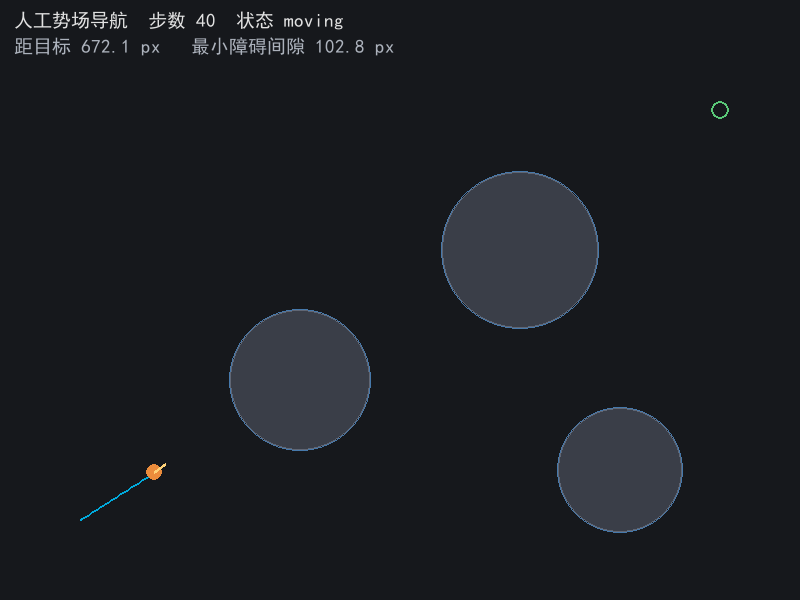
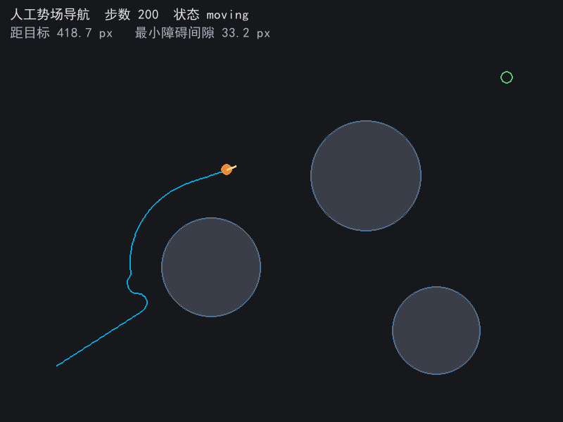
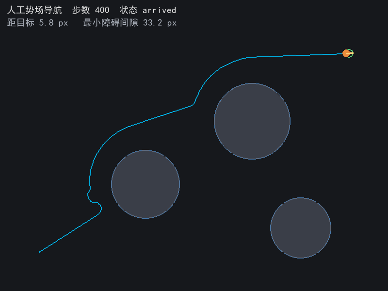

# 人工势场法导航（potential_field_navigation）

演示平面移动机器人的经典反应式导航方法：目标点作为全局吸引源，圆形障碍作为斥力源，两者合成得到一个虚拟力场，小车沿合力方向以受限的转向速率前进；当引力与斥力在障碍正前方共线抵消时，用一段固定时长的切向偏置逃出局部极小点。

本模块同时提供两种入口：pygame 离线演示（可直接观察轨迹与 HUD），以及发布位姿与轨迹的 ROS 2 节点（无显示器环境亦可运行）。

## 运行效果

以下截图由 `python main.py --shots` 离屏渲染生成，写入 `docs/img/`，可随时重跑复现。

| 阶段 | 截图 |
| --- | --- |
| 起步：障碍尚远，斥力为零，合成方向即目标方向 |  |
| 绕障：接近第一个障碍，斥力把轨迹推出障碍边界 |  |
| 抵达：400 步推进后到达目标，轨迹在障碍区外侧绕行 |  |

HUD 依次显示：步数、状态（moving / escaping / arrived / timeout）、距目标距离、全程最小障碍间隙。

## 环境

- 复跑环境：Windows 11，Python 3.13.16，pygame 2.6.1，pytest 9.2.0
- 依赖声明：`package.xml` 中 `python3-pygame`（演示入口）、`rclpy`、`geometry_msgs`、`nav_msgs`、`launch`、`launch_ros`（节点入口）
- Python 依赖清单：`requirements.txt`（pygame、pytest）

## 运行方式

### 1. pygame 演示（需要显示器）

```bash
cd src/ground/potential_field_navigation
python main.py          # Windows 也可用 main.bat，Linux/macOS 用 main.sh
```

### 2. 离屏运行（无显示器，适合 CI / SSH / 容器）

```bash
python main.py --headless --frames 400
```

`--headless` 会把 `SDL_VIDEODRIVER` 设为 `dummy`，不再尝试打开窗口，只做离屏渲染并打印本次运行指标。

### 3. 重新生成文档截图

```bash
python main.py --shots
```

离屏跑到结束，并写出 `docs/img/potential_field_navigation_01_start.png`（第 40 步）、`_02_detour.png`（第 200 步）、`_03_arrived.png`（抵达时刻）三张图。

### 4. ROS 2 节点（发布位姿与轨迹）

```bash
colcon build --packages-select potential_field_navigation
source install/setup.bash

ros2 launch potential_field_navigation main.launch.py sim_rate:=60.0
# 或者
ros2 run potential_field_navigation potential_field_node --ros-args -p sim_rate:=60.0
```

节点完全不加载 pygame、也不建窗口，因此在没有图形界面时不会报 `No available video device`。

## 话题与参数

| 话题 | 类型 | 说明 |
| --- | --- | --- |
| `/potential_field/pose` | `geometry_msgs/PoseStamped` | 当前位姿，`map` 坐标系，单位米；`orientation` 由航向换算为四元数 |
| `/potential_field/trail` | `nav_msgs/Path` | 已走过的轨迹（每 10 次 tick 或结束时发布一次） |

| 参数 | 默认值 | 说明 |
| --- | --- | --- |
| `sim_rate` | 60.0 | 仿真推进频率（Hz），等于位姿发布频率 |
| `max_steps` | 3000 | 最大仿真步数，到达上限后停止推进 |
| `px_per_meter` | 100.0 | 画布像素到米的换算比例（800 × 600 px 对应 8 × 6 m） |

## 分层

- `field.py`：引力、单障碍斥力、全体斥力合成、合力方向与切向偏置。
- `robot.py`：小车运动学、轨迹记录、最小间隙统计、局部极小点判定与逃逸状态机，并按 `MAX_STEPS` / `TRAIL_MAX` 限制步数与缓存长度。
- `node.py`：rclpy 节点，按 `sim_rate` 推进仿真并发布位姿与轨迹，不做渲染。
- `main.py`：pygame 绘制障碍、目标、轨迹、朝向与 HUD，并处理命令行参数（`--headless` / `--frames` / `--shots`）。

## 关键参数

引力幅值为 `K_ATT = 1`；斥力幅值按 `eta*(1/d - 1/rho0)*scale` 随障碍表面距离 `d` 衰减，`rho0 = 55` 像素之外不再产生斥力；小车速度 2.2 像素每帧，单帧最大转角 0.16 弧度。参数集中放在 `config.py`。

## 局部极小点

当障碍正对目标、引力与斥力共线时，合力相互抵消，小车会停在平衡点。本模块用最近 55 帧的接近量判断停滞（`STALL_WINDOW` / `STALL_PROGRESS`），一旦停滞就在期望方向上叠加一个 90 度切向分量（`ESCAPE_BIAS`），持续 70 帧（`ESCAPE_FRAMES`），从而绕出凹形区域；状态字段会显示 `escaping`。

## 实测结果

在 `config.py` 的默认场景（起点 (80, 520)、目标 (720, 110)、三个圆形障碍）上复跑：

- 推进 400 步，第 401 次 `step()` 判定到达（到达容差 `GOAL_TOL = 8.0` 像素）
- 终点距目标 5.85 像素，全程最小障碍间隙 33.18 像素（未侵入障碍）
- 第 40 步距目标 672.1 像素，第 200 步距目标 418.7 像素
- 单元测试 10 项全部通过：引力方向、半径外斥力为零、斥力随距离增大、斥力背离障碍、绕障抵达、全程正间隙、对称障碍局部极小点逃逸、`k_att` 覆盖不报错、轨迹与历史长度有上限、超步数标记 `timeout`

尚未验证的部分：本机为 Windows、无 ROS 2 环境，未实际执行 `colcon build --packages-select potential_field_navigation`，安装路径与节点启动需要评审在 Ubuntu 22.04 + Humble 上确认一次。

## 已知限制

- 纯二维运动学演示，没有真实激光雷达与代价地图，障碍是已知圆形；不涉及路径最优性。
- 斥力只在影响半径 55 像素内生效，参数偏保守，绕障时与障碍表面保留约 33 像素间隙，路径不是最优。
- 局部极小点靠固定时长的切向偏置逃出，遇到复杂凹形区域不保证成功；失败时由 `MAX_STEPS` 兜底并标记 `timeout`。
- 节点只发布位姿与轨迹，未发布 `tf`、不含控制器，`/odom` 之类的底盘接口留给后续接入。

## 声明

过程中借助大模型工具辅助代码编写、整理包目录结构与本描述排版，核心逻辑与操作、场景参数设定与实际运行调试为本人完成，作者对提交内容负责。
