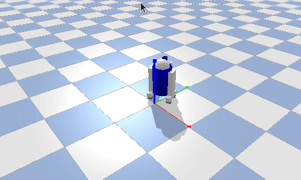

# R2D2小车 固定轮速差速圆周运动示例

## 实验简介
本示例使用PyBullet搭建R2D2四轮小车，通过左右车轮固定速度差实现差速圆周运动：左轮速度高、右轮速度低，小车沿圆弧轨迹持续自动行驶，无需人工干预，无限循环。

> 说明：本示例仅演示「固定轮速差速圆周运动」，不包含轨迹反馈、路径跟踪或避障，不能据此说明能够稳定保持给定巡航轨迹。

## 运行环境（已验证）
- Ubuntu 20.04
- Python 3.8
- pybullet 3.x（`pip install pybullet`）

## 运行步骤（从仓库根目录执行）
```bash
# 1. 安装依赖
pip install pybullet

# 2. 直接运行（推荐）
python3 src/ground/r2d2_cruise/main.py

# 3. 或通过 ROS launch 启动（需 ROS 环境）
#    将 src/ground/r2d2_cruise 放入 catkin 工作空间的 src 后：
#    catkin_make && roslaunch r2d2_cruise main.launch
```

运行后弹出 PyBullet 可视化窗口：小车沿圆弧轨迹持续圆周巡航行驶。关闭仿真窗口或按 Ctrl+C 即可退出，程序会自动释放仿真连接。

## ROS 接口说明
本模块为独立 PyBullet 仿真脚本，不发布/订阅 ROS 话题。`package.xml` 与 `launch/main.launch` 用于满足仓库「模块支持 launch 启动、入口为 main 开头」的约定：roslaunch 仅作为统一启动入口调用 `main.py`，不依赖 ROS 运行时。

## 验收方法
- 运行后弹出 PyBullet 可视化窗口，小车自动沿圆弧轨迹持续巡航，无需按键或人工干预；
- 关闭窗口或按 Ctrl+C：程序正常退出，无残留进程，仿真连接已释放；
- 运行效果参考动图：



## 说明
本作业的代码与文档在编写过程中使用了 AI 大模型辅助，本人已核对并确认提交内容，对提交内容负责。
