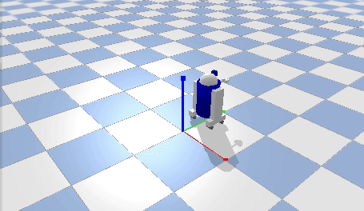

# R2D2小车 键盘手动遥控仿真

## 实验简介
本实验使用PyBullet搭建R2D2四轮小车，通过键盘手动遥控小车运动：按方向键或WASD控制小车前进、后退、左转、右转，小车实时响应键盘输入，无需人工干预之外的任何自动逻辑。

## 运行环境
Ubuntu20.04 + Python3 + pybullet

## 运行步骤
```bash
# 1. 安装依赖
pip install pybullet

# 2. 运行仿真（源码位于 src/ground/r2d2_keyboard_control/main.py）
python3 src/ground/r2d2_keyboard_control/main.py
```

运行后弹出 PyBullet 可视化窗口，聚焦仿真窗口后使用键盘遥控小车：

| 按键 | 功能 |
| --- | --- |
| W / ↑ | 前进 |
| S / ↓ | 后退 |
| A / ← | 左转 |
| D / → | 右转 |
| 空格 | 急停 |
| Q / Esc | 退出程序 |



## 说明
本作业的代码与文档在编写过程中使用了 AI 大模型辅助，本人已核对并确认提交内容，对提交内容负责。
