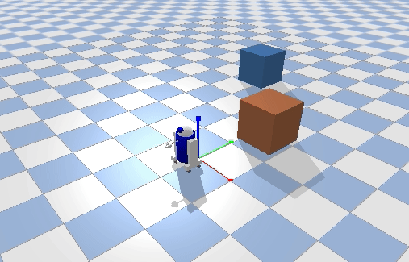

# R2D2小车 自动避障仿真

## 实验简介
用 PyBullet 搭一个简单场景：小车出发路线上摆两个箱子，R2D2 小车自动出发直行，遇到箱子会先停一下，判断障碍在左边还是右边，往空的一边转 90 度绕过去，绕完再转回原来的方向继续直行，走完全程自动停下，全程不需要人工操作。

## 实现思路
- 小车前方打一条射线（`rayTest`），实时量障碍距离，距离小于阈值就认为前面有东西；
- 再用左前、右前两条偏射线比较，判断障碍偏哪边，往空旷一侧转 90 度；
- 转完直行一段距离，把箱子甩到车身后边，再转回初始朝向继续走；
- 到达终点线后停车，打印提示。

## 运行环境（已验证）
- Ubuntu 20.04
- Python 3.8
- pybullet 3.x（`pip install pybullet`）

## 运行步骤（从仓库根目录执行）
```bash
# 1. 安装依赖
pip install pybullet

# 2. 直接运行（推荐）
python3 src/ground/r2d2_obstacle_avoid/main.py

# 3. 或通过 ROS launch 启动（需 ROS 环境）
#    将 src/ground/r2d2_obstacle_avoid 放入 catkin 工作空间的 src 后：
#    catkin_make && roslaunch r2d2_obstacle_avoid main.launch
```

运行后弹出 PyBullet 可视化窗口：小车自动直行、两次绕开箱子、到达终点停下。关闭仿真窗口或按 Ctrl+C 即可退出。

## ROS 接口说明
本模块为独立 PyBullet 仿真脚本，不发布/订阅 ROS 话题。`package.xml` 与 `launch/main.launch` 用于满足仓库「模块支持 launch 启动、入口为 main 开头」的约定：roslaunch 仅作为统一启动入口调用 `main.py`，不依赖 ROS 运行时。

## 验收方法
- 运行后弹出 PyBullet 可视化窗口，小车自动完成绕障并到达终点停下，无需按键；
- 关闭窗口或按 Ctrl+C：程序正常退出，无残留进程，仿真连接已释放；
- 运行效果参考动图：



## 说明
本作业的代码与文档在编写过程中使用了 AI 大模型辅助，本人已核对并确认提交内容，对提交内容负责。
