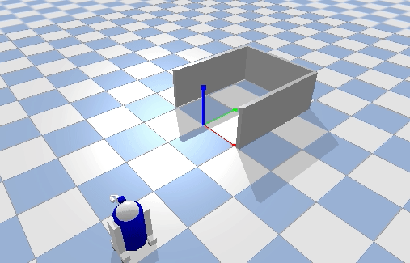

# R2D2小车 倒车入库仿真

用 PyBullet 搭了个简易车库（后墙加左右两面墙），R2D2 小车从远处出发，先直行横穿库口前方，再弧线转弯倒车入库，进库后打印"入库成功"并停下。

## 运行环境

- Ubuntu 20.04
- Python 3.8
- pybullet

## 运行步骤

```bash
pip install pybullet
python3 src/ground/r2d2_parking/main.py
```

运行后弹出 PyBullet 窗口，小车先直行到库口侧方，再弧线转弯倒车入库，入库成功后停下。



## 实现思路

1. 用三个盒子搭出车库：后墙加左右两面墙，库口朝 y 正方向。
2. 小车从库口前方远处出发，先直行横穿库口前方（车头朝 +x 开 1.8m），停到库口侧方。
3. 倒车入库用视线引导：每帧算车尾应该对准库中心的方向（`atan2(1.5-y, -x)`），车尾偏了就边倒车边差速转向，对准了就直倒。
4. 进库判定：车 y > 0.6 就停车，打印"入库成功"。
5. 加了靠墙保护：靠近库口时如果 x 偏出 0.68 就直倒拉回中线，防止撞墙。

## 说明

本作业的代码与文档在编写过程中使用了 AI 大模型辅助，本人已核对并确认提交内容，对提交内容负责。
