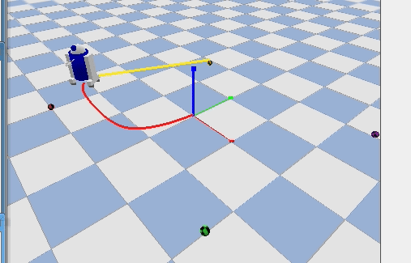

# R2D2仿真小车搜寻收集小球

用 PyBullet 搭了辆 R2D2 小车，场地里撒了 4 个彩球（红/绿/黄/紫），小车自己找最近的球、开过去"收"掉，收完 4 个就停。

## 怎么跑

```bash
pip install pybullet
python3 src/ground/r2d2_search_collect/main.py
```

跑起来后：小车先锁定最近的球，车头转向目标、边转边走（走出弧线），靠近到 1 米以内球消失、计数 +1，接着找下一个。黄色指示线一直指着当前目标，红色轨迹是走过的路线；4 个收完自动停车。

## 小车怎么找球

两步：选目标 + 转向过去。

- **选目标**：每次收完一个球，把没收集的球都看一遍，选离自己最近的那个锁住，直到收掉才换下一个（不然车会在几个球之间乱跑）；
- **转向**：P 比例控制。先算目标方向角：

```
target_angle = atan2(target.y - car.y, target.x - car.x)
err = normalize(target_angle - 车头朝向)
angular = clamp(KP * err)   # 限幅，防止原地打转
```

然后左右轮差速：左轮 = 线速度 - 角速度，右轮 = 线速度 + 角速度，车边前进边转，走出平滑弧线朝目标过去。

调参时试过几组：KP 太小（2 左右）转向太慢绕大圈，太大（10 以上）车头抖、来回摆，最后定在 5.0，线速度 12，角速度限幅 8，跑起来比较顺。

## 参数

| 参数 | 值 | 干什么的 |
|------|-----|---------|
| LINEAR_SPEED | 12.0 | 前进速度 |
| KP | 5.0 | 转向比例系数 |
| MAX_ANGULAR | 8.0 | 角速度限幅 |
| COLLECT_DIST | 1.0 | 离球多近算收集成功 |
| WHEEL_FORCE | 100 | 轮子驱动力 |

## 效果



终端会打印 `[收集] 第 x/4 个球收集完成`，收完打印任务结束。

## 备注

代码和文档用了 AI 辅助，我自己调试跑通的，内容我负责。
