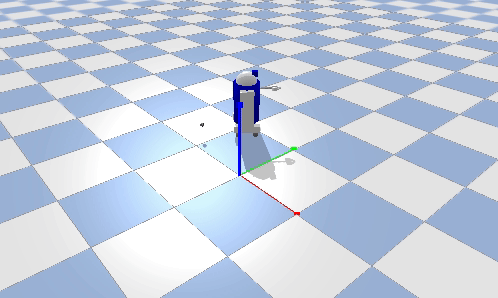

# R2D2小车 目标追踪仿真

## 实验简介
本实验使用PyBullet搭建R2D2四轮小车与一个沿圆形轨迹移动的目标球。小车实时获取目标球位置，计算转向误差并通过左右车轮差速控制调整方向，自动追踪场内移动的目标球；追上后与目标球保持约0.5米距离稳定跟随，无需人工干预。

## 运行环境
Ubuntu20.04 + Python3 + pybullet

## 运行步骤
```bash
# 1. 安装依赖
pip install pybullet

# 2. 运行仿真（源码位于 src/ground/r2d2_tracking/main.py）
python3 src/ground/r2d2_tracking/main.py
```

运行后弹出 PyBullet 可视化窗口：目标球沿圆形轨迹移动，R2D2 小车自动转向追踪目标球，追上后保持距离跟随目标球同步移动。



## 说明
本作业的代码与文档在编写过程中使用了 AI 大模型辅助，本人已核对并确认提交内容，对提交内容负责。
