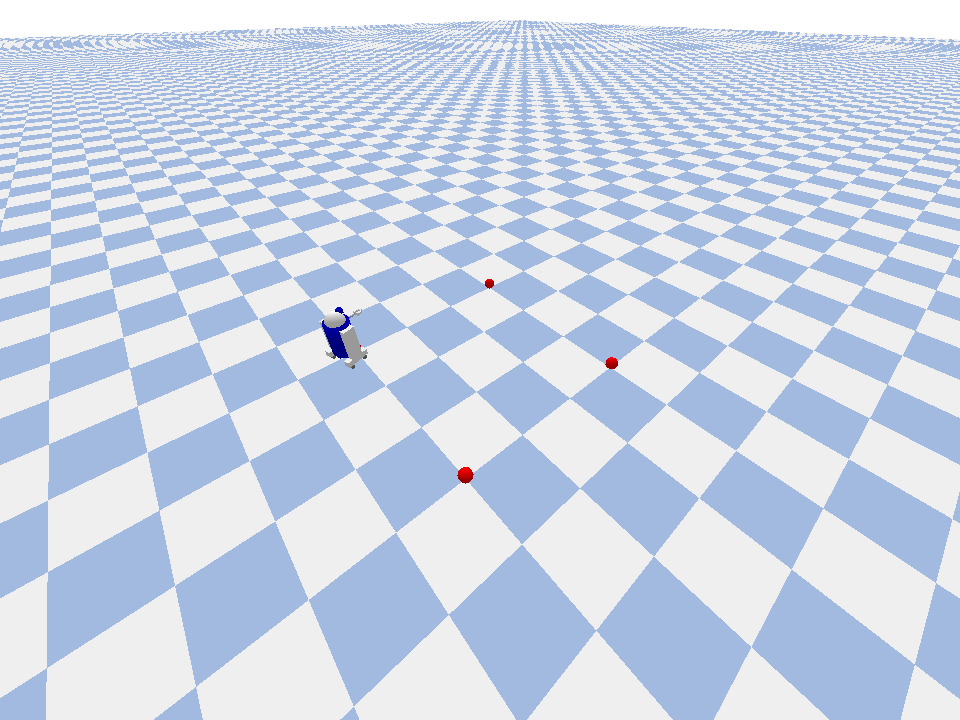
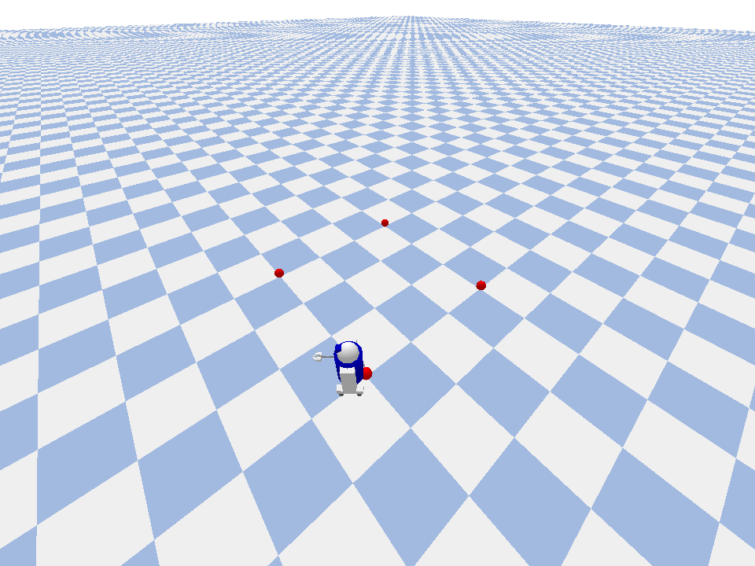
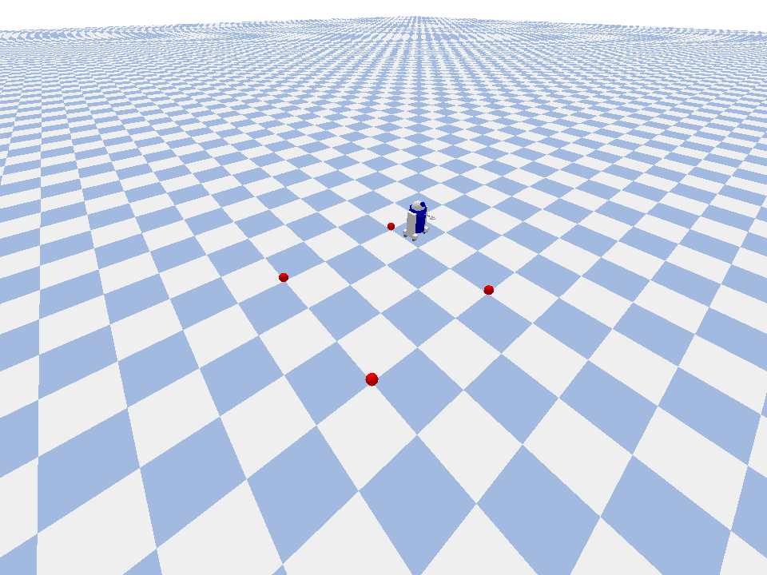
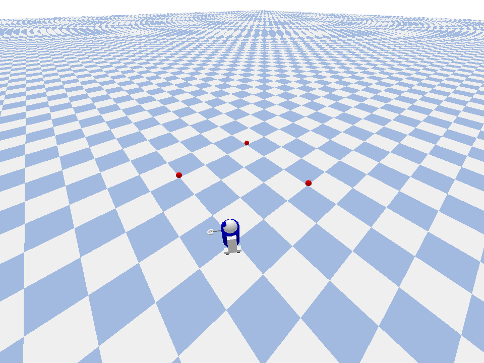

# R2D2小车航点自动巡航仿真

## 实验简介
本示例使用 PyBullet 搭建 R2D2 四轮差速小车，沿预设的方形航点路径实现自动巡航。小车通过 P 控制器实时计算位置与航向误差，依次导航到每个红色航点球标记点，到达后自动切换下一个目标，完成一圈后循环巡逻。

与固定轮速差速圆周运动不同，本示例包含完整的**航点跟踪闭环控制**：实时读取机器人位姿、计算机器人与目标航点的距离与角度偏差、根据偏差动态调整左右轮速度，实现有目的的路径巡航，而非被动的圆弧绕行。

## 运行环境（已验证）
- Ubuntu 20.04 / 22.04
- Python 3.8+
- pybullet 3.x（`pip install pybullet`）
- numpy（`pip install numpy`）

## 运行步骤（从仓库根目录执行）
```bash
# 1. 安装依赖
pip install pybullet numpy

# 2. 方式一：通过 main.sh 启动（推荐）
cd src/ground/r2d2_waypoint_cruise && ./main.sh

# 3. 方式二：直接运行核心脚本
python3 src/ground/r2d2_waypoint_cruise/src/r2d2_waypoint_cruise/cruise.py

# 4. 方式三：ROS2 launch 启动（需 ROS2 环境）
#    将包放入 ROS2 工作空间 src 后：
#    colcon build && source install/setup.bash
#    ros2 launch r2d2_waypoint_cruise cruise.launch.py
```

运行后弹出 PyBullet 可视化窗口：R2D2 小车从起点出发，依次经过四个航点球标记，沿方形路径自动巡航巡逻。关闭仿真窗口或按 Ctrl+C 即可退出，程序自动保存轨迹数据并释放仿真连接。

## 控制算法说明
### 差速运动学
R2D2 为四轮差速驱动模型，左右两侧车轮分别独立控制：
- 线速度 $v = (v_{left} + v_{right}) / 2$
- 角速度 $\omega = (v_{left} - v_{right}) / L$（$L$ 为轮距）

### 航点跟踪 P 控制器
1. **位置误差**：计算机器人当前位置 $(x, y)$ 到目标航点 $(g_x, g_y)$ 的距离 $d$。
2. **航向误差**：计算目标方向角与当前朝向的夹角偏差 $\Delta\theta$。
3. **速度调节**：
   - 线速度 $v = K_p^{dist} \cdot d$，接近目标时自动减速；
   - 角速度 $\omega = K_p^{heading} \cdot \Delta\theta$，航向偏差大时先转向再前进。
4. **航点切换**：当距离小于阈值（0.3 m）时，自动切换到下一个航点。

## ROS 接口说明
本模块为独立 PyBullet 仿真脚本，不发布/订阅 ROS 话题。包结构采用标准 ament_python ROS2 包格式（`setup.py` + `package.xml` + `resource/` + `launch/*.launch.py`），`ros2 launch` 仅作为统一启动入口调用仿真脚本，不依赖 ROS 运行时。

## 运行测试
```bash
cd src/ground/r2d2_waypoint_cruise
python3 tests/test_basic.py
```

## 输出数据
程序运行结束后，轨迹数据自动保存到 `/tmp/r2d2_cruise_trajectory.csv`，包含以下字段：

| 字段 | 说明 |
|------|------|
| time | 仿真时间（秒） |
| x, y | 机器人当前位置（米） |
| yaw | 当前偏航角（弧度） |
| target_wp_idx | 当前目标航点索引 |
| dist_to_target | 距离目标航点的距离（米） |

## 验收方法
- 运行后弹出 PyBullet 窗口，小车自动从起点出发，依次经过四个红色航点球标记；
- 每到达一个航点，终端打印到达信息，并自动转向下一个航点；
- 完成一圈后自动循环巡逻，无需人工干预；
- 关闭窗口或按 Ctrl+C：程序正常退出，轨迹 CSV 已保存，仿真连接已释放。

## 运行效果





## 说明
本作业的代码与文档在编写过程中使用了 AI 大模型辅助，本人已核对并确认提交内容，对提交内容负责。
