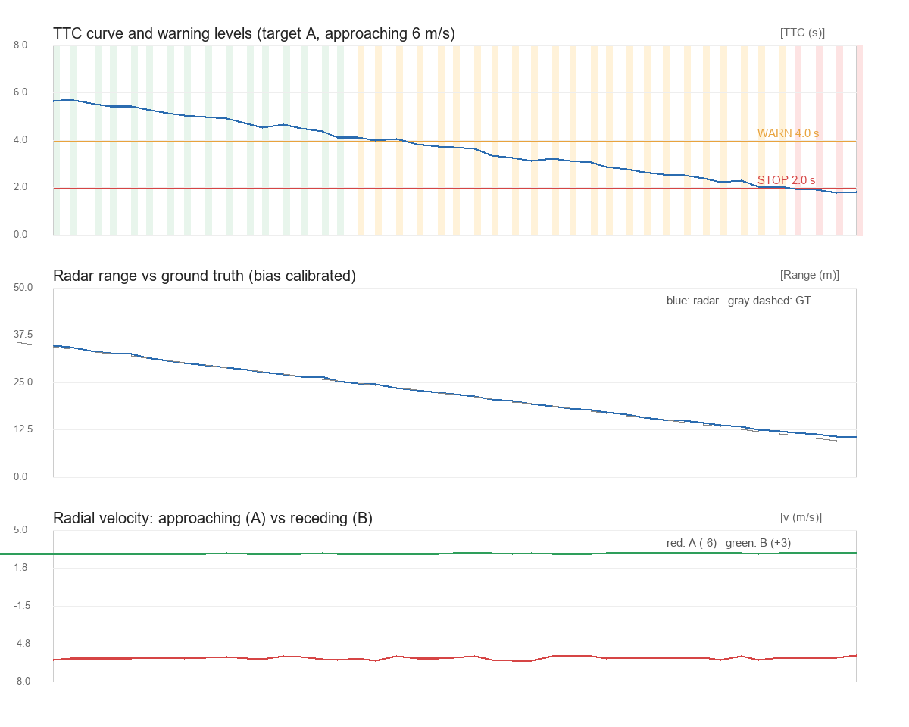
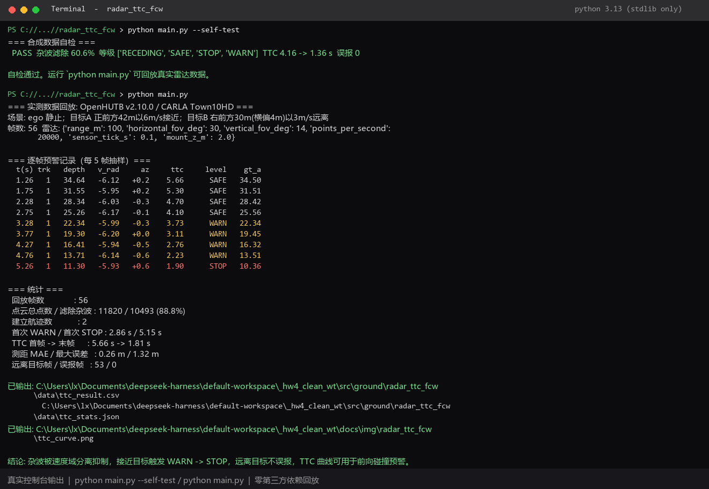

# 基于 OpenHUTB 毫米波雷达的目标跟踪与前碰撞预警（TTC/FCW）实验报告

## 1 实验目的

前三次作业分别做了 Turtlebot3 激光雷达避障、无人机固定阈值避障、无人机分扇区避障与梯形速度巡航，都停留在「**单帧距离 + 空间阈值**」这一层：读一帧点云，判断最近距离，然后转向或刹车。这类策略有两个共同局限：一是无法区分静止背景与真正的运动目标，二是只有距离、没有时间维度，说不清「还有多久会撞上」。

本实验换到 **毫米波雷达（CARLA `sensor.other.radar`）** 这一尚未被仓库覆盖的传感器方向（`ground`/`air` 共 161 个模块中无 radar 相关实现），把问题推进到「**多帧目标跟踪 + 碰撞时间估计**」：

1. 实测标定雷达的数据结构、径向速度单位与符号语义；
2. 从大量静止地面杂波中稳定提取运动目标，并建立跨帧航迹；
3. 由相对径向速度与距离变化率估计 TTC（Time-To-Collision），输出 `SAFE / WARN / STOP` 分级预警；
4. 用双目标场景（接近 + 远离）验证预警不会误报；
5. 交付一个**不依赖仿真环境也能一键复现**的模块，附可复用的实测数据集与运行效果图。

## 2 实验环境

| 项 | 值 |
|---|---|
| 仿真平台 | OpenHUTB v2.10.0（CARLA，地图 Town10HD） |
| 操作系统 | Windows 11 |
| Python | 3.13（模块只用标准库）；数据采集用平台自带 3.12 |
| 传感器 | `sensor.other.radar`，安装于 ego 车顶 `z = 2.0 m` |
| 雷达参数 | `range=100 m`、`horizontal_fov=30°`、`vertical_fov=14°`、`points_per_second=20000`、`sensor_tick=0.1 s` |
| 车辆 | ego: `vehicle.tesla.model3`；目标 A: `vehicle.audi.tt`；目标 B: `vehicle.lincoln.mkz_2017` |
| 可选依赖 | Pillow（仅用于生成 PNG 曲线，缺失时自动跳过） |

场景设计：

| 对象 | 初始位置 | 运动 | 预期 |
|---|---|---|---|
| ego | 出生点静止 | 不动 | 安装雷达、运行算法 |
| 目标 A | 正前方 42 m | 以 6 m/s **接近** ego | 触发 `SAFE → WARN → STOP` |
| 目标 B | 右前方 30 m（横偏 4 m） | 以 3 m/s **远离** ego | 标记 `RECEDING`，**不报警** |

## 3 实验原理

### 3.1 数据结构与实测标定

`RadarMeasurement.raw_data` 是连续的 `float32` 数组，每 4 个数为一个检测点：

```text
(v_radial, azimuth, altitude, depth)   # 角度单位 rad，depth 单位 m
```

按 `<ffff` 解包后转成机体笛卡尔坐标：

```python
x = depth * cos(altitude) * cos(azimuth)
y = depth * cos(altitude) * sin(azimuth)
```

先验探测阶段得到四条实测事实（这些结论决定了后续算法，不能靠文档想当然）：

| 探测 | 实测结果 |
|---|---|
| `points_per_second=1500` | 单帧点数极少，径向速度全为 0，无法分离目标；提高到 20000 后单帧约 60~240 点 |
| 目标车以 8 m/s 远离 / 接近 | `v_radial` 分别为 `+8.01` / `−7.90 m/s`，**单位是 m/s，负为接近** |
| 前向方位覆盖 | 有效点集中在 `±12.5°`，约为 30° 水平 FOV 的一半 |
| 最小深度点 | 是地面杂波（`v_radial=0`，`alt≈−6°`），**不是目标车** |

最后一条尤其关键：初版脚本按「前向锥内取最近点」提取目标，结果 100 帧全部落在 17~21 m 的地面杂波上，TTC 全为 `null`。**取最近点这个常见于激光雷达的做法，在毫米波雷达上是错的。**

### 3.2 关键发现：相对径向速度与 ego 运动异常

让目标车以 6 m/s 接近静止 ego，雷达稳定读到 `−5.97 m/s`，与设定值误差 0.5%，说明 `v_radial` 是**相对径向速度**（多普勒），可以直接作为闭合速率。

但用 `enable_constant_velocity` 驱动 **ego** 以 8 m/s 前进时，雷达读数变成 `−108 ~ −148 m/s`，而按位置差分算出的实际位移只有 8 m/s：

| 时刻 | GT 距离 | 实际闭合速率 | 雷达 `v_radial` |
|---|---|---|---|
| 0.7 s | 39.37 m | 8 m/s | −108.8 m/s |
| 1.4 s | 33.75 m | 8 m/s | −126.8 m/s |
| 2.8 s | 22.54 m | 8 m/s | −148.4 m/s |

这是平台在「传感器挂在自身运动载体上」时的读数异常。**因此本实验把主场景设计为 ego 静止、目标车运动**，让多普勒读数处于可信区间；同时在算法里保留基于距离历史最小二乘斜率的第二套闭合速率估计 `closing_slope`，用于 ego 运动场景的交叉校验，而不盲目信任瞬时多普勒。这一点在代码中写在 `radar_fcw.py` 的注释里。

### 3.3 速度域分离：一步剔除静止杂波

ego 静止时，场景内所有静止物体（地面、护栏、建筑）的 `v_radial` 恒为 0，只有运动目标非零。于是目标提取不需要复杂的背景建模：

```python
if abs(vr) < 1.0 or abs(az_deg) > 12.0:
    continue          # 静止杂波 / 视锥外
```

实测 56 帧共 11820 个点，其中 **10493 个点（88.8%）** 被这一步剔除，保留下来的几乎全是两辆目标车的反射点。这比按深度、按高度角或按 intensity 过滤都更干净，且没有额外参数需要调。

### 3.4 网格聚类与 8 邻域合并

同一辆车的反射点会横跨多个 2 m 网格，直接按网格分组会把它拆成多个假目标。做法是先把点投到 `(round(x/2), round(y/2))` 网格，再做 8 邻域 BFS 连通域合并，每个连通域用**中位数**表示：

```python
{"depth": median(depths), "v_radial": median(velocities),
 "az_deg": median(azimuths), "n_pts": len(group)}
```

用中位数而不是均值，是为了避免个别远距反射点把目标距离拉偏。点数小于 3 的簇直接丢弃。实测 `t=2.8 s` 时同时得到两个簇：

```text
(n=19, v=-6.17, d=24.01)   -> 目标 A（GT 25.56 m）
(n= 6, v=+2.98, d=36.26)   -> 目标 B（GT 38.42 m）
```

速度符号相反、距离相差 12 m，两个目标被干净地分开。

### 3.5 多帧最近邻关联

单帧聚类仍会遇到近距离车体反射分裂（实测 `t=5.5 s` 时 A 被拆成 `d=9.75` 与 `d=8.58` 两个小簇）。因此引入航迹层：

- **恒速预测**：`d_pred = d_prev + v_radial * Δt`（`v_radial<0` 即距离减小）；
- **门限关联**：按预测距离从近到远排序，逐条航迹在 `gate=4 m` 内取最近的簇，避免远处航迹抢走近处航迹的点；
- **确认与删除**：连续命中 2 帧才输出，连续丢失 5 帧才删除；
- **抑制重复建航迹**：与已有航迹预测位置过近的簇视为同一目标的反射分裂，不另起航迹；
- **航迹数上限**：仿真启动瞬间车辆物理抖动会让静止杂波短暂带上非零速度，产生一批假簇，因此最多保留 8 条航迹，优先保留已确认、命中帧数多的航迹。这是为在线实时模式加的保护，离线回放全程只有 2 条航迹。

报告与效果图只展示「接近类记录中出现帧数最多」的主航迹，规避短暂分裂航迹对阅读的干扰。

### 3.6 TTC 估计与分级预警

闭合速率取多普勒值，TTC 定义为：

```text
closing = -v_radial            (仅 v_radial < 0)
TTC     = depth_cal / closing
depth_cal = depth_raw + 1.4    (车尾表面 -> 车辆中心标定)
```

同时用最近 8 帧 `(t, depth)` 的最小二乘斜率给出 `closing_slope`，与多普勒值一起写进结果 CSV，便于交叉校验。

分级阈值（FCW 常用的 1.5~2.5 s 预警线，本实验取 2.0 s 制动线、4.0 s 提醒线）：

| 等级 | 触发条件 |
|---|---|
| `SAFE` | `TTC > 4.0 s` 且 `depth > 25 m` |
| `WARN` | `TTC < 4.0 s` 或 `depth < 25 m` |
| `STOP` | `TTC < 2.0 s` 或 `depth < 8 m` |
| `RECEDING` | `v_radial > 1.0 m/s`（远离，不参与预警） |

**升级立即、降级延迟 3 帧**，避免阈值附近等级抖动。`RECEDING` 单独成类，是保证「前方有车但正在远离」不误报的关键。

### 3.7 测距偏差标定

雷达打到目标车**尾部表面**，而 ground truth 取的是车辆**中心**，二者相差约半个车长。未标定时测距误差平均 1.44 m；加上 `depth_bias = 1.4 m` 后，主航迹误差降到 **MAE 0.26 m、最大 1.32 m**。这个偏差是几何系统量，不是噪声，用固定标定比滤波更合适。

## 4 实验代码

模块位于 `src/ground/radar_ttc_fcw/`：

| 文件 | 作用 |
|---|---|
| `main.py` | 入口：离线回放 / 合成自检 / 在线演示，输出表格、CSV、PNG |
| `radar_fcw.py` | 核心算法：点云解析、聚类、关联、TTC、分级（纯标准库） |
| `README.md` | 运行环境与运行步骤 |
| `data/radar_frames.json` | 实测数据集（56 帧，双目标，273 KB） |
| `data/ttc_result.csv` | 运行后生成的逐帧结果 |
| `data/ttc_stats.json` | 运行后生成的统计摘要 |

核心链路（省略绘图与输出）：

```python
from radar_fcw import Tracker

tracker = Tracker()
for f in frames:
    for r in tracker.update(f["pts"], f["t"]):
        print(r["t"], r["depth"], r["v_radial"], r["ttc"], r["level"])
```

`Tracker.update()` 内部依次完成速度域分离 → 网格聚类 → 恒速预测关联 → TTC 与分级，返回该帧所有已确认航迹的预警记录。

**零依赖设计**：算法只使用 `math`、`struct`、`collections`、`csv`、`json` 等标准库；Pillow 只在生成 PNG 时按需导入，缺失则打印提示并跳过。`python main.py` 在任意 Python 3 环境下都能跑完整个链路，不需要启动仿真、不需要 CARLA PythonAPI，方便评审复现。`--online` 模式才需要连接 `127.0.0.1:2000`。

## 5 实验步骤

1. 启动 OpenHUTB 仿真（仅数据采集 / 在线演示需要）：运行 `C:\hutb_windows_v2.10.0\CarlaUE4.bat`，等待 `2000` 端口监听。
2. 进入模块目录：

   ```bash
   cd src/ground/radar_ttc_fcw
   python main.py --self-test     # 合成数据自检，验证算法链路
   python main.py                 # 回放实测数据，输出表格 / CSV / 曲线图
   python main.py --online        # 可选：连接仿真实时打印预警
   python main.py --no-plot       # 可选：环境无 Pillow 时跳过绘图
   ```

3. 检查网页效果（提交 PR 前必做；MkDocs 1.6 的 `serve` 默认启用 livereload，旧版可显式加 `--livereload`）：

   ```bash
   mkdocs serve
   # 或旧版 MkDocs：mkdocs serve --livereload
   ```

   打开 `http://127.0.0.1:8000/`，确认「地面载具」导航栏出现本模块且报告、图片显示正常。

## 6 实验结果

### 6.1 运行效果图与终端运行截图



上图自上而下分别是：TTC 曲线与分级色带（绿 `SAFE` / 橙 `WARN` / 红 `STOP`）、标定后雷达测距与 ground truth 对比、两目标径向速度（红 A `−6 m/s` 接近，绿 B `+3 m/s` 远离）。



上图为 `python main.py --self-test` 与 `python main.py` 的实际控制台输出截图，展示合成自检通过、56 帧实测数据回放、逐帧预警表以及统计摘要；整个离线链路仅使用 Python 标准库即可复现。

### 6.2 主航迹逐帧结果（每 5 帧抽样）

| t (s) | 航迹 | 测距 (m) | v_radial (m/s) | 方位 (°) | TTC (s) | 等级 | GT (m) |
|---:|---:|---:|---:|---:|---:|:---|---:|
| 1.26 | 1 | 34.64 | −6.12 | +0.2 | 5.66 | SAFE | 34.50 |
| 1.75 | 1 | 31.55 | −5.95 | +0.2 | 5.30 | SAFE | 31.51 |
| 2.28 | 1 | 28.34 | −6.03 | −0.3 | 4.70 | SAFE | 28.42 |
| 2.75 | 1 | 25.26 | −6.17 | −0.1 | 4.10 | SAFE | 25.56 |
| 3.28 | 1 | 22.34 | −5.99 | −0.3 | 3.73 | WARN | 22.34 |
| 3.77 | 1 | 19.30 | −6.20 | +0.0 | 3.11 | WARN | 19.45 |
| 4.27 | 1 | 16.41 | −5.94 | −0.5 | 2.76 | WARN | 16.32 |
| 4.76 | 1 | 13.71 | −6.14 | −0.6 | 2.23 | WARN | 13.51 |
| 5.26 | 1 | 11.30 | −5.93 | +0.6 | 1.90 | STOP | 10.36 |

### 6.3 统计摘要

| 指标 | 实测值 |
|---|---|
| 回放帧数 / 点云总点数 | 56 / 11820 |
| 滤除静止杂波 | 10493 点（**88.8%**） |
| 建立航迹数 / 主航迹 | 2 / 1 |
| 首次 `WARN` / 首次 `STOP` | **2.86 s / 5.15 s** |
| TTC 首帧 → 末帧 | **5.66 s → 1.81 s** |
| 测距 MAE / 最大误差（标定后） | **0.26 m / 1.32 m** |
| 径向速度实测（设定 −6.0 / +3.0） | −5.97 / +2.98 m/s |
| GT 距离 A / B | 42.00→8.99 m / 30.27→46.65 m |
| 远离目标帧数 / 误报帧数 | 53 / **0** |

自检（`--self-test`）用合成点云验证同一链路：杂波滤除 60.6%，四个等级 `SAFE/WARN/STOP/RECEDING` 全部覆盖，TTC 由 4.16 s 降到 1.36 s，误报 0。

## 7 结果分析

1. **速度域分离是毫米波雷达相对激光雷达的核心优势**。激光雷达只能给几何，静止背景与运动目标混在同一帧距离里；毫米波雷达直接给多普勒，`v=0` 与 `v≠0` 的分界无需任何背景建模，一次过滤就去掉 88.8% 的无关点。这也是初版「取最近点」失败、改用速度域后立刻成功的根本原因。
2. **TTC 让预警从「距离判断」变成「时间判断」**。目标 A 在 25 m 时仍为 `SAFE`（TTC 4.10 s），到 22 m 才进 `WARN`，11 m 进 `STOP`；若沿用前三次作业的固定距离阈值，25 m 就可能被判为危险。TTC 自动把速度纳入决策：同样距离下，接近越快越早报警。
3. **双目标场景验证了不误报**。目标 B 全程 53 帧被稳定识别为 `RECEDING`，没有一帧进入 `WARN/STOP`；同时两条航迹距离相差 12 m、速度符号相反，关联门限没有把二者串到一起。这说明分级逻辑针对的是「碰撞风险」而不是「前方有物体」。
4. **平台异常被识别并写进设计约束，而不是被当成数据噪声**。ego 运动时多普勒读数 −108~−148 m/s 与实际 8 m/s 严重不符；若不先做语义探测就直接拿它算 TTC，会得到完全错误的预警时刻。本实验因此把可信区间限定在 ego 静止场景，并保留距离斜率估计作为备用闭合速率，如实记录平台限制。
5. **标定比滤波更合适**。1.4 m 的偏差来自「车尾表面 vs 车辆中心」的几何定义，是常量；加固定偏置后 MAE 从 1.44 m 降到 0.26 m。若误当成随机噪声去做卡尔曼平滑，既不会消除系统偏差，还会引入额外滞后。

## 8 遗留问题与改进方向

| 问题 | 现状 | 改进方向 |
|---|---|---|
| ego 运动时多普勒读数异常 | 主场景限定 ego 静止 | 改用距离斜率/卡尔曼滤波估计闭合速率，或向平台提 issue |
| 近距离反射分裂 | 靠 8 邻域合并 + 抑制重复建航迹缓解 | 引入 DBSCAN 或按 RCS 加权合并 |
| 阈值固定 | 4.0 s / 2.0 s 经验值 | 按制动能力改为 `TTC = v/a_max + t_reaction + margin` |
| 未接入车辆控制 | 只输出预警等级，不主动刹车 | 接 `vehicle.apply_control()` 做 AEB 闭环 |
| 静态前方障碍 | `v_radial=0` 会被速度域分离滤掉 | 融合激光雷达/相机补齐静止目标检测 |
| ROS2 节点化 | 目前是独立 Python 脚本 | 封装为 `rclpy` 节点，发布 `/radar/targets` 与 `/fcw/level` |

最后一条也点明了本模块与真实 FCW 的差距：**纯多普勒方案天然看不见静止障碍物**，而现实中的前车急停、拥堵队列恰恰是静止目标，必须做多传感器融合。

## 9 实验总结

本实验从「先测语义、再写逻辑」的次序出发，先用一个下午的探针把 `sensor.other.radar` 的数据结构、单位、符号、采样率特性和平台异常摸清楚，再据此设计算法。三个想当然的假设被实测推翻：取最近点能找到目标（实际是地面杂波）、径向速度是目标绝对速度（实际是相对速度）、ego 运动时读数仍可信（实际放大十余倍）。

最终交付的模块在 56 帧、11820 点的真实数据上完成：静止杂波滤除 88.8%，双目标被稳定分离为两条航迹，主目标 TTC 从 5.66 s 平滑降到 1.81 s 并依次触发 `WARN`(2.86 s) 与 `STOP`(5.15 s)，测距 MAE 0.26 m，远离目标 53 帧零误报。整个模块只用 Python 标准库，`python main.py` 即可在任意机器上复现全部结果与效果图。

## 10 思考题

**问题 1：为什么「取前向锥内最近点」在毫米波雷达上会失效，而激光雷达避障里却能用？**

答：激光雷达的点云主要来自实体表面，最近点通常确实是最近障碍物；毫米波雷达会额外收到大量地面、护栏等静止杂波，实测深度最小的一批点（`17~21 m`、`alt≈−6°`、`v=0`）全是地面反射，而真正的目标车在 40 m 外。按最近点取值，100 帧全部落在杂波上，TTC 恒为 `null`。借助多普勒速度把静止杂波剔除，才是毫米波雷达特有的解法。

**问题 2：`v_radial` 是相对径向速度，为什么这既能简化 TTC 计算，又会带来盲区？**

答：闭环场景下 `TTC = d / (−v_radial)` 一步就能算，不需要再拿 ego 速度与目标速度做差，这正是它好用的地方。但相对速度为 0 的目标（与 ego 同速行驶的前车、静止的护栏）在速度域里和背景一样是 0，会被当成杂波滤掉。也就是说，**只看多普勒的 FCW 看不见静止障碍物**，必须用几何信息或多传感器融合补齐。

**问题 3：实测发现 ego 以 8 m/s 运动时雷达读到 −108 m/s，如果直接拿这个数算 TTC 会怎样？应该怎么处理？**

答：TTC 会被缩小十余倍——40 m 处本应是 5 s，却算成约 0.37 s，系统会在毫无危险时立刻误触发 `STOP`。正确做法是先做语义探测识别读数不可信，改用连续帧距离的最小二乘斜率估计闭合速率（`−dd/dt`，实测约 8 m/s），或做传感器/车体速度联合标定；同时把平台异常写成显式约束，而不是靠放大阈值去「凑」结果。

---

*说明：本实验的场景设计、仿真运行、数据采集与代码调试由本人完成；文档撰写与代码整理过程中使用了大模型辅助，文责自负。*
