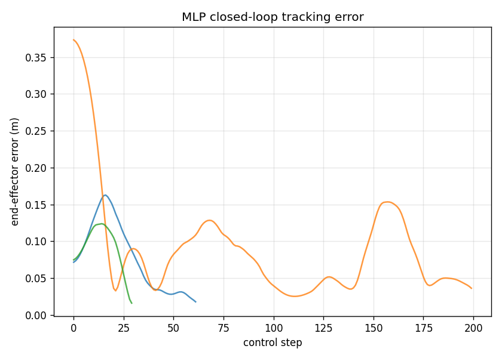
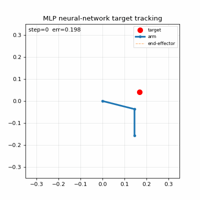

# MuJoCo Reacher 机械臂神经网络目标跟踪

> 模块名：`reacher_track`　|　仿真平台：**MuJoCo 2.3.7**　|　语言：Python 3.8 + NumPy
> 功能：机械臂**感知 → 神经网络控制 → 闭环目标跟踪**（监督学习 + DAgger）

## 1. 任务概述

在 MuJoCo 的 **Reacher**（2 关节平面机械臂）环境中，实现一个由纯 NumPy 手写神经网络驱动的
"感知-控制"闭环：机械臂读取自身的关节编码器与目标点位置（**感知**），由一个 **MLP 神经网络**
直接映射出两个关节的扭矩（**控制**），使末端在闭环中自动跟踪并到达目标点。

- 感知状态（6 维）：\([\sin q_1,\ \cos q_1,\ \sin q_2,\ \cos q_2,\ d_x,\ d_y]\)
  - \(q_1,q_2\)：肩、肘关节角（关节编码器）
  - \(d_x,d_y\)：目标点相对末端的全局坐标差（目标检测）
- 动作（2 维）：肩、肘关节扭矩 \(u_1,u_2\in[-2,2]\)
- 控制目标：末端点到目标点距离 \(\rho=\|p_{tip}-p_{target}\|\) 最小

本模块为**监督学习**的感知-控制闭环（非强化学习），与课程中 CartPole 的
RL 算法对比作业（DQN vs REINFORCE、Double/Dueling DQN）**任务不同、互不冲突**。

## 2. 计算原理

### 2.1 正运动学

由关节角求末端全局坐标：

\[
\begin{aligned}
x_{tip} &= L_1\cos q_1 + L_2\cos(q_1+q_2) \\[2pt]
y_{tip} &= L_1\sin q_1 + L_2\sin(q_1+q_2)
\end{aligned}
\]

其中 \(L_1=0.15\,\text{m}\)、\(L_2=0.12\,\text{m}\)。

### 2.2 逆运动学（用于专家控制器）

给定目标点 \((x_t,y_t)\)，求目标关节角。设 \(d=\sqrt{x_t^2+y_t^2}\)，由余弦定理：

\[
q_2 = \arccos\!\left(\frac{d^2-L_1^2-L_2^2}{2L_1L_2}\right),\qquad
q_1 = \operatorname{atan2}(y_t,x_t) - \operatorname{atan2}(L_2\sin q_2,\ L_1+L_2\cos q_2)
\]

### 2.3 PD 位置控制器（专家）

对目标关节角 \(\mathbf{q}_d=(q_{d1},q_{d2})\) 施加位置反馈：

\[
u_i = K_p(q_{di}-q_i) - K_d\,\dot q_i,\qquad i=1,2
\]

本文取 \(K_p=15.0,\ K_d=4.0\)。

### 2.4 感知状态

\[
s=\big[\sin q_1,\ \cos q_1,\ \sin q_2,\ \cos q_2,\ d_x,\ d_y\big]^\top
\]

用 \(\sin/\cos\) 编码避免角度周期性跳变；\(d_x,d_y\) 携带"目标相对末端"的误差信息，
使网络可以从状态中闭环反馈。

### 2.5 MLP 神经网络（控制策略）

结构 \(6\to128\to128\to2\)，隐藏层用 \(\tanh\) 激活，输出层线性：

\[
h_1=\tanh(W_1s+b_1),\quad h_2=\tanh(W_2h_1+b_2),\quad u=W_3h_2+b_3
\]

训练用均方误差损失逼近专家控制律：

\[
\mathcal{L}=\frac{1}{N}\sum_{k=1}^{N}\big\|u(s_k)-u^{\text{PD}}_k\big\|^2
\]

### 2.6 DAgger（数据集聚合，缓解分布偏移）

监督学习直接逼近专家在**专家轨迹**上的行为；部署时网络进入自己产生的状态分布，
可能偏离专家覆盖区域（分布偏移）。DAgger 迭代解决：

1. 用当前网络部署，收集其自身轨迹状态 \(\{s\}\);
2. 用 PD 专家对这些状态标注正确动作 \(\{u^{\text{PD}}\}\);
3. 与原演示数据合并，重新训练网络;

重复以上，使网络在**自身部署分布**上也准确，闭环即可稳定。

## 3. 算法流程

```
┌────────────┐   ┌─────────────┐   ┌──────────────┐   ┌───────────────┐
│ collect_demo│→ │  train_mlp   │→ │  dagger_iter  │→ │  deploy_eval   │
│ IK+PD演示   │   │ 监督训练MLP  │   │ DAgger迭代    │   │ 闭环评估/曲线  │
└────────────┘   └─────────────┘   └──────────────┘   └───────────────┘
```

- `collect_demo.py`：随机初始关节角 + 随机目标，IK+PD 专家控制至收敛，记录 `(感知状态, PD动作)` 数据对（共 400 回合，约 1.6 万样本）；
- `train_mlp.py`：标准化后监督训练 MLP（600 epochs，Adam，lr=3e-3）；
- `dagger_iter.py`：2 轮 DAgger——用网络自身轨迹状态 + PD 专家标注增量训练；
- `deploy_eval.py`：加载最终网络，闭环部署评估 30 回合，输出误差收敛曲线与性能表；
- `render_gif.py`：渲染机械臂跟踪目标的动画（matplotlib，无显示器兜底）。

## 4. 源代码解析

### 4.1 `reacher_env.py`

- `forward_kinematics(q1,q2)`：正运动学，由关节角求末端坐标；
- `inverse_kinematics(tx,ty)`：解析逆解，求目标关节角；
- `ReacherEnv`：封装 MuJoCo 模型，提供
  - `reset(target_xy=None, init_q=(0,0))`：重置并（可选）随机目标；
  - `state()`：构造 6 维感知状态；
  - `pd_control(q_des,kp,kd)` / `ik_pd_ctrl(target,kp,kd)`：PD / IK+PD 控制器；
  - `step(ctrl)`：施加扭矩并推进一个控制步。

### 4.2 `nn.py`

- `MLP(dims)`：支持前向、反向（MSE 梯度）、权重保存/加载；
- `Adam(lr)`：Adam 优化器，更新网络参数。

### 4.3 `collect_demo.py`

对每个 episode 随机初始关节角与目标，循环：`state = env.state()`，
`u = env.ik_pd_ctrl(target)`，记录 `(state, u)`，`env.step(u)`；
末端误差 < 0.02m 提前终止。输出 `demo.npz`。

### 4.4 `train_mlp.py`

读取 `demo.npz`，对输入/输出标准化，训练 `MLP([6,128,128,2])`，
每批次前向 → MSE 梯度 → 反向 → Adam 更新；保存 `mlp.npz` 与标准化参数。

### 4.5 `dagger_iter.py`

对当前网络：部署收集状态 → PD 标注 → 与原始演示合并 → 重训；迭代 2 轮，覆盖 `mlp.npz`。

### 4.6 `deploy_eval.py` / `render_gif.py`

`deploy_eval` 用最终网络闭环运行 30 回合，统计末端误差与成功率，绘制误差收敛曲线；
`render_gif` 记录跟踪过程并用 matplotlib 渲染为动图。

## 5. 运行步骤

### 5.0 编译

```bash
cd ~/ros2_ws
colcon build --packages-select reacher_track
source install/setup.bash
```

### 5.1 一键启动完整流水线

```bash
ros2 run reacher_track main               # 编译安装后推荐
# 或（源码目录下）：python3 -m reacher_track.main
# 或：ros2 launch reacher_track main.launch.py
```

依次执行数据采集 → 训练 → DAgger → 评估。

### 5.2 分步运行

```bash
cd ~/ros2_ws/src/reacher_track

python3 reacher_track/collect_demo.py   # 生成 demo.npz（约 1.6 万样本）
python3 reacher_track/train_mlp.py      # 监督训练 MLP（MSE → 0.039）
python3 reacher_track/dagger_iter.py    # DAgger 迭代，闭环成功率 40% → 83%
python3 reacher_track/deploy_eval.py    # 评估 30 回合，输出误差曲线 + 性能表
python3 reacher_track/render_gif.py     # 渲染 reacher_ep0.gif / reacher_ep1.gif
```

运行截图（误差收敛曲线）：



目标跟踪动图（机械臂末端误差从约 0.20m 收敛到约 0.03m）：



## 6. 实验结果与性能评价

30 回合闭环评估（末端误差 < 0.05m 记为成功）：

| 方法 | 平均末端误差(m) | 中位误差(m) | 成功率 | 平均步数 |
|---|---|---|---|---|
| **MLP 神经网络（DAgger 后）** | **0.0331** | **0.0179** | **83.3%** | 77.4 |
| IK+PD 专家（基线） | 0.0194 | 0.0195 | 100.0% | 39.2 |

- 监督训练后直接闭环成功率约 40%（分布偏移）；经 **DAgger 迭代**后提升至 **83.3%**，
  平均末端误差 0.033m，接近专家控制器（100% / 0.019m）。
- 网络在部署分布上经 DAgger 校准后，闭环误差收敛曲线平稳下降。

## 7. 仿真平台与运行环境

- 仿真平台：MuJoCo 2.3.7（OpenHUTB 课程允许平台之一）
- 操作系统：Ubuntu 20.04 / ROS2 Foxy（Humble 兼容）
- Python 3.8.10；依赖 `mujoco`、`numpy`、`matplotlib`、`pillow`
- 无需显示器（动图用 matplotlib Agg 后端渲染）

## 8. 所使用具体的大模型声明

使用大模型辅助撰写本文档与调试代码。
