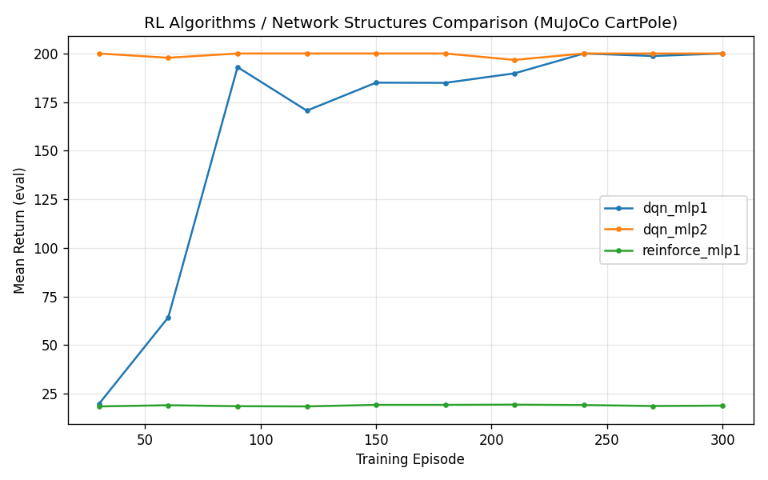
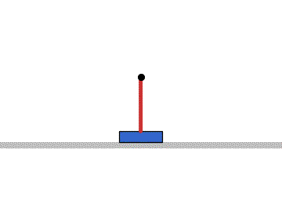
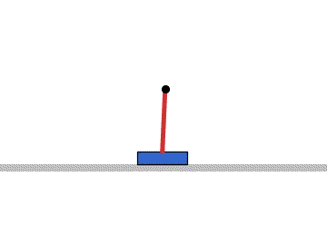
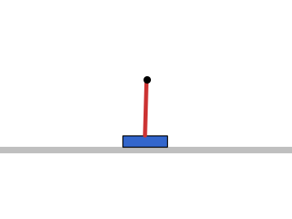

# 神经网络强化学习算法与网络结构对比（MuJoCo CartPole）

## 1. 实验概述

本实验在 **MuJoCo**（OpenHUTB 课程要求的仿真平台之一）的 **CartPole（倒立摆）** 环境中，
用**纯 NumPy 手写神经网络**（不依赖 PyTorch / stable-baselines3）实现神经网络强化学习控制，
完成两类对比：

- **相同网络结构（MLP 16）下的不同 RL 算法**：对比 DQN 与 REINFORCE 两种算法的学习性能；
- **相同算法（DQN）下的不同网络结构**：对比 MLP(16) 单层网络与 MLP(16,16) 双层网络的结构差异。

每个算法以 4 维观测（小车位置/速度、摆杆角度/角速度）为输入，输出 2 个离散控制力
（左推/右推），构成"状态 → 控制指令"的端到端神经网络策略。

**覆盖任务点：**

- 同样模型不同 RL 算法、同样 RL 算法不同模型结构的对比（课程"其他"项）
- 使用 MuJoCo 仿真平台（不用 Gazebo）

## 2. 环境与任务

CartPole 是经典强化学习控制问题：小车在水平导轨上运动，杆的一端铰接在小车顶部，需施加水平力使倒立的摆杆保持平衡。

- 观测空间：4 维连续向量（小车位置 \(x\)、速度 \(\dot{x}\)、摆角 \(\theta\)、角速度 \(\dot{\theta}\)）；
- 动作空间：2 个离散动作（左推 \(-F\) / 右推 \(+F\)，\(F=20\,\text{N}\)）；
- 奖励：每存活一步 +1；
- 终止条件：摆角 \(|\theta| > 0.3\,\text{rad}\) 或小车越界 \(|x| > 2.4\,\text{m}\) 或达到最大步数 200；
- 目标：持续保持平衡，回合回报达到最大步数 200 视为成功。

仿真由 MuJoCo 物理引擎推进（RK4 积分，步长 0.01 s），环境 XML 由本模块自写。

## 3. 算法原理

### 3.1 DQN（深度 Q 网络）

DQN 基于 Q-learning，用神经网络逼近动作价值函数 \(Q(s,a)\)，更新依据贝尔曼方程：

\[
Q(s_t, a_t) \leftarrow Q(s_t, a_t) + \alpha \left( r_t + \gamma \max_{a'} Q(s_{t+1}, a') - Q(s_t, a_t) \right)
\]

本实现采用经验回放（Experience Replay）、目标网络（Target Network）与 epsilon-greedy 探索以提高稳定性。

### 3.2 REINFORCE（蒙特卡洛策略梯度）

REINFORCE 直接对策略 \(\pi_\theta\) 求梯度，用完整回合的折扣回报估计梯度：

\[
\nabla_\theta J(\theta) = \mathbb{E}_\tau \left[ \sum_{t} G_t \nabla_\theta \log \pi_\theta(a_t|s_t) \right]
\]

其中折扣回报 \(G_t = \sum_{k=0}^{T-t} \gamma^k r_{t+k}\)。本实现减去回报均值作为基线以降低方差。

### 3.3 网络结构

本实验采用全连接（MLP）策略/价值网络。`16` 单层与 `16,16` 双层的差异：

- 深度不同：深层网络可拟合更复杂的映射，但参数量翻倍、训练更慢；
- 用于对比网络容量对 DQN 学习的影响。

网络前向/反向传播与 Adam 优化均由 `nn.py` 用 NumPy 手写实现。

## 4. 对比设计

| 对比维度 | 变量 | 固定项 |
|----------|------|--------|
| 算法对比 | 算法：DQN / REINFORCE | 网络结构 MLP(16)，训练 300 回合 |
| 结构对比 | 网络：MLP(16) / MLP(16,16) | 算法 DQN，训练 300 回合 |

每个配置独立训练，每 30 回合用确定性策略评估 10 个回合，记录平均回报作为学习曲线。

## 5. 操作步骤

### 5.1 依赖安装

```bash
sudo apt install python3-pip
python3 -m pip install --user mujoco==2.3.7 numpy matplotlib pillow
```

> mujoco 2.3.x 兼容 Python3.8。本模块不依赖 torch/gym/sb3。

### 5.2 编译

```bash
cd ~/ros2_ws
colcon build --packages-select rl_algorithm_compare
source install/setup.bash
```

### 5.3 启动训练（launch 方式）

```bash
ros2 launch rl_algorithm_compare main.launch.py
# 覆盖参数，例如训练 REINFORCE
ros2 launch rl_algorithm_compare main.launch.py algo:=reinforce tag:=reinforce_mlp1
```

### 5.4 直接运行脚本

```bash
# 训练 3 个对比项
python3 train.py --algo dqn       --layers 16    --tag dqn_mlp1      --episodes 300
python3 train.py --algo dqn       --layers 16,16 --tag dqn_mlp2      --episodes 300
python3 train.py --algo reinforce --layers 16    --tag reinforce_mlp1 --episodes 300

# 评估
python3 evaluate.py --model results/dqn_mlp1.pkl --algo dqn --episodes 20

# 汇总对比
python3 compare.py --out results

# 渲染推理 gif
python3 render_gif.py --model results/dqn_mlp1.pkl --algo dqn --episodes 1
```

## 6. 实验结果

### 6.1 学习曲线对比



### 6.2 推理动图







### 6.3 对比表

| 配置 | 算法 | 网络结构 | 最终平均回报 | 成功率 |
|------|------|----------|--------------|--------|
| dqn_mlp1 | DQN | MLP(16) | 198.70 | 90% |
| dqn_mlp2 | DQN | MLP(16,16) | 200.00 | 100% |
| reinforce_mlp1 | REINFORCE | MLP(16) | 18.75 | 0% |

> 各配置训练 300 回合，最终模型用确定性策略评估 20 回合。成功率定义为评估回合中撑满最大步数（200 步）的比例。
>
> 说明：REINFORCE 为蒙特卡洛策略梯度方法，样本效率远低于基于经验回放与目标网络的 DQN，且对学习率与回报方差更敏感；在仅训练 300 回合的设置下尚未收敛（回报 18.75、成功率 0% 属预期现象），其曲线仅用于与 DQN 类方法做学习效率对比，不代表该方法在更多回合训练下无法收敛。

## 7. 性能评价

- 以训练过程中的平均回报曲线作为学习效率指标；
- 以最终模型的平均回报与成功率（撑满 200 步）作为算法/结构优劣指标。

## 8. 目录结构

```
src/rl_algorithm_compare/
├── package.xml
├── setup.py
├── setup.cfg
├── models/cartpole.xml        # MuJoCo 环境模型
├── rl_algorithm_compare/
│   ├── cartpole_env.py        # MuJoCo 环境封装
│   ├── nn.py                  # NumPy MLP + Adam
│   ├── dqn.py                 # DQN 算法
│   ├── reinforce.py           # REINFORCE 算法
│   ├── train.py               # 训练 + 记录曲线
│   ├── evaluate.py            # 评估模型
│   ├── compare.py             # 汇总对比曲线与表格
│   └── render_gif.py          # 渲染推理gif
├── launch/main.launch.py
├── config/algo_config.yaml
├── results/                   # 训练曲线数据（csv）
└── README.md
```

## 9. 源代码解析

### 9.1 cartpole_env.py —— MuJoCo 环境封装

加载自写 `models/cartpole.xml`，封装 reset/step，将离散动作映射为水平力：

```python
def step(self, a):
    self.data.ctrl[0] = -self.force if a == 0 else self.force
    mujoco.mj_step(self.model, self.data)
    x, xd, th, thd = self._obs()
    done = bool(abs(th) > 0.3 or abs(x) > 2.4 or self.steps >= self.max_steps)
    return self._obs(), 1.0, done, {}
```

### 9.2 nn.py —— NumPy 全连接网络

实现 MLP 前向、反向与 Adam 更新。反向传播核心（softmax 输出的策略梯度）：

```python
# REINFORCE: dy = (one_hot - prob) * G[:, None]
prob, _ = self.policy.forward(X)
one_hot = np.zeros_like(prob)
one_hot[np.arange(len(A)), A] = 1
dy = (one_hot - prob) * G[:, None]
gW, gb = self.policy.backward(X, dy)
self.policy.adam_update(gW, gb)
```

### 9.3 dqn.py —— DQN 更新

从经验回放采样一批，用目标网络计算 TD 目标并更新 Q 网络：

```python
q_next = self.q_target.predict(s2).max(axis=1)
target = r + self.gamma * q_next * (1 - d)
q = self.q.predict(s)
dy[np.arange(len(a)), a] = (q[np.arange(len(a)), a] - target) / len(a)
gW, gb = self.q.backward(s, dy)
self.q.adam_update(gW, gb)
```

### 9.4 train.py —— 训练循环

每回合收集交互数据：DQN 逐 step 更新回放，REINFORCE 回合末用整条轨迹更新；每 `eval_interval` 回合做确定性评估并写 csv。

## 10. 兼容性

本模块仅依赖 MuJoCo 与 NumPy，可在 ROS2 Foxy/Humble + Python3.8/3.10 上运行；gif 渲染在无 OpenGL 环境自动回退到 matplotlib 状态动画，保证无显示器也能生成演示动图。
