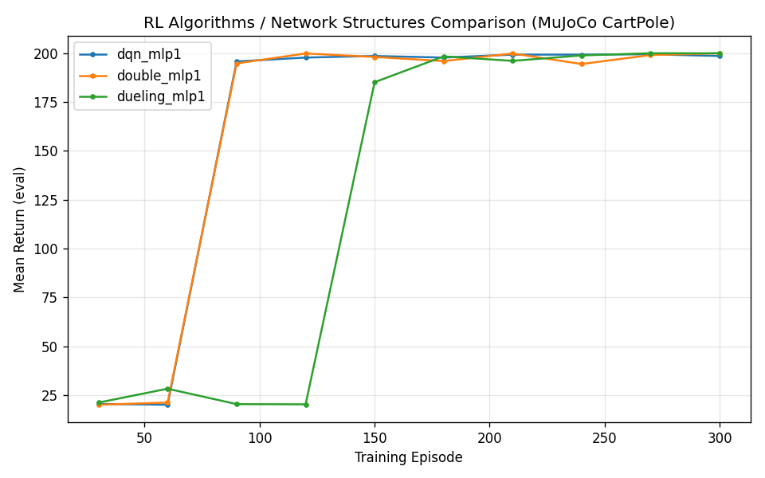
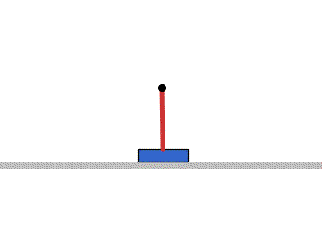
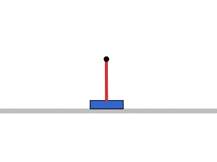

# 神经网络强化学习 DQN 改进算法对比（MuJoCo CartPole）

## 1. 实验概述

本实验在 **MuJoCo**（OpenHUTB 课程要求的仿真平台之一）的 **CartPole（倒立摆）** 环境中，
用**纯 NumPy 手写神经网络**（不依赖 PyTorch / stable-baselines3）实现并对比三种 DQN 系
改进算法：

- **DQN**（基线）：标准深度 Q 网络，用目标网络取 max 构造 TD 目标；
- **Double DQN**：在线网络选择最优动作、目标网络负责评估，缓解 Q 值过估计；
- **Dueling DQN**：网络输出分裂为状态价值 \(V(s)\) 与优势 \(A(s,a)\) 两个流，学习更稳定。

三种算法共享同一环境、同一网络结构（MLP16）与同一套训练超参，差异仅在 TD 目标的构造
（Double）或网络输出结构（Dueling）上，从而公平对比 DQN 系列算法的改进效果。

**覆盖任务点：**

- 同样模型不同 RL 算法、同样 RL 算法不同模型结构的对比（课程"其他"项）
- 使用 MuJoCo 仿真平台（不用 Gazebo）

## 2. 环境与任务

CartPole 是经典强化学习控制问题：小车在水平导轨上运动，杆的一端铰接在小车顶部，需施加水平力使倒立的摆杆保持平衡。

- 观测空间：4 维连续向量（小车位置 \(x\)、速度 \(\dot{x}\)、摆角 \(\theta\)、角速度 \(\dot{\theta}\)）；
- 动作空间：2 个离散动作（左推 \(-F\) / 右推 \(+F\)，\(F=20\,\text{N}\)）；
- 奖励：每存活一步 +1；
- 终止条件：摆角 \(|\theta| > 0.3\,\text{rad}\) 或小车越界 \(|x| > 2.4\,\text{m}\) 或达到最大步数 200；
- 目标：持续保持平衡，回合回报达到最大步数 200 视为成功。

仿真由 MuJoCo 物理引擎推进（RK4 积分，步长 0.01 s），环境 XML 由本模块自写。

## 3. 算法原理

### 3.1 DQN（深度 Q 网络）

DQN 用神经网络逼近动作价值函数 \(Q(s,a)\)，TD 目标由目标网络的最大值给出：

\[
Q(s_t, a_t) \leftarrow Q(s_t, a_t) + \alpha \left( r_t + \gamma \max_{a'} Q_{\theta^-}(s_{t+1}, a') - Q_\theta(s_t, a_t) \right)
\]

其中 \(\theta^-\) 为目标网络参数（周期同步），\(\theta\) 为在线网络参数。

### 3.2 Double DQN

标准 DQN 用同一个 max 同时做"选择"和"评估"，会系统性高估动作价值。Double DQN 将二者解耦：
用**在线网络**选择最优动作，用**目标网络**评估该动作的价值：

\[
a^* = \arg\max_{a'} Q_\theta(s_{t+1}, a'), \qquad
Q_{\text{target}} = r_t + \gamma Q_{\theta^-}(s_{t+1}, a^*)
\]

由于在线网络对 Q 值的高估小于目标网络，Double DQN 能缓解过估计问题。

### 3.3 Dueling DQN

Dueling DQN 改变网络输出结构：共享隐藏层后分裂为**状态价值流** \(V(s)\) 与**优势流**
\(A(s,a)\) 两个分支，再组合成动作价值：

\[
Q(s,a) = V(s) + \left( A(s,a) - \frac{1}{|\mathcal{A}|}\sum_{a'} A(s,a') \right)
\]

减去优势均值保证可辨识性。该结构让网络不必为每个动作都学习完整价值，学习更稳定、样本效率更高。

## 4. 对比设计

| 对比项 | 变量 | 固定项 |
|--------|------|--------|
| 算法对比 | 算法：DQN / Double DQN / Dueling DQN | 网络结构 MLP(16)，训练 300 回合 |

每个配置独立训练，每 30 回合用确定性策略评估 10 个回合，记录平均回报作为学习曲线。

## 5. 操作步骤

### 5.1 依赖安装

```bash
sudo apt install python3-pip
python3 -m pip install --user mujoco==2.3.7 numpy matplotlib pillow
```

> mujoco 2.3.x 兼容 Python3.8。本模块不依赖 torch/gym/sb3。

### 5.2 编译

```bash
cd ~/ros2_ws
colcon build --packages-select rl_dqn_improvement
source install/setup.bash
```

### 5.3 启动训练（launch 方式）

```bash
ros2 launch rl_dqn_improvement main.launch.py
# 覆盖参数，例如训练 Double DQN
ros2 launch rl_dqn_improvement main.launch.py variant:=double tag:=double_mlp1 episodes:=300
```

### 5.4 直接运行脚本

```bash
# 训练 3 个对比项
python3 -m rl_dqn_improvement.train --variant dqn     --tag dqn_mlp1     --episodes 300
python3 -m rl_dqn_improvement.train --variant double  --tag double_mlp1  --episodes 300
python3 -m rl_dqn_improvement.train --variant dueling --tag dueling_mlp1 --episodes 300

# 评估
python3 -m rl_dqn_improvement.evaluate --model results/dqn_mlp1.pkl

# 汇总对比
python3 -m rl_dqn_improvement.compare --out results --tags dqn_mlp1 double_mlp1 dueling_mlp1

# 渲染推理 gif
python3 -m rl_dqn_improvement.render_gif --model results/dqn_mlp1.pkl
```

## 6. 实验结果

### 6.1 学习曲线对比



### 6.2 推理动图






### 6.3 对比表

| 配置 | 算法 | 网络结构 | 最终平均回报 | 成功率 |
|------|------|----------|--------------|--------|
| dqn_mlp1 | DQN | MLP(16) | 199.95 | 95% |
| double_mlp1 | Double DQN | MLP(16) | 196.60 | 85% |
| dueling_mlp1 | Dueling DQN | MLP(16) | 200.00 | 100% |

> 各配置训练 300 回合，最终模型用确定性策略评估 20 回合。成功率定义为评估回合中撑满最大步数（200 步）的比例。可以看到在 CartPole 这种过估计不严重的简单任务上三种算法均能收敛到 200 附近，其中 Dueling DQN 的结构优势最稳定（std=0、成功率 100%）。

## 7. 性能评价

- 以训练过程中的平均回报曲线作为学习效率指标；
- 以最终模型的平均回报与成功率（撑满 200 步）作为算法优劣指标。

## 8. 目录结构

```
src/rl_dqn_improvement/
├── package.xml
├── setup.py
├── setup.cfg
├── models/cartpole.xml        # MuJoCo 环境模型
├── rl_dqn_improvement/
│   ├── cartpole_env.py        # MuJoCo 环境封装
│   ├── nn.py                  # NumPy MLP + Adam
│   ├── dqn.py                 # DQN / Double / Dueling 三变体
│   ├── train.py               # 训练 + 记录曲线
│   ├── evaluate.py            # 评估模型
│   ├── compare.py             # 汇总对比曲线与表格
│   └── render_gif.py          # 渲染推理gif
├── launch/main.launch.py
├── config/algo_config.yaml
├── results/                   # 训练曲线数据（csv）
└── README.md
```

## 9. 源代码解析

### 9.1 dqn.py —— DQN 三变体核心

`DQN` 类通过 `variant` 参数选择三种变体，共享经验回放、目标网络与 epsilon-greedy 探索。

Dueling 网络的 Q 值组合（`_q_values`）：

```python
def _q_values(self, net, x):
    out = net.predict(x)          # [V, A0, A1]
    if self.variant != 'dueling':
        return out
    V = out[:, 0:1]
    A = out[:, 1:]
    return V + (A - A.mean(axis=1, keepdims=True))   # Q(a) = V + A(a) - mean(A)
```

TD 目标构造（Double 解耦选择与评估）：

```python
def _td_target(self, r, s2, d):
    n = len(r)
    if self.variant == 'double':
        a2 = self.q.predict(s2).argmax(axis=1)        # 在线网络选动作
        q_next = self._q_values(self.q_target, s2)[np.arange(n), a2]
    else:
        q_next = self._q_values(self.q_target, s2).max(axis=1)
    return r + self.gamma * q_next * (1 - d)
```

Dueling 反向传播（把 dQ 分摊回 V 和 A 流）：

```python
# Q_a = V + A_a - mean(A)，K=动作数
dy[i, 0] += dq_i                                     # dV
for j in range(K):
    coeff = 1.0 - 1.0 / K if j == ai else -1.0 / K
    dy[i, 1 + j] += dq_i * coeff                     # dA
```

### 9.2 train.py —— 训练循环

每回合交互收集数据并 `store + update`（三种变体均逐 step 更新），每 `eval_interval` 回合做确定性评估写 csv。

## 10. 兼容性

本模块仅依赖 MuJoCo 与 NumPy，可在 ROS2 Foxy/Humble + Python3.8/3.10 上运行；gif 渲染在无 OpenGL 环境自动回退到 matplotlib 状态动画，保证无显示器也能生成演示动图。
