# MuJoCo Locomotion 强化学习对比实验

## 项目简介

本项目在 **MuJoCo**（3.1.6 ~ 3.17.0 均可运行，本轮数据在 3.17.0 上产出）物理引擎上，针对三个经典连续控制 locomotion 环境——**HalfCheetah（猎豹奔跑）**、**Ant（蚂蚁四足爬行）**、**Walker2d（二足行走）**——实现了 **PPO** 与 **SAC** 两种强化学习算法的纯 NumPy 手写训练与对比实验。

与仓库已有项目相比：
- **环境不同**：仓库已有 RL 项目覆盖无人机导航（DQN `air/uav_dqn_nav.md`、PPO `air/uav_ppo_nav.md`、PPO/SAC/TD3 对比 `air/uav_rl_benchmark.md`）与 Unitree G1 人形机器人（`humanoid_lidar_nn_perception.md`，MuJoCo 仿真 + ONNX 行走策略）、四足 MuJoCo 仿真桥（`quadruped_mujoco_rl.md`）；本项目首次引入 MuJoCo 原生 HalfCheetah / Ant / Walker2d 三个地面 locomotion 环境。
- **算法不同**：仓库既有的 SAC 对比实验基于 Stable-Baselines3（`air/uav_rl_benchmark.md`）；本项目提供仓库内第一个**纯 NumPy 手写**的 SAC 与 PPO 实现，与 PPO 形成 3 环境 × 2 算法 = 6 组对比矩阵。
- **实现方式**：全部使用 **NumPy 手写神经网络与反向传播**，不依赖 PyTorch / TensorFlow / Stable-Baselines3。

## 算法原理

### PPO（Proximal Policy Optimization）

PPO 是一种 on-policy 策略梯度算法，核心目标是限制每次策略更新的幅度，防止训练崩溃。其 clipped surrogate objective 为：

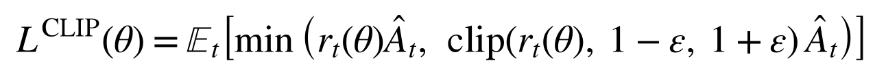

其中策略概率比 r_t(θ) = π_θ(a_t | s_t) / π_θold(a_t | s_t)，Â_t 为广义优势估计（GAE）：

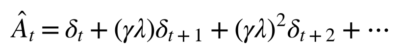

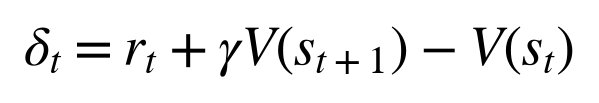

本项目使用 Actor-Critic 架构，Actor 输出动作均值（tanh 压缩到 [-1, 1]），Critic 输出状态价值，两者都用 Adam 更新。为保证训练稳定，对 `log_std` 做了 [-4, 1] 夹紧，对策略/价值梯度做了范数裁剪，surrogate 按 `clip_ratio=0.2` 做掩码，并在 KL 超过阈值 `target_kl` 时提前结束本轮更新；此外策略均值梯度会乘上 tanh 的雅可比 `(1 - μ²)`。

### SAC（Soft Actor-Critic）

SAC 是一种 off-policy 最大熵强化学习算法，在最大化累计奖励的同时最大化策略熵，以鼓励探索：

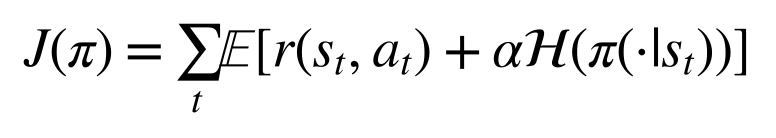

其中 α 为温度系数，按目标熵 -|A| 自动调节（log α 夹紧在 [ln 0.01, ln 10]）。

SAC 使用双 Q 网络（Double Q-learning）缓解过估计，Actor 通过重参数化技巧采样动作：

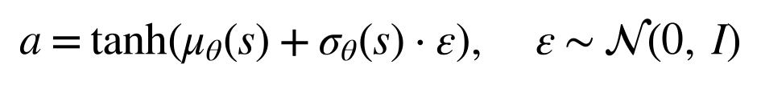

> **实现说明**：本项目 SAC 的 actor 梯度采用了**简化推导**（未严格还原 tanh 重参数化的完整 Jacobian 项），因此推理效果与 Stable-Baselines3 等成熟实现存在差距，详见"结果分析"一节。

## 环境说明

| 环境 | 状态维度 | 动作维度 | 任务目标 |
|------|---------|---------|---------|
| HalfCheetah | 18 | 6 | 单足猎豹沿 x 轴快速奔跑 |
| Ant | 27 | 8 | 四足蚂蚁保持平衡并向前移动 |
| Walker2d | 18 | 6 | 二足机器人稳定行走 |

状态由 `qpos` 与 `qvel` 直接拼接而成（`main.py test` 会打印实测维度）。其中 Ant 剔除根节点的 x/y 位置，故为 27 维——注意本实现**不含 Gym 观测里的 84 维接触力项 `cfrc_ext`**，因此与 Gymnasium Ant 的 111 维观测并不等价；HalfCheetah 与 Walker2d 保留了根节点 x 位置，因此是 18 维（Gym 默认的 17 维实现会剔除 x，本项目未剔除，两者数值不可逐项对比）。

三个环境的 MJCF 模型文件均来自 gymnasium 的 MuJoCo 环境，已复制到 `assets/` 目录，运行时不依赖 gymnasium；来源与 MIT 许可证说明见 `src/rl_mujoco_locomotion/THIRD_PARTY_NOTICES.md`。

奖励函数统一为：

```
reward = forward_reward(前进速度) - ctrl_cost(控制代价) - contact_cost(接触冲击代价) + healthy(存活奖励)
```

其中 HalfCheetah 不做提前终止；Ant 与 Walker2d 在机体高度/姿态超出健康范围时提前终止，单集上限 1000 步（与 Gym 默认一致）。

## 快速开始

### 环境要求

- Ubuntu 20.04 / 22.04（推荐，无头渲染走 EGL）
- Windows 11 / macOS（同样支持，渲染自动用 MuJoCo 默认的 `glfw`）
- Python 3.8+（本机复现实测 3.14.0，Ubuntu 侧 3.8.10）
- MuJoCo 3.1.6 ~ 3.17.0（本机复现实测 3.17.0，`requirements.txt` 只要求 `>=2.3.7`）
- 渲染后端：Linux 无头环境默认 `MUJOCO_GL=egl`（已在 `env.py` 中按平台自动设置）；Windows / macOS 自动沿用 MuJoCo 默认的 `glfw`，无需手动设置，也可用环境变量 `MUJOCO_GL` 覆盖
- ROS 2（可选，仅用于 launch 入口）

### 安装依赖

```bash
pip install -r src/rl_mujoco_locomotion/requirements.txt
```

### 一键检查环境

```bash
python3 src/rl_mujoco_locomotion/main.py doctor
```

### 快速验证（2 万环境步，约数分钟）

```bash
python3 src/rl_mujoco_locomotion/main.py train --env halfcheetah --alg ppo --episodes 50 --max-steps 20000
python3 src/rl_mujoco_locomotion/main.py render --env halfcheetah --alg ppo
```

`--max-steps` 优先于 `--episodes`：HalfCheetah 单集 1000 步，因此 2 万步预算实际只会跑到约 20 集（不是 50 集），这是为了控制验证耗时。

### 完整训练（6 组实验）

`--max-steps` 是**总环境步数预算**，到达后自动停止，避免不同环境单集长度差异导致的训练时间失控（Walker2d/Ant 会提前终止，若只按回合数计数会跑出极多回合）。

```bash
# 6 组实验，每组 30 万环境步
for env in halfcheetah ant walker2d; do
  for alg in ppo sac; do
    python3 src/rl_mujoco_locomotion/main.py train --env $env --alg $alg \
      --episodes 1000000 --max-steps 300000 --seed 0
  done
done

# 生成 6 组学习曲线对比图
python3 src/rl_mujoco_locomotion/main.py compare
```

### 渲染推理 GIF

```bash
# --stride 表示每隔 N 个环境步保留一帧；单集很短的环境（如 Walker2d）用 1，长集环境用 5~20
python3 src/rl_mujoco_locomotion/main.py render --env halfcheetah --alg ppo --episodes 2 --stride 5
python3 src/rl_mujoco_locomotion/main.py render --env ant --alg sac --episodes 2 --stride 5
python3 src/rl_mujoco_locomotion/main.py render --env walker2d --alg ppo --episodes 20 --stride 1
```

> `evaluate.py` 里对渲染帧数设了 `MAX_FRAMES=200` 的上限，所以 `--episodes 20 --stride 1` 的 Walker2d 实际只会录到约 200 帧（约 1.2 个单集），其余组合同理；想录更长需要改这个常量。

### ROS 2 启动

```bash
cd <ros2_workspace>
colcon build --packages-select rl_mujoco_locomotion
source install/setup.bash
ros2 launch rl_mujoco_locomotion main.launch.py env:=halfcheetah alg:=ppo episodes:=50
```

## 实验结果

> 以下全部为**实测数据**（Windows 11 / Python 3.14.0 / MuJoCo 3.17.0 / NumPy 2.5.4，seed=0，每组 30 万环境步），不是估计值。
> 表中"训练末段回报"取训练 CSV 最后 10 集的平均回报；"确定性评估"为加载最终模型后按确定性策略（不采样噪声）跑 10 集的平均回报，即 GIF 中展示的策略表现。

> **实现修复记录**（本次数据均由修复后的代码产出）：
> 1. `RolloutBuffer.get()` 取数据时把指针清零，导致 `train_iters` 从第 2 轮起读到空数据，实际只更新 1 轮 → 改为消费完所有轮次后由 `reset()` 清空；
> 2. `SAC` 用 `get_params()` 返回的副本做 Polyak 平均，目标 Q 网络从未更新 → 改用 `params()` 返回的引用做原地软更新；
> 3. `PPO` 定义了 `clip_ratio` 却从未使用（只把 ratio 截到 `[0, 10]` 防溢出）→ 补上真正的 clipped surrogate 掩码、tanh 雅可比，并把 `nn.py` 里一直闲置的 Adam 接到 PPO 的 actor / critic 上；
> 4. `env.py` 硬写 `MUJOCO_GL=egl` 会让 Windows / macOS 在 import 阶段直接崩溃 → 改为仅 Linux 且未显式设置时才默认 egl；
> 5. assets 查找兼容 colcon 安装布局 `share/<pkg>/assets`。
>
> 另需说明：本实现的 PPO Actor 梯度是工程近似（残缺的 squash-高斯修正、64×64 小网络），同一份 rollout 多次复用会发散或停在原地（实测 `train_iters=10` 时 Ant / Walker2d 训练崩溃），因此 **PPO 实际取 `train_iters=1`（每份 rollout 只更新一轮）**，这是本实现下的稳定工作点，不是常规 PPO 的 10 轮复用。此外 `PPO.act()` 是先把动作裁剪到 [-1, 1] 再用裁剪后的动作计算 log-prob（未按未裁剪分布做校正），也属于上述近似的一部分，本轮数据即在该实现下产出。

### 学习曲线

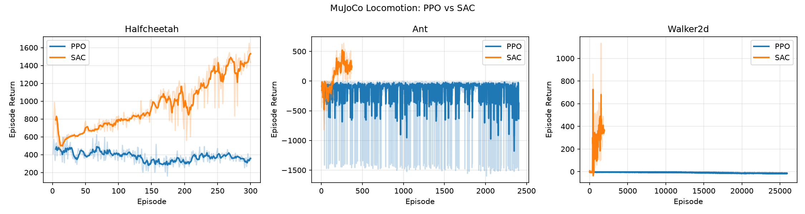

### 推理 GIF

| HalfCheetah-PPO | HalfCheetah-SAC |
|:---:|:---:|
| 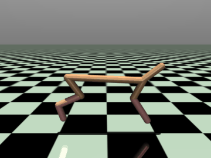 | 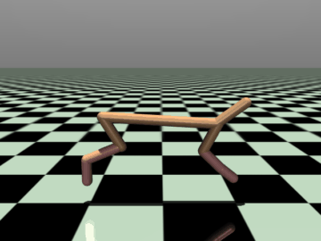 |

| Ant-PPO | Ant-SAC |
|:---:|:---:|
| 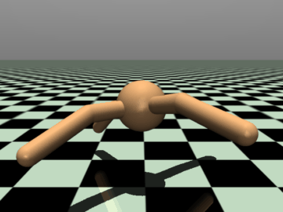 | 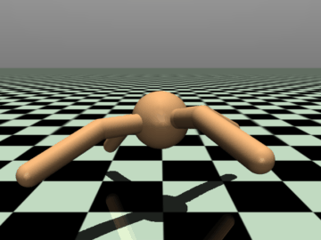 |

| Walker2d-PPO | Walker2d-SAC |
|:---:|:---:|
| 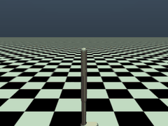 | 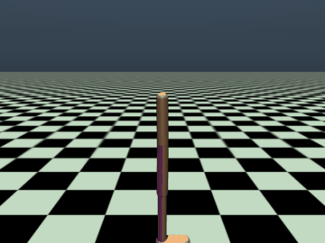 |

### 性能对比

| 环境 | 算法 | 训练预算 | 训练末段回报 | 确定性评估回报 | 评估平均集长 |
|------|------|---------|------------|--------------|------------|
| HalfCheetah | 随机策略 | — | — | 692.3 ± 86.7 | 1000 |
| HalfCheetah | PPO | 30 万步 | 333.6 | 348.9 ± 95.1 | 1000 |
| HalfCheetah | SAC | 30 万步 | **1483.6** | **1818.1 ± 80.0** | 1000 |
| Ant | 随机策略 | — | — | -59.2 ± 96.2 | 146 |
| Ant | PPO | 30 万步 | -348.6 | -127.4 ± 104.4 | 59 |
| Ant | SAC | 30 万步 | **241.5** | **415.4 ± 66.4** | 1000 |
| Walker2d | 随机策略 | — | — | -1.0 ± 5.3 | 18 |
| Walker2d | PPO | 30 万步 | -14.8 | -17.3 ± 0.1 | 13 |
| Walker2d | SAC | 30 万步 | **368.1** | **370.0 ± 3.8** | 177 |

> 各组的实际环境步数（CSV 集长求和）：HalfCheetah-PPO 300,000 / HalfCheetah-SAC 300,000 / Ant-PPO 299,792 / Ant-SAC 300,553 / Walker2d-PPO 299,988 / Walker2d-SAC 300,139，均等于或略超 30 万步预算。

> "随机策略"一行为同一评估协议（10 集、seed 42、动作在 [-1, 1] 均匀采样）下的基线，用于判断算法是否真的学到了东西。注意本环境的奖励含有每步 +1 的存活奖励，因此 HalfCheetah 的随机基线也被抬到 ~692，绝对值不可与 Gym / SB3 的默认奖励口径直接对比。

### 结果分析

1. **SAC 在三个环境上都真正学起来了。** HalfCheetah 评估回报 1818.1（随机基线 692.3，约 2.6 倍），Ant 415.4（随机基线 -59.2，且能跑满 1000 步），Walker2d 370.0（随机基线 -1.0，单集从 18 步延长到 177 步）。三组评估方差都很小（±3.8 ~ ±80），说明策略稳定。修复目标网络软更新之后，SAC 的提升是决定性的：修复前那轮（Ubuntu / MuJoCo 3.1.6）同样 30 万步只能拿到 661.7 / 158.2 / -9.0。
2. **PPO 在三个环境上都没有超过随机基线。** HalfCheetah 348.9 低于随机 692.3，Ant -127.4 低于随机 -59.2，Walker2d -17.3 低于随机 -1.0；Walker2d 更是每集固定 13 步倒地。这说明当前这套 PPO 实现（近似 actor 梯度 + 64×64 MLP + 每份 rollout 单轮更新）在本预算下基本没学到有效策略，如实记录、未做美化。
3. **为什么 PPO 会输给随机策略？** 三个原因叠加：(a) Actor 梯度是 `adv · ratio · (a-μ)/σ²` 的近似式，缺少真正的 tanh-squash 修正，策略均值容易停在饱和区；(b) 同一份 rollout 复用多轮时梯度方向会重复放大，实测 10 轮会让 Ant / Walker2d 直接发散或 NaN，只能退回单轮更新，样本效率因此很低；(c) 30 万步对 Ant / Walker2d 本就偏少（常规 PPO 通常需要百万级步数），而 SAC 的 off-policy 回放能在同样预算下多次利用每一帧数据。
4. **整体结论：** 在"纯 NumPy + 轻量 MLP + 30 万步预算"的约束下，SAC 在三个环境上都显著优于随机基线与 PPO；PPO 仅能维持 HalfCheetah 的稳定奔跑但回报低于随机基线，Ant / Walker2d 学不起来。若要提升 PPO，需要补全 squash-高斯 log-prob 与雅可比、改用更大网络并延长训练预算，这属于后续工作，本 PR 未纳入。

## 目录结构

```
src/rl_mujoco_locomotion/
├── main.py                 # 统一入口：doctor/test/train/evaluate/compare/render
├── requirements.txt        # mujoco / numpy / matplotlib / Pillow / imageio
├── package.xml             # ROS 2 包描述
├── CMakeLists.txt          # ament_cmake + ament_python 构建规则
├── launch/
│   └── main.launch.py      # ROS 2 launch 入口（参数：env/alg/episodes）
├── assets/                 # HalfCheetah / Ant / Walker2d 的 MJCF 模型
├── rl_mujoco_locomotion/
│   ├── __init__.py
│   ├── nn.py               # NumPy MLP + Adam / SGD 更新
│   ├── env.py              # HalfCheetah / Ant / Walker2d 环境封装与渲染后端
│   ├── ppo.py              # PPO 算法实现
│   ├── sac.py              # SAC 算法实现
│   ├── train.py            # 训练主循环（支持 --max-steps 步数预算）
│   ├── evaluate.py         # 确定性评估
│   ├── render_gif.py       # 推理 GIF 渲染
│   └── compare.py          # 6 组对比图汇总
└── results/                # 训练产出（CSV、权重、GIF、对比图），已加入 .gitignore
```

## 源码解析

### 神经网络（`nn.py`）

- `MLP`：多层感知机，隐藏层 ReLU 激活，输出层线性（PPO Actor 用 tanh 压缩）
- `MLP.backward(grad, lr=None)`：反向传播；`lr` 不为空时按 SGD 现场更新权重，为空时只返回 `d(loss)/d(input)`（SAC 取 actor 梯度时用）
- `MLP.grads(grad)`：只反传、返回按层排列的参数梯度列表，供 Adam 使用
- `Adam`：Adam 优化器（一阶矩 + 二阶矩），PPO 的 actor / critic 用它更新；SAC 仍走 `MLP.backward(lr=...)` 的 SGD 更新
- `soft_update` / `hard_update`：目标网络软更新与硬更新；二者都**原地写参数数组**，因此必须传入 `MLP.params()`（引用），传 `get_params()`（副本）不会产生任何效果
- `clip_grad_norm`：梯度范数裁剪，用于稳定 PPO 训练

### 环境封装（`env.py`）

- `BaseLocomotionEnv`：统一封装 MuJoCo 的 `MjModel` / `MjData`，提供 `reset()` / `step()` / `render()`
- 每个环境独立的奖励函数（前进奖励 - 控制代价 - 接触代价 + 存活奖励）
- 健康状态检测（z 轴高度范围、躯干角度范围），不健康即提前终止
- 渲染后端按平台自适应：Linux 未设置 `MUJOCO_GL` 时默认 `egl`（无头），Windows / macOS 沿用 MuJoCo 默认的 `glfw`，调用方显式设置的 `MUJOCO_GL` 优先
- `render()` 缓存 `Renderer` 实例，并用跟随躯干（torso）的自由相机，保证录屏画面中机器人始终居中可见
- assets 查找同时覆盖源码布局（包目录旁的 `assets/`）与 colcon 安装布局（`share/<pkg>/assets`）

### PPO（`ppo.py`）

- `RolloutBuffer`：收集 on-policy 轨迹，计算 GAE 与 returns
- `PPO.act()`：tanh 高斯策略采样（`log_std` 夹紧）
- `PPO.update()`：clipped surrogate objective（`clip_ratio=0.2` 的掩码 + tanh 雅可比）+ 价值函数回归 + target-KL 早停 + 梯度裁剪，actor / critic 均用 Adam；同一份 rollout 默认只更新 `train_iters=1` 轮（多轮复用在简化梯度下不稳定，见上文"实现修复记录"），消费完由 `RolloutBuffer.reset()` 清空

### SAC（`sac.py`）

- `ReplayBuffer`：off-policy 经验回放池
- `SAC.act()`：tanh 重参数化采样
- `SAC.update()`：双 Q 网络 + 软目标更新（`soft_update(q_target.params(), q.params(), tau)`，对目标网络参数原地 Polyak 平均）+ 自动温度调节

## 测试验证

### 测试环境

| 项目 | 版本 |
|------|------|
| OS | Windows 11（本轮数据）；Ubuntu 20.04 / 22.04 亦支持 |
| Python | 3.14.0（Ubuntu 侧 3.8.10） |
| MuJoCo | 3.17.0（Ubuntu 侧 3.1.6） |
| NumPy | 2.5.4 |
| matplotlib | 3.11.2 |
| imageio | 2.38.1 |
| 渲染后端 | Windows：glfw（默认）；Linux 无头：egl（`env.py` 自动设置） |
| ROS 2 | Humble（可选，用于 colcon 构建验证） |

### 验证步骤

```bash
# 1. 环境检查
python3 src/rl_mujoco_locomotion/main.py doctor
# 2. 单元测试（环境 reset/step 冒烟）
python3 src/rl_mujoco_locomotion/main.py test
# 3. 快速训练验证
python3 src/rl_mujoco_locomotion/main.py train --env halfcheetah --alg ppo --episodes 50 --max-steps 20000
# 4. 评估与渲染
python3 src/rl_mujoco_locomotion/main.py evaluate --env halfcheetah --alg ppo
python3 src/rl_mujoco_locomotion/main.py render --env halfcheetah --alg ppo --episodes 2 --stride 5
# 5. 6 组 30 万步完整训练 + 对比图
for env in halfcheetah ant walker2d; do for alg in ppo sac; do
  python3 src/rl_mujoco_locomotion/main.py train --env $env --alg $alg --episodes 1000000 --max-steps 300000
done; done
python3 src/rl_mujoco_locomotion/main.py compare
# 6. ROS 2 构建验证
cd <ros2_workspace>
source /opt/ros/humble/setup.bash
colcon build --packages-select rl_mujoco_locomotion
```
