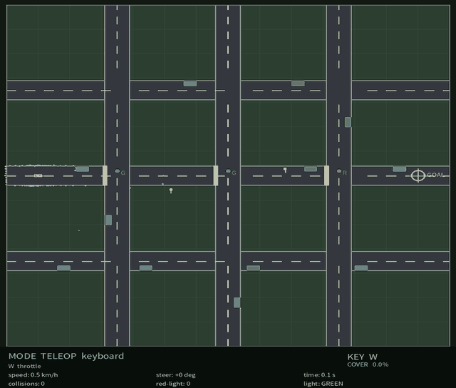
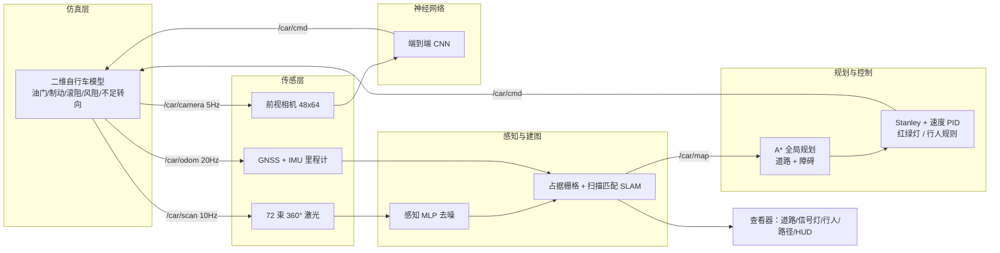
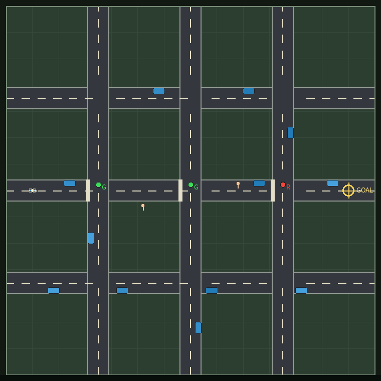
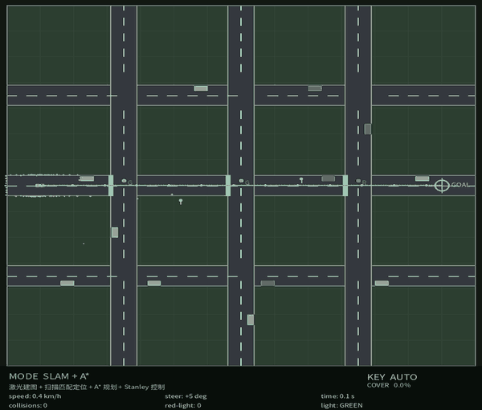
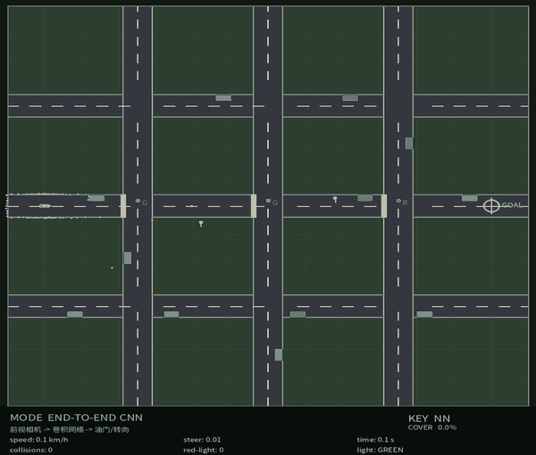
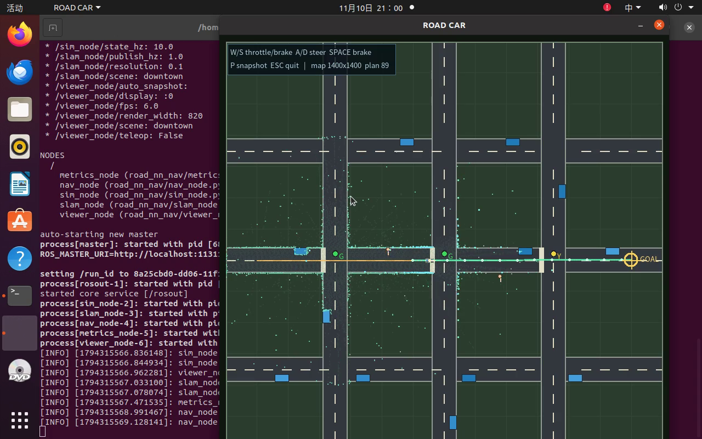

# 城市道路地面载具 RoadNN：二维车辆动力学、激光 SLAM 与纯 NumPy 神经网络导航

> 模块源码：[`src/ground/road_numpy_nn_slam`](https://github.com/OpenHUTB/ros2/tree/master/src/ground/road_numpy_nn_slam)
> 运行环境：Ubuntu 20.04.6 + ROS Noetic + Python 3.8/3.11（项目私有 venv，仅 NumPy）
> 关键词：地面载具、自行车模型、红绿灯、行人礼让、激光 SLAM、A*、Stanley、行为克隆、端到端 CNN、DQN、REINFORCE



## 1. 概述

城市道路自动驾驶需要在**交叉路口信号灯、行人横道、路边停车与施工封路**之间安全通行，同时处理传感器噪声与定位漂移。本模块给出一个可在普通笔记本虚拟机（4 核 CPU、无 GPU、无 CARLA/MuJoCo）中完整运行的地面载具示例，覆盖从**车辆动力学**到**神经网络闭环导航**的完整链路：

1. **物理仿真与键盘运动控制**：2-D 自行车（单轨）动力学模型：油门/制动、滚阻与风阻、转向速率限制、不足转向梯度；`W/S/A/D/Space` 遥控；
2. **多传感器感知**：72 束 360° 激光雷达（距离噪声、野值、丢点）、GNSS、IMU 与前视相机；感知 MLP 对激光去噪；
3. **建图与导航**：对数几率占据栅格 + 相关性扫描匹配 SLAM；A* 全局规划（道路边界与障碍硬约束）、Stanley 横向控制、纵向速度 PID、红绿灯停车与行人礼让；
4. **端到端模型**：前视相机（48×64×3）→ 2 层 CNN → 油门/转向；
5. **神经网络训练/测试/ROS 封装**：纯 NumPy 实现 MLP/CNN/Adam/DQN/REINFORCE，7 个模型、8 个 ROS 节点、6 个 launch；
6. **多场景性能评价**：`downtown`、`campus`、`construction` 三场景闭环 benchmark，含闯红灯、撞行人、越界时间等交通规则指标，以及 RL 算法/网络结构对比。

## 2. 系统架构



## 3. 车辆动力学与传感器模型

### 3.1 单轨（自行车）模型

$$
\dot v = a - k_d v\lvert v\rvert - k_r\,\mathrm{sign}(v) - a_{\text{offroad}},
\qquad
\dot\psi = \frac{v}{L}\frac{\tan\delta}{1 + K v^2},
\qquad
\dot x = v\cos\psi,\quad \dot y = v\sin\psi
$$

其中 $L=2.6$ m 为轴距，$\delta\in[-0.6,0.6]$ rad 为前轮转角（转向速率限制 1.6 rad/s），$K=0.0025$ s²/m² 为不足转向梯度，$k_d=0.020$、$k_r=0.18$ m/s²；最大加速度 3 m/s²、最大制动 6 m/s²、最高车速 12 m/s（约 43 km/h），倒车限速 3 m/s。

### 3.2 交通参与者与道路

- **红绿灯**：每 17 s 一个周期（绿 8 s、黄 2 s、红 7 s），三个路口相位错开；
- **行人**：沿固定横道往返，速度 1.0–1.3 m/s，相位可配；
- **路边停车 / 锥桶 / 护栏**：矩形与圆形障碍，参与激光回波与碰撞检测；
- **道路约束**：`scene.is_drivable(x,y)` 定义可行驶区域，路缘在激光中表现为墙面；离开道路会额外减速并计入 `off_road_time`。

| 场景 | 尺寸（m） | 道路结构 | 信号灯 / 行人 | 主要障碍 |
| --- | --- | --- | --- | --- |
| `downtown` | 140 × 140 | 三纵三横，车道宽 8 m | 3 个信号灯路口 / 2 处行人横道 | 12 辆路边停车 |
| `campus` | 120 × 100 | 矩形环路 | 无信号灯 / 2 处行人横道 | 5 棵树、1 段护栏 |
| `construction` | 160 × 100 | 一条 10 m 宽道路 | 无 | 锥桶渐变封道 + 2 段护栏 + 2 辆停放车 |



### 3.3 传感器模型

- **激光雷达**：360°、72 束、量程 0.3–40 m，射线步进求交后叠加 0.03 m 高斯噪声、1% 比例误差、4% 野值、3% 丢点；
- **GNSS**：位置 + 0.35 m 噪声与慢漂移；**IMU**：偏航角/角速度噪声；**轮式里程计**：尺度误差 + 航向偏置；
- **相机**：由前向激光深度剖面合成 48×64 道路视图（天空/路面/车道线/建筑侧面/信号灯色块/行人剪影）。

## 4. SLAM：占据栅格建图与扫描匹配定位

每个栅格维护对数几率 $L_t=\log\frac{p}{1-p}$，沿激光波束做射线遍历（终点加占据证据、途经格加空闲证据），并截断到 $[0.12,0.88]$。在里程计预测位姿附近做粗到细相关性扫描匹配：

$$
(\hat x,\hat y,\hat\theta) = \arg\max_{\Delta}\sum_{k=1}^{72} p_{\text{occ}}\!\left(\mathcal{T}(x_t+\Delta x,\ y_t+\Delta y,\ \theta_t+\Delta\theta)\cdot r_k\right)
$$

downtown 使用 0.10 m 分辨率（1400×1400 = 196 万栅格），射线遍历与对数几率更新全部向量化，保证在 CPU 上实时。

## 5. 规划与控制

### 5.1 道路约束的 A*

规划栅格 0.25 m，道路外与障碍格全部视为不可通行；圆形膨胀 1.55 m（≥ 车辆安全半径 1.05 m），八方向 octile 启发式，路径经 supercover 视线平滑（禁止斜穿障碍角点）。

### 5.2 Stanley 横向控制

前轮转角由航向误差与前视点横向偏差组成：

$$
\delta = \psi_e + \arctan\!\left(\frac{k\, e_y}{v + \varepsilon}\right),\qquad
\psi_e = \psi_{\text{path}} - \psi
$$

$k=1.8$、$\varepsilon=1.5$，结果限幅到 $\pm 0.6$ rad，并按转向速率斜坡输出。

### 5.3 纵向速度 PID 与交通规则

速度环采用带阻力前馈的 PID（$k_p=0.55$、$k_i=0.10$、$k_d=0.03$，制动增益非对称放大），并对路径做曲率/离障限速。在此之上叠加三个状态机规则：

- **红灯停车**：距停止线 25 m 开始按舒适减速度（≤1.2 m/s²）规划停车，红线前 2.5 m 为停车余量；黄灯视距离决定停或过；**不允许闯红**；
- **行人礼让**：前方 12 m、横向 4 m 内有行人时减速，5 m 内停车等待，行人离开后恢复；
- **安全滤波**：前方 ±40° 激光余量 < 3.5 m 减速、< 1.6 m 停车，防止规划跳变导致碰撞。

## 6. 神经网络

全部网络以**纯 NumPy** 实现（前向/反向传播、Adam、CNN im2col），不依赖 PyTorch/TensorFlow。

| 网络 | 结构 | 任务 | 实测指标 |
| --- | --- | --- | --- |
| `perception_mlp` | 72→160→160→72 | 激光去噪（残差回归） | RMSE **6.542 → 2.070 m（+68.4%）** |
| `control_mlp` | 44→192→192→2 | 行为克隆（throttle, steer） | steer MAE **0.064**；throttle MAE 0.237 |
| `planner_mlp` | 44→128→128→8 | 8 方向局部决策 | 准确率 **84.1%** |
| `e2e_cnn` | 3×48×64→8×16→64→2 | 图像→油门/转向 | throttle MAE **0.136**；steer MAE 0.211 |
| `rl_dqn` / `rl_pg` | 2×64 / 3×64 MLP | 离散道路导航 RL | DQN 2×64 **66.7%**、DQN 3×64 **50.0%**、REINFORCE **43.3%** |

训练数据由 MissionController 专家在三种场景采集（共 4015 条样本，downtown/construction 专家 100% 成功）；总训练时间约 14.5 分钟（CPU）。

## 7. ROS 接口

| 话题 | 类型 | 说明 |
| --- | --- | --- |
| `/car/cmd` | `geometry_msgs/Twist` | `linear.x` 目标速度（m/s）、`angular.z` 前轮转角（rad，左正） |
| `/car/scan` | `sensor_msgs/LaserScan` | 72 束 360° 激光（含噪声） |
| `/car/scan_filtered` | `sensor_msgs/LaserScan` | 感知网络去噪后的激光 |
| `/car/odom` | `nav_msgs/Odometry` | GNSS+IMU 里程计 |
| `/car/imu` | `sensor_msgs/Imu` | 姿态与角速度 |
| `/car/camera/image_raw` | `sensor_msgs/Image` | 48×64 `bgr8` 图像 |
| `/car/map` | `nav_msgs/OccupancyGrid` | 占据栅格地图 |
| `/car/slam_pose` | `geometry_msgs/PoseStamped` | SLAM 估计位姿 |
| `/car/plan` | `nav_msgs/Path` | A* 全局路径 |
| `/car/state` | `std_msgs/String` | JSON 状态（真值/里程计/指令/信号灯/计数） |

启动文件：`teleop.launch`、`slam_nav.launch`、`perception.launch`、`e2e.launch`、`benchmark.launch`、`bringup.launch`；查看器窗口标题 **ROAD CAR**。

## 8. 运行效果

### 8.1 城市路网键盘遥控（含红灯停车）


### 8.2 激光 SLAM + A* + 红绿灯/行人规则自主导航（downtown）



### 8.3 端到端 CNN 导航（downtown）



### 8.4 Ubuntu 桌面实操录屏

[▶ 下载/播放桌面实操视频（3 分 57 秒，1280×800）](../img/ground/road_numpy_nn_slam_demo.mp4)



## 9. 多场景性能评价

### 9.1 四控制器 × 三场景闭环（每场景 2 条 episode，最长 75 s）

| 场景 | 控制器 | 成功率 | 平均耗时 (s) | 碰撞 | 闯红灯 | 撞行人 | 越界时间 (s) | 终点误差 (m) |
| --- | --- | --- | --- | --- | --- | --- | --- | --- |
| downtown | 经典 SLAM+A*+Stanley | 100% | 34.8 | 0 | 0 | 0 | 0.0 | 2.98 |
| campus | 经典 SLAM+A*+Stanley | 100% | 43.5 | 0 | 0 | 0 | 0.0 | 2.88 |
| construction | 经典 SLAM+A*+Stanley | 100% | 34.4 | 0 | 0 | 0 | 0.0 | 2.91 |
| downtown | 神经控制（行为克隆） | 100% | 25.1 | 0 | 1 | 0 | 0.0 | 2.88 |
| campus | 神经控制（行为克隆） | 0% | 75.0 | 10 | 0 | 10 | 0.0 | 79.99 |
| construction | 神经控制（行为克隆） | 0% | 75.0 | 4.5 | 0 | 0 | 0.0 | 84.58 |
| downtown | 神经两级控制（规划+控制） | 50% | 52.8 | 1.5 | 0.5 | 1.0 | 0.0 | 20.37 |
| campus / construction | 神经两级控制 | 0% | 75.0 | 10 / 6.5 | 0 | 10 / 0 | 0.0 | 79.96 / 83.71 |
| downtown / campus / construction | 端到端 CNN | 0% | 75.0 | 0 / 10 / 0 | 0.5 / 0 / 0 | 0 / 10 / 0 | 0.0 | 54.41 / 80.00 / 139.91 |

### 9.2 SLAM 与规划

| 指标 | downtown | campus | construction |
| --- | --- | --- | --- |
| SLAM ATE RMSE (m) | 0.187 | 0.297 | 0.281 |
| 可行驶区覆盖率 | 59.4% | — | — |
| A* 路径长度 (m) | 120.0 | 133.0 | 140.9 |
| 绕行比 | 1.00 | 1.66 | 1.01 |
| 最小离障 (m) | 4.23 | 18.20 | 1.71 |
| 规划耗时 (ms) | 24.5 | 1316.6 | 281.7 |

> 地图分辨率 0.10 m，downtown 栅格 1400×1400；DWA 局部闭环 sanity：40 m 目标 7.1 s 到达、剩余 2.94 m、0 碰撞/闯红/行人。

### 9.3 训练侧指标

| 模型 | 结构 | 训练样本 | 训练耗时 (s) |
| --- | --- | --- | --- |
| perception_mlp | 72→160→160→72 | 9715 | 184 |
| control_mlp | 44→192→192→2 | 16430 | 356 |
| planner_mlp | 44→128→128→8 | 5815 | 49 |
| e2e_cnn | 3×48×64 → conv → fc64 → 2 | 2215 | 169 |
| RL（3 个智能体） | 2×64 / 3×64 / 2×64 | — | 109 |

### 9.4 失败分析

- **端到端 CNN**：steer MAE 0.211 与“预测均值”基线 0.209 相当，单帧前视相机无法推断 A* 路线的曲率与转向意图；闭环 0/3。
- **单级神经控制**：campus 起步处有行人横穿，反应式策略直接驶入并持续接触（仿真以物理步计撞行人次数），经典状态机规则可稳定处理（2/2 成功）。
- **两级神经控制**：planner 监督标签严重偏斜（ahead 与 ahead_right 占多数），转弯样本不足，仅 downtown 50% 成功。
- **RL**：道路任务的稀疏奖励与红灯/碰撞惩罚使 DQN 成功率约 67%，明显低于无交通规则的空旷场景任务；这是任务难度差异而非实现缺陷。

## 10. 复现步骤

```bash
cd src/ground/road_numpy_nn_slam
bash main.sh setup
bash main.sh test
bash scripts/build_ros.sh
bash main.sh teleop downtown
bash main.sh slam_nav construction
bash main.sh train
.venv/bin/python tools/evaluate.py --scenes downtown,campus,construction
```

结果 JSON 写入 `results/`（训练指标、三场景 benchmark、ROS 运行记录）。

## 11. 已知限制

- control 的 throttle MAE（0.237）略高于 0.20 设计目标，主要来自停车/起步瞬态验证样本；
- 端到端 CNN 的 steer 与均值基线相当，闭环失败（见 9.4）；
- 激光去噪与规划为几何/统计模型，未做真实车辆参数辨识；
- 相机为激光深度剖面合成视图，非真实光学渲染。

## 12. 参考

- ROS Noetic：<https://wiki.ros.org/noetic>
- 自行车模型与 Stanley 控制：S. Thrun et al., *Stanley: The Robot that Won the DARPA Grand Challenge*, 2006
- 本仓库已有地面载具示例：`docs/ground/` 下 CARLA、差速底盘、纯跟踪等教程

> 本模块由课程作业独立实现，未使用他人代码；AI 工具仅用于实现与文档辅助，提交内容由作者负责。
