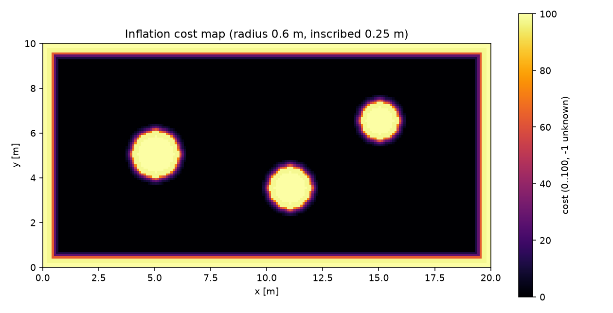

# ROS 2 代价地图障碍膨胀（精确欧氏距离）

建图/规划之间还缺一层：把占据栅格变成带**安全距离代价**的 costmap。本模块对
`/map` 做精确欧氏距离变换，输出 0–100 的代价值，供 Nav2 costmap 或 A\* 膨胀层使用。

## 1. 方法

### 1.1 精确距离变换

对每行、每列分别做一维平方距离变换（Felzenszwalb–Huttenlocher 抛物线下包络），
再取平方根，得到每个格到最近障碍格的**精确欧氏距离**。与 chamfer 3-4 相比，
斜向没有系统误差。

### 1.2 代价值

| 条件 | 代价 |
| --- | ---: |
| 障碍格 | 100 |
| `dist <= inscribed_radius` | 99 |
| `inscribed < dist <= inflation_radius` | `98·exp(-scaling·(d-inscribed)/(inflation-inscribed))` |
| `dist > inflation_radius` | 0 |
| 未知格 | -1 |

## 2. 运行

```bash
cd ~/hutb_ws
colcon build --packages-select ros2_costmap_inflation
source install/setup.bash
ros2 launch ros2_costmap_inflation main_launch.py
```

| 方向 | 话题 | 类型 |
| --- | --- | --- |
| 订阅 | `/map` | `nav_msgs/OccupancyGrid` |
| 发布 | `/costmap` | `nav_msgs/OccupancyGrid`（0–100） |

参数在 `config/inflation_params.yaml`：`inflation_radius`、`inscribed_radius`、
`cost_scaling`。

## 3. 离线复现

```bash
cd src/ground/ros2_costmap_inflation
python3 -m unittest discover -s test -v   # 8 项
python3 -m ros2_costmap_inflation.sim
```

## 4. 结果

200 × 100 格、0.1 m 分辨率的房间 + 三个圆柱：

| 指标 | 数值 |
| --- | ---: |
| 障碍格（lethal） | 1643 |
| 膨胀格（1–99） | 3872 |
| 自由格（0） | 14485 |
| 距离最大误差 | **0.000 m** |



## 5. 与规划器的关系

* 输出标准 `OccupancyGrid`，可作为 Nav2 inflation layer 的 0–100 输入，但不能直接替换 costmap_2d 的 253/254 语义；
* 与 #1077 的 A\* 栅格互补：那边用固定 0.30 m 膨胀，本模块给出连续代价；
* 与 #1285 的建图模块衔接：`/map` 直接作为本模块输入。

## 6. 局限

* 只做几何膨胀，不区分障碍类别/动力学；
* 未知格保持 -1，规划器需决定是否当障碍；
* 一次处理一张静态地图，动态障碍需重发或分层；
* Python 双循环 EDT 适合 10⁴–10⁵ 格，超大图建议 C++ 实现。

## 7. 大模型声明

代码与文档在编写过程中使用了 AI 大模型辅助。作者已实际运行 8 项单元测试和
一张 200 × 100 离线地图，并对提交内容的正确性与完整性负全部责任。


