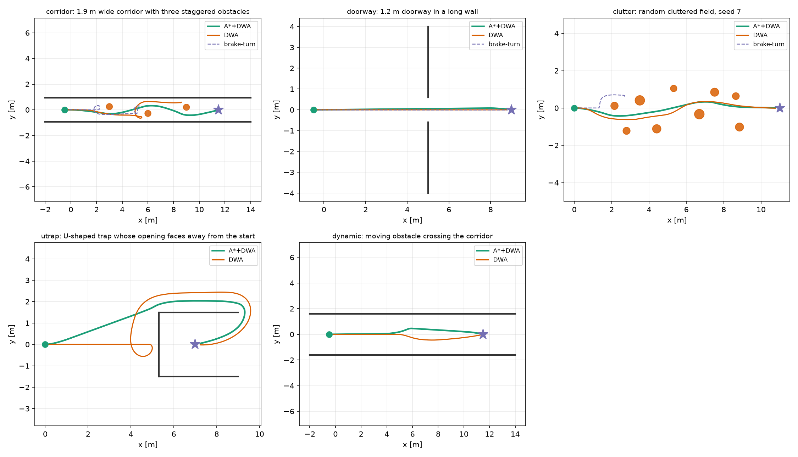
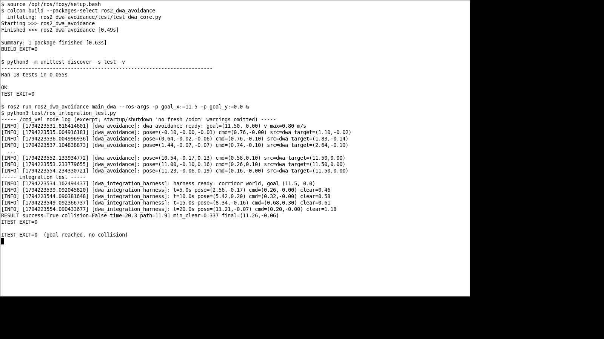
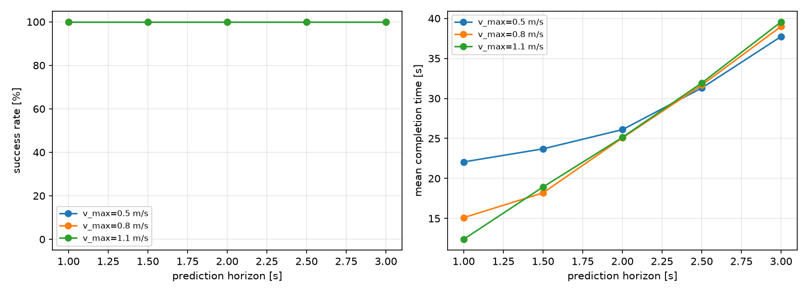

# ROS2 差速机器人 A* 全局规划与 DWA 局部避障

本文档介绍 `src/ground/ros2_dwa_avoidance` 模块：用
**A* 全局路线 + 动态窗口法（DWA）局部跟踪** 驱动差速机器人绕过静态与动态障碍。
代码在 Ubuntu 20.04 + ROS 2 Foxy 下完成 `colcon build` 与话题级闭环实测，
只使用 Foxy/Humble 共有的 rclpy 与消息接口。

与仓库中已有地面载具模块的区别：

* [`ros2_astar_planner`](https://github.com/OpenHUTB/ros2/tree/master/src/ground/ros2_astar_planner)
  只做栅格 A* 全局路径，没有速度层；
* `turtlebot3_lidar_avoid` 等模块用三态状态机或势场法做反应式避障，没有预测轨迹；
* 本模块把两者接起来：A* 负责“往哪走”，DWA 负责“怎么走得平滑且不撞”，
  并给出 5 个场景、3 种控制器的闭环定量对比与参数灵敏度实验。

5 个场景的闭环结果：A*+DWA **5/5 成功**，纯 DWA 4/5（在 1.9 m 窄走廊中卡死），
反应式基线 1/3；ROS 2 话题级闭环测试在 2.5 m 走廊中两次运行均到达目标、无碰撞。

* 源代码目录：[`src/ground/ros2_dwa_avoidance`](https://github.com/OpenHUTB/ros2/tree/master/src/ground/ros2_dwa_avoidance)
* 一键离线复现：`cd src/ground/ros2_dwa_avoidance && python3 -m ros2_dwa_avoidance.sim --no-figures`
* 一键测试：`python3 -m unittest discover -s test -v`（18 项，全部通过）

## 1. 目标与系统架构

任务是在未知/部分已知的平面环境中，让差速机器人从起点自主到达目标：

1. 对静态障碍（走廊、门洞、随机障碍场、U 形陷阱）不碰撞并到达；
2. 对横向穿过的动态障碍及时减速/绕行；
3. 输出满足加速度约束的平滑 `/cmd_vel`，而不是速度阶跃。

系统分三层：

```
  /scan ──► 占据栅格(世界系) ──► A* 路线 ──► 前视目标点
                                                   │
  /odom ──► 机器人位姿 ────────────────────────────┤
                                                   ▼
                                       DWA 采样 (v, ω) + 轨迹预测
                                                   │
                                          代价排序 / 碰撞剔除
                                                   ▼
                                               /cmd_vel
```

A* 层解决**局部极小**：纯 DWA 只看 1.5 s 的预测轨迹，当目标正好在障碍物后面时，
它无法判断该从左侧还是右侧绕，容易在障碍物前来回摆动。A* 在栅格上给出绕行路线，
DWA 只需跟踪前视点，同时保留对新障碍的反应能力。

## 2. 机器人模型与动态窗口

差速机器人在平面上的运动学：

$$x_{k+1} = x_k + v_k\cos\theta_k\,\Delta t,\qquad
y_{k+1} = y_k + v_k\sin\theta_k\,\Delta t,\qquad
\theta_{k+1} = \theta_k + \omega_k\,\Delta t$$

考虑电机加速度限制，下一控制周期可达的速度集合（动态窗口）为：

$$V_d = \left\{(v,\omega)\ \middle|\
\begin{aligned}
v &\in [v_c-a_v\Delta t,\ v_c+a_v\Delta t]\cap[v_{\min},v_{\max}]\\
\omega &\in [\omega_c-a_\omega\Delta t,\ \omega_c+a_\omega\Delta t]\cap[-\omega_{\max},\omega_{\max}]
\end{aligned}\right\}$$

默认参数：$v_{\max}=0.8$ m/s、$v_{\min}=-0.15$ m/s、$\omega_{\max}=1.8$ rad/s、
$a_v=1.2$ m/s²、$a_\omega=3.0$ rad/s²、$\Delta t=0.1$ s。
窗口内按 $0.1$ m/s 与 $0.1$ rad/s 离散采样，逐条前向预测 $T=1.5$ s（15 步）。

## 3. 轨迹评价函数

对每条可行轨迹 $\tau$，计算四项归一化代价：

$$
J(\tau)=w_h J_{\text{heading}}+w_g J_{\text{goal}}+w_c J_{\text{clear}}+w_v J_{\text{vel}}
$$

| 代价项 | 定义 | 默认权重 |
| --- | --- | --- |
| 航向 $J_{\text{heading}}$ | 轨迹终点到前视点的方位角与终点航向之差，除以 $\pi$ | 0.60 |
| 目标 $J_{\text{goal}}$ | 终点到前视点距离 / 当前距离 | 0.50 |
| 间隙 $J_{\text{clear}}$ | $\mathrm{clip}\big((d_{\text{norm}}-(d_{\min}-r))/d_{\text{norm}},0,1\big)$ | 0.60 |
| 速度 $J_{\text{vel}}$ | $(v_{\max}-v)/(v_{\max}-v_{\min})$ | 1.50 |

其中 $d_{\min}$ 是预测轨迹到最近激光点的最小距离，$r=0.22$ m 为机器人半径，
$d_{\text{norm}}=0.7$ m。速度权重取得较大，是为了避免“停下来最安全”的退化解：
在早期调试中，速度权重 0.3 时规划器会在障碍物前 2 m 处逐渐刹停并原地不动，
把权重提高到 1.5 后才表现为绕行。

**可行性**：轨迹上任意一点到激光点的距离必须不小于 $r+0.08$ m（安全裕度），
否则该样本直接剔除。若窗口内所有样本都不可行，进入恢复行为：比较左右前向
扇区的最近障碍距离，向更空旷的一侧原地旋转（$v=0$），直到前方重新可行。
这一条很关键：早期版本在恢复时朝目标方向旋转，结果机器人正对障碍物反复“盯”着它，
在窄走廊里 60 s 都出不来；改成朝自由侧旋转后才能脱困。

另有一条“防蠕动”规则：当最优样本速度接近 0、而最近间隙只比安全阈值大不到 0.15 m 时，
即使窗口里还有可行慢速样本，也强制进入上述旋转恢复。没有它，DWA 会在障碍前以
0.01 m/s 的速度“蹭”很久；ROS 2 实测中曾因此在第一个障碍前停滞 60 s。

## 4. A* 全局路线层

### 4.1 局部占据栅格

* 分辨率 0.1 m，滚动窗口 20 m × 20 m（`map_half_size=10`），机器人偏离窗口中心
  超过 5 m 时平移；平移时把重叠区域的障碍格复制到新窗口，不丢已经看到的墙；
* 激光点按机器人半径 + 安全裕度（0.30 m）膨胀；
* **未知区域视为可通行**：这是局部规划器，必须允许机器人朝未观测区域前进，
  否则一开机就被 6 m 扫描圈外的“未知墙”围死；
* 栅格在两次重规划之间**持续累积**，已经离开当前扫描的墙不会遗忘，
  避免 A* 反复从同一面墙“穿过去”导致机器人来回振荡；
* 目标在窗口外时，沿机器人→目标连线把目标裁剪到窗口内（留 0.4 m 余量），
  避免 `astar` 直接返回空路径、退化成“直奔目标”后停在第一个障碍前。

### 4.2 搜索与路径简化

8 邻域 A*，对角线代价 $\sqrt{2}$，禁止穿过两个相邻障碍格的角点。
得到栅格路径后用贪心视线简化（string pulling）压缩成少量折线点。

### 4.3 前视点与视线约束

沿简化路径取距机器人 1.2 m 的点作为 DWA 的“目标”。先计算机器人在路径上的
投影，再从投影点向前量取弧长——若从路径起点量取，机器人已走过一段后会得到
身后的点，表现为原地打转。

前视点还要做视线检查：若机器人与前视点连线穿过障碍，就按 0.15 m 步长缩短前视距离，
最小到 0.35 m。否则在 U 形陷阱的直角拐角处，前视点会“穿墙”指到墙另一侧，
DWA 被拉向墙面。

## 5. 安全与异常处理

| 情况 | 行为 |
| --- | --- |
| `/odom` 超过 0.5 s 未更新 | 发布零速度，告警 `no fresh /odom` |
| `/scan` 超过 0.5 s 未更新 | 发布零速度，告警 `no fresh /scan` |
| 到达目标 0.25 m 内 | 发布零速度，`goal reached` |
| 输出速度 | 截断到 $\pm v_{\max}$、$\pm\omega_{\max}$ |
| 目标在滚动窗口外 | 沿机器人→目标连线裁剪到窗口边界，靠近后指向真实目标 |

节点订阅 `/scan`、`/odom`、`/goal_pose`，发布 `/cmd_vel`；参数全部可在
`config/dwa_params.yaml` 或 launch 参数中修改。

## 文件结构

```text
src/ground/ros2_dwa_avoidance/
├── ros2_dwa_avoidance/       # main_dwa.py / dwa_core.py / sim.py
├── config/dwa_params.yaml    # 全部规划参数
├── launch/main_launch.py     # 一键启动
├── test/                     # 18 项单元测试
├── results.json              # 5 场景 × 3 控制器结果
├── sweep.json                # 45 次参数扫描
├── requirements.txt
└── README.md
```

## 6. 运行步骤

### 运行环境

| 项目 | 版本 |
| --- | --- |
| ROS 2 | Ubuntu 20.04.6 + Foxy 0.9.2（Humble 共用接口） |
| Python | 3.8.10 |
| 离线基准 | Windows 11 + Python 3.12 + NumPy 2.5.4 |

### 6.1 编译

环境同上文「运行环境」表（Ubuntu 20.04.6 + Foxy 0.9.2 + Python 3.8.10）；
代码只使用 Foxy/Humble 共有的接口，在 Humble 下同样可编译。

```bash
mkdir -p ~/hutb_ws/src
cp -r src/ground/ros2_dwa_avoidance ~/hutb_ws/src/
cd ~/hutb_ws
rosdep install --from-paths src --ignore-src -r -y
colcon build --packages-select ros2_dwa_avoidance
source install/setup.bash
```

### 6.2 启动

```bash
ros2 launch ros2_dwa_avoidance main_launch.py goal_x:=8.0 goal_y:=0.0 max_v:=0.8
```

`goal_x`、`goal_y`、`max_v` 是 launch 参数（不写在 YAML 里，避免同名参数互相覆盖）；
其余参数在 `config/dwa_params.yaml` 中。

话题检查：

```bash
ros2 topic hz /scan
ros2 topic echo /cmd_vel
```

### 6.3 离线基准（无需 ROS / Gazebo）

```bash
cd src/ground/ros2_dwa_avoidance
python3 -m pip install -r requirements.txt   # numpy, matplotlib
python3 -m ros2_dwa_avoidance.sim --no-figures   # 写 results/sweep，不需要 matplotlib
python3 -m ros2_dwa_avoidance.sim                # 完整运行，额外生成 figures/
python3 -m unittest discover -s test -v      # 18 项单元测试
```

## 参数说明

| 参数 | 含义 | 默认 |
| --- | --- | --- |
| `max_v` / `max_w` | 线速度/角速度上限 | 0.80 m/s / 1.80 rad/s |
| `max_acc_v` / `max_acc_w` | 线/角加速度上限 | 1.20 m/s² / 3.00 rad/s² |
| `predict_time` | DWA 轨迹预测时域 | 1.50 s |
| `control_rate` | 控制频率 | 10 Hz |
| `robot_radius` / `safety_margin` | 机器人半径/安全裕度 | 0.22 m / 0.08 m |
| `heading_weight` / `velocity_weight` / `clearance_weight` | 三项代价权重 | 0.60 / 1.50 / 0.60 |
| `lookahead` | A\* 前视距离 | 1.20 m |
| `map_half_size` | 局部栅格半边长 | 10.0 m |
| `publish_tf` | 是否发布 `odom→base_link` | true |

## 7. 实验设置

仿真器为纯 NumPy 的二维平面仿真，不依赖 Gazebo/CARLA：

* 机器人：圆形，半径 0.22 m，差速运动学，加速度限幅；
* 传感器：360° 激光，180 束，量程 6 m，无噪声；未命中的光束不生成障碍点
  （这一点在早期版本中写错，把 6 m 处的“无回波”当成了环形墙，A* 因此永远找不到出口）；
* 控制周期 0.1 s，单场景超时 60 s（U 形陷阱 90 s）；
* 碰撞判定用真实几何（圆/线段）而不是激光点，最小间隙 < 0 记为碰撞。

5 个场景：

| 场景 | 内容 | 起点 → 终点 |
| --- | --- | --- |
| corridor | 1.9 m 宽走廊，3 个交错圆柱障碍 | (-0.5, 0) → (11.5, 0) |
| doorway | 长墙上的 1.2 m 门洞 | (-0.5, 0) → (9, 0) |
| clutter | 9 个随机圆柱（种子 7） | (0, 0) → (11, 0) |
| utrap | 开口朝 +x 的 U 形墙，目标在内部 | (0, 0) → (7, 0) |
| dynamic | 走廊中一个 0.25 m 圆柱以 0.35 m/s 横穿 | (-0.5, 0) → (11.5, 0) |

三种控制器：

1. **A\*+DWA**：本文方法；
2. **纯 DWA**：去掉 A* 层，直接把最终目标作为 DWA 的目标点（消融对照）；
3. **brake-turn**：反应式基线，前方 0.75 m 内有障碍就停车并朝空侧原地转，
   否则直行并朝目标转（只在 corridor/doorway/clutter 三个静态场景中运行）。

## 8. 实验结果

### 8.1 主结果

| 场景 | A\*+DWA | 纯 DWA | brake-turn |
| --- | --- | --- | --- |
| corridor | **成功 21.2 s / 12.01 m / 0.32 m** | 超时 60 s / 10.99 m | 超时 60 s / 8.69 m |
| doorway | **成功 14.2 s / 9.27 m / 0.55 m** | 成功 13.4 s / 9.27 m / 0.60 m | 成功 17.1 s / 9.30 m / 0.60 m |
| clutter | **成功 19.2 s / 10.90 m / 0.33 m** | 成功 15.6 s / 11.06 m / 0.30 m | 超时 60 s / 3.24 m |
| utrap | **成功 23.3 s / 12.64 m / 0.32 m** | 成功 29.3 s / 17.37 m / 0.30 m | — |
| dynamic | **成功 21.6 s / 11.84 m / 0.99 m** | 成功 16.6 s / 11.84 m / 1.14 m | — |

格式：成功/超时 + 完成时间 / 路径长度 / 最小离障距离（到障碍表面的距离）。
成功率：A\*+DWA **5/5**，纯 DWA **4/5**，brake-turn **1/3**。

> 表中的数字在 Windows 11 + Python 3.12 + NumPy 2.5.4 上生成。Linux + NumPy 1.24
> 复现时 utrap/A\*+DWA 为 22.3 s / 12.63 m / 0.303 m（本表 23.3 s / 12.64 m / 0.32 m），
> 属平台/数值库差异；其余回合一致。不同环境不要求逐位相同。

### 8.2 分析

1. **窄走廊**：纯 DWA 在走廊中段（路径 10.99 m、终点距目标 2.96 m）停住并原地摆动，
   无法判断绕行方向；A* 给出绕行路线后 21.2 s 通过，最小间隙 0.32 m
   （大于半径 0.22 m）。这是本模块最核心的对照：同样的 DWA 参数，只增加 A* 层，
   窄走廊从超时变为通过。
2. **U 形陷阱**：纯 DWA 依靠第 3 节的“防蠕动 + 朝自由侧旋转”恢复行为也能脱困，
   但耗时 29.3 s、路径 17.37 m，比 A* 版本多 6.0 s、多 4.7 m——恢复行为是
   “撞上死路再退出来”，A* 则一开始就规划了绕行路线。
3. **开阔场景 A\*+DWA 反而慢 1–3 s**：门洞 14.2 s vs 13.4 s、障碍场 19.2 s vs 15.6 s、
   动态 21.6 s vs 16.6 s。原因是 A* 路线带折角、前视点跟踪比直奔目标更保守，
   且每 1 s 重规划会短暂改变目标点。这是用少量时间换鲁棒性的典型权衡，
   而不是实现缺陷。
4. **反应式基线**：门洞能过（17.1 s），但窄走廊和随机障碍场都会卡死——
   它没有“绕过去”的概念，只会在障碍前反复转向。
5. **动态障碍**：A\*+DWA 最小间隙 0.99 m，纯 DWA 1.14 m；两者都成功，
   但 A* 版本因为路线更靠中间，间隙略小，仍在安全范围内。

### 8.3 最小间隙

所有成功回合的最小离障距离为 0.30–1.14 m。规划器内部要求 $r+0.08=0.30$ m，
实测最低 0.30 m，说明安全裕度被真正执行，而不是只在代价函数里“软约束”。

## 运行效果

5 个场景的 A\*+DWA 全部成功（5/5），纯 DWA 4/5，反应式基线 1/3；轨迹对比如下：



ROS 2 话题级闭环两次运行均到达目标（26.1 s / 20.3 s，路径约 11.9 m）：



## 9. 参数灵敏度

固定 A* 层，扫描 `predict_time ∈ {1.0,1.5,2.0,2.5,3.0}` s 与
`max_v ∈ {0.5,0.8,1.1}` m/s，在 corridor/doorway/clutter 三个场景各跑一次，
共 **5 × 3 × 3 = 45 次**：

| predict_time | 平均完成时间（3 场景，v_max=0.8） | 成功率 | corridor 最小间隙 |
| --- | --- | --- | --- |
| 1.0 s | 15.1 s | 3/3 | 0.327 m |
| 1.5 s | 18.2 s | 3/3 | 0.316 m |
| 2.0 s | 25.1 s | 3/3 | 0.325 m |
| 2.5 s | 31.7 s | 3/3 | 0.328 m |
| 3.0 s | 39.0 s | 3/3 | 0.314 m |



结论：在已有 A* 路线的前提下，**缩短预测时域能显著提高通行速度，成功率不降**。
时域从 1.5 s 增到 3.0 s，平均时间从 18.2 s 增到 39.0 s，翻了一倍多；
原因是恒定 $(v,\omega)$ 的长时域预测会放大航向代价，规划器倾向于选小速度。
所有 45 次组合都成功，最小间隙范围是 **0.302–0.600 m**
（corridor 0.314–0.328 m、doorway 0.535–0.600 m、clutter 0.302–0.344 m）；
成功率对参数不敏感，但间隙随场景差异很大，不能概括为“稳定在 0.31–0.33 m”。
实际部署建议 `predict_time=1.0–1.5 s`。

## 10. 复现与测试

* `python3 -m ros2_dwa_avoidance.sim --no-figures`：5 场景 × 3 控制器 + **45 次**参数扫描，
  输出 `results.json`、`sweep.json`；完整运行额外生成 `figures/`。场景与随机种子固定，
在**同一环境**（Windows 11 + Python 3.12 + NumPy 2.5.4）下结果可逐位复现；
不同 NumPy/平台的浮点差异可能带来秒级时间差（见 8.1 注）。
* `python3 -m unittest discover -s test -v`：18 项测试，覆盖角度归一化、
  动态窗口边界、轨迹预测几何、碰撞可行性、被围困时的旋转恢复、A* 绕墙/无解、
  路径简化、前视点投影、混合规划器到达目标。
* 主基准在 Windows 11 + Python 3.12.13 + NumPy 2.5.4 上运行；ROS 2 节点在
  Ubuntu 20.04.6 + ROS 2 Foxy 0.9.2 下编译运行，见下节。

### 10.1 ROS 2 节点运行验证

实测环境：VMware 虚拟机，Ubuntu 20.04.6 LTS，ROS 2 Foxy 0.9.2，
Python 3.8.10，4 vCPU / 8 GB。仓库文档默认 ROS 2 Humble；本机只有 20.04，
因此实测用 Foxy，节点只使用两版共有的 `rclpy`/消息接口。

**编译与单元测试**（在虚拟机内实际执行）：

```text
$ colcon build --packages-select ros2_dwa_avoidance
Starting >>> ros2_dwa_avoidance
Finished <<< ros2_dwa_avoidance [0.49s]
Summary: 1 package finished [0.60s]
BUILD_EXIT=0

$ python3 -m unittest discover -s test -v
Ran 18 tests in 0.055s
OK
TEST_EXIT=0
```

**话题级闭环测试**：`test/ros_integration_manual.py` 扮演机器人与世界，
按 10 Hz 发布 180 束 `/scan` 与 `/odom`，订阅 `/cmd_vel` 并按差速运动学积分；
节点通过 `ros2 run` 启动，目标 `(11.5, 0)`。测试场景是 2.5 m 宽走廊
（比离线基准的 1.9 m 窄走廊宽松），目的是验证 ROS 话题链路与闭环控制，
而不是重复最难的场景。

两次连续运行结果：

| 运行 | 结果 | 时间 | 路径 | 最小间隙 |
| --- | --- | --- | --- | --- |
| 1 | 成功，无碰撞 | 26.1 s | 11.93 m | 0.300 m |
| 2 | 成功，无碰撞 | 20.3 s | 11.91 m | 0.337 m |

另一位同学在 Ubuntu 22.04 + ROS 2 Humble 上复现同一测试，得到 18.7 s / 18.9 s、
path 11.91 m、min_clear 0.313 / 0.316 m。路径一致说明是同一场景，
但完成时间在 18.7–26.1 s 之间波动（约 ±30%），主要来自机器调度和 Gazebo/仿真节奏，
**不能把某个时间点当作算法差异的验收基线**。

`test/ros_integration_manual.py` 的文件名不匹配 `unittest` 默认的 `test*.py`，
所以 18 项单测**不包含**它，需要手动运行。节点现在也会发布 `odom → base_link` TF，
RViz2 里可以直接显示 RobotModel。

第一次 ROS 运行时，节点曾在第一个障碍前以 0.01 m/s 的速度“蹭”了 60 s；
定位到 DWA 在“存在可行慢速样本”时不会触发旋转恢复，加入第 3 节的防蠕动规则后，
连续两次都正常通过。`ros2 launch ... goal_x:=11.5 goal_y:=0.0` 也已验证：
launch 参数能正确覆盖节点默认目标（日志中 `goal=(11.50, 0.00)`）。

## 11. 局限与展望

* 二维圆形机器人模型，未考虑轮子打滑、电机力矩饱和；真车部署需在 `/cmd_vel`
  前加速度 PID 环；
* 激光无噪声、无动态遮挡，真实场景需要多帧滤波与更稳健的膨胀策略；
* 未知区域视为可通行，若真实环境存在玻璃/低矮障碍，需要额外的传感器或先验地图；
* A* 只在 20 m 滚动窗口内规划，超长距离任务需要与全局地图/全局规划器配合；
* 动态障碍按匀速直线运动，未做意图预测；对突然加塞的物体仍可能急停；
* 激光点按 `angle_min + i*angle_increment` 在 odom 系直接展开，默认激光与 base 重合；
  有安装偏移时用 `laser_x`/`laser_y`（base 系）补偿，但没有查询 TF 的
  `scan.header.frame_id`，倾斜安装或多雷达外参需自行扩展；
* 节点默认发布 `odom→base_link`；若底盘驱动已发布同一 TF，把 `publish_tf` 设为
  false，避免 RViz 报重复 TF；
* 尚未接入 Gazebo/TurtleBot3 做三维仿真验证，这是下一步工作（另见 #1134）。

## 大模型使用声明

本模块的代码、实验脚本与文档在编写过程中使用了 AI 大模型辅助。
作者已在离线仿真中实际运行全部基准与单元测试，并在 Ubuntu 20.04 + ROS 2 Foxy
下完成 `colcon build`、单元测试与 `/scan`+`/odom`→`/cmd_vel` 闭环运行；
对提交内容的正确性与完整性负全部责任。
