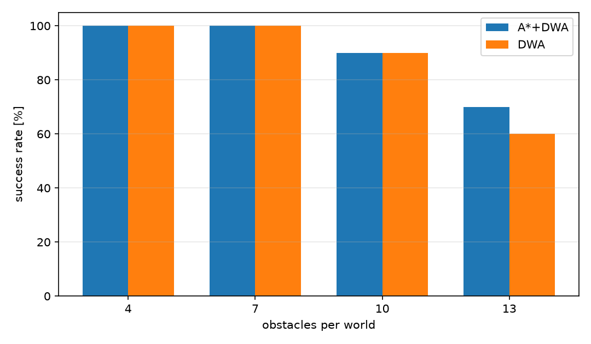
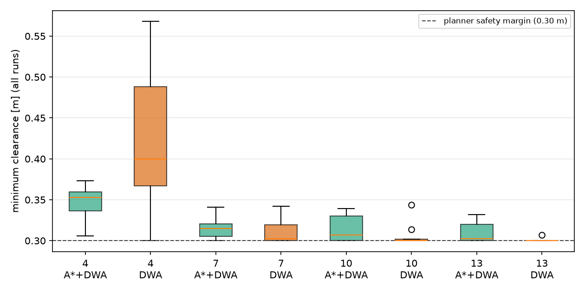
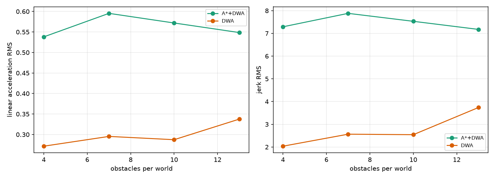

# ROS2 DWA 局部规划器随机场景压力测试与舒适性评价

本文档介绍 `src/ground/ros2_dwa_benchmark` 模块。它不重复实现规划器，而是在
[`ros2_dwa_avoidance`](https://github.com/OpenHUTB/ros2/tree/master/src/ground/ros2_dwa_avoidance)
（A* 全局路线 + DWA 局部避障）之上做**随机场景压力测试**，回答两个问题：

1. 增加 A* 全局路线层后，通过率真的更高吗？代价是什么？
2. 规划器的速度指令有多“颠”？即加速度和 jerk 是否适合真实机器人？

> 依赖关系：本模块通过 `exec_depend` 依赖 `ros2_dwa_avoidance`，
> 需要先安装该模块（对应 PR #1077）。两者的导航算法与参数完全一致，
> 本模块只增加世界生成、指标统计与可视化。

## 1. 随机世界生成

每个世界是一条 3.2 m 宽、13 m 长的走廊，内部随机放置 $n$ 个半径 0.18–0.30 m 的圆柱：

* $n \in \{4, 7, 10, 13\}$，每个密度 10 个世界，共 40 个世界；
* 圆柱之间至少留 0.55 m 净距，起点/终点 1.2 m 内不放障碍；
* 种子固定为 $1000 + 100n + i$，结果可逐位复现；
* **可行性校验**：在真值栅格上用与规划器相同的 0.30 m 膨胀做 A*，
  同时标记随机圆柱**和走廊墙**（`scenario.segments`）。只标圆柱会让 A* 从墙外
  绕过去，把实际无解的世界误判为可行；现在只有起终点真正连通的世界才会被采用。
  这样“失败”一定来自规划器，而不是无解世界。

生成逻辑见 `ros2_dwa_benchmark/worlds.py`，每个世界最多尝试 60 个种子，
不满足可行性就换下一个。

## 2. 评价指标

| 指标 | 定义 |
| --- | --- |
| 成功率 | 60 s 内到达目标 0.25 m 内且无碰撞 |
| 完成时间* / 路径* | 成功回合的仿真时间、累计路程 |
| 最小间隙! | 机器人中心到障碍表面的最小距离 |
| 线性加速度 RMS! | $\sqrt{\mathrm{mean}\left((\Delta v/\Delta t)^2\right)}$ |
| 角加速度 RMS! | $\sqrt{\mathrm{mean}\left((\Delta \omega/\Delta t)^2\right)}$ |
| jerk RMS! | $\sqrt{\mathrm{mean}\left((\Delta a/\Delta t)^2\right)}$ |
| 贴边比例 | 成功回合中最小间隙 ≤0.31 m 的比例（贴近 0.30 m 硬约束） |

带 `*` 的指标只在成功回合上统计；带 `!` 的指标在**全部回合**上统计
（失败回合按 60 s 超时计入，不会只挑成功样本）。速度序列取仿真中实际下发的
$(v,\omega)$（已经过与真机一致的加速度限幅），所以加速度和 jerk 描述的是机器人
真正会经历的冲击，而不是规划器的内部期望。指标实现见 `ros2_dwa_benchmark/metrics.py`。

## 3. 实验设置

* 机器人：半径 0.22 m，$v_{\max}=0.8$ m/s，$\omega_{\max}=1.8$ rad/s，
  $a_v=1.2$ m/s²，$a_\omega=3.0$ rad/s²；
* DWA：预测时域 1.5 s，控制周期 0.1 s，航向/目标/间隙/速度权重
  0.60/0.50/0.60/1.50；
* 两个控制器使用**完全相同**的 DWA 参数：
  * `A*+DWA`：A* 在 20 m 滚动栅格上规划，DWA 跟踪前视点；
  * `纯 DWA`：直接把最终目标作为 DWA 目标，不加全局路线；
* 每个世界跑两次（每个控制器一次），共 80 次闭环运行。

## 4. 结果

| 密度 | 控制器 | 成功率 | 时间* | 时间! | 间隙! | 加速度! | jerk! | 贴边% |
| ---: | --- | ---: | ---: | ---: | ---: | ---: | ---: | ---: |
| 4 | A\*+DWA | 100% | 19.09 s | 19.09 s | 0.347 m | 0.538 | 7.29 | 10.0 |
| 4 | 纯 DWA | 100% | 16.85 s | 16.85 s | 0.418 m | 0.272 | 2.04 | 20.0 |
| 7 | A\*+DWA | 100% | 21.53 s | 21.53 s | 0.315 m | 0.602 | 7.94 | 30.0 |
| 7 | 纯 DWA | 100% | 17.80 s | 17.80 s | 0.312 m | 0.295 | 2.56 | 60.0 |
| 10 | A\*+DWA | 90% | 23.63 s | 27.27 s | 0.314 m | 0.572 | 7.53 | 44.4 |
| 10 | 纯 DWA | 90% | 18.19 s | 22.37 s | 0.306 m | 0.287 | 2.54 | 77.8 |
| 13 | A\*+DWA | 70% | 23.23 s | 34.26 s | 0.310 m | 0.549 | 7.18 | 57.1 |
| 13 | 纯 DWA | 60% | 25.63 s | 39.38 s | 0.301 m | 0.337 | 3.73 | 100.0 |

`*` 成功回合均值，`!` 全部回合均值（失败按 60 s 计入）。

> 本表在 Ubuntu 20.04 + Python 3.8.10 + NumPy 1.24.4 上生成（已合并 #1077 的依赖）。
> 贴边阈值 0.31 m = 0.30 m 硬约束 + 1 cm；可用 `--edge-threshold` 复验敏感性
> （例如 0.305 时密度 13 纯 DWA 的 100% 会下降）。







## 5. 分析

1. **中低密度（4/7 个障碍）**：两者都 100% 成功。纯 DWA 快 12%–21%，
   最小间隙反而略大；jerk 只有 A\*+DWA 的 1/3 左右。
2. **密度 10**：成功率相同（90%，但失败的是不同世界），纯 DWA 仍快 23%、
   加速度只有 A\*+DWA 的一半。
3. **密度 13**：A\*+DWA 成功率 70%，纯 DWA 60%；成功回合里 A\*+DWA 也更快
   （23.2 s vs 25.6 s）。更关键的是**贴边比例**：纯 DWA 的成功回合 100% 都贴着
   0.30 m 硬约束，A\*+DWA 只有 57%。这说明 A* 路线在密集场景里保留了真实的安全余量，
   而纯 DWA 是“擦着约束通过”。这是全局路线层真正体现价值的区间。
4. **舒适性代价**：A\*+DWA 的加速度 RMS 在所有密度下都更高，jerk RMS 约为纯 DWA 的
   1.9–3.5 倍。原因是 A* 路线每秒重规划、前视点在拐角处切换，角速度反复修正。
   **全局路线层不是无条件有益的：它用舒适性换高密度下的通过率与间隙余量。**
5. **工程建议**：开阔/中低密度场景可以退回纯 DWA；高密度或窄通道再启用 A* 层。
   若要同时保留通过率和舒适性，下一步应对 A* 路径做平滑（Chaikin/B 样条），
   或对前视点做一阶低通滤波，再交给 DWA 跟踪。

## 6. 复现

```bash
# 仓库根目录
cd ~/hutb_ws
colcon build --packages-select ros2_dwa_avoidance ros2_dwa_benchmark
source install/setup.bash
ros2 launch ros2_dwa_benchmark main_launch.py worlds:=10

# 或直接跑 CLI
python3 -m ros2_dwa_benchmark.main_benchmark \
  --out results.json --figdir figures --worlds 10 --densities 4,7,10,13

# 单元测试
cd src/ground/ros2_dwa_benchmark
python3 -m unittest discover -s test -v
```

测试依赖 `ros2_dwa_avoidance`；缺少该包时测试会**显式报错**（不再整体 skip 造成“假通过”）。
冒烟测试用 `figdir=""` / `--no-figures` 跳过绘图，因此没有 matplotlib 也能拿到 JSON。

输出：`results.json`（逐世界明细 + 分组汇总）、已提交的 `results/summary.json`
（分组汇总，便于不跑基准也能核对 §4）、`figures/` 下三张图。

完整 40 世界基准在 **Ubuntu 20.04.6 + Python 3.8.10 + NumPy 1.24.4** 上运行；
Windows + NumPy 2.5.4 下密度 7 的 A\*+DWA 行为 22.43 s / 0.595 / 7.88，
与下表（21.53 s / 0.602 / 7.94）存在平台差异。

## 7. 局限

* 每个密度只有 10 个世界，成功率的分辨率为 10%，密度 10 与 13 的差异
  需要更多样本才能做显著性判断；
* 最小间隙被 DWA 的 0.30 m 硬约束截断，密集场景大量成功回合恰好为 0.300 m；
  本文用“贴边比例”补充说明，但没有跑 `safety_margin=0` 的对照；
* 只有二维圆形机器人和无噪声激光，未考虑打滑、力矩饱和、传感器噪声；
* 随机世界由单一生成规则产生（走廊 + 圆柱），没有门洞、U 形陷阱等结构化场景；
* 舒适性指标来自仿真指令，未在真机上用 IMU 验证；
* 依赖 `ros2_dwa_avoidance`（#1077），需先合并对应 PR；本模块本身不包含规划算法。

## 8. 大模型声明

本模块的代码、实验脚本与文档在编写过程中使用了 AI 大模型辅助。
作者已实际运行 40 个随机世界、80 次闭环基准和 5 项单元测试；
对提交内容的正确性与完整性负全部责任。
