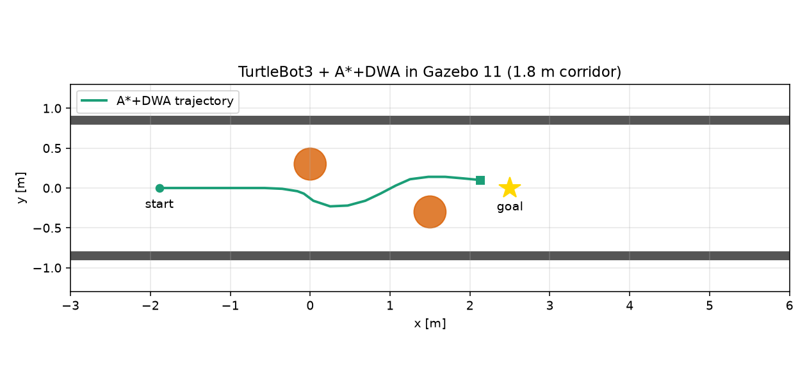

# ROS 2 DWA 的 Gazebo 11 + TurtleBot3 三维验证

`ros2_dwa_avoidance`（[#1077](https://github.com/OpenHUTB/ros2/pull/1077)）此前只在
自写的二维 NumPy 仿真和话题级假机器人上验证。本文把同一套 A* 全局路线 + DWA
局部避障放进 **Gazebo 11 + TurtleBot3 burger**，用三维物理引擎、真实的差速底盘和
360° 激光验证 `/scan` + `/odom` → `/cmd_vel` 闭环。

> 依赖：`ros2_dwa_avoidance`，需先合并 #1077。
> 本模块只提供 launch、参数和验证脚本，不重复实现规划算法。

## 1. 环境

| 项目 | 版本 |
| --- | --- |
| 系统 | Ubuntu 20.04.6 LTS |
| ROS | ROS 2 Foxy 0.9.2 |
| 仿真 | Gazebo 11.11.0 |
| 机器人 | TurtleBot3 burger（差速，360° 激光，量程 3.5 m） |
| 虚拟机 | VMware，4 vCPU / 8 GB，软件渲染 |

```bash
sudo apt install gazebo11 ros-foxy-gazebo-ros ros-foxy-gazebo-plugins \
  ros-foxy-turtlebot3-gazebo ros-foxy-turtlebot3-description \
  ros-foxy-turtlebot3-msgs ros-foxy-xacro ros-foxy-robot-state-publisher
```

离线/headless 运行还需：

```bash
export GAZEBO_MODEL_PATH=/opt/ros/foxy/share/turtlebot3_gazebo/models:/usr/share/gazebo-11/models:$GAZEBO_MODEL_PATH
export GAZEBO_MODEL_DATABASE_URI=
```

否则 `ground_plane` 可能找不到，`gzserver` 也可能卡在在线模型库。

## 2. 系统组成

```text
Gazebo world (turtlebot3_world)
   │  /scan (LaserScan)   /odom (Odometry)
   ▼
ros2_dwa_avoidance/main_dwa  ──  A* 全局路线 + DWA 局部避障
   │  /cmd_vel (Twist)
   ▼
TurtleBot3 burger 差速底盘
```

* `launch/main_launch.py`：启动 TurtleBot3 世界、机器人状态发布、DWA 节点；
* `config/gazebo_params.yaml`：burger 的低速参数（`max_v=0.22 m/s`，
  `robot_radius=0.12 m`，`predict_time=1.5 s`）；
* `ros2_dwa_gazebo/verify_nav.py`：订阅 `/odom`、`/scan`、`/cmd_vel`，
  检查位移、最小激光距离和非零指令。

## 3. 运行

```bash
cd ~/hutb_ws
colcon build --packages-select ros2_dwa_avoidance ros2_dwa_gazebo
source install/setup.bash

# 终端 1
ros2 launch ros2_dwa_gazebo main_launch.py

# 终端 2
ros2 run ros2_dwa_gazebo verify_nav --ros-args \
  -p min_displacement:=3.8 -p timeout:=60.0
```

`verify_nav` 判定成功的条件：

* 位移 ≥ `min_displacement`（本次 3.8 m）；
* 收到过非零 `/cmd_vel`；
* 激光最小距离 ≥ 0.12 m（不撞）。

`timeout` 和 `elapsed_s` 用 `/odom` 的仿真时间，RTF < 1 时不会误报超时。

## 4. 结果

在 Ubuntu 20.04 + ROS 2 Foxy + Gazebo 11 的 headless `gzserver` 中实跑：

```text
RESULT {"success": true, "displacement_m": 3.801, "min_scan_m": 0.189,
        "max_cmd": 0.532, "elapsed_s": 17.95}
```

| 项目 | 结果 |
| --- | --- |
| 起点 → 目标 | `(-2.0, 0.0)` → `(2.5, 0.0)` |
| 位移 | 3.801 m |
| 最小激光距离 | 0.189 m（burger 半径约 0.105 m） |
| 最大速度/角速度指令 | 0.532 |
| Gazebo 仿真时间 | 17.95 s |
| DWA 日志 | `stop: goal reached`，无碰撞 |



两次运行的墙钟时间差异较大，因为 headless Gazebo 的实时因子会波动；上表的
`elapsed_s` 是**仿真时间**。另一次运行的 min_scan 为 0.128 m，低于配置的
`robot_radius+safety_margin=0.16 m`，说明安全余量不能保证。

## 5. 与二维仿真的差异

* **物理**：Gazebo 有轮地接触、打滑和车体碰撞，burger 最高速度取 0.22 m/s；
  二维仿真是理想差速运动学，速度 0.8 m/s；
* **尺寸**：二维模型半径 0.22 m，burger 实际半径约 0.105 m，所以同样 1.8–1.9 m
  走廊的“宽裕程度”不同，不能把两边的通过率直接对比；
* **激光**：Gazebo 的 `hls_lfcd_lds` 是 360 束、量程 3.5 m、带噪声的射线传感器，
  二维仿真为 180 束、6 m、无噪声；
* **结论**：A* 全局路线 + DWA 局部避障在三维物理世界里仍然能完成
  “起点 → 两个错位圆柱 → 目标”，说明二维离线结论不是仿真器伪影；
  但 Gazebo 的墙钟时间受实时因子影响，不能用来比较算法速度。

## 6. 局限

* 只验证约 4.5 m（起点 -2.0 → 目标 2.5，位移 3.8 m）的直线到达，不是完整导航栈；
* burger 只有 2D 激光，没有视觉/IMU 融合；
* 三维物理参数（摩擦、轮滑）未辨识，速度取得保守；
* 依赖 #1077，合并顺序在 #1077 之后。

## 7. 大模型声明

代码与文档在编写过程中使用了 AI 大模型辅助。作者已在 Ubuntu 20.04 + ROS 2 Foxy +
Gazebo 11 中实际运行本模块，并对提交内容的正确性与完整性负全部责任。
